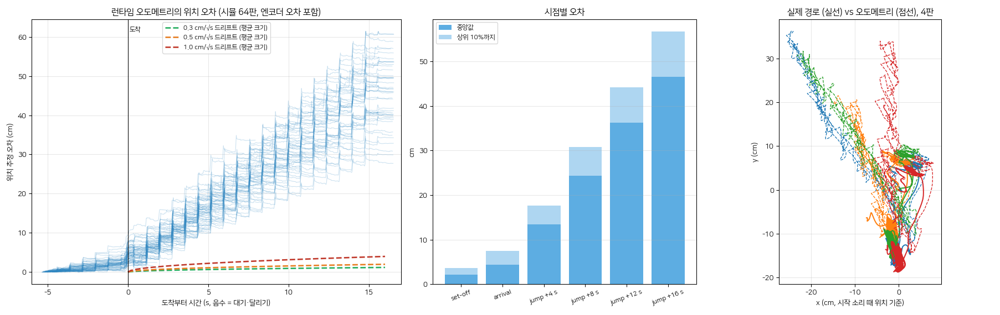
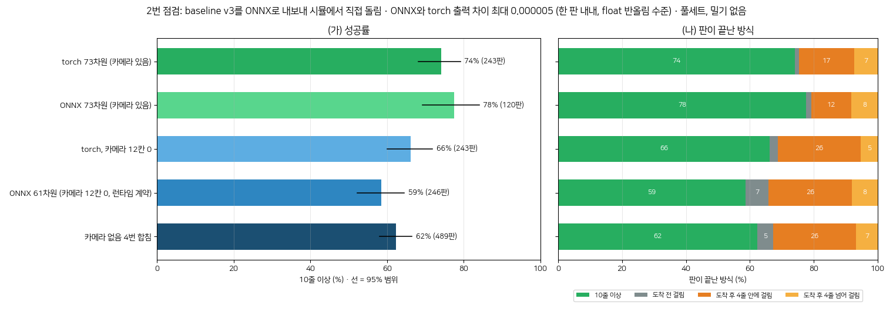
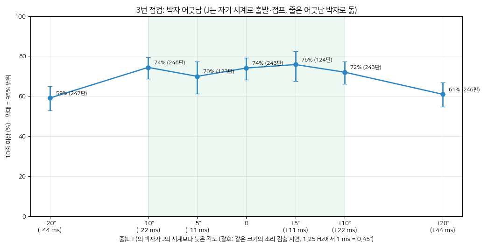
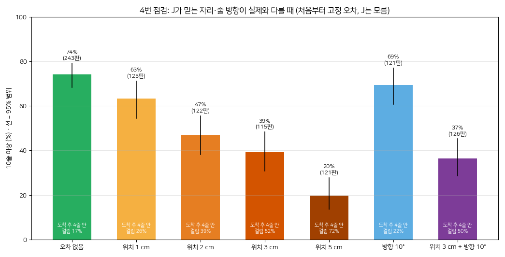
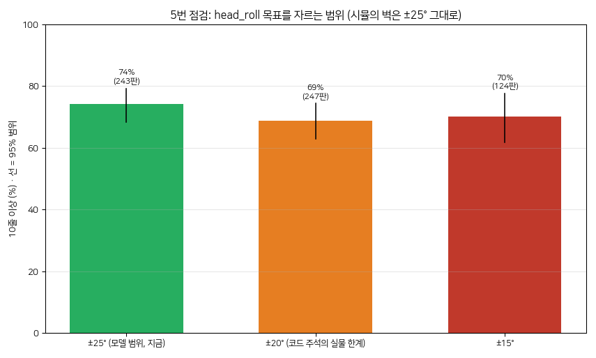
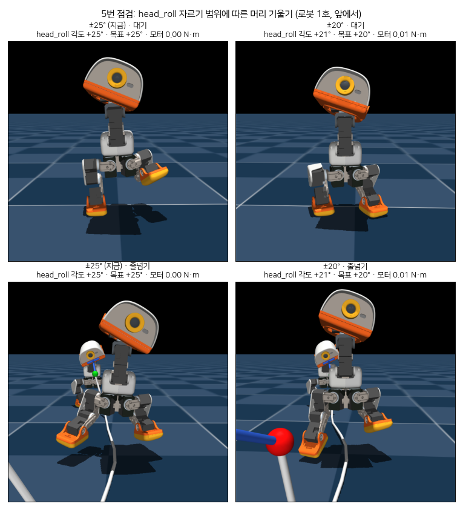
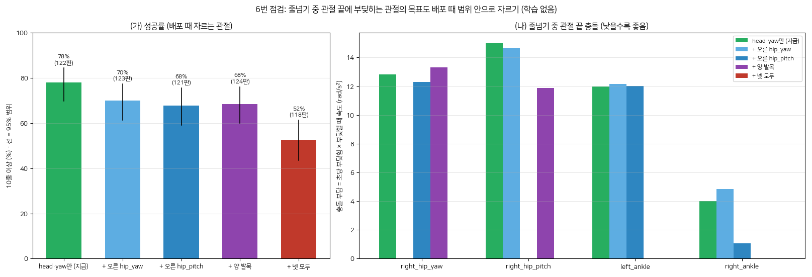
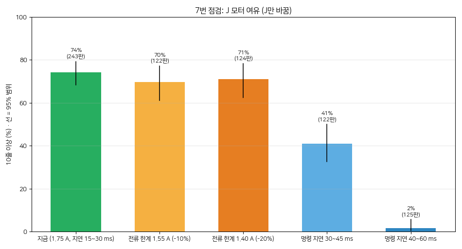
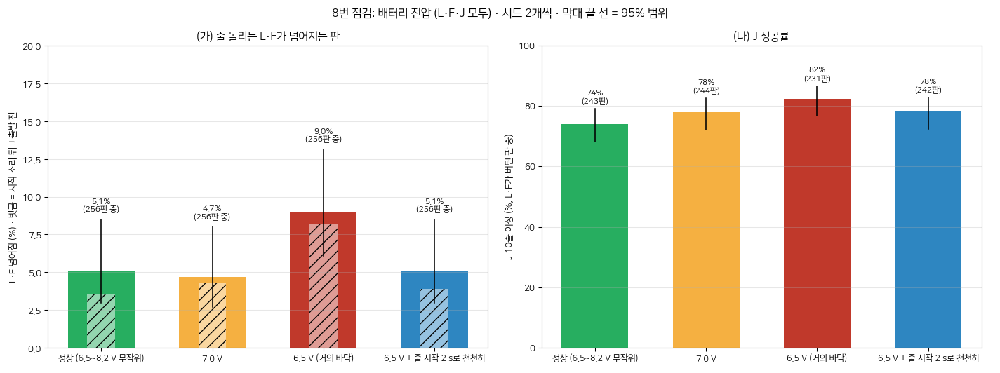
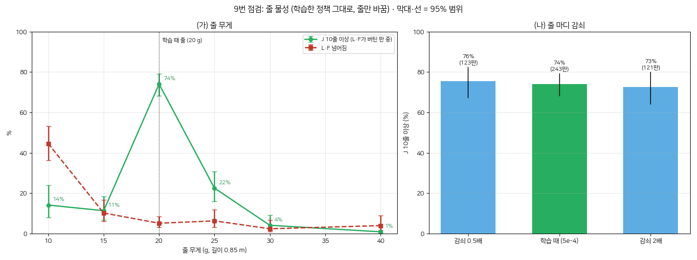

# 실물 투입 전 고려사항 (baseline v3)

baseline v3를 실물에 올리기 전에 시뮬에서 확인한 9개 항목의 기록입니다(2026-11-09, 사용자 요청). 항목마다 배경, 결과, 제안을 적었습니다. 하나씩 개선할 때마다 상태와 개선 기록을 갱신합니다.

- **기준 (baseline v3)**
  - J: D1Asky@5994 (`logs/rsl_rl/ys_trio_jump/2026-11-09_14-48-08_D1Asky/model_5994.pt`)
  - 배포 설정: head_roll과 left_hip_yaw 목표를 관절 범위로 자릅니다. A형(마지막 12 cm에서 L 쪽으로 돌기)이고, 출발 창은 20~60°입니다.
  - L·F는 rope14이고, 진행은 풀세트 절차입니다.
  - 성적: 풀세트 10줄 이상 74%(밀기 없음, 243판), 약한 밀기에서 68%입니다.
- **숫자의 출처**: 전부 시뮬레이션이고 학습은 하지 않았습니다. 풀세트를 128판씩 돌렸고, 따로 적지 않으면 시드 1개입니다.
- **점검 전 측정** (그림 `docs/ys/deploy/real3.png`): 저전압, 카메라 끄기, 위치 보정 끄기, 드리프트 허용치. 1·2·8번 배경의 "지금 숫자"가 여기서 나왔습니다.
- **고쳐 나가는 법**
  1. 아래 표에서 항목 하나를 고릅니다.
  2. 개선한 뒤 같은 조건으로 다시 잽니다(맨 아래 "재현" 참고).
  3. 상태 표, 제안 목록의 상태, 그 항목의 "개선 기록"을 갱신합니다.
- 실험 전체 기록은 `STAGES-ys.md` 7-13에, 보고 방식은 `WORKFLOW-ys.md`에 있습니다.

## 범례
- **풀세트**: 손잡이 물기부터 걸어 나가 자리 서기, J의 시작 소리, 입장, 줄넘기, 끝 소리까지 경기 전체를 재는 평가입니다.
- **10줄 이상**: 풀세트의 성공 기준입니다. J가 출발한 뒤 걸리지 않고 10줄 이상 넘은 판의 비율입니다. L·F가 넘어진 판은 빼고 셉니다.
- **위치 보정 명령 (centering command)**: 정책 밖에서 J의 위치 오차로 만들어 넣어 주는 이동 명령(앞뒤·옆·회전 속도)입니다.
- **드리프트**: 위치 추정 오차가 시간에 따라 쌓이는 정도입니다. 1 cm/√s면 16 s 뒤 약 4 cm 어긋납니다.
- **제안 번호**: "점검 번호-제안 번호"입니다. 예를 들어 7-1은 7번 점검의 첫 제안입니다.
  - 보고 당시 1·2번 점검의 제안은 "3-1"처럼 적었는데, 여기서는 "1-1", "2-1"처럼 점검 번호로 통일했습니다.
- **상태**: 미착수 / 진행 중 / 완료 / 보류

## 한눈에 보기

| # | 점검 | 결과 (시뮬) | 판정 | 추천 제안 | 상태 |
|---|---|---|---|---|---|
| 1 | 실물 오도메트리 드리프트 | 줄넘기 16 s 뒤 위치 오차 46 cm (허용 약 2 cm). 한 번 뛸 때마다 2.3 cm씩 같은 방향으로 밀림 | **불가** | 1-1 | 미착수 |
| 2 | 61차원 ONNX | 변환은 정확(차이 0.000005). 카메라 없이는 62%로 −12%p, 주로 입장 직후 | 가능 (손해 있음) | 2-1 | 미착수 |
| 3 | 박자 오차 | ±10°(±22 ms)까지 손해 없음, ±20°에서 −13~15%p | 가능 (조건부) | 3-1, 3-2 | 미착수 |
| 4 | J 자리 오차 | 1 cm −11%p, 2 cm −27%p, 3 cm −35%p. 방향 10°는 영향 작음 | **매우 민감** | 4-1 | 미착수 |
| 5 | head_roll 범위 ±20° | 69% (−5%p, 흔들림 안). 머리 +21°, 모터 0.01 N·m | 문제없음 | 5-1 | 미착수 |
| 6 | 관절 끝 충돌 자르기 | 한 관절씩 −8~10%p, 넷 모두 −26%p. 자른 관절은 충돌 사라짐 | 실물 확인 필요 | 6-1 | 미착수 |
| 7 | 모터 여유 | 전류 −20%까지 문제없음. **명령 지연 30~45 ms면 41%, 40~60 ms면 2%** | **지연에 매우 민감** | 7-1 | 미착수 |
| 8 | 저전압 | 6.5 V에서 L·F 넘어짐 5→9%. 줄 시작을 2 s로 늦추면 5%로 회복 | 해결책 있음 | 8-1, 8-2 | 미착수 |
| 9 | 줄 물성 | 줄 무게 ±25%면 J 11~22%. 10 g이면 L·F도 45% 넘어짐. 감쇠는 무관 | **매우 민감** | 9-1 | 미착수 |

**전체 그림**: baseline v3는 시뮬과 똑같은 조건에서만 잘 됩니다. 실물에서 어긋날 수 있는 것 가운데 다음에 특히 약합니다.
- 줄 기준 J의 위치 (1, 4번)
- 명령 지연 (7번)
- 줄 무게 (9번)
- 덜하지만 카메라 입력 (2번)과 박자 (3번)

반면 전류 한계, 전압, 관절 범위에는 여유가 있습니다.

## 제안 목록 (종류별)

**가. 학습 없이 할 수 있는 것 (런타임·운용)**

| 번호 | 내용 | 상태 |
|---|---|---|
| 3-1 | 박자 계산을 monotonic time으로 바꿉니다(틱 건너뛰기 제거). 실물 투입의 전제 조건입니다 | 미착수 |
| 5-1 | 실물 head_roll·left_hip_yaw의 기구 한계를 재고, 그 값으로 런타임 자르기를 정합니다 | 미착수 |
| 8-1 | 줄 시작 램프를 2 s로 바꿉니다(정상 전압에서 시뮬로 한 번 더 확인) | 미착수 |
| 8-2 | 배터리가 7.0 V 아래면 교체하는 규칙을 둡니다 | 미착수 |
| 2-1 | 첫 실물 테스트는 61차원 ONNX(카메라 없음)로 합니다 | 미착수 |
| 4-2 | 바닥 표시나 지그로 J의 처음 위치를 1 cm 안으로 맞춥니다(처음 위치만 해결) | 미착수 |
| 9-2 | 실제 줄을 0.85 m에 20 g으로 맞춥니다 | 미착수 |

**나. 실물에서 재야 하는 것**

| 번호 | 내용 | 상태 |
|---|---|---|
| 7-1 | J의 명령→반응 지연을 잽니다. **30 ms 이하인지가 가장 먼저 확인할 사양**입니다 | 미착수 |
| 3-2 | 시작 소리의 검출 지연과 흔들림을 잽니다(흔들림 ±20 ms 이내) | 미착수 |
| 9-1 | 실제 줄의 무게와 돌 때의 모양을 잽니다 | 미착수 |
| 6-1 | 줄넘기를 반복하며 관절 끝 충돌 부위(혼, 브래킷)를 확인합니다 | 미착수 |

**다. 다시 학습해야 하는 것 (한 번의 재학습으로 묶을 수 있음)**

| 번호 | 내용 | 상태 |
|---|---|---|
| 1-1 / 4-1 | 도착 뒤 위치 보정 없이 자리 지키기 + 위치·방향 기준점 흔들기. 위치 정보에 덜 의존하게 합니다 | 미착수 |
| 2-3 | 카메라 입력을 일부 판에서 끄고 학습합니다 | 미착수 |
| 9-3 | 줄 무게를 무작위로 바꿔 학습합니다(J만으로 될지는 불확실) | 미착수 |
| 7-2 | 실측 지연이 30 ms를 넘으면 지연 범위를 넓혀 학습합니다 | 미착수 |
| 6-3 / 5-2 (선택) | 관절 끝 속도 벌점, head_roll을 0° 근처로 두는 항 | 미착수 |

**라. 큰 별도 작업**

| 번호 | 내용 | 상태 |
|---|---|---|
| 1-3 / 2-2 / 4-3 | 카메라로 L의 공을 보고 J의 위치를 바로잡기. 카메라 추적 프로세스와 73차원 런타임 계약이 함께 필요합니다 | 미착수 |
| 1-2 | 줄넘기에 맞게 런타임 오도메트리를 고칩니다(공중 구간, 착지 미끄러짐) | 미착수 |

---

## 1번: 실물 오도메트리 드리프트

### 1. Background
- **배경**
  - J 정책은 자기 위치를 모릅니다. 61차원 관측에 위치가 없기 때문입니다. 예전 제자리 점프 jump3는 이 때문에 1.9 m를 떠내려갔습니다.
  - 그래서 정책 밖에서 "자리까지 얼마나 남았는지"를 이동 명령으로 넣어 줍니다(오차 × 2/s, 최대 0.3 m/s).
  - 시뮬은 이 명령을 J의 실제 위치로 만듭니다. 실물에서는 런타임의 odometry(발 접지점과 IMU로 위치를 추정하는 것)가 이 위치를 대신해야 합니다.
  - 이 오도메트리는 걷기 3.2 m에서 9 mm 오차였습니다. 하지만 발이 번갈아 뜨고 착지 충격이 있는 줄넘기에서는 잰 적이 없습니다.
- **지금 숫자**
  - 도착 뒤 보정을 끄면 13%입니다.
  - 드리프트 0.3 cm/√s에서 66%, 0.5에서 65%, 1에서 41%, 3에서 7%입니다.
  - 따라서 허용치는 0.5 cm/√s 안팎, 16 s 동안 약 2 cm입니다.
- **시뮬 검토**: 풀세트 동안 J의 관절각과 IMU를 기록합니다. 런타임과 같은 오도메트리 계산을 돌린 뒤, 실제 위치와 비교해 드리프트를 잽니다.
- **판단**: 0.5 cm/√s 이하면 그대로 갑니다. 넘으면 다음 셋 중에서 고릅니다.
  - 추정기를 개선합니다.
  - 드리프트를 넣어 다시 학습합니다.
  - 카메라로 L의 공을 보고 옆 방향 오차를 바로잡습니다.

### 2. 작업 결과
그래프 `docs/ys/deploy/check1.png`, 영상 `1번_오도메트리_small.mp4`(커밋하지 않음)



- **한 일**
  - baseline v3로 풀세트 64판을 돌렸습니다(밀기 없음, 이번 실행의 성공률 82%).
  - J의 시작 소리부터 끝까지 20 ms마다 세 가지를 기록했습니다: 엔코더가 읽는 관절각 14개(시뮬의 엔코더 오차 포함), 몸통 자세(쿼터니언), 실제 위치.
  - 이 기록을 런타임의 오도메트리 코드(`runtime/odometry`, 수정하지 않음)에 그대로 넣었습니다.

| 시점 | 위치 추정 오차, 중앙값 (상위 10%) |
|---|---|
| 출발 순간 (대기 약 4.4 s 뒤) | 2.1 cm (3.6) |
| 자리 도착 (달리기 0.6 s 뒤) | 4.4 cm (7.5) |
| 줄넘기 4 s | 13.4 cm (17.7) |
| 줄넘기 8 s | 24.4 cm (30.8) |
| 줄넘기 16 s | **46.5 cm** (56.6) |

- **분석**
  1. **허용치(약 2 cm)의 20배가 넘습니다.** 지금 오도메트리로는 줄넘기 중 J의 위치 보정을 할 수 없습니다.
  2. **오차는 무작위로 쌓이지 않습니다.** 한 번 뛸 때마다 약 2.3 cm씩 계단처럼 같은 방향으로 밀립니다(약 2.9 cm/s). 영상에서도 빨간 점이 한쪽으로 꾸준히 멀어집니다.
  3. **원인은 센서가 아니라 알고리즘입니다.** 엔코더 오차를 뺀 실제 관절각을 넣어도 16 s 뒤 45.3 cm입니다. 실물에서는 IMU 잡음이 더해지니 이보다 나빠질 수 있습니다.
  4. **추정 원인**: 이 오도메트리는 "발바닥 한 점이 땅에 고정돼 있다"고 가정하고, 다른 발 모서리가 더 낮아지면 그 점으로 기준을 옮깁니다. 걷기에는 맞는 가정입니다. 하지만 v3의 옆으로 뛰기는 매 박자 두 발이 잠깐 같이 뜨고, 착지할 때 미끄러집니다. 그래서 착지마다 기준점이 조금씩 틀린 자리에 다시 잡히는 것으로 보입니다. 확인은 하지 않았습니다.
  5. **입장 구간은 상대적으로 괜찮습니다.** 대기와 달리기(약 5 s) 동안 오차는 2~4 cm입니다.

### 3. 다음 제안 방향 (실행하지 않음)
- **1-1 (추천)**: 오도메트리는 입장까지만 쓰고, 도착 뒤에는 위치 보정 없이 J가 스스로 자리를 지키게 학습합니다.
  - 학습 때 도착 뒤 보정 명령을 0으로 둡니다.
  - J는 이미 카메라로 L의 머리와 공 위치를 받고 있으니, 이것으로 옆 방향 위치를 가늠하도록 배울 여지가 있습니다.
  - 그 전에, 학습 없이 "입장까지만 실제 오도메트리로 보정하는" 시뮬 시험으로 입장 구간이 버티는지 먼저 확인합니다.
- **1-2**: 줄넘기에 맞게 오도메트리를 고칩니다. 공중 구간과 착지 미끄러짐을 처리하는 런타임 코드 수정이 필요하고, 이번 재생 도구(`scripts/ys_odo_replay`)로 바로 검증할 수 있습니다.
- **1-3**: 카메라로 본 L의 공 방향으로 위치를 바로잡습니다. 카메라 추적 프로세스가 있어야 해서 2번 점검과 이어집니다.

### 개선 기록
- 아직 없음

---

## 2번: 61차원 ONNX 검증

### 1. Background
- **배경**
  - 실물 런타임은 정책 입력을 61차원으로 고정합니다(`duck-control/src/obs.rs:51`). 정책끼리 바꿔 끼우려고 정한 계약이라, 차원이 다른 정책은 내려받기 전에 거부됩니다.
  - v3는 여기에 카메라 추적값 12칸을 더한 73차원입니다. 12칸은 J의 머리 카메라에 보이는 L의 머리와 빨간 공 각각에 대해, 화면 위치(u, v)와 보임 여부를 최근 두 프레임씩 담은 값입니다.
  - 시뮬은 이 카메라를 30 Hz, 지연 60~100 ms, 프레임 누락 5%로 흉내 냅니다.
  - ONNX로 내보낼 때는 입력 정규화(normalizer)를 그래프 안에 넣어야 합니다. 시뮬에서 torch 정책으로 돌리면 정규화가 자동으로 적용되므로, 이걸 빠뜨린 실수가 드러나지 않습니다(AGENTS.md).
- **지금 숫자**: 카메라 12칸을 0("안 보임")으로 두면 66%로, 74%보다 8%p 낮습니다.
- **시뮬 검토**
  - 12칸을 0으로 채운 61차원 ONNX를 실제로 내보냅니다.
  - 시뮬에서 torch 정책 대신 이 ONNX로 풀세트를 돌려, 같은 입력에 같은 출력이 나오는지와 성적을 봅니다.
  - 배포용 목표 자르기(head_roll, left_hip_yaw)는 정책 밖에서 적용합니다.
- **판단**: 66% 근처가 나오면 첫 실물 테스트는 61차원으로 갑니다. 8%p를 되찾으려면 카메라 추적 프로세스를 만들고 런타임 계약을 넓혀야 하는데, 이건 별도의 큰 작업입니다.

### 2. 작업 결과
그래프 `docs/ys/deploy/check2.png`, 영상 `2번_ONNX61_3판_small.mp4`(커밋하지 않음)



- **한 일**
  - 저장소의 정식 내보내기 경로(`scripts/export.py`)로 v3를 73차원 ONNX로 내보냈습니다. 정규화가 그래프 안에 들어가고, 체크포인트 sha256이 메타데이터에 남습니다.
  - 그 앞에 카메라 12칸을 0으로 채우는 노드 하나를 붙여 61차원 ONNX를 만들었습니다(`scripts/ys_onnx61.py`).
  - 시뮬 풀세트에서 torch 정책 대신 ONNX(CPU, onnxruntime)가 J를 움직이게 했습니다. 매 스텝 같은 관측을 torch 정책에도 넣어 출력을 비교했습니다.

| 조건 | 10줄 이상 | 도착 전 걸림 | 도착 후 4줄 안에 걸림 |
|---|---|---|---|
| torch 73차원 (기준) | 74% (243판) | 1% | 17% |
| ONNX 73차원 | 78% (120판) | 2% | 12% |
| torch, 카메라 0 | 66% (243판) | 3% | 26% |
| ONNX 61차원 (카메라 0) | 59% (246판) | 7% | 26% |
| **카메라 없음, 4번 합침** | **62% (489판)** | 5% | 26% |

- **분석**
  1. **변환은 정확합니다.** 한 판 내내 ONNX와 torch의 출력 차이가 최대 0.000005로, float 반올림 수준입니다. 73차원 ONNX의 성적(78%)도 torch(74%)와 판 수 흔들림 안에서 같습니다. 정규화가 제대로 들어갔다는 뜻입니다.
  2. **카메라를 빼면 손해가 앞서 본 것보다 큽니다.** torch로 잰 66%와 ONNX로 잰 59%는 입력이 똑같으니 같은 조건이고, 차이는 판 수 흔들림(z 1.8)입니다. 둘을 합친 **62%**가 더 믿을 만한 값이고, 카메라가 있을 때보다 **12~15%p 낮습니다**. 앞 보고의 −8%p는 첫 시험 하나만 본 값이었습니다.
  3. **손해가 생기는 곳은 입장과 도착 직후입니다.** 도착 전 걸림이 1%에서 5%로, 도착 후 4줄 안에 걸림이 17%에서 26%로 늘었습니다. J는 L 쪽으로 돌면서 들어올 때 카메라로 L을 보고 마지막 접근을 맞추는 것으로 보입니다(추정).
  4. **영상 3판**: 로봇 1호 판은 걸어 나가는 동안 L·F가 넘어져 J 판정이 없고, 2·3호 판은 20줄까지 넘었습니다.

### 3. 다음 제안 방향 (실행하지 않음)
- **2-1 (추천)**: 첫 실물 테스트는 61차원 ONNX로 시작합니다. 런타임 변경 없이 바로 올릴 수 있고, 시뮬 기준 약 62%입니다. 목표는 오도메트리, 시계, 관절 범위 같은 다른 실물 항목을 먼저 확인하는 것입니다.
- **2-2**: 카메라 입력 12~15%p를 되찾으려면 카메라 추적 프로세스(30 Hz, 지연 100 ms 이하)와 73차원 런타임 계약이 필요합니다. 1번 점검의 1-3(카메라로 위치 바로잡기)과 같은 부품이라 함께 계획하는 게 효율적입니다.
- **2-3**: 카메라 없이도 버티게 다시 학습합니다. 학습 때 카메라 입력을 일부 판에서 꺼 두는 방식입니다. 1-1(도착 뒤 위치 보정 없이 학습)과 묶어 한 번에 시험할 수 있습니다.

### 개선 기록
- 아직 없음

---

## 3번: 박자 오차

### 1. Background
- **배경**
  - 시뮬 풀세트에서는 J, L, F가 같은 시계를 씁니다. F에만 소리를 귀로 들을 때 생기는 시작 오차를 넣었습니다.
  - 실물에서는 J가 시작 소리를 내고, L과 F가 그 소리를 듣고 각자 시계를 시작합니다. 그래서 J와 L 사이에 소리 검출 지연만큼 어긋남이 생깁니다. 1.25 Hz 박자에서 1 ms는 0.45°입니다.
  - robotd가 늦은 틱을 건너뛰면 한 번에 9°씩 밀립니다. 시계를 monotonic time으로 바꾸는 작업이 남아 있습니다.
  - J는 자기 시계(머리 명령 칸)에 맞춰 출발하고 발을 듭니다. 그래서 시계가 L의 실제 줄 위상과 어긋나면 그만큼 일찍 또는 늦게 뜁니다.
- **지금 숫자**: 입장 환경에서 J 시계를 ±20° 무작위로 흔들었을 때 D1A가 80%에서 73%가 됐습니다. 학습 때도 ±20°를 넣었습니다. v3를 풀세트에서 잰 적은 아직 없습니다.
- **시뮬 검토**: 풀세트에서 J 시계와 L 위상의 차이를 −20, −10, −5, +5, +10, +20°로 고정하고 성적을 봅니다.
- **판단**: 허용 각도가 런타임 시계의 정확도 요구치가 됩니다. 예를 들어 10°까지 괜찮다면 소리 검출 지연은 22 ms 안이어야 합니다.

### 2. 작업 결과
그래프 `docs/ys/deploy/check3.png`, 영상 `3번_박자_small.mp4`(커밋하지 않음)



- **한 일**: 줄(L·F)이 J의 시계보다 정해진 각도만큼 늦거나 빠르게 돌게 했습니다. J는 이 어긋남을 모른 채 자기 시계로 출발하고 뜁니다.

| 줄의 박자 어긋남 (같은 크기의 소리 지연) | 10줄 이상 |
|---|---|
| −20° (−44 ms) | 59% (247판) |
| −10° (−22 ms) | 74% (246판) |
| −5° | 70% (123판) |
| 0 (기준) | 74% (243판) |
| +5° | 76% (124판) |
| +10° (+22 ms) | 72% (243판) |
| +20° (+44 ms) | 61% (246판) |

- **분석**
  1. **±10°(±22 ms)까지는 손해가 없습니다.** 72~76%로 기준과 같습니다. ±20°에서는 13~15%p 떨어집니다. 허용치는 대략 ±10°입니다.
  2. **±20°에서는 걸리는 판 전체가 늘어납니다.** 도착 후 4줄 안에 걸림이 17%에서 28~31%로, 그 뒤에 걸림도 함께 늘었습니다. 박자가 어긋나면 처음 몇 줄만이 아니라 줄넘기 내내 위험해집니다.
  3. **실물에 비춰 보면**
     - 소리 검출 지연 가운데 고정된 부분은 한 번 재서 빼면 됩니다(보정).
     - 남는 흔들림과 틱 건너뛰기를 합쳐 ±22 ms 안에 들어야 합니다.
     - 틱을 한 번 건너뛰면 9°로, 허용치의 거의 절반을 씁니다. 그래서 monotonic time 작업은 꼭 필요합니다.
  4. **영상 (로봇 1호, 고르지 않음)**: +20°는 도착 뒤 2줄째에 걸렸습니다(J가 줄을 붙잡아 늦춤). −20°는 20줄을 넘었습니다.

### 3. 다음 제안 방향 (실행하지 않음)
- **3-1**: 런타임의 박자 계산을 monotonic time 기준으로 바꿉니다. 틱 건너뛰기를 없애는 작업이고, 실물 투입의 전제 조건입니다.
- **3-2**: 실물에서 시작 소리의 검출 지연과 흔들림을 잽니다. 고정 지연은 보정하고, 흔들림이 ±20 ms 안인지 확인합니다.
- **3-3** (흔들림이 크면): 학습 때 박자 어긋남을 ±30°로 넓혀 다시 학습하거나, L도 J의 '톡' 소리로 박자를 맞추게 합니다(F에 쓰던 ys_beat 장치).

### 개선 기록
- 아직 없음

---

## 4번: J 대기 위치·방향 오차

### 1. Background
- **배경**
  - 시뮬은 J를 자리 옆 12~20 cm에 ±1 cm 정확도로 세우고, 이동 명령도 자리와 줄 방향을 정확히 아는 상태에서 만듭니다.
  - 실물에서는 사람이 J를 놓습니다. 또 J의 IMU 방향 기준은 "켰을 때 바라보던 방향"입니다(지자기 센서가 없음).
  - 그래서 놓을 때의 위치·방향 오차가 J가 믿는 자리 위치와 줄 방향에 그대로 들어갑니다.
  - 방향이 10° 틀리면 16 cm를 달려 들어갈 때 옆으로 약 3 cm 빗나가고, 도착 뒤 L을 향해 도는 각도도 10° 틀립니다.
- **지금 숫자**: 없습니다.
- **시뮬 검토**: J가 믿는 자리와 줄 방향에 고정 오차(위치 ±3 cm, 방향 ±10°)를 넣고, J는 그 오차를 모르는 상태로 풀세트를 돌립니다.
- **판단**: 허용치가 J를 놓는 정밀도 요구가 됩니다. 부족하면 놓은 뒤 보정 절차가 필요합니다(예: L의 공을 카메라로 보고 방향 맞추기).

### 2. 작업 결과
그래프 `docs/ys/deploy/check4.png`, 영상 `4번_자리오차_small.mp4`(커밋하지 않음)



- **한 일**: 판이 시작될 때 J가 믿는 자리(무작위 방향으로 1~5 cm)와 줄 방향(±10°)에 고정 오차를 넣었습니다. J의 이동 명령은 그 믿음을 기준으로 만듭니다.

| J가 믿는 자리·방향의 오차 | 10줄 이상 | 도착 후 4줄 안에 걸림 |
|---|---|---|
| 없음 (기준) | 74% (243판) | 17% |
| 위치 1 cm | 63% (125판) | 26% |
| 위치 2 cm | 47% (122판) | 39% |
| 위치 3 cm | 39% (115판) | 52% |
| 위치 5 cm | 20% (121판) | 72% |
| 방향 10° | 69% (121판) | 22% |
| 위치 3 cm + 방향 10° | 37% (126판) | 50% |

- **분석**
  1. **위치 오차에 매우 민감합니다.** 1 cm만 틀려도 −11%p, 3 cm면 −35%p입니다. 반면 방향 10°는 −5%p로 판 수 흔들림 수준입니다.
  2. **원인**: 위치 보정 명령이 J를 믿는 자리로 끌고 가기 때문에, J는 판 내내 실제 자리에서 1~3 cm 떨어진 곳에서 뜁니다. 자리는 줄 축에서 8 cm 옆이라 몇 cm 차이가 발밑을 지나는 줄의 시각과 높이를 바꾸고, 그래서 도착 직후에 걸리는 판이 늘어납니다.
  3. **1번 점검과 합치면**: J는 줄 기준 자기 위치를 놓을 때도, 뛰는 동안에도 약 1 cm 안으로 알아야 합니다. 그런데 사람 손으로 1 cm 정밀도로 놓기는 어렵고, 오도메트리는 줄넘기 중 2.9 cm/s씩 밀립니다. 지금 구조로는 실물에서 위치 정보가 맞지 않습니다.
  4. **영상 (로봇 1호, 고르지 않음)**: J는 빨간 원(믿는 자리)을 중심으로 뛰고, 실제 자리(흰 원)와는 3 cm 떨어져 있습니다. 16줄을 넘은 뒤 발이 줄에 걸렸습니다.

### 3. 다음 제안 방향 (실행하지 않음)
- **4-1 (추천)**: 학습으로 자리 오차에 강하게 만듭니다.
  - 학습 때 위치 보정 명령의 기준점을 ±3 cm, 방향을 ±10° 흔듭니다.
  - 1-1(도착 뒤 보정 없이 자리 지키기)과 2-3(카메라 없는 판 섞기)을 한 번의 재학습으로 묶어 시험할 수 있습니다.
- **4-2**: 바닥에 J의 대기 위치 표시나 지그를 두어 처음 놓는 위치를 1 cm 안으로 맞춥니다. 처음 위치만 해결되고, 뛰는 동안의 밀림은 남습니다.
- **4-3**: 카메라로 L의 공을 보고 자리를 바로잡습니다. 1-3, 2-2와 같은 부품입니다.

### 개선 기록
- 아직 없음

---

## 5번: 관절 범위 차이

### 1. Background
- **배경**
  - 시뮬의 관절 범위는 Onshape에서 뽑은 모델 파일(MJCF)에 있고, 범위 끝은 완전히 단단한 벽입니다.
  - head_roll은 모델에서 ±25°인데, 코드 주석(`microduck_velocity_env_cfg.py:664`)에는 실물 한계가 ±20°로 적혀 있습니다.
  - v3는 대기와 줄넘기 내내 머리를 +25° 끝에 기대 둡니다. 배포 때 목표도 +25°에서 자릅니다.
  - 실물 끝이 20°라면 머리는 20°에서 멈춥니다. 목표와의 차이 5°만큼 모터가 계속 밀고, 정책이 본 적 없는 머리 각도가 됩니다.
  - left_hip_yaw(−25°)도 같은 문제가 있습니다.
- **지금 숫자**: 없습니다.
- **시뮬 검토**: head_roll 자르기를 ±20°로 바꿔 풀세트를 돌립니다. 시뮬의 벽은 25° 그대로이므로, 머리가 20° 근처에 머물 때의 효과를 볼 수 있습니다.
- **판단**: 차이가 작으면 실물 범위를 잰 뒤 그 값으로 자르면 됩니다. 크면 머리를 끝에 기대는 습관 자체를 학습으로 고쳐야 합니다(head_roll을 0° 근처로 두는 항).

### 2. 작업 결과
그래프 `docs/ys/deploy/check5.png`, 머리 비교 `docs/ys/deploy/check5_cap.png`, 영상 `5번_head20_small.mp4`(커밋하지 않음)




| head_roll 목표를 자르는 범위 | 10줄 이상 |
|---|---|
| ±25° (지금, 모델 범위) | 74% (243판) |
| ±20° (코드 주석의 실물 한계) | 69% (247판) |
| ±15° | 70% (124판) |

- **분석**
  1. **손해가 작습니다.** ±20°는 −5%p이고, 판 수 흔들림(z 1.3) 안입니다. ±15°에서도 70%로 비슷합니다.
  2. **머리 자세**: ±20°로 자르면 머리는 +21°에서 PD로 잡혀 있고, 모터는 0.01 N·m만 씁니다. 끝을 미는 문제는 생기지 않습니다. 기울어진 정도만 25°에서 21°로 조금 줄어듭니다.
  3. **영상**: 로봇 1호, 20줄을 넘었습니다.
  4. 정책은 머리가 정확히 끝에 있지 않아도 됩니다. 그러므로 실물 범위를 잰 뒤 그 값으로 자르면 충분합니다.

### 3. 다음 제안 방향 (실행하지 않음)
- **5-1 (추천)**: 실물에서 head_roll과 left_hip_yaw의 기구 한계를 잽니다(토크를 끄고 손으로 돌리기). 런타임 자르기 값을 그 범위보다 1~2° 안쪽으로 정합니다. 학습은 필요 없습니다.
- **5-2**: 머리가 한쪽으로 25° 기운 자세 자체를 고치고 싶다면, 다음 재학습에 "head_roll을 0° 근처로" 항을 넣습니다. 성적 문제가 아니라 보기와 실물 안전을 위한 선택입니다.

### 개선 기록
- 아직 없음

---

## 6번: 관절 끝 충돌 완화

### 1. Background
- **배경**
  - v3는 줄넘기 중 다리 관절 목표를 범위 밖으로 자주 줍니다. 오른 hip_yaw는 시간의 36%, 발목은 22~27%입니다. 빨리 움직이려고 목표를 넘겨 주는 것입니다.
  - 그 결과 관절이 범위 끝에 빠르게 부딪힙니다.
  - 시뮬의 관절 끝은 부드러운 구속(MuJoCo 제약)이라 부딪혀도 아무 일이 없습니다.
  - 실물에서는 서보 케이스나 브래킷이 닿고, 그 충격이 XL330의 플라스틱 기어와 혼 고정부로 갑니다.
- **지금 숫자 (줄넘기 중)**
  - 왼 발목: 초당 1.3회, 부딪히는 속도 9.5 rad/s
  - 오른 hip_yaw: 초당 1.2회, 10.5 rad/s
  - 오른 hip_pitch: 초당 1.1회, 13.3 rad/s
  - 오른 발목: 초당 1.1회, 3.7 rad/s
  - 16 s 한 판이면 관절마다 약 20번 부딪힙니다.
- **시뮬 검토**: 이 관절들만 배포 때 목표를 범위 안으로 자릅니다. head_roll 때처럼 학습 없이 하고, 관절별로 따로 잘라 부딪히는 속도와 성적이 어떻게 바뀌는지 봅니다.
- **판단**: 성적이 유지되면 런타임 자르기에 추가합니다. 떨어지면, 실물에서 충격 문제가 실제로 보일 때 "범위 끝 근처의 관절 속도" 벌점을 넣는 재학습을 검토합니다.

### 2. 작업 결과
그래프 `docs/ys/deploy/check6.png`, 영상 `6번_다리넷_small.mp4`(커밋하지 않음)



- **범례**: 충돌 부담 = 초당 부딪히는 횟수 × 부딪힐 때 속도입니다. 이번에 비교용으로 정한 지표입니다.

| 배포 때 추가로 자른 관절 (모두 시드 1) | 10줄 이상 | 자른 관절의 충돌 |
|---|---|---|
| 없음 (지금, head·yaw만) | 78% (122판) | — |
| 오른 hip_yaw | 70% (123판) | 사라짐 |
| 오른 hip_pitch | 68% (121판) | 사라짐 (오른 발목 충돌도 3분의 1로) |
| 양 발목 | 68% (124판) | 사라짐 |
| 넷 모두 | **52%** (118판) | 넷 다 사라짐 |

- **분석**
  1. **목표를 자른 관절은 끝에 부딪히지 않습니다.** 목표가 끝까지만 가니 PD가 끝 근처에서 힘을 빼기 때문입니다.
  2. **한 관절씩 자르면 8~10%p 손해, 넷 모두 자르면 26%p 손해입니다.** 같은 시드의 기준 78%와 비교한 값입니다. 하나씩 자를 때의 손해는 판 수 흔들림과 경계에 있습니다. 넷 모두는 다리의 목표 넘겨 주기를 한꺼번에 막아, 학습 없이 모든 관절을 잘랐을 때와 같은 방향으로 무너집니다.
  3. **영상 (로봇 1호, 넷 모두 자름)**: 20줄을 넘었습니다. 한 판이라 성적보다는 동작이 크게 바뀌지 않았음을 보여 주는 정도입니다.
  4. **실물에서 충격이 정말 문제인지는 아직 모릅니다.** 시뮬은 충격의 크기를 알려 줄 뿐, 부품이 견디는지는 실물에서 봐야 합니다.

### 3. 다음 제안 방향 (실행하지 않음)
- **6-1 (추천)**: 지금은 런타임 자르기를 head_roll·left_hip_yaw로만 둡니다. 첫 실물 테스트에서 줄넘기 20 s를 반복하며 오른 hip_yaw, 오른 hip_pitch, 발목의 혼과 브래킷 상태(풀림, 흔적)를 봅니다.
- **6-2**: 실물에서 문제가 보이면, 가장 부담이 큰 관절 하나(오른 hip_pitch, 충돌 속도 13 rad/s)만 먼저 배포 자르기에 넣습니다. 시뮬 기준 약 −10%p입니다.
- **6-3**: 손해 없이 충격을 줄이려면 재학습이 필요합니다. "범위 끝 근처의 관절 속도" 벌점을 넣어, 정책이 목표를 덜 넘기는 동작을 배우게 합니다.

### 개선 기록
- 아직 없음

---

## 7번: 모터 여유

### 1. Background
- **배경**
  - 시뮬 모터(BAM 모델)는 XL330 펌웨어의 전류 한계 1.75 A로 토크를 0.64 N·m에서 자릅니다.
  - 실물 모터는 개체마다 토크 상수와 마찰이 다릅니다. 뜨거워지면 자석이 약해져 같은 전류에서 토크가 줄고, 기어도 닳습니다.
  - 학습 때 마찰, 게인, 배터리 전압은 흔들었지만 전류 한계는 1.75 A로 고정했습니다.
  - 명령 지연은 시뮬에서 15~30 ms(물리 스텝 3~6)입니다.
- **지금 숫자**: 줄넘기 중 오른 무릎이 시간의 10%를, 달리기 중 오른 hip_pitch가 9%를 전류 한계에 붙어 씁니다. 여유가 없는 관절입니다.
- **시뮬 검토**: 전류 한계를 1.55 A(−10%)와 1.4 A(−20%)로 낮추고, 명령 지연을 최대 40~60 ms로 늘려 풀세트를 돌립니다.
- **판단**: −10%에서 크게 떨어지면 실물에서 온도와 배터리 상태에 민감할 것입니다. 그 경우 오른 무릎의 온도를 실물에서 먼저 확인합니다.

### 2. 작업 결과
그래프 `docs/ys/deploy/check7.png`, 영상(지연 30~45 / 40~60 ms, 커밋하지 않음)



| J만 바꾼 조건 | 10줄 이상 | J 넘어짐 |
|---|---|---|
| 지금 (1.75 A, 지연 15~30 ms) | 74% (243판) | 0% |
| 전류 한계 1.55 A (−10%) | 70% (122판) | 0% |
| 전류 한계 1.40 A (−20%) | 71% (124판) | 0% |
| 명령 지연 30~45 ms | **41%** (122판) | 7% |
| 명령 지연 40~60 ms | **2%** (125판) | **81%** |

- **분석**
  1. **전류 한계에는 여유가 있습니다.** −20%까지 낮춰도 판 수 흔들림 안입니다. 오른 무릎이 한계에 붙는 순간이 있어도, 전체 동작이 거기에 매달려 있지는 않습니다.
  2. **명령 지연에는 매우 민감합니다.** 학습 범위(15~30 ms)를 조금만 넘어도 성적이 반으로 줄고(41%), 40~60 ms면 J가 대부분 넘어집니다. 그래서 실물의 실제 지연이 무엇보다 중요한 사양입니다. 이 지연은 센서를 읽고, 정책을 계산하고, 명령을 쓰고, 모터가 반응하기까지의 시간입니다.
  3. **실수 정정**: 처음 돌린 지연 시험은 설정 객체가 J·L·F에 공유돼 있어서 셋 모두에 지연이 걸렸습니다. J만 바꾸도록 고쳐 다시 쟀고, 위 표가 그 결과입니다. 처음 결과는 쓰지 않았습니다.

### 3. 다음 제안 방향 (실행하지 않음)
- **7-1 (추천)**: 실물 J에서 명령에서 반응까지의 지연을 잽니다. 예를 들어 목표를 한 번 바꾸고, 엔코더가 움직이기 시작할 때까지의 시간을 robotd 로그로 봅니다. 30 ms 안이면 그대로 갑니다.
- **7-2**: 30 ms를 넘으면 학습 때 지연 범위를 실측값에 맞춰 넓혀 다시 학습합니다. 지연이 길수록 줄넘기 같은 빠른 동작은 어려워지므로, 런타임 쪽 지연을 줄이는 것(버스 트랜잭션, 추론 시간)을 먼저 봅니다.
- **7-3**: 전류 한계 쪽은 추가 작업이 필요 없습니다. 실물 온도 확인만 남깁니다.

### 개선 기록
- 아직 없음

---

## 8번: L·F 저전압

### 1. Background
- **배경**
  - 2셀 배터리는 가득 찼을 때 8.4 V이고, 바닥 근처에서는 6.5 V 안팎입니다.
  - 시뮬은 로봇마다 전압을 6.5~8.2 V에서 뽑고, 부하에 따른 전압 강하도 넣습니다.
  - 전압이 낮으면 모터가 빨리 돌 때 낼 수 있는 토크가 줄어듭니다.
- **지금 숫자**
  - 6.5 V로 고정해도 J는 78%로 정상 전압과 같았습니다.
  - 그런데 L·F 넘어짐은 3.9%에서 9.4%로 늘었습니다(128판 중 5판에서 12판). 대부분 시작 소리 뒤, J가 출발하기 전이었습니다. 줄이 돌기 시작하고 J가 기다리는 4~5 s 사이입니다.
  - 시드가 하나뿐이라 우연일 수 있습니다.
- **시뮬 검토**: 6.5 V와 7.0 V에서 시드 2개씩 다시 잽니다. 넘어짐이 확인되면, 줄을 1 s가 아니라 2 s에 걸쳐 천천히 키우는 방법도 함께 시험합니다(재학습 없음).
- **판단**: 확인되면 운용 규칙(몇 V 아래면 배터리 교체)이나 시작 램프 변경으로 대응합니다.

### 2. 작업 결과
그래프 `docs/ys/deploy/check8.png`, 영상 `8번_저전압_small.mp4`(커밋하지 않음)



| 배터리 (L·F·J 모두) | L·F 넘어짐 (256판 중) | 그중 시작 소리 뒤 J 출발 전 | J 10줄 이상 |
|---|---|---|---|
| 정상 (6.5~8.2 V 무작위) | 5.1% | 3.5% | 74% |
| 7.0 V | 4.7% | 4.3% | 78% |
| 6.5 V | **9.0%** | 8.2% | 82% |
| 6.5 V + 줄 시작 2 s | 5.1% | 3.9% | 78% |

- **분석**
  1. **6.5 V에서 L·F 넘어짐이 두 배 가까이 됩니다.** 거의 다 줄이 돌기 시작한 뒤, J가 출발하기 전 구간입니다. 앞의 128판까지 합치면 384판 중 35판(9.1%)으로, 정상 전압(4.7%)과의 차이가 판 수 흔들림보다 큽니다.
  2. **7.0 V는 정상과 같습니다.** 문제는 거의 바닥난 배터리에서만 생깁니다.
  3. **줄을 2 s에 걸쳐 천천히 돌리기 시작하면 5.1%로 돌아옵니다.** 재학습이 필요 없습니다.
  4. **J는 저전압의 영향을 받지 않습니다**(78~82%).
  5. **영상 (6.5 V, 로봇 1~3호, 고르지 않음)**: 3호 판은 시작 소리 뒤 J가 출발하기 전에 L·F가 넘어졌고, 1·2호 판은 20줄을 넘었습니다.

### 3. 다음 제안 방향 (실행하지 않음)
- **8-1 (추천)**: 줄 시작 램프를 1 s에서 2 s로 바꿉니다. 재학습은 필요 없습니다. 정상 전압에서도 J 성적이 그대로인지 시뮬로 한 번 더 확인해야 합니다(J는 시작 소리 4 s 뒤에 출발하니 영향은 적을 것으로 예상합니다).
- **8-2**: 운용 규칙을 정합니다. 배터리가 약 7.0 V 아래면 교체합니다. 런타임이 1초마다 전압을 읽으니 자동 경고를 붙일 수 있습니다.

### 개선 기록
- 아직 없음

---

## 9번: 줄 물성

### 1. Background
- **배경**
  - 시뮬 줄은 길이 0.85 m, 무게 20 g, 12마디(마디 사이 감쇠 5e-4)로 만든 모델입니다.
  - 이 값은 5단계에서 줄이 터지지 않게 맞춘 것이지, 실제 줄을 잰 값이 아닙니다.
  - 줄넘기 성패는 줄이 J의 발밑을 지나는 순간의 높이와 속도로 정해집니다. 줄 무게와 감쇠가 다르면 같은 박자로 돌려도 줄이 내려오는 시각과 높이가 바뀝니다.
- **지금 숫자**: 없습니다.
- **시뮬 검토**: 줄 무게를 10 g과 40 g으로, 감쇠를 0.5배와 2배로 바꿔 풀세트를 돌립니다.
- **판단**: 민감하면 실제 줄 무게를 재고, 돌릴 때 처지는 모양을 영상으로 비교해 시뮬 줄을 맞춥니다.

### 2. 작업 결과
그래프 `docs/ys/deploy/check9.png`, 영상 `9번_줄무게_small.mp4`(커밋하지 않음)



- **한 일**: 10 g과 40 g이 둘 다 크게 떨어져서, 허용 범위를 찾으려고 15, 25, 30 g도 추가로 쟀습니다.

| 줄 | J 10줄 이상 | L·F 넘어짐 |
|---|---|---|
| 10 g | 14% (71판) | **45%** |
| 15 g (−25%) | **11%** (115판) | 10% |
| **20 g (학습 때)** | **74%** (243판) | 5% |
| 25 g (+25%) | **22%** (120판) | 6% |
| 30 g | 4% (123판) | 2% |
| 40 g | 1% (122판) | 4% |
| 감쇠 0.5배 | 76% (123판) | 3% |
| 감쇠 2배 | 73% (121판) | 6% |

- **분석**
  1. **줄 무게가 ±25%만 달라도 J가 무너집니다**(11~22%). 지금 셋의 동작은 정확히 20 g짜리 시뮬 줄에 맞춰져 있습니다.
  2. **실패는 대부분 도착 후 4줄 안에 걸리는 판입니다**(57~89%). J가 뛰는 박자와 높이가 줄이 지나가는 순간과 맞지 않게 된다는 뜻입니다.
  3. **가벼운 줄(10 g)에서는 L·F도 넘어집니다**(45%). rope14는 20 g 줄을 당기며 균형을 잡도록 배운 것으로 보입니다.
  4. **감쇠는 0.5~2배에서 영향이 없습니다.**
  5. **추정 원인**: 마디 감쇠는 고정이고 줄의 관성은 무게에 비례합니다. 그래서 무게가 바뀌면 돌 때의 모양과 늦어짐이 달라져, 줄이 발밑을 지나는 시각과 높이가 어긋나는 것으로 보입니다. 확인하지는 않았습니다.
  6. **영상 (로봇 1호, 고르지 않음)**: 10 g은 J가 뛰는 중에 L·F가 넘어졌습니다. 40 g은 도착 직후 1줄째에 발이 걸렸습니다.

### 3. 다음 제안 방향 (실행하지 않음)
- **9-1 (추천)**: 실제 줄을 잽니다. 길이당 무게를 재고, L·F가 돌릴 때(또는 손으로 같은 원을 그릴 때) 줄 모양을 영상으로 찍어 시뮬 줄과 비교합니다. 그 결과로 시뮬 줄의 무게와 감쇠를 맞춥니다.
- **9-2**: 당장은 실제 줄을 0.85 m에 20 g이 되도록 고르거나 무게를 더해 맞춥니다.
- **9-3**: 근본적으로는 줄 무게를 무작위로 바꾸며 J를(필요하면 L·F도) 다시 학습합니다. 다만 J는 줄을 직접 보지 않고 시계와 L만 보므로, 무게가 달라진 줄에 맞춰 반응할 수 있을지는 불확실합니다. 줄을 보는 입력이 필요할 수 있습니다.

### 개선 기록
- 아직 없음

---

## 재현
저장소 루트에서 실행합니다. `../policies/velstand.onnx`(J 서기, L·F 걸어 나가기)가 필요하고, 경로는 `VEL`로 바꿀 수 있습니다.

```bash
CK=logs/rsl_rl/ys_trio_jump/2026-11-09_14-48-08_D1Asky/model_5994.pt
V3="CLIP=head+yaw YS_HIT_RULE=caught YS_ENTER_SIDE=+ YS_J_CLOCK_IN=1 YS_ENTER_MODE=turn YS_ENTER_PH=20,60 PUSH=none"
env $V3 SEED=1 <아래 옵션> uv run python scripts/ys_fullset.py stats $CK 128 out.json   # 기준: 시드 1, 2를 합쳐 74%
```

| # | 옵션 (위 명령에 더함) / 도구 |
|---|---|
| 1 | `scripts/ys_odo_rec.py $CK 64 rec.npz` → `scripts/ys_odo_ana.py rec.npz <stem>`. 먼저 `scripts/ys_odo_replay`에서 `cargo build --release`를 합니다(옆에 `runtime/` 저장소가 있어야 함) |
| 2 | 내보내기: `env YS_HIT_RULE=caught YS_ENTER_MODE=turn YS_J_CLOCK_IN=1 YS_ENTER_PH=20,60 uv run scripts/export.py Mjlab-YsTrioJumpEnter3-Flat-MicroDuck --checkpoint-file $CK --onnx-file v3_73.onnx --num-envs 1` → `scripts/ys_onnx61.py v3_73.onnx v3_61.onnx` → 평가는 `ONNX=v3_61.onnx PARITY=1`. torch로 카메라만 끄려면 `NOCAM=1` |
| 3 | `CLOCKOFF=-20` … `CLOCKOFF=20` (양수 = 줄이 J의 시계보다 늦음) |
| 4 | `BELIEF=1,0` `2,0` `3,0` `5,0` (cm, 방향 무작위) / `0,10` (방향 °) / `3,10` |
| 5 | `CLIPLIM=head_roll=-20:20` (또는 `-15:15`) |
| 6 | `scripts/ys_torq.py $CK 128 out.json`에 `CLIP=head+yaw+right_hip_yaw` / `+right_hip_pitch` / `+left_ankle+right_ankle` / 넷 모두 |
| 7 | `IMAX=1.55` / `IMAX=1.40` (A), `DELAY=6,9` (30~45 ms) / `DELAY=8,12` (40~60 ms). 지연은 J만 바뀝니다(물리 스텝 5 ms 단위) |
| 8 | `VIN=6.5` / `VIN=7.0` (셋 모두), 줄 시작 램프 `BEAT_W_RAMP=2.0` |
| 9 | `YS_ROPE_MASS=0.01` … `0.04` (kg), `YS_ROPE_DAMPING=2.5e-4` / `1e-3` |

- 위치 보정 끄기와 드리프트(1번의 "지금 숫자")는 `NOCENTER=1`, `DRIFT=0.003`(m/√s)입니다.
- 영상은 `scripts/ys_fullset.py video $CK <stem> <label> <rate text> <p> [판 수]`에 같은 옵션을 붙여 만듭니다. 1번(오도메트리 궤적)과 4번(믿는 자리 표시) 영상은 전용 스크립트로 만들었고 커밋하지 않았습니다.
