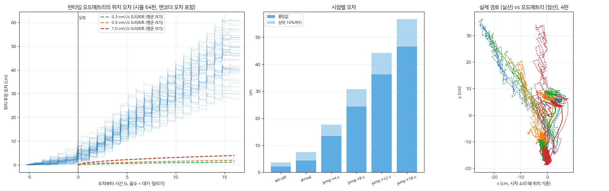
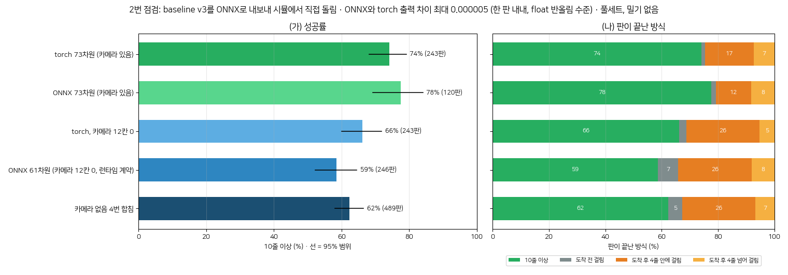
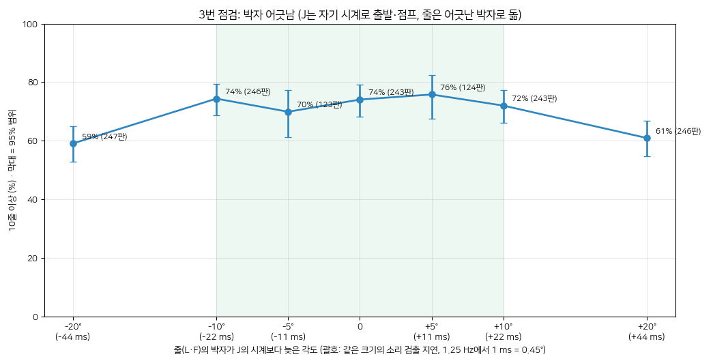
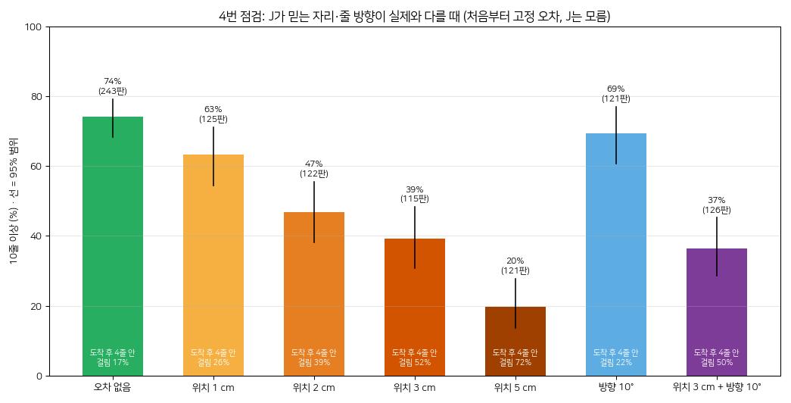
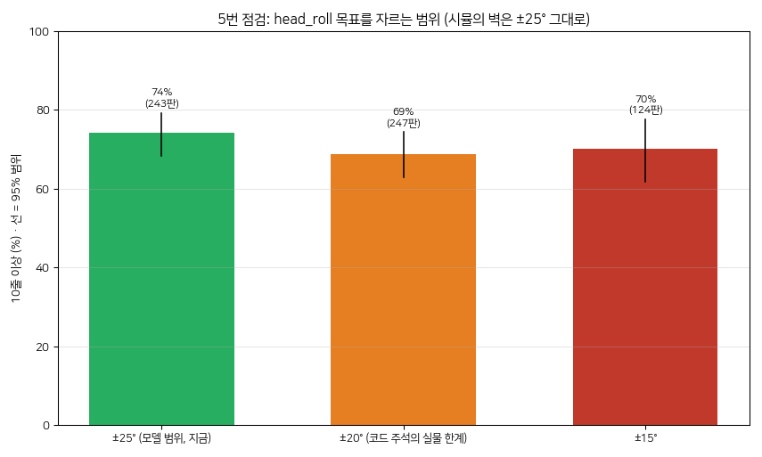
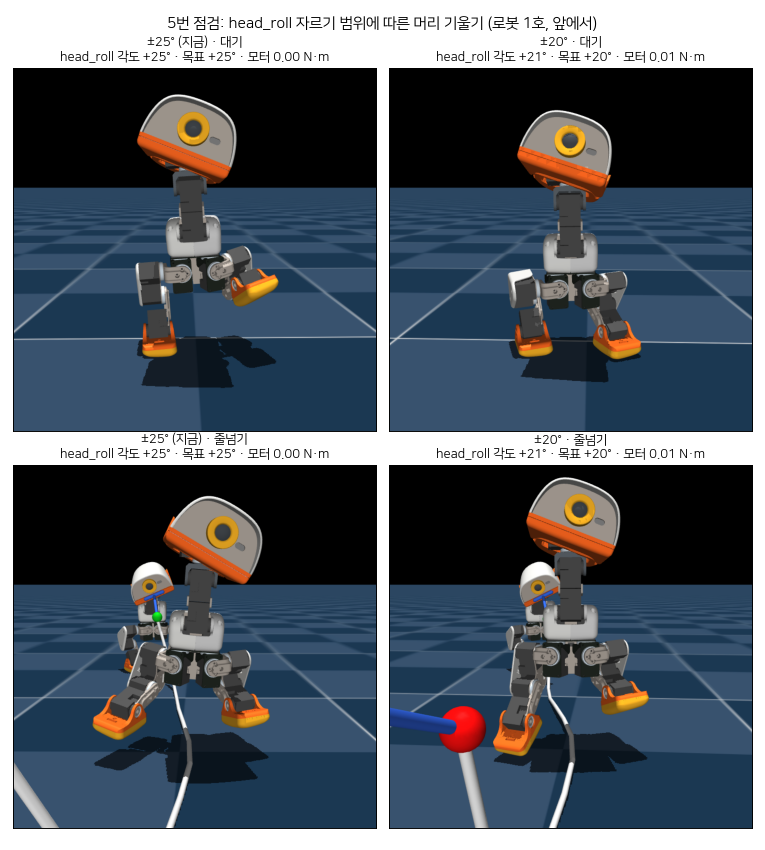
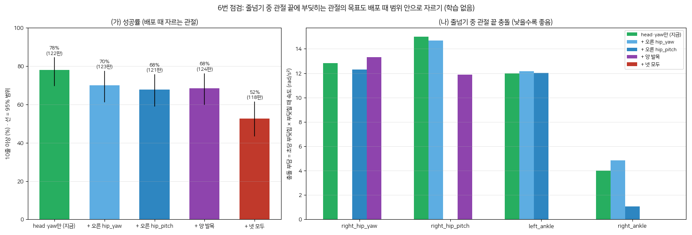
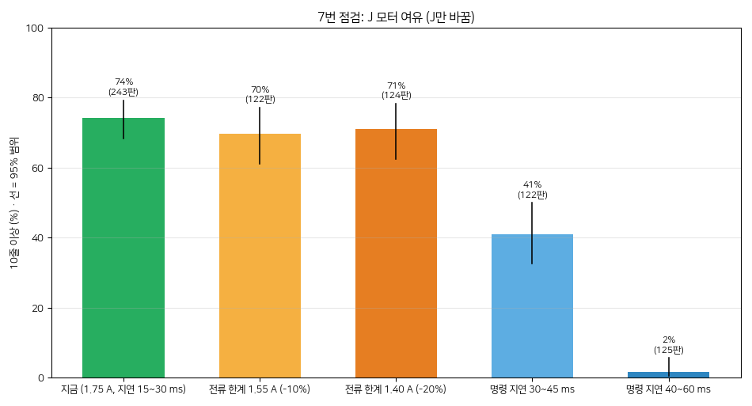
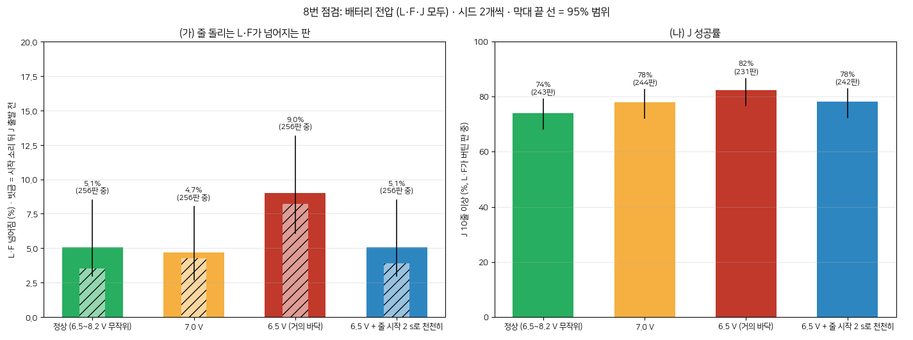
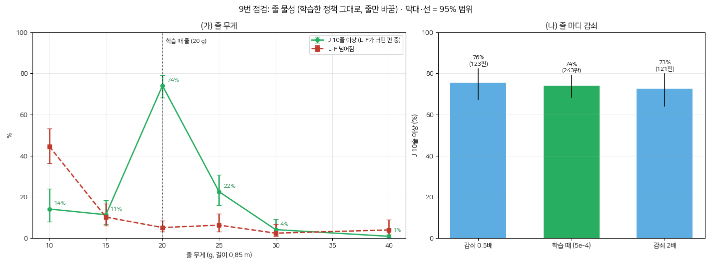

# 실물 투입 전 고려사항 (baseline v3)

baseline v3를 실물에 올리기 전에 시뮬에서 확인한 9개 항목의 기록입니다(2026-11-09, 사용자 요청). 항목마다 배경, 결과, 제안을 적었습니다. 하나씩 개선할 때마다 상태와 개선 기록을 갱신합니다.

- **기준 (baseline v3)**
  - J: D1Asky@5994 (`logs/rsl_rl/ys_trio_jump/2026-11-09_14-48-08_D1Asky/model_5994.pt`)
  - 배포 설정: head_roll과 left_hip_yaw 목표를 관절 범위로 자릅니다. A형(마지막 12 cm에서 L 쪽으로 돌기)이고, 출발 창은 20~60°입니다.
  - L·F는 rope14이고, 진행은 풀세트 절차입니다.
  - 성적: 풀세트 10줄 이상 74%(밀기 없음, 243판), 약한 밀기에서 68%입니다.
  - 2026-11-10 저녁 사용자: baseline v4는 보류하고 baseline v3를 유지합니다. 재학습 7은 지연에 강해졌지만(30~45 ms 37 → 67%) 오도메트리 풀세트가 0.4%(baseline v3 6%)입니다. 오도메트리를 고친 뒤(1-2) 둘을 다시 비교해 정합니다(`STAGES-ys.md` 7-15).
  - 1-2 시험 뒤 비교(2026-11-10 저녁): 고친 오도메트리 + 지연 30~45 ms에서 baseline v3 0.0%, 재학습 7 2.9%(시드 2개, 약 245판씩). 2026-11-10 저녁 사용자: 아직 baseline을 올릴 개선은 아니므로 baseline v3를 유지하고, 다음 작업은 재학습 7로 합니다.
  - 같은 시드로 다시 재도 결과가 흔들립니다(시드 2개면 ±6%p, GPU 계산 순서 때문으로 추정). baseline v3를 지금까지 잰 것을 모두 합치면 69.8%(853판, 95% 67~73%)이고, 이것을 잣대로 씁니다.
  - 2026-11-11 사용자 결정: **baseline v4 = 재학습 7**입니다(`STAGES-ys.md` 7-17). 아래 9개 점검의 숫자는 baseline v3로 잰 그대로 두었습니다. 2026-11-13에 더한 제안(4-4, 1-6, 4-5, 1-7)은 baseline v4로 잽니다.
  - 2026-11-16 사용자 결정: **baseline v5-1 = R14의 6950번째 저장본, baseline v5-2 = P1b의 6100번째 저장본**을 둘 다 올려 둡니다. 실물 명령 지연(7-1)을 잰 뒤 하나를 고릅니다. 20 ms 이하면 v5-2, 그보다 길면 v5-1이고, 실물 카메라가 L을 오래 놓치는 일이 잦으면 지연과 상관없이 v5-1입니다(`STAGES-ys.md` 7-34, 7-39).
- **숫자의 출처**: 전부 시뮬레이션이고 학습은 하지 않았습니다. 풀세트를 128판씩 돌렸고, 따로 적지 않으면 시드 1개입니다.
- **점검 전 측정** (그림 `docs/ys/deploy/real3.png`): 저전압, 카메라 끄기, 위치 보정 끄기, 드리프트 허용치. 1·2·8번 배경의 "지금 숫자"가 여기서 나왔습니다.
- **고쳐 나가는 법**
  1. 아래 표에서 항목 하나를 고릅니다.
  2. 개선한 뒤 같은 조건으로 다시 잽니다(맨 아래 "재현" 참고).
  3. 상태 표, 제안 목록의 상태, 그 항목의 "개선 기록"을 갱신합니다.
- 실험 전체 기록은 `STAGES-ys.md` 7-13에, 보고 방식은 `WORKFLOW-ys.md`에 있습니다.

## 범례
- **풀세트**: 손잡이 물기부터 걸어 나가 자리 서기, J의 시작 소리, 입장, 줄넘기, 끝 소리까지 경기 전체를 재는 평가입니다.
- **10줄 이상**: 풀세트의 성공 기준입니다. J가 출발한 뒤 걸리지 않고 10줄 이상 넘은 판의 비율입니다. L·F가 넘어진 판은 빼고 셉니다.
- **위치 보정 명령 (centering command)**: 정책 밖에서 J의 위치 오차로 만들어 넣어 주는 이동 명령(앞뒤·옆·회전 속도)입니다.
- **드리프트**: 위치 추정 오차가 시간에 따라 쌓이는 정도입니다. 1 cm/√s면 16 s 뒤 약 4 cm 어긋납니다.
- **제안 번호**: "점검 번호-제안 번호"입니다. 예를 들어 7-1은 7번 점검의 첫 제안입니다.
  - 보고 당시 1·2번 점검의 제안은 "3-1"처럼 적었는데, 여기서는 "1-1", "2-1"처럼 점검 번호로 통일했습니다.
- **상태**: 미착수 / 진행 중 / 완료 / 보류

## 한눈에 보기

| # | 점검 | 결과 (시뮬) | 판정 | 추천 제안 | 상태 |
|---|---|---|---|---|---|
| 1 | 실물 오도메트리 드리프트 | 줄넘기 16 s 뒤 위치 오차 46 cm (허용 약 2 cm). 한 번 뛸 때마다 2.3 cm씩 같은 방향으로 밀림 | **불가** | 1-1 | 1-1 멈춤, 1-2 진행 중 (2026-11-10). 1-6 완료 (2026-11-13): 위치 추정 오차를 없애면 실물 조건 51 → 73%. 1-8 시뮬 평가 끝 (2026-11-14): 실물 조건 52 → 68%, 지연·약한 밀기·줄 무게 조건에서도 낮아진 곳 없음. 런타임에는 계산 코드만 넣음(연결은 J의 절차가 런타임에 생긴 뒤). 새 시뮬 잣대(7-29)로는 55 → 73%. 다만 실물 카메라가 볼 수 있는 범위를 시뮬에 넣으면 1-8을 켠 쪽이 더 낮음(37% < 47%, 7-29): baseline v5는 결정 대기. 1-7 결정 대기 |
| 2 | 61차원 ONNX | 변환은 정확(차이 0.000005). 카메라 없이는 62%로 −12%p, 주로 입장 직후 | 가능 (손해 있음) | 2-1 | 시도함 (2-3, 2026-11-10) |
| 3 | 박자 오차 | ±10°(±22 ms)까지 손해 없음, ±20°에서 −13~15%p | 가능 (조건부) | 3-1, 3-2 | 미착수 |
| 4 | J 자리 오차 | 1 cm −11%p, 2 cm −27%p, 3 cm −35%p. 방향 10°는 영향 작음(J가 자기 위치를 참값으로 알 때). **J가 틀린 방향을 위치 추정에도 쓰면 처음 5° −33~−36%p, 틀어짐 0.3 °/s −22~−27%p (2026-11-16, 4-11)** | **매우 민감** | 4-1 | 시도함 (4-1, 2026-11-10). 4-4 완료 (2026-11-13): L·F가 정확히 서면 실물 조건 51 → 73%. 4-7 접음 (2026-11-14 사용자). 4-9 추가 (2026-11-14), 첫 시험 끝(7-29): F가 멈추는 거리 여유를 늘려도 1-8을 켠 경기는 73 → 75%(오차 범위 안)이고 L·F 실패가 8 → 31판. 4-6 / 4-8 / 4-9 결정 대기 |
| 5 | head_roll 범위 ±20° | 69% (−5%p, 흔들림 안). 머리 +21°, 모터 0.01 N·m | 문제없음 | 5-1 | 미착수 |
| 6 | 관절 끝 충돌 자르기 | 한 관절씩 −8~10%p, 넷 모두 −26%p. 자른 관절은 충돌 사라짐 | 실물 확인 필요 | 6-1 | 미착수 |
| 7 | 모터 여유 | 전류 −20%까지 문제없음. **명령 지연 30~45 ms면 41%, 40~60 ms면 2%** | **지연에 매우 민감** | 7-1 | 7-2 통과 (재학습 7), 대신 오도메트리에 약함 (2026-11-10) |
| 8 | 저전압 | 6.5 V에서 L·F 넘어짐 5→9%. 줄 시작을 2 s로 늦추면 5%로 회복 | 해결책 있음 | 8-1, 8-2 | 미착수 |
| 9 | 줄 물성 | 줄 무게 ±25%면 J 11~22%. 10 g이면 L·F도 45% 넘어짐. 감쇠는 무관 | **매우 민감** | 9-1 | 9-2 진행: 실물 줄 20 g 근처 (2026-11-10) |

**전체 그림**: baseline v3는 시뮬과 똑같은 조건에서만 잘 됩니다. 실물에서 어긋날 수 있는 것 가운데 다음에 특히 약합니다.
- 줄 기준 J의 위치 (1, 4번)
- 명령 지연 (7번)
- 줄 무게 (9번)
- 덜하지만 카메라 입력 (2번)과 박자 (3번)

반면 전류 한계, 전압, 관절 범위에는 여유가 있습니다.

**baseline v4 기준 (2026-11-13, `STAGES-ys.md` 7-26)**: 실물 조건에서 10줄 이상은 51%입니다. 잃는 것은 둘입니다. L·F가 걸어 나온 뒤 선 모양(4번: 정확히 서면 73%)과 J의 위치 추정 오차(1번: 없애면 73%)이고, 둘 다 없으면 91%입니다(시뮬).

**2026-11-14 (`STAGES-ys.md` 7-27, 7-28)**: J의 위치 추정을 작은 신경망으로 보정하면(1-8) 실물 조건 52 → 68%입니다(정책 학습 없음, 시뮬). 걸어 나온 뒤 서로 마주 보게 고쳐 서기(4-7)는 효과가 없어 접었습니다.

**2026-11-14 (`STAGES-ys.md` 7-29), 새 시뮬 잣대**: 사용자 결정으로 실물 조건의 IMU 장착 기울기 범위를 0~6°에서 0~2°로 줄였습니다(`IMU_SCALE=0.3333`, `WORKFLOW-ys.md`). 이 잣대로 baseline v4는 55% (281/508), 1-8을 켜면 73% (370/508), 위치 정답은 77% (197/256)입니다. 그 전 숫자(51~52%, 68%)는 옛 잣대(0~6°)라서 바로 비교하지 않습니다. F가 멈추는 거리 여유를 늘리는 4-9의 첫 시험은 성공률을 올리지 못했습니다. J의 절차를 런타임으로 옮기는 설계는 `RUNTIME-ys.md`에 있습니다(초안, 사용자 확인 전). 그 설계를 쓰다가 시뮬의 카메라가 J에게 실물이 알 수 없는 값(안 보이는 표식의 진짜 좌표)을 주는 것을 찾았고, 실물 카메라가 볼 수 있는 범위를 반영하면 1-8을 켠 경기가 37%로 baseline v4만 쓴 것(47%)보다 낮습니다. 1-8을 baseline v5로 올리는 것은 지금 권하지 않습니다("새로 찾은 것").

## 제안 목록 (종류별)

**가. 학습 없이 할 수 있는 것 (런타임·운용)**

| 번호 | 내용 | 상태 |
|---|---|---|
| 3-1 | 박자 계산을 monotonic time으로 바꿉니다(틱 건너뛰기 제거). 실물 투입의 전제 조건입니다 | 미착수 |
| 5-1 | 실물 head_roll·left_hip_yaw의 기구 한계를 재고, 그 값으로 런타임 자르기를 정합니다 | 미착수 |
| 8-1 | 줄 시작 램프를 2 s로 바꿉니다(정상 전압에서 시뮬로 한 번 더 확인) | 미착수 |
| 8-2 | 배터리가 7.0 V 아래면 교체하는 규칙을 둡니다 | 미착수 |
| 2-1 | 첫 실물 테스트는 61차원 ONNX(카메라 없음)로 합니다 | 미착수 |
| 4-2 | 바닥 표시나 지그로 J의 처음 위치를 1 cm 안으로 맞춥니다(처음 위치만 해결) | 미착수 |
| 1-4 | J가 기다리는 동안 가만히 서 있게 합니다(기다릴 때만 서기 정책으로 바꿈). 기다리는 4.4 s 동안 몸통이 약 70 cm를 움직여 오도메트리 오차 1.5 cm가 쌓입니다(도착 때 3 cm의 절반). 서 있던 J를 넘겨받으면 첫 줄에서 걸린 적이 있어서(7단계 교훈 5), 안 되면 재학습(다)으로 갑니다 | 시험 (2026-11-11 새벽): 서서 기다리기만 해도 풀세트(카메라 보정) 38 → 49%(시드 2개 두 번, 약 490판씩). 서서 L을 보거나 L·F를 보는 것은 더 얻는 것이 없음(서 있는 카메라의 거리 오차). 넘겨받기 문제 없음 |
| 1-5 | 도착 직후에는 L의 머리도 카메라 위치 보정에 씁니다. 도착 뒤 1초 동안 머리는 75%, 공은 45% 보입니다 | 보류 (2026-11-10 밤 사용자: 1-4 결과를 보고 다시 정함) |
| 9-2 | 실제 줄을 0.85 m에 20 g으로 맞춥니다 | 진행 (2026-11-10 저녁 사용자 선택). 시뮬에서 15~25 g이면 깔끔하지 않은 바퀴 1~2%, L·F 넘어짐 0~3%. 사용자가 실물 줄 무게를 잼 |
| 4-4 | 줄 쪽에서 잃는 양 재기: baseline v4는 그대로 두고, L·F가 걸어 나오지 않고 정확한 자리에서 돌리는 대조(`NOWALK=1`)를 위치 정답과 실물 조건에서 잽니다(평가만). 10%p 넘게 오르면 L·F를 바닥 표시나 지그로 정확히 세우는 것이 가장 싼 형태입니다 | 완료 (2026-11-13, `STAGES-ys.md` 7-26). 대조는 위치 정답 76 → 91%(+15.6 ± 6.3%p), 실물 조건 51 → 73%(+21.5 ± 8.3%p)로 줄 쪽이 큰 몫입니다. 깎는 것은 걸어 나온 뒤 L·F가 선 모양이고, 그중 L과 F가 서로 틀어진 각도가 가장 큽니다(+12°를 넘으면 47 → 15 → 0%, 걸어 나온 판의 34%가 그 밖). 4-6 / 4-7 / 4-8로 이어집니다 |
| 1-6 | 기억 탐침: 얼린 baseline v4가 도는 동안 J의 관측 73개와 위치 추정 오차를 기록하고, 관측 이력(5 / 25 / 50스텝)으로 그 오차를 맞히는 작은 네트워크를 맞춰 봅니다(정책 학습 없음). 1.5 cm 아래로 내려가면 J가 보는 것 안에 쓰지 않은 정보가 있다는 뜻입니다 | 완료 (2026-11-13, `STAGES-ys.md` 7-26). 관측 1초 분량으로 위치 추정 오차 2.67 → 1.46 cm입니다. 이어서 잰 가정 실험: 오차가 0.55배(1.47 cm)면 실물 조건 51 → 67%(+16.1 ± 8.7%p), 0이면 73%로 위치 정답 수준입니다. 1-8 / 1-7로 이어집니다 |
| 4-6 | L·F를 바닥 표시나 지그로 정확히 세우기: 걸어 나오는 대신 표시에 맞춰 세웁니다. 맞출 것은 L과 F가 서로 틀어진 각도 ±6°(늦어도 ±12°)와 간격 ±2 cm입니다. 한 쌍이 통째로 옮겨지거나 돌아간 것은 걸어 나온 만큼(자리 2~3 cm, 줄 축 방향 4°)이면 괜찮습니다 | 후보 (2026-11-13). 4-4의 대조가 이 상태입니다: 실물 조건 51 → 73%, 위치 정답 76 → 91%(시뮬). 사용자 결정 필요 |
| 4-7 | 걸어 나온 뒤 서로 마주 보게 고쳐 서기: 지금 절차는 F가 L의 공을 화면 가운데 두며 뒤로 걸어 멈춘 뒤 방향을 다시 맞추지 않습니다(`scripts/ys_trio_scn.py`의 `walkout_pre`, 코드 읽기). 멈춘 뒤 둘이 제자리에서 방향을 맞추는 단계를 더합니다. 절차를 바꾸므로 승인이 필요합니다 | **접음** (2026-11-14 사용자). 시뮬로 잼(7-27): 효과 없음. 실물 조건 51.0 → 51.1%, 위치 정답 75.8 → 66.9%. 서로 틀어진 각도는 고쳐지지만(12°를 넘는 판 36 → 1~5%) 간격의 흩어짐이 커지고 L·F가 더 넘어집니다. 옵션(`BEAT_W_FACE=1`)은 기본 꺼짐으로 남겼습니다 |
| 1-8 | 절차 안에 배운 보정 두기: J의 정책은 그대로 두고, 최근 관측 1초 분량으로 위치 추정 오차를 맞히는 작은 신경망(1-6의 탐침, 경기 기록으로 따로 맞춤)을 절차에 넣어 위치 추정을 고칩니다. 7-16의 구조(73차원 정책 + 절차)는 그대로입니다. 정책 학습은 없지만 런타임에 관측 버퍼와 작은 신경망이 더해지므로 승인이 필요합니다 | 시뮬 평가 끝 (2026-11-14, 7-27): 실물 조건 52.1 → 68.1%(네 시드 489판씩, +16.0 ± 6.1%p). 보정은 J가 출발할 때부터 켜고 시간 상수는 0.2 s입니다. 표준 잣대 묶음(2026-11-14, 7-28, 시드 2개 256판씩): 지연 30~45 ms 44.9 → 49.4%(오차 범위 안), 약한 밀기 48.1 → 68.6%, 줄 25 g 19.2 → 32.1%, 줄 15 g 3.5 → 10.2%. 런타임(`runtime-ys`, 로컬 브랜치 `ys/odo-flight-hold`)에는 계산 코드 `odometry::Correction`만 넣었고, 기록한 경기 8판에서 시뮬과 같은 보정을 내는지 확인했습니다(가장 큰 차이 0.03 µm, 허용 10 µm). `robotd`에는 연결하지 않았습니다. J의 절차(73차원 관측, 카메라 위치 보정, 위치 보정 명령, 출발과 끝 소리)가 런타임에 없기 때문입니다. 그 절차를 런타임으로 옮기는 것은 큰 별도 작업(1-3 / 2-2 / 4-3)입니다. 새 시뮬 잣대(2026-11-14, 7-29, IMU 장착 기울기 0~2°): 실물 조건 55.3 → 72.8%(네 시드 512판씩, +17.5%p, 95% 범위 +11.7~+23.3), 지연 30~45 ms 51.8 → 58.2%(오차 범위 안), 약한 밀기 53.4 → 68.0%, 줄 25 g 16.8 → 32.5%, 줄 15 g 2.9 → 6.1%(오차 범위 안). 낮아진 조건 없음 |
| 4-9 | F가 멈추는 자리의 흩어짐 줄이기: L·F 사이 간격이 ±1 cm 안이어야 잘 되는데, F가 멈추는 자리는 1.4~1.8 cm씩 흩어집니다. 걸어 나오는 절차에서 F가 멈추는 자리를 더 정확히 맞춥니다. 절차를 바꾸므로 승인이 필요하고, 방법은 아직 정하지 않았습니다 | 첫 시험 끝 (2026-11-14, 7-29, 평가만): F가 멈추는 거리 여유(`BEAT_W_COAST`)를 4.0 → 5.2 cm로 늘리면 간격의 평균 치우침은 +13 → +2 mm로 없어지지만 흩어짐(13 mm)은 그대로입니다. 1-8을 켠 경기의 10줄 이상은 72.8 → 74.5%(네 시드 512판씩, +1.7%p, 95% 범위 -3.8~+7.2)로 오르지 않았고, L·F 실패가 8 → 31판(1024판 중)으로 늘었습니다. 5.2 cm는 채택하지 않기를 권합니다(사용자 결정 대기). 남은 것은 흩어짐 자체입니다. 그 전 기록(2026-11-14 사용자 승인으로 항목 추가, 7-28, 옛 잣대): 실물 조건 726판에서 간격은 기준보다 평균 12 mm 넓고 표준편차 13.8 mm이며, ±10 mm 안에 드는 판은 39%입니다. 1-8을 켠 경기 가운데 간격이 ±10 mm 안인 판은 81%(166/204), +20 mm보다 넓은 판은 51%(70/137)입니다(판을 나눠 본 것이라 간격만의 효과인지는 확인하지 않음) |
| 4-10 | L·F가 걸어 나올 때 쓰는 참값 없애기: 시뮬의 걸어 나오기 절차는 L·F가 자기의 진짜 위치와 방향을 보고 걷고 돕니다(`scripts/ys_trio_scn.py`의 `walk_cmd`, `turn_cmd`, 코드 읽기). 실물은 발로 세는 위치 추정과 몸통 기울기 센서(IMU)의 회전 누적값만 압니다. 시뮬의 걸어 나오기를 그 값으로 바꿔 L·F가 선 모양과 성공률을 다시 잽니다(평가만, 시뮬 절차를 바꿈). L·F를 바닥 표시나 지그로 세우면(4-6) 걸어 나오기가 없어지므로 이 문제도 없어집니다 | 후보 (2026-11-15 사용자: 문서에 넣기). 첫 측정 7-31: 위치만 실물 추정(손잡이에서 출발해 발로 셈, `LFODO=1`), 방향은 아직 참값. baseline v4 실물 조건 47.5 → 42.4%(-5.1%p, -13.7~+3.5, 시드 1·2), L·F 실패는 늘지 않음. 방향까지 바꾸는 것은 남음 → **full check 부분 4 (7-36, 시드 21·22, 세 정책)**: 위치를 발로 셈 -4.3 ~ +4.7%p, 방향 자이로 틀어짐 0.1 / 0.3 / 1 °/s -1.4 ~ +4.0 / -2.0 ~ +4.0 / -6.0 ~ -1.1%p, 모두 구분 안 됨. 참값으로 걸어도 L과 F가 서로 틀어진 각도가 9°쯤 흩어지므로 실물은 더 흩어질 수 있습니다(추정) |
| 1-9 | 시뮬에서 L의 머리 표식이 줄에 가려지게 하기: J의 카메라는 L의 빨간 공과 머리 표식을 보는데, 시뮬에서는 머리 표식이 줄에 가려지는 경우가 없습니다(2026-11-15 full check 기획 때 찾음). 실물에서는 줄이 카메라 앞을 지날 때 머리 표식도 가려질 수 있습니다. 시뮬에 그 가려짐을 넣어 크기를 잽니다(평가만) | 후보 (2026-11-15 사용자: 문서에 넣기). 크기는 full check 부분 4에서 잼. 단서: 머리 표식이 아예 없으면 순서 2 기준 -3~-10%p(7-30). **측정 (7-36, 시드 21·22, `YS_CAM_HEADOCC=1`)**: 줄이 공을 가리는 것과 같은 규칙으로 머리 표식도 가리면 baseline v4 -5.8, 후보 +1.4, 재학습 1 +100 it -5.2%p, 셋 다 구분 안 됨 |
| 4-11 | J가 자기 방향을 정확히 알게 하기: full check 부분 4(`STAGES-ys.md` 7-36)에서 성적을 가장 크게 깎은 것이 J의 방향 추정입니다. 실물 J의 방향은 IMU 칩이 자이로와 가속도계를 섞은 값인데 지자기가 없어서 시간에 따라 틀어지고, 사람이 놓을 때의 방향 오차도 그대로 들어갑니다. 틀린 방향은 위치 추정, 카메라 보정, 이동 명령에 모두 들어갑니다. 틀어짐 0.1 °/s까지는 괜찮고, 0.3 °/s면 −22~−27%p, 1 °/s면 −38~−61%p, 처음 방향 2°면 −8~−12%p, 5°면 −33~−36%p입니다(실물 조건, 시드 21·22, baseline v4·v5-1·v5-2). 고치는 길: 카메라로 본 L의 공·머리 표식 방향을 기준으로 J의 방향을 바로잡는 칼만 필터(절차만, 학습 없음). 실물에서 잴 것: 뛰는 동안 J 자이로가 틀어지는 정도, 손으로 세울 때 방향 오차 | 시험 끝 (2026-11-17, `STAGES-ys.md` 7-40·7-41): 카메라로 바로잡기는 L만 보면 방향 오차가 위치로 흡수돼 버리고, J가 서 있는 동안 자이로 치우침을 추정해 빼는 칼만 필터(절차만)로 시험. 틀어짐만 있으면 0.3 °/s 29 → 53%, 1 °/s 6 → 58%(오차 없을 때 54%). 참값 없는 잣대에서는 혼자 +1~3%p(구분 안 됨), 4-12의 보낸 위치와 함께 +9%p(좋아짐). 처음 방향 오차(사람이 놓을 때)는 못 고침. 실물에서 잴 것은 그대로 |
| 4-12 | J가 설 자리를 L·F의 실제 위치로 정하기: 시뮬은 L·F가 실제로 선 위치의 가운데를 J에게 줍니다(참값). 실물 J가 바로 아는 것은 L·F에게 준 걷기 목표뿐이고, 목표의 가운데를 쓰면 −30~−32%p입니다(`STAGES-ys.md` 7-36). 목표의 가운데는 실제 가운데에서 평균 30 mm, 90%가 59 mm 안이고, 옆으로 +25 mm·앞뒤로 −13 mm 치우쳐 있습니다. 고치는 길: 치우침 빼기(실물에서는 다시 재서 넣는 조정값), L·F가 발로 센 위치를 J에게 보내기(로봇 사이 통신 필요), L·F를 바닥 표시로 세우기(4-6). 실물에서 잴 것: L·F가 목표에서 벗어나 서는 거리 | 시험 끝 (2026-11-17, `STAGES-ys.md` 7-40·7-41): 치우침 빼기는 +5~9%p(평균만 빠지고 판마다 흩어짐이 남음). L·F가 발로 센 자기 위치를 J에게 보내면 참값 자리와 구분 안 되고(받은 자리 오차 중앙값 6~10 mm), 참값 없는 잣대 v5-1 20 → 33%, v5-2 23 → 35%, 칼만 필터(4-11)와 함께 43%. 실물에 필요: 로봇 사이 통신(런타임 보류) |

**나. 실물에서 재야 하는 것**

| 번호 | 내용 | 상태 |
|---|---|---|
| 7-1 | J의 명령→반응 지연을 잽니다. **30 ms 이하인지가 가장 먼저 확인할 사양**입니다 | 보류 (2026-11-09 사용자: 지금은 실물 측정 안 함. 2026-11-10 다시 보류). 2026-11-16 사용자: 이 값으로 baseline v5-1·v5-2 중 하나를 고름(20 ms 이하면 v5-2, 그보다 길면 v5-1) |
| 3-2 | 시작 소리의 검출 지연과 흔들림을 잽니다(흔들림 ±20 ms 이내) | 보류 (2026-11-09 사용자: 지금은 실물 측정 안 함). 2026-11-15: 시뮬은 L이 J의 시작 소리를 오차 없이 들음(새로 찾은 것, 사용자: 문서에 넣기). 그 크기는 full check 부분 4에서 잼. **측정 (7-36, 시드 21·22, `LEAR=1`: L의 시계 시작에 귀 오차, J는 모름)**: baseline v4 -0.2, 후보 +0.8, 재학습 1 +100 it -1.5%p, 셋 다 구분 안 됨. 시뮬이 가정한 오차 크기(`ys_beat` CAL_SD, JIT)에서는 문제가 아님 |
| 9-1 | 실제 줄의 무게와 돌 때의 모양을 잽니다 | 진행 (2026-11-10 저녁 보류 해제: 9-2를 위해 무게부터 잼, 사용자) |
| 6-1 | 줄넘기를 반복하며 관절 끝 충돌 부위(혼, 브래킷)를 확인합니다 | 보류 (2026-11-09 사용자: 지금은 실물 측정 안 함) |
| 4-8 | 실물에서 L·F가 선 모양 재기: 실물 L·F가 걸어 나온 뒤 L과 F가 서로 틀어진 각도와 간격을 10판쯤 잽니다. 시뮬의 값(서로 틀어진 각도 중앙값 +8.4°, 흩어짐 9°, 간격 흩어짐 13 mm)이 실물에도 해당하는지 봅니다 | 후보 (2026-11-13). 사용자 결정 필요 |

**다. 다시 학습해야 하는 것 (한 번의 재학습으로 묶을 수 있음)**

| 번호 | 내용 | 상태 |
|---|---|---|
| 1-1 / 4-1 | 도착 뒤 위치 보정 없이 자리 지키기 + 위치·방향 기준점 흔들기. 위치 정보에 덜 의존하게 합니다 | 시도 (2026-11-10, 재학습 1): 기본 73% 유지, 오도메트리 풀세트 6 → 24% (기준 40%, 규칙상 실패). 재학습 6(500 it 더): 오도메트리 풀세트 10%, 기본 40%로 멈춤(7-15). 학습으로 버티는 방향은 접고 1-2로 감 |
| 2-3 | 카메라 입력을 일부 판에서 끄고 학습합니다 | 중단 (2026-11-10 사용자). 재학습 2가 기본 10%로 무너짐. 실물은 카메라 입력(73차원)을 쓰는 것을 전제로 함 |
| 2-4 | 박자는 절차가 줄 박자를 재서 J의 시계 칸에 넣고, J 정책은 카메라 없이(61차원으로 돌 수 있게) 학습합니다(사용자 제안) | 시도 (2026-11-11 새벽, 재학습 8): 위치 정답에서는 재학습 7과 같음(70%, 카메라 없이도 70%). 카메라 보정 조건에서 42 → 15%(도착 전 걸림 36%). 카메라 12칸이 위치 오차를 견디는 데도 쓰임(추정). 절차가 줄 박자를 재는 부분은 가정(오차 5°) |
| 9-3 | 줄 무게를 무작위로 바꿔 학습합니다(J만으로 될지는 불확실) | 시도 (2026-11-10): L·F 학습은 지금 J가 0.4%가 되어 쓰지 않음. J만 15~25 g (재학습 3)은 효과 없음(15 / 25 g 7 / 26%), 기본 −8%p. 2026-11-10 사용자: 학습 없는 짧은 평가(줄 무게별 L의 공 궤적과 줄 가운데)를 보고 정함 |
| 9-4 | L·F를 줄 무게 10~40 g으로 학습하되 줄 최고 높이를 지금처럼 유지하는 조건을 더합니다. 새 L·F(10~40 g)는 넘어짐이 줄었지만 줄이 낮아져 J가 0.4%였습니다 | 후보 (2026-11-10 사용자: 실물 줄 무게를 안 뒤 15~25 g 밖이면 돌림) |
| 9-5 | J가 정해진 시간(시작 소리 뒤 4 s)이 아니라 줄이 깔끔하게 돌 때를 보고 들어가도록 학습합니다. 줄 10 g에서는 줄 가운데가 명령 1바퀴에 1.05~1.15바퀴 돕니다 | 후보 (2026-11-10 저녁): 짧은 평가에서 깔끔하지 않은 바퀴는 10 g만 6%(15~40 g 1~2%). L·F 싱크는 원인이 아님(7-15). 실물 줄을 20 g 근처로 쓰기로 해서(9-2) 후보로 둠 |
| 7-2 | 실측 지연이 30 ms를 넘으면 지연 범위를 넓혀 학습합니다 | 시도 (2026-11-10, 재학습 4: 15~45 ms): 30~45 ms 37 → 68%, 기본 74 → 61%. 실측 지연(7-1)에 따라 선택. 재학습 7(15~40 ms): 기본 71%, 30~45 ms 67%로 통과. 다만 오도메트리 풀세트 0.4%(baseline v3 6%). baseline v4는 1-2 뒤 다시 비교(2026-11-10 사용자) |
| 6-3 / 5-2 (선택) | 관절 끝 속도 벌점, head_roll을 0° 근처로 두는 항 | 미착수 |
| 1-7 | 기억 + 선생 → 학생: 위치 정답을 아는 정책(선생)을 먼저 두고, 관측 이력만 보는 정책(학생)이 그 행동을 따라 배운 뒤 마무리 학습을 합니다. 7-16의 구조 결정(73차원 정책 + 절차)과 런타임이 바뀝니다 | 후보 (2026-11-13). 1-6에서 걸 만한 것으로 나왔습니다(1.46 cm. 오차가 그만큼 줄면 실물 조건 +16%p, 가정 실험). 다만 같은 정보를 정책을 그대로 두고 쓰는 1-8이 더 쌉니다. 사용자 결정 필요 |

이어 학습을 다시 할 때 함께 넣을 것(번호 없음: 점검 항목이 아니라 학습 방식 규칙, `STAGES-ys.md` 7-25): 학습률 고침 한 줄, 아무것도 바꾸지 않은 대조 1개, 학습 시드 2~3개.

**라. 큰 별도 작업**

| 번호 | 내용 | 상태 |
|---|---|---|
| 1-3 / 2-2 / 4-3 | 카메라로 L의 공을 보고 J의 위치를 바로잡기. 카메라 추적 프로세스와 73차원 런타임 계약이 함께 필요합니다 | 진행. 시뮬 시험(재학습 7, 2026-11-10 밤): 카메라로 도착 1초 뒤부터 위치 오차 1~1.4 cm. 풀세트 끝까지 위치 명령 13 → 36~42%, 지연 30~45 ms 포함 3 → 34~35%. J는 도착 전에는 L을 못 봄. 2026-11-14 사용자: 런타임에 반영하되 문서부터. 설계 초안은 `RUNTIME-ys.md`(사용자 확인 전, 런타임 코드는 아직 쓰지 않음) |
| 1-2 | 줄넘기에 맞게 런타임 오도메트리를 고칩니다(공중 구간, 착지 미끄러짐) | 진행 중. 원인: 두 발이 모두 뜬 틱(16 s에 53틱)이 가장 큼(7-15). J의 박자 시계 창(±8°)으로 속도를 유지하면 도착 후 16 s 오차 44 → 12 cm(파이썬). 풀세트에서도 도착 뒤 3~5 cm로 유지되지만 J는 0~13%: 도착 때 이미 약 3 cm 틀림. 런타임: 로컬 브랜치 `ys/odo-flight-hold`(`7061ab4`, 작업 폴더 `runtime-ys`)에 `update_with_flight`, 파이썬과 0.16 cm 안. `robotd` 연결은 J의 박자 시계가 런타임에 생긴 뒤 |
| 4-5 | 줄 쪽이 J에게 맞추기: L·F(또는 둘을 조율하는 절차)가 J의 위치와 박자를 보고 줄을 맞춥니다. 지금은 J만 맞추고 L·F는 시계대로만 돕니다(선행 연구 Marope는 줄 쪽이 맞춤, `STAGES-ys.md` 7-25) | 후보 (2026-11-13). 4-4에서 줄 쪽 몫이 크게 나왔습니다(실물 조건 +21.5%p). 다만 잃는 것이 L·F가 선 모양이라 4-6이나 4-7로 풀리면 필요가 줄어듭니다. 사용자 결정 필요 |

---

## 1번: 실물 오도메트리 드리프트

### 1. Background
- **배경**
  - J 정책은 자기 위치를 모릅니다. 61차원 관측에 위치가 없기 때문입니다. 예전 제자리 점프 jump3는 이 때문에 1.9 m를 떠내려갔습니다.
  - 그래서 정책 밖에서 "자리까지 얼마나 남았는지"를 이동 명령으로 넣어 줍니다(오차 × 2/s, 최대 0.3 m/s).
  - 시뮬은 이 명령을 J의 실제 위치로 만듭니다. 실물에서는 런타임의 odometry(발 접지점과 IMU로 위치를 추정하는 것)가 이 위치를 대신해야 합니다.
  - 이 오도메트리는 걷기 3.2 m에서 9 mm 오차였습니다. 하지만 발이 번갈아 뜨고 착지 충격이 있는 줄넘기에서는 잰 적이 없습니다.
- **지금 숫자**
  - 도착 뒤 보정을 끄면 13%입니다.
  - 드리프트 0.3 cm/√s에서 66%, 0.5에서 65%, 1에서 41%, 3에서 7%입니다.
  - 따라서 허용치는 0.5 cm/√s 안팎, 16 s 동안 약 2 cm입니다.
- **시뮬 검토**: 풀세트 동안 J의 관절각과 IMU를 기록합니다. 런타임과 같은 오도메트리 계산을 돌린 뒤, 실제 위치와 비교해 드리프트를 잽니다.
- **판단**: 0.5 cm/√s 이하면 그대로 갑니다. 넘으면 다음 셋 중에서 고릅니다.
  - 추정기를 개선합니다.
  - 드리프트를 넣어 다시 학습합니다.
  - 카메라로 L의 공을 보고 옆 방향 오차를 바로잡습니다.

### 2. 작업 결과
그래프 `docs/ys/deploy/check1.png`, 영상 `1번_오도메트리_small.mp4`(커밋하지 않음)



- **한 일**
  - baseline v3로 풀세트 64판을 돌렸습니다(밀기 없음, 이번 실행의 성공률 82%).
  - J의 시작 소리부터 끝까지 20 ms마다 세 가지를 기록했습니다: 엔코더가 읽는 관절각 14개(시뮬의 엔코더 오차 포함), 몸통 자세(쿼터니언), 실제 위치.
  - 이 기록을 런타임의 오도메트리 코드(`runtime/odometry`, 수정하지 않음)에 그대로 넣었습니다.

| 시점 | 위치 추정 오차, 중앙값 (상위 10%) |
|---|---|
| 출발 순간 (대기 약 4.4 s 뒤) | 2.1 cm (3.6) |
| 자리 도착 (달리기 0.6 s 뒤) | 4.4 cm (7.5) |
| 줄넘기 4 s | 13.4 cm (17.7) |
| 줄넘기 8 s | 24.4 cm (30.8) |
| 줄넘기 16 s | **46.5 cm** (56.6) |

- **분석**
  1. **허용치(약 2 cm)의 20배가 넘습니다.** 지금 오도메트리로는 줄넘기 중 J의 위치 보정을 할 수 없습니다.
  2. **오차는 무작위로 쌓이지 않습니다.** 한 번 뛸 때마다 약 2.3 cm씩 계단처럼 같은 방향으로 밀립니다(약 2.9 cm/s). 영상에서도 빨간 점이 한쪽으로 꾸준히 멀어집니다.
  3. **원인은 센서가 아니라 알고리즘입니다.** 엔코더 오차를 뺀 실제 관절각을 넣어도 16 s 뒤 45.3 cm입니다. 실물에서는 IMU 잡음이 더해지니 이보다 나빠질 수 있습니다.
  4. **추정 원인**: 이 오도메트리는 "발바닥 한 점이 땅에 고정돼 있다"고 가정하고, 다른 발 모서리가 더 낮아지면 그 점으로 기준을 옮깁니다. 걷기에는 맞는 가정입니다. 하지만 v3의 옆으로 뛰기는 매 박자 두 발이 잠깐 같이 뜨고, 착지할 때 미끄러집니다. 그래서 착지마다 기준점이 조금씩 틀린 자리에 다시 잡히는 것으로 보입니다. 확인은 하지 않았습니다.
  5. **입장 구간은 상대적으로 괜찮습니다.** 대기와 달리기(약 5 s) 동안 오차는 2~4 cm입니다.

### 3. 다음 제안 방향 (실행하지 않음)
- **1-1 (추천)**: 오도메트리는 입장까지만 쓰고, 도착 뒤에는 위치 보정 없이 J가 스스로 자리를 지키게 학습합니다.
  - 학습 때 도착 뒤 보정 명령을 0으로 둡니다.
  - J는 이미 카메라로 L의 머리와 공 위치를 받고 있으니, 이것으로 옆 방향 위치를 가늠하도록 배울 여지가 있습니다.
  - 그 전에, 학습 없이 "입장까지만 실제 오도메트리로 보정하는" 시뮬 시험으로 입장 구간이 버티는지 먼저 확인합니다.
- **1-2**: 줄넘기에 맞게 오도메트리를 고칩니다. 공중 구간과 착지 미끄러짐을 처리하는 런타임 코드 수정이 필요하고, 이번 재생 도구(`scripts/ys_odo_replay`)로 바로 검증할 수 있습니다.
- **1-3**: 카메라로 본 L의 공 방향으로 위치를 바로잡습니다. 카메라 추적 프로세스가 있어야 해서 2번 점검과 이어집니다.
- **1-4** (2026-11-10 추가): J가 기다리는 동안 가만히 서 있게 합니다. 지금은 기다리는 4.4 s 동안 몸통이 약 70 cm를 움직이고(실제 자리 이동 7~8 cm), 그동안 오도메트리 오차가 1.5 cm 쌓입니다.
  - 2026-11-10 밤 사용자 제안을 더함: 서 있는 동안 L을(또는 L과 F를 모두) 카메라로 보고 위치를 바로잡은 뒤 출발합니다. J는 지금 자리 쪽을 보고 기다려서, L의 공이 카메라 정면에서 왼쪽으로 48~87°(중앙값 69°)에 있어 화면(좌우 ±31°) 밖입니다. 서기 정책은 머리 좌우 ±80°까지 명령을 받도록 학습돼 있어 고개를 돌려 볼 수 있습니다. L과 F를 모두 보면 자리를 두 공의 중심으로 직접 구해, 도착 뒤에는 볼 수 없는 F 위치 몫까지 줄일 수 있습니다.
- **1-5** (2026-11-10 추가, 보류): 도착 직후에는 L의 머리도 카메라 위치 보정에 씁니다. 도착 뒤 1초 동안 머리는 75%, 공은 45% 보입니다(1-3 시험).
- **1-6** (2026-11-13 추가, 완료): 기억 탐침. 얼린 baseline v4의 관측 이력(5 / 25 / 50스텝)으로 위치 추정 오차를 맞혀 봤습니다(정책 학습 없음). 1초 분량으로 2.67 → 1.46 cm입니다. J가 보는 것 안에 쓰지 않은 정보가 있습니다(아래 개선 기록).
- **1-7** (2026-11-13 추가, 후보): 기억 + 선생 → 학생. 7-16의 구조 결정과 런타임이 바뀌므로 사용자 결정이 필요합니다. 1-6에서 걸 만한 것으로 나왔지만, 같은 정보를 정책을 그대로 두고 쓰는 1-8이 더 싸서 1-8을 먼저 보는 것을 권합니다.
- **1-8** (2026-11-13 추가, 시뮬 평가 끝): 절차 안에 배운 보정 두기. J의 정책은 그대로 두고, 최근 관측 1초 분량으로 위치 추정 오차를 맞히는 작은 신경망(1-6의 탐침)을 절차에 넣어 위치 추정을 고칩니다. 첫 단계는 보정을 넣은 채로 재는 시뮬 평가입니다. 런타임이 바뀌므로 승인이 필요합니다. 시뮬 평가는 끝났습니다(2026-11-14, 실물 조건 52 → 68%, 아래 개선 기록). 지연, 약한 밀기, 줄 무게 조건에서도 낮아진 곳은 없습니다. 런타임에는 계산 코드만 넣었고, `robotd` 연결은 J의 절차가 런타임에 생긴 뒤입니다.
- **1-9** (2026-11-15 추가, 후보): 시뮬에서 L의 머리 표식이 줄에 가려지게 합니다. 지금 시뮬은 머리 표식이 줄에 가려지는 경우가 없어서, 그만큼 J의 카메라 위치 보정과 정책 입력이 실물보다 좋게 나올 수 있습니다. 크기는 full check 부분 4에서 잽니다.

### 개선 기록
- 2026-11-10 (밤샘 첫째, STAGES-ys.md 7-14, 그림 `docs/ys/deploy/improve1_*.png`):
  - 잣대를 만들었습니다. **오도메트리 풀세트**는 위치 보정 명령을 런타임 오도메트리로 만들고, 도착 뒤에는 명령을 주지 않습니다(`scripts/ys_fullset.py` ODO=1 NOCENTER=1). baseline v3는 6%(243판)이고, 끝까지 오도메트리로 보정하면 0%(126판)입니다.
  - 1-1/4-1 재학습(재학습 1, baseline v3에서 500 it): 기본 풀세트 73%(251판), **오도메트리 풀세트 24%(247판, 95% 19~30%)**. 기준 40%에 못 미쳐 규칙상 실패입니다.
  - 자리를 지키는 법은 배우지 못했습니다. 도착 2 s 뒤 중앙값 5 cm로 baseline v3와 같습니다. 대신 5~10 cm 벗어나도 계속 뜁니다.
  - 카메라를 빼면 1%(시드 1)입니다. 카메라로 위치를 가늠하므로 실물에도 73차원 런타임이 필요합니다.
  - 첫 시도는 '줄 밖에 머묾' 벌점을 피할 수 없게 되어 무너졌습니다. 고친 커밋은 `6404759`입니다.
- 2026-11-10 (낮, STAGES-ys.md 7-15, 그림 `docs/ys/deploy/improve_r67.png`, `docs/ys/deploy/improve1_odo_cause.png`):
  - 재학습 6(재학습 1에서 500 it 더): 오도메트리 풀세트 10%(241판, 95% 7~15%), 기본 40%(247판)로 무너져 멈췄습니다. 예측(30~40%)이 틀렸고, 원인은 확인하지 않았습니다.
  - 오도메트리 원인(1-2): 파이썬 사본으로 baseline v3 기록 44판을 재생했습니다. 도착 뒤 16 s 오차 45 cm에서 가장 큰 몫은 두 발이 모두 뜬 틱입니다(800틱 중 53틱, 66 cm). 정답 접촉으로 공중 구간을 알려 주고 직전 속도를 유지하면 14 cm입니다.
  - 다음(2026-11-10 저녁 사용자): J의 박자 시계로 공중 구간을 알아내는 방식을 파이썬 사본에서 시험합니다.
- 2026-11-10 (저녁, STAGES-ys.md 7-15, 그림 `docs/ys/deploy/improve1_clock.png`, `improve1_clock_fullset.png`): 1-2 시험.
  - J의 박자 시계가 창(중심 -174.9°, ±8°) 안이면 오도메트리 출력이 직전 속도를 유지합니다(`ODO_HOLD=-174.9,8`, 런타임 코드는 그대로). 파이썬 시험 36판에서 도착 후 16 s 오차 44 → 12 cm입니다. 창이 22 ms 늦으면 34 cm, 44 ms 늦으면 91 cm라 실물에서는 창을 맞추는 단계가 필요합니다.
  - 풀세트(시드 2개): 끝까지 위치 명령 + 박자 창 baseline v3 8.0%, 재학습 7 12.9%(고치기 전 baseline v3 0%). 지연 30~45 ms를 더하면 0.0% / 2.9%. 오도메트리 풀세트 + 박자 창 7.3% / 3.6%.
  - 도착할 때 이미 약 3 cm 틀립니다(기다리는 동안 1.5 cm, 뛰어 들어가는 동안 1.3 cm). 오도메트리만으로는 부족하고 카메라 위치 보정(1-3·2-2·4-3)이 필요합니다.
- 2026-11-10 (밤, STAGES-ys.md 7-15, 그림 `docs/ys/deploy/improve1_cam.png`, `improve1_cam_fullset.png`): 1-3 시뮬 시험(재학습 7).
  - J의 카메라로 L 공의 원 중심을 찾아 오도메트리를 바로잡습니다(`scripts/ys_camfix.py`, `CAM_FIX=1`). 공의 원 반지름은 고정해야 거리가 나옵니다. 도착 1초 뒤부터 위치 오차 1~1.4 cm입니다.
  - 풀세트(시드 2개): 끝까지 위치 명령 12.9% → 36.0%(계획한 설정), 41.7%(빠르게 반영). 지연 30~45 ms 포함 2.9% → 33.6% / 35.1%.
  - 남은 것: J는 기다리는 동안과 뛰어 들어가는 동안 L을 못 봐서 도착 때 약 3 cm는 그대로입니다. 자리 기준이 L 공 중심에서 판마다 다른 몫(표준편차 0.9 / 1.4 cm, F가 선 위치)도 J가 볼 수 없습니다.

- 2026-11-11 (새벽, STAGES-ys.md 7-15, 그림 `docs/ys/deploy/improve1_wait.png`): 1-4 + 사용자 제안 시험(재학습 7, 사용자 순서: 시작 소리 → 줄 돌리기 → 줄이 안정되면 J 위치 보정 → 진입).
  - 서서 기다리기(서기 정책, 시작 소리 5.2 s 뒤 자기 정책으로 넘김): 출발 때 위치 오차 2.0 → 0.7 cm, 도착 때 3.0 → 2.1 cm, 풀세트 38 → 49%.
  - 서서 L 보기 48%, 서서 L·F 보기 38%: 서 있는 카메라로 잰 공 원 중심이 거리 방향으로 치우쳐(정확한 화면 위치로도 −1.3 cm) 오히려 출발 때 오차가 커짐. 원인의 하나는 공이 줄 방향으로도 ±40 mm 움직이는 것(모델에 넣어도 풀세트 이득 없음).
  - 도착 1초 뒤 오차는 모든 갈래가 약 2.3 cm로 같음. 남은 한계는 도착 뒤 카메라 보정입니다.
- 2026-11-13 (STAGES-ys.md 7-26, 그림 `docs/ys/memprobe_7-26.png`, `docs/ys/errk_7-26.png`): 1-6 기억 탐침(baseline v4, 평가만).
  - 실물 조건 경기 389판(표본 36,784개)에서 J의 관측 이력으로 위치 추정 오차를 맞혔습니다(배우지 않은 판으로 채점). 지금 2.67 cm, 평균 치우침만 빼면 2.21, 관측 1개 1.98, 0.5 s 1.53, 1 s 1.46 cm입니다. 판마다의 상수를 안다면 1.15 cm입니다.
  - 이어서 잰 가정 실험(`ERRK`: 실물 조건 절차는 그대로 두고 명령에 쓰이는 추정 오차에만 배수를 곱함, 시드 2개, 10줄 이상): 그대로 51.0% → 0.55배(1.47 cm) 67.1%(+16.1 ± 8.7%p) → 0.37배 71.0% → 오차 없음 73.3%. 오차가 없으면 위치 정답(75.8%)과 −2.5 ± 7.7%p로 같습니다.
  - 위치 정답과 실물 조건의 차이는 위치 추정 오차가 만든 것이고, 그 오차를 탐침 수준으로 줄이면 대부분 돌아옵니다(미리 정한 기준 10%p 초과). 세 점 사이의 차이는 오차 범위 안입니다.
  - 한계: 탐침은 기록에 맞춘 값입니다. 보정을 실제로 넣으면 J의 움직임과 관측이 달라지므로 넣은 채로 다시 재야 합니다(1-8). 전부 시뮬입니다.
- 2026-11-14 (STAGES-ys.md 7-27, 그림 `docs/ys/summary_7-27.png`): 1-8 절차 안에 배운 보정 두기를 시뮬로 쟀습니다(baseline v4 그대로, 정책 학습 없음, 옵션 `CORR=<model.pt>`는 기본 꺼짐).
  - 작은 신경망이 J의 최근 관측 1초 분량과 지금 쓰는 보정을 읽고 남은 위치 추정 오차를 답하면, 보정이 그 답을 따라가며 위치 추정에 더해집니다. 신경망은 경기 기록 1,195판(보정이 무작위로 떠도는 경기 포함, 평가에 쓰지 않은 시드)으로 맞췄습니다.
  - 실물 조건 10줄 이상: 52.1% (255/489) → **68.1% (333/489), +16.0 ± 6.1%p** (시드 1·2에서 설정을 고르고 시드 9·10으로 확인: 53.3 → 69.7%). 위치 정답(75.8%)과의 차이 약 24%p 가운데 16%p를 되찾았습니다.
  - 경기 중 위치 추정 오차는 도착 뒤 첫 1초 2.97 → 1.65 cm, 그 뒤 2.55 → 1.2~1.3 cm입니다.
  - 처음에는 보정을 도착 0.5초 뒤부터 켰고 57.3%(오차 범위 안)였습니다. 오차가 가장 크고 판이 가장 많이 끝나는 때가 도착 뒤 첫 1초여서, J가 출발할 때부터 켜고 시간 상수를 0.4 → 0.2 s로 줄였습니다.
  - 한계: 전부 시뮬입니다. 신경망의 정답은 시뮬에만 있어서 실물 기록으로는 같은 방식으로 맞출 수 없고, 시뮬에서 맞춘 것이 실물 관측에서도 맞는지는 확인하지 않았습니다. 지연, 줄 무게, 약한 밀기 조건에서는 재지 않았습니다(다음 기록에서 잼).
- 2026-11-14 (STAGES-ys.md 7-28, 그림 `docs/ys/summary_7-28.png`): 1-8을 표준 잣대 묶음의 나머지 조건으로 쟀고(평가만, 128판 × 시드 1·2, 10줄 이상, 경기가 된 판 기준), 계산 코드를 런타임에 넣었습니다.

    | 조건 | baseline v4 그대로 | 1-8을 켬 | 차이 |
    |---|---|---|---|
    | 실물 조건 (기본) | 51.0% (124/243; 45~57) | 66.5% (163/245; 60~72) | +15.5%p |
    | + 지연 30~45 ms | 44.9% (111/247; 39~51) | 49.4% (118/239; 43~56) | +4.5%p (오차 범위 ±9%p 안) |
    | + 약한 밀기 | 48.1% (115/239; 42~54) | 68.6% (166/242; 62~74) | +20.5%p |
    | + 줄 25 g (기본 20 g) | 19.2% (45/234; 15~25) | 32.1% (76/237; 26~38) | +12.9%p |
    | + 줄 15 g (기본 20 g) | 3.5% (8/227; 2~7) | 10.2% (23/226; 7~15) | +6.7%p |

  - 낮아진 조건은 없습니다. 지연 조건은 차이가 오차 범위 안이라 좋아졌다고 말할 수 없습니다(예측 55~65%는 틀림). 신경망을 지연이 없는 경기로만 맞췄고, 지연 조건에서는 위치 추정 오차가 덜 줄었습니다(J가 자리에 도착한 뒤 첫 1 s의 오차 2.89 → 2.41 cm. 약한 밀기에서는 2.98 → 1.69 cm. 시드 하나, 확인 필요). 왜 덜 줄어드는지는 확인하지 않았습니다.
  - 줄 무게가 20 g에서 벗어나면 보정을 켜도 32% / 10%입니다. 줄 무게에 약한 것(9번)은 그대로입니다.
  - 런타임(`runtime-ys`, 로컬 브랜치 `ys/odo-flight-hold`): `odometry/src/correction.rs`의 `Correction`이 모델 파일을 읽어 20 ms마다 보정을 계산합니다(신경망 3층, 최근 관측 50개). 모델 파일은 `scripts/ys_corr_export.py`가 만들고, 같은 스크립트가 기록한 경기 8판을 런타임 코드로 다시 계산해 시뮬과 견줍니다(가장 큰 차이 0.03 µm, 허용 10 µm). 런타임 커밋은 `99cafd0`입니다(push하지 않음).
  - `robotd`에는 연결하지 않았습니다. 런타임의 정책 입력은 61차원이고, J의 절차(73차원 관측, 카메라 위치 보정, 위치 보정 명령, 출발과 끝 소리)가 없습니다. 그 절차를 옮기는 일(1-3 / 2-2 / 4-3)이 먼저입니다.
  - 한계: 전부 시뮬입니다. 시뮬에서 맞춘 신경망이 실물 관측에서도 맞는지는 확인하지 않았습니다.
- 2026-11-14 (STAGES-ys.md 7-29, 그림 `docs/ys/summary_7-29_checks.png`): 1-8의 추가 확인(평가만). 실물 카메라가 볼 수 있는 범위를 시뮬에 반영하면 1-8을 켠 경기는 74 → 37% (93/252), baseline v4만은 56 → 47% (121/255)로, 1-8을 켠 쪽이 더 낮습니다(-10.5%p (-19.1~-2.0). 128판 × 시드 1·2).
  - 지금의 신경망은 카메라가 "안 보이는 표식의 진짜 좌표"까지 넘겨주는 시뮬 기록으로 맞춘 것입니다. 실물 추적기는 그 값을 줄 수 없습니다.
  - 그래서 1-8을 baseline v5로 올리는 것은 지금 권하지 않습니다(사용자 결정 대기). 자세한 것은 아래 "새로 찾은 것"의 시뮬 카메라 항목과 `RUNTIME-ys.md` 9절입니다.
---

## 2번: 61차원 ONNX 검증

### 1. Background
- **배경**
  - 실물 런타임은 정책 입력을 61차원으로 고정합니다(`duck-control/src/obs.rs:51`). 정책끼리 바꿔 끼우려고 정한 계약이라, 차원이 다른 정책은 내려받기 전에 거부됩니다.
  - v3는 여기에 카메라 추적값 12칸을 더한 73차원입니다. 12칸은 J의 머리 카메라에 보이는 L의 머리와 빨간 공 각각에 대해, 화면 위치(u, v)와 보임 여부를 최근 두 프레임씩 담은 값입니다.
  - 시뮬은 이 카메라를 30 Hz, 지연 60~100 ms, 프레임 누락 5%로 흉내 냅니다.
  - ONNX로 내보낼 때는 입력 정규화(normalizer)를 그래프 안에 넣어야 합니다. 시뮬에서 torch 정책으로 돌리면 정규화가 자동으로 적용되므로, 이걸 빠뜨린 실수가 드러나지 않습니다(AGENTS.md).
- **지금 숫자**: 카메라 12칸을 0("안 보임")으로 두면 66%로, 74%보다 8%p 낮습니다.
- **시뮬 검토**
  - 12칸을 0으로 채운 61차원 ONNX를 실제로 내보냅니다.
  - 시뮬에서 torch 정책 대신 이 ONNX로 풀세트를 돌려, 같은 입력에 같은 출력이 나오는지와 성적을 봅니다.
  - 배포용 목표 자르기(head_roll, left_hip_yaw)는 정책 밖에서 적용합니다.
- **판단**: 66% 근처가 나오면 첫 실물 테스트는 61차원으로 갑니다. 8%p를 되찾으려면 카메라 추적 프로세스를 만들고 런타임 계약을 넓혀야 하는데, 이건 별도의 큰 작업입니다.

### 2. 작업 결과
그래프 `docs/ys/deploy/check2.png`, 영상 `2번_ONNX61_3판_small.mp4`(커밋하지 않음)



- **한 일**
  - 저장소의 정식 내보내기 경로(`scripts/export.py`)로 v3를 73차원 ONNX로 내보냈습니다. 정규화가 그래프 안에 들어가고, 체크포인트 sha256이 메타데이터에 남습니다.
  - 그 앞에 카메라 12칸을 0으로 채우는 노드 하나를 붙여 61차원 ONNX를 만들었습니다(`scripts/ys_onnx61.py`).
  - 시뮬 풀세트에서 torch 정책 대신 ONNX(CPU, onnxruntime)가 J를 움직이게 했습니다. 매 스텝 같은 관측을 torch 정책에도 넣어 출력을 비교했습니다.

| 조건 | 10줄 이상 | 도착 전 걸림 | 도착 후 4줄 안에 걸림 |
|---|---|---|---|
| torch 73차원 (기준) | 74% (243판) | 1% | 17% |
| ONNX 73차원 | 78% (120판) | 2% | 12% |
| torch, 카메라 0 | 66% (243판) | 3% | 26% |
| ONNX 61차원 (카메라 0) | 59% (246판) | 7% | 26% |
| **카메라 없음, 4번 합침** | **62% (489판)** | 5% | 26% |

- **분석**
  1. **변환은 정확합니다.** 한 판 내내 ONNX와 torch의 출력 차이가 최대 0.000005로, float 반올림 수준입니다. 73차원 ONNX의 성적(78%)도 torch(74%)와 판 수 흔들림 안에서 같습니다. 정규화가 제대로 들어갔다는 뜻입니다.
  2. **카메라를 빼면 손해가 앞서 본 것보다 큽니다.** torch로 잰 66%와 ONNX로 잰 59%는 입력이 똑같으니 같은 조건이고, 차이는 판 수 흔들림(z 1.8)입니다. 둘을 합친 **62%**가 더 믿을 만한 값이고, 카메라가 있을 때보다 **12~15%p 낮습니다**. 앞 보고의 −8%p는 첫 시험 하나만 본 값이었습니다.
  3. **손해가 생기는 곳은 입장과 도착 직후입니다.** 도착 전 걸림이 1%에서 5%로, 도착 후 4줄 안에 걸림이 17%에서 26%로 늘었습니다. J는 L 쪽으로 돌면서 들어올 때 카메라로 L을 보고 마지막 접근을 맞추는 것으로 보입니다(추정).
  4. **영상 3판**: 로봇 1호 판은 걸어 나가는 동안 L·F가 넘어져 J 판정이 없고, 2·3호 판은 20줄까지 넘었습니다.

### 3. 다음 제안 방향 (실행하지 않음)
- **2-1 (추천)**: 첫 실물 테스트는 61차원 ONNX로 시작합니다. 런타임 변경 없이 바로 올릴 수 있고, 시뮬 기준 약 62%입니다. 목표는 오도메트리, 시계, 관절 범위 같은 다른 실물 항목을 먼저 확인하는 것입니다.
- **2-2**: 카메라 입력 12~15%p를 되찾으려면 카메라 추적 프로세스(30 Hz, 지연 100 ms 이하)와 73차원 런타임 계약이 필요합니다. 1번 점검의 1-3(카메라로 위치 바로잡기)과 같은 부품이라 함께 계획하는 게 효율적입니다.
- **2-3**: 카메라 없이도 버티게 다시 학습합니다. 학습 때 카메라 입력을 일부 판에서 꺼 두는 방식입니다. 1-1(도착 뒤 위치 보정 없이 학습)과 묶어 한 번에 시험할 수 있습니다.

### 개선 기록
- 2026-11-10 (밤샘 첫째): 2-3(카메라 입력을 절반의 판에서 0, 1-1/4-1과 함께, 재학습 2)은 학습 중 계속 나빠져 기본 10%(248판), 오도메트리 풀세트 0%, 카메라 없이 0%였습니다. 61차원에서는 위치 단서가 없어 유지 보상과 벌점을 피할 수 없던 것으로 추정합니다. 중단을 권합니다.

---

## 3번: 박자 오차

### 1. Background
- **배경**
  - 시뮬 풀세트에서는 J, L, F가 같은 시계를 씁니다. F에만 소리를 귀로 들을 때 생기는 시작 오차를 넣었습니다.
  - 실물에서는 J가 시작 소리를 내고, L과 F가 그 소리를 듣고 각자 시계를 시작합니다. 그래서 J와 L 사이에 소리 검출 지연만큼 어긋남이 생깁니다. 1.25 Hz 박자에서 1 ms는 0.45°입니다.
  - robotd가 늦은 틱을 건너뛰면 한 번에 9°씩 밀립니다. 시계를 monotonic time으로 바꾸는 작업이 남아 있습니다.
  - J는 자기 시계(머리 명령 칸)에 맞춰 출발하고 발을 듭니다. 그래서 시계가 L의 실제 줄 위상과 어긋나면 그만큼 일찍 또는 늦게 뜁니다.
- **지금 숫자**: 입장 환경에서 J 시계를 ±20° 무작위로 흔들었을 때 D1A가 80%에서 73%가 됐습니다. 학습 때도 ±20°를 넣었습니다. v3를 풀세트에서 잰 적은 아직 없습니다.
- **시뮬 검토**: 풀세트에서 J 시계와 L 위상의 차이를 −20, −10, −5, +5, +10, +20°로 고정하고 성적을 봅니다.
- **판단**: 허용 각도가 런타임 시계의 정확도 요구치가 됩니다. 예를 들어 10°까지 괜찮다면 소리 검출 지연은 22 ms 안이어야 합니다.

### 2. 작업 결과
그래프 `docs/ys/deploy/check3.png`, 영상 `3번_박자_small.mp4`(커밋하지 않음)



- **한 일**: 줄(L·F)이 J의 시계보다 정해진 각도만큼 늦거나 빠르게 돌게 했습니다. J는 이 어긋남을 모른 채 자기 시계로 출발하고 뜁니다.

| 줄의 박자 어긋남 (같은 크기의 소리 지연) | 10줄 이상 |
|---|---|
| −20° (−44 ms) | 59% (247판) |
| −10° (−22 ms) | 74% (246판) |
| −5° | 70% (123판) |
| 0 (기준) | 74% (243판) |
| +5° | 76% (124판) |
| +10° (+22 ms) | 72% (243판) |
| +20° (+44 ms) | 61% (246판) |

- **분석**
  1. **±10°(±22 ms)까지는 손해가 없습니다.** 72~76%로 기준과 같습니다. ±20°에서는 13~15%p 떨어집니다. 허용치는 대략 ±10°입니다.
  2. **±20°에서는 걸리는 판 전체가 늘어납니다.** 도착 후 4줄 안에 걸림이 17%에서 28~31%로, 그 뒤에 걸림도 함께 늘었습니다. 박자가 어긋나면 처음 몇 줄만이 아니라 줄넘기 내내 위험해집니다.
  3. **실물에 비춰 보면**
     - 소리 검출 지연 가운데 고정된 부분은 한 번 재서 빼면 됩니다(보정).
     - 남는 흔들림과 틱 건너뛰기를 합쳐 ±22 ms 안에 들어야 합니다.
     - 틱을 한 번 건너뛰면 9°로, 허용치의 거의 절반을 씁니다. 그래서 monotonic time 작업은 꼭 필요합니다.
  4. **영상 (로봇 1호, 고르지 않음)**: +20°는 도착 뒤 2줄째에 걸렸습니다(J가 줄을 붙잡아 늦춤). −20°는 20줄을 넘었습니다.

### 3. 다음 제안 방향 (실행하지 않음)
- **3-1**: 런타임의 박자 계산을 monotonic time 기준으로 바꿉니다. 틱 건너뛰기를 없애는 작업이고, 실물 투입의 전제 조건입니다.
- **3-2**: 실물에서 시작 소리의 검출 지연과 흔들림을 잽니다. 고정 지연은 보정하고, 흔들림이 ±20 ms 안인지 확인합니다.
- **3-3** (흔들림이 크면): 학습 때 박자 어긋남을 ±30°로 넓혀 다시 학습하거나, L도 J의 '톡' 소리로 박자를 맞추게 합니다(F에 쓰던 ys_beat 장치).

### 개선 기록
- 2026-11-15 (full check 기획, 사용자: 문서에 넣기): 시뮬은 L이 J의 시작 소리를 오차 없이 듣습니다(F만 귀로 듣는 오차가 있음). 실물에서는 검출 지연과 흔들림만큼 J와 L이 어긋납니다. 위 표의 박자 어긋남이 같은 효과이고, 실물 조건(7-30 잣대)의 full check 부분 2에서 후보는 ±5°(약 11 ms)에서 그대로였고 +10°(약 22 ms)에서 13%p 떨어졌습니다. baseline v4는 ±5°에서도 6%p쯤 떨어졌습니다. 실물처럼 넣은 크기는 full check 부분 4에서 잽니다(3-2와 이어짐).

---

## 4번: J 대기 위치·방향 오차

### 1. Background
- **배경**
  - 시뮬은 J를 자리 옆 12~20 cm에 ±1 cm 정확도로 세우고, 이동 명령도 자리와 줄 방향을 정확히 아는 상태에서 만듭니다.
  - 실물에서는 사람이 J를 놓습니다. 또 J의 IMU 방향 기준은 "켰을 때 바라보던 방향"입니다(지자기 센서가 없음).
  - 그래서 놓을 때의 위치·방향 오차가 J가 믿는 자리 위치와 줄 방향에 그대로 들어갑니다.
  - 방향이 10° 틀리면 16 cm를 달려 들어갈 때 옆으로 약 3 cm 빗나가고, 도착 뒤 L을 향해 도는 각도도 10° 틀립니다.
- **지금 숫자**: 없습니다.
- **시뮬 검토**: J가 믿는 자리와 줄 방향에 고정 오차(위치 ±3 cm, 방향 ±10°)를 넣고, J는 그 오차를 모르는 상태로 풀세트를 돌립니다.
- **판단**: 허용치가 J를 놓는 정밀도 요구가 됩니다. 부족하면 놓은 뒤 보정 절차가 필요합니다(예: L의 공을 카메라로 보고 방향 맞추기).

### 2. 작업 결과
그래프 `docs/ys/deploy/check4.png`, 영상 `4번_자리오차_small.mp4`(커밋하지 않음)



- **한 일**: 판이 시작될 때 J가 믿는 자리(무작위 방향으로 1~5 cm)와 줄 방향(±10°)에 고정 오차를 넣었습니다. J의 이동 명령은 그 믿음을 기준으로 만듭니다.

| J가 믿는 자리·방향의 오차 | 10줄 이상 | 도착 후 4줄 안에 걸림 |
|---|---|---|
| 없음 (기준) | 74% (243판) | 17% |
| 위치 1 cm | 63% (125판) | 26% |
| 위치 2 cm | 47% (122판) | 39% |
| 위치 3 cm | 39% (115판) | 52% |
| 위치 5 cm | 20% (121판) | 72% |
| 방향 10° | 69% (121판) | 22% |
| 위치 3 cm + 방향 10° | 37% (126판) | 50% |

- **분석**
  1. **위치 오차에 매우 민감합니다.** 1 cm만 틀려도 −11%p, 3 cm면 −35%p입니다. 반면 방향 10°는 −5%p로 판 수 흔들림 수준입니다. (2026-11-16 정정: 이 시험에서 J는 자기 위치를 참값으로 알고, 자리와 줄 방향만 틀리게 믿었습니다. full check 부분 4(`STAGES-ys.md` 7-36)처럼 틀린 방향이 위치 추정, 카메라 보정, 이동 명령에 모두 들어가면 처음 방향 5°에서 −33~−36%p입니다. 4-11)
  2. **원인**: 위치 보정 명령이 J를 믿는 자리로 끌고 가기 때문에, J는 판 내내 실제 자리에서 1~3 cm 떨어진 곳에서 뜁니다. 자리는 줄 축에서 8 cm 옆이라 몇 cm 차이가 발밑을 지나는 줄의 시각과 높이를 바꾸고, 그래서 도착 직후에 걸리는 판이 늘어납니다.
  3. **1번 점검과 합치면**: J는 줄 기준 자기 위치를 놓을 때도, 뛰는 동안에도 약 1 cm 안으로 알아야 합니다. 그런데 사람 손으로 1 cm 정밀도로 놓기는 어렵고, 오도메트리는 줄넘기 중 2.9 cm/s씩 밀립니다. 지금 구조로는 실물에서 위치 정보가 맞지 않습니다.
  4. **영상 (로봇 1호, 고르지 않음)**: J는 빨간 원(믿는 자리)을 중심으로 뛰고, 실제 자리(흰 원)와는 3 cm 떨어져 있습니다. 16줄을 넘은 뒤 발이 줄에 걸렸습니다.

### 3. 다음 제안 방향 (실행하지 않음)
- **4-1 (추천)**: 학습으로 자리 오차에 강하게 만듭니다.
  - 학습 때 위치 보정 명령의 기준점을 ±3 cm, 방향을 ±10° 흔듭니다.
  - 1-1(도착 뒤 보정 없이 자리 지키기)과 2-3(카메라 없는 판 섞기)을 한 번의 재학습으로 묶어 시험할 수 있습니다.
- **4-2**: 바닥에 J의 대기 위치 표시나 지그를 두어 처음 놓는 위치를 1 cm 안으로 맞춥니다. 처음 위치만 해결되고, 뛰는 동안의 밀림은 남습니다.
- **4-3**: 카메라로 L의 공을 보고 자리를 바로잡습니다. 1-3, 2-2와 같은 부품입니다.
- **4-4** (2026-11-13 추가, 완료): 줄 쪽에서 잃는 양 재기. L·F가 걸어 나오지 않고 정확한 자리에서 돌리는 대조(`NOWALK=1`)로, 지금 잃는 성공률 가운데 L·F 배치의 몫을 쟀습니다(평가만). 실물 조건 51 → 73%로 줄 쪽이 큰 몫입니다(아래 개선 기록).
- **4-5** (2026-11-13 추가, 후보): 줄 쪽이 J에게 맞추기. L·F 학습이나 조율 절차가 필요한 큰 작업이라 사용자 결정이 필요합니다. 4-4에서 잃는 것이 L·F가 선 모양으로 나와서, 4-6이나 4-7로 풀리면 필요가 줄어듭니다.
- **4-6** (2026-11-13 추가, 후보): L·F를 바닥 표시나 지그로 정확히 세우기. 걸어 나오는 대신 표시에 맞춰 세웁니다. 맞출 것은 L과 F가 서로 틀어진 각도 ±6°(늦어도 ±12°)와 간격 ±2 cm입니다. 4-4의 대조가 이 상태입니다(실물 조건 73%, 위치 정답 91%).
- **4-7** (2026-11-13 추가, 접음): 걸어 나온 뒤 서로 마주 보게 고쳐 서기. 멈춘 뒤 둘이 제자리에서 방향을 맞추는 단계를 절차에 더합니다. 절차를 바꾸므로 승인이 필요합니다. 시뮬로 쟀고 효과가 없어서 접었습니다(2026-11-14 사용자, 실물 조건 51 → 51%, 아래 개선 기록).
- **4-8** (2026-11-13 추가, 후보): 실물에서 L·F가 선 모양 재기. 실물 L·F가 걸어 나온 뒤 서로 틀어진 각도와 간격을 10판쯤 잽니다.
- **4-9** (2026-11-14 추가, 첫 시험 끝): F가 멈추는 자리의 흩어짐 줄이기. L·F 사이 간격이 ±1 cm 안이어야 잘 되는데, F가 멈추는 자리는 1.4~1.8 cm씩 흩어집니다. 걸어 나오는 절차에서 F가 멈추는 자리를 더 정확히 맞춥니다. 절차를 바꾸므로 승인이 필요하고, 방법은 아직 정하지 않았습니다. 첫 시험(F가 멈추는 거리 여유 4.0 → 5.2 cm)은 치우침만 없애고 성공률은 올리지 못했습니다(아래 개선 기록).
- **4-10** (2026-11-15 추가, 후보): L·F가 걸어 나올 때 쓰는 참값 없애기. 시뮬의 걸어 나오기 절차는 L·F가 자기의 진짜 위치와 방향을 보고 걷고 돕니다(코드 읽기). 실물이 아는 값(발로 세는 위치 추정, 몸통 기울기 센서의 회전 누적값)으로 바꿔 다시 잽니다(평가만, 시뮬 절차를 바꿈). 4-6을 고르면 필요 없어집니다. 7-31 첫 측정: 위치만 바꾸면 baseline v4 -5.1%p(범위가 0에 걸침), 후보 R14 6950번째 저장본 59.2%.
- **4-11** (2026-11-16 추가, 시험 끝 2026-11-17): J가 자기 방향을 정확히 알게 하기. 틀어짐 0.3 °/s면 −22~−27%p, 처음 방향 5°면 −33~−36%p입니다(full check 부분 4). J가 서 있는 동안 자이로 치우침을 추정해 빼는 칼만 필터(절차만)는 틀어짐을 거의 다 되돌리고, 4-12와 함께 쓰면 참값 없는 잣대에서 +9%p입니다(`STAGES-ys.md` 7-40·7-41).
- **4-12** (2026-11-16 추가, 시험 끝 2026-11-17): J가 설 자리를 L·F의 실제 위치로 정하기. L·F 걷기 목표의 가운데를 쓰면 −30~−32%p입니다(full check 부분 4). 치우침 빼기는 +5~9%p에 그치고, L·F가 발로 센 자기 위치를 J에게 보내면 참값 자리와 구분되지 않습니다. 참값 없는 잣대 20 → 33~35%, 4-11의 칼만 필터와 함께 43%(`STAGES-ys.md` 7-41). 실물에는 로봇 사이 통신이 필요합니다.

### 개선 기록
- 2026-11-10 (밤샘 첫째): 4-1(J가 믿는 자리 0~3 cm, ±10°)은 1-1과 함께 재학습 1로 시험했습니다. 결과는 1번 점검의 개선 기록에 있습니다.
- 2026-11-13 (STAGES-ys.md 7-26, 그림 `docs/ys/place_7-26.png`, `docs/ys/place_parts_7-26.png`): 4-4 줄 쪽에서 잃는 양 재기(baseline v4, 평가만, 128판 × 시드 2개, 숫자는 위치 정답 / 실물 조건의 10줄 이상).
  - 대조(L·F가 걸어 나오지 않고 정확한 자리에서 시작): 위치 정답 75.8 → 91.4%(+15.6 ± 6.3%p), 실물 조건 51.0 → 72.5%(+21.5 ± 8.3%p). 예측(72~78% / 52~60%)은 틀렸습니다.
  - 대조에 걸어 나온 배치(원래 경기 121판에서 기록한, 걸어 나온 뒤 L·F가 선 모양)만 넣으면 68.7% / 49.6%로 원래 수준입니다. 깎는 것은 걷는 동작이 아니라 걸어 나온 뒤 L·F가 선 모양입니다.
  - 가장 큰 것은 L과 F가 서로 틀어진 각도(L의 방향 오차 − F의 방향 오차. + = 두 오리의 몸이 J가 서는 쪽으로 틀어짐)입니다. −6~+6°면 87~89%, +12°를 넘으면 47 → 15 → 0%입니다(위치 정답). 걸어 나온 배치는 중앙값이 +8.4°(F가 −7.9° 돌아서 섬)이고 34%가 +12° 밖입니다.
  - 간격은 ±2 cm 밖에서 떨어집니다. L·F 한 쌍이 통째로 옮겨지거나 돌아간 것(걸어 나온 만큼: 자리 흩어짐 2~3 cm, 줄 축 방향 흩어짐 4°)은 위치 정답에서 깎지 않습니다(92.2%).
  - 걸어 나온 배치에서 평균 치우침(여섯 값의 중앙값)만 빼면 78.6% / 62.4%, 오차를 절반으로 줄이면 86.2% / 61.1%입니다.
  - J가 학습 때 쓴 배치 범위에서 고르게 뽑으면 56.9% / 44.4%입니다. J를 더 넓은 배치로 학습하는 것만으로는 약합니다.
  - 절차(코드 읽기, `scripts/ys_trio_scn.py`의 `walkout_pre`): F는 L의 공을 화면 가운데 두며 뒤로 걸어 멈추고, 멈춘 뒤 방향을 다시 맞추는 단계가 없습니다. F가 한쪽으로 치우치는 원인은 확인하지 않았습니다.
  - 1번과 합치면(실물 조건): 지금 51.0%, L·F만 정확히 서면 72.5%, 위치 추정 오차만 없애면 73.3%, 둘 다면 91.4%(위치 정답 조건의 대조)입니다.
  - 한계: 전부 시뮬입니다. +12° 밖에서 왜 무너지는지와 실물 L·F가 실제로 어떻게 서는지(4-8)는 확인하지 않았습니다.
- 2026-11-14 (STAGES-ys.md 7-27, 그림 `docs/ys/summary_7-27.png`): 4-7 걸어 나온 뒤 서로 마주 보게 고쳐 서기를 시뮬로 쟀습니다(`BEAT_W_FACE=1`, 기본 꺼짐).
  - 효과가 없었습니다. 실물 조건 51.0% (124/243) → 51.1% (121/237), 위치 정답 75.8% → 66.9%. 예측(60~67% / 82~88%)은 틀렸습니다.
  - 서로 틀어진 각도는 고쳐졌습니다(중앙값 +8.6 → +1.4°, 12°를 넘는 판 36 → 1~5%). 그 대신 간격의 흩어짐이 커졌고(표준편차 13.6 → 18.0 mm) L·F가 더 넘어졌습니다(13 → 19판).
  - 4-4의 "서로 틀어진 각도가 가장 큰 원인"은 배치를 옮겨 넣은 재생 평가에서 나온 것이고, 실제로 걸어 나오는 경기에서 각도만 고쳐서는 성적이 오르지 않았습니다.
  - 간격을 따로 봤습니다(위치 정답, 고쳐 서기 + F가 1.5 cm 더 가까이 멈춤): J는 간격 -20~+10 mm에서 79~89%, +20 mm 위에서 25%이고, 간격이 -10 mm보다 좁으면 J 출발 전에 L·F가 넘어지는 판이 늘어납니다(-40~-30 mm 6/17판). 쓸 만한 폭은 ±10 mm쯤인데 멈추는 자리의 흩어짐은 14~18 mm입니다. L·F가 왜 넘어지는지는 확인하지 않았습니다.
  - 1-8과 함께 켜도(실물 조건 62.6%, 149/238) 1-8만 켠 것(66.5%, 163/245)보다 높지 않았습니다.
- 2026-11-14 (STAGES-ys.md 7-28): 4-7을 접었습니다(사용자). F가 멈추는 자리의 흩어짐 줄이기를 4-9로 넣었습니다(사용자 승인).
  - 4-9의 지금 숫자(걸어 나온 뒤 L·F 손잡이 끝 사이 거리 - 기준 0.60 m, 실물 조건, baseline v4 여섯 시드 726판): 평균 +12.0 mm(기준보다 넓게 섬), 표준편차 13.8 mm, ±10 mm 안에 드는 판 38.7%.
  - 간격별 10줄 이상(판을 나눠 본 것이라 간격만의 효과인지는 확인하지 않음). baseline v4: -10 mm 아래 31.8% (14/44), -10~0: 47.3% (44/93), 0~+10: 58.0% (109/188), +10~+20: 51.8% (103/199), +20~+30: 53.6% (74/138), +30 mm 위 43.8% (28/64). 1-8을 켠 경기(네 시드 489판): 60.7% (17/28), 80.0% (68/85), 82.4% (98/119), 66.7% (80/120), 57.0% (53/93), 38.6% (17/44). ±10 mm 안이면 81.4% (166/204; 75~86), +20 mm 위면 51.1% (70/137)입니다.
  - 위치 추정 오차가 줄어든 뒤(1-8)에는 간격이 성적을 더 뚜렷하게 가릅니다. 간격이 평균적으로 12 mm 넓게 치우쳐 있어서, 흩어짐뿐 아니라 치우침도 줄일 대상입니다. 방법은 정하지 않았습니다(후보: F가 멈추는 거리 여유 `BEAT_W_COAST`를 고쳐 서기 없이 따로 재기. 7-27에서 고쳐 서기와 함께 1.5 cm 당겼을 때는 J가 79.9%로 올랐지만 L·F 넘어짐이 22판으로 늘었습니다).
  - "L·F가 왜 넘어지는지"(위 기록의 남은 물음)는 일부 확인했습니다. 실물 조건 768판의 L·F 실패 41판 가운데 35판이 몸통 기울기 센서(IMU)가 앞뒤로 크게 비뚤게 달린 판입니다(아래 "새로 찾은 것"). 센서 기울기는 간격의 흩어짐을 설명하지 않습니다(기울기가 작은 판만 봐도 13.7 mm, 기울기를 0으로 둔 재측정에서도 14.0 mm).
- 2026-11-14 (STAGES-ys.md 7-29, 그림 `docs/ys/summary_7-29_stop.png`): 4-9의 첫 시험. F가 멈추는 거리 여유(`BEAT_W_COAST`: F는 L의 공이 "목표 거리에서 이 값을 뺀 거리"에서 보일 크기가 되면 멈춤)만 4.0 → 5.2 cm로 바꿔 쟀습니다(평가만, 새 시뮬 잣대, 네 시드 512판씩).
  - 간격의 평균 치우침 +12.8 → +2.0 mm(예측 -3~+3 mm), 흩어짐(표준편차) 13.5 → 13.0 mm로 그대로, ±10 mm 안에 드는 판 36.9 → 56.8%.
  - 10줄 이상: baseline v4 55.3% (281/508) → 61.8% (310/502), +6.4%p(95% 범위 +0.4~+12.5, 경계선). 1-8을 켠 경기 72.8% (370/508) → 74.5% (366/491), +1.7%p(95% 범위 -3.8~+7.2). 예측(+2~+6%p)보다 낮고 0과 구분되지 않습니다. 모든 판 기준으로는 72.3 → 71.5%입니다.
  - L·F 실패: baseline v4 4 → 10판, 1-8을 켠 경기 4 → 21판. 예측(2~8판 늘어남)은 뒤쪽에서 틀렸습니다. 합쳐 8 → 31판(1024판 중)이고 31판 가운데 26판이 J 출발 전입니다. L과 F가 서로 틀어진 각도는 그대로입니다(평균 9~10°).
  - 네 조건을 합쳐 간격별로 보면(2048판) 시작 소리 뒤의 L·F 실패는 간격이 -10 mm보다 좁은 판에서 8.4% (19/227), 0 mm 이상인 판에서 0.8% (12/1431)입니다. 반대로 J는 +20 mm보다 넓은 판에서 41~52%로 낮습니다. 쓸 만한 폭은 -10~+10 mm쯤인데 흩어짐이 13 mm라서, 가운데만 옮기면 얻는 만큼 잃습니다. 좁게 서면 왜 L·F가 실패하는지는 확인하지 않았습니다(7-27에서도 같은 경향).
  - 같은 간격 구간 안에서 5.2 cm 쪽 J의 성공률이 낮은 곳이 있습니다(1-8을 켠 경기, 0~+10 mm 86 → 77%, +10~+20 mm 75 → 66%, 오차 범위 경계). 이유는 확인하지 않았습니다.
  - 권장: 5.2 cm는 채택하지 않습니다. 남은 후보는 흩어짐 자체를 줄이는 방법(정하지 않음)과 중간 값(4.6 cm, 재지 않음)입니다. 사용자 결정 대기.
- 2026-11-17 (STAGES-ys.md 7-40·7-41, 그림 `docs/ys/fullcheck_4a.png`, `docs/ys/fullcheck_4c.png`, `docs/ys/spot_from_lf.png`): 4-11·4-12 시험(참값 없는 잣대, 시드 21~24, v5-1 / v5-2). 지금 방식 19.8 / 22.6%, 치우침 빼기 24.4 / 31.4%, 칼만 필터 23.2 / 24.0%, 둘 다 30.8 / 34.8%, L·F가 보낸 위치 33.1 / 34.8%, 보낸 위치 + 칼만 필터 42.5 / 43.4%.

---

## 5번: 관절 범위 차이

### 1. Background
- **배경**
  - 시뮬의 관절 범위는 Onshape에서 뽑은 모델 파일(MJCF)에 있고, 범위 끝은 완전히 단단한 벽입니다.
  - head_roll은 모델에서 ±25°인데, 코드 주석(`microduck_velocity_env_cfg.py:664`)에는 실물 한계가 ±20°로 적혀 있습니다.
  - v3는 대기와 줄넘기 내내 머리를 +25° 끝에 기대 둡니다. 배포 때 목표도 +25°에서 자릅니다.
  - 실물 끝이 20°라면 머리는 20°에서 멈춥니다. 목표와의 차이 5°만큼 모터가 계속 밀고, 정책이 본 적 없는 머리 각도가 됩니다.
  - left_hip_yaw(−25°)도 같은 문제가 있습니다.
- **지금 숫자**: 없습니다.
- **시뮬 검토**: head_roll 자르기를 ±20°로 바꿔 풀세트를 돌립니다. 시뮬의 벽은 25° 그대로이므로, 머리가 20° 근처에 머물 때의 효과를 볼 수 있습니다.
- **판단**: 차이가 작으면 실물 범위를 잰 뒤 그 값으로 자르면 됩니다. 크면 머리를 끝에 기대는 습관 자체를 학습으로 고쳐야 합니다(head_roll을 0° 근처로 두는 항).

### 2. 작업 결과
그래프 `docs/ys/deploy/check5.png`, 머리 비교 `docs/ys/deploy/check5_cap.png`, 영상 `5번_head20_small.mp4`(커밋하지 않음)




| head_roll 목표를 자르는 범위 | 10줄 이상 |
|---|---|
| ±25° (지금, 모델 범위) | 74% (243판) |
| ±20° (코드 주석의 실물 한계) | 69% (247판) |
| ±15° | 70% (124판) |

- **분석**
  1. **손해가 작습니다.** ±20°는 −5%p이고, 판 수 흔들림(z 1.3) 안입니다. ±15°에서도 70%로 비슷합니다.
  2. **머리 자세**: ±20°로 자르면 머리는 +21°에서 PD로 잡혀 있고, 모터는 0.01 N·m만 씁니다. 끝을 미는 문제는 생기지 않습니다. 기울어진 정도만 25°에서 21°로 조금 줄어듭니다.
  3. **영상**: 로봇 1호, 20줄을 넘었습니다.
  4. 정책은 머리가 정확히 끝에 있지 않아도 됩니다. 그러므로 실물 범위를 잰 뒤 그 값으로 자르면 충분합니다.

### 3. 다음 제안 방향 (실행하지 않음)
- **5-1 (추천)**: 실물에서 head_roll과 left_hip_yaw의 기구 한계를 잽니다(토크를 끄고 손으로 돌리기). 런타임 자르기 값을 그 범위보다 1~2° 안쪽으로 정합니다. 학습은 필요 없습니다.
- **5-2**: 머리가 한쪽으로 25° 기운 자세 자체를 고치고 싶다면, 다음 재학습에 "head_roll을 0° 근처로" 항을 넣습니다. 성적 문제가 아니라 보기와 실물 안전을 위한 선택입니다.

### 개선 기록
- 아직 없음

---

## 6번: 관절 끝 충돌 완화

### 1. Background
- **배경**
  - v3는 줄넘기 중 다리 관절 목표를 범위 밖으로 자주 줍니다. 오른 hip_yaw는 시간의 36%, 발목은 22~27%입니다. 빨리 움직이려고 목표를 넘겨 주는 것입니다.
  - 그 결과 관절이 범위 끝에 빠르게 부딪힙니다.
  - 시뮬의 관절 끝은 부드러운 구속(MuJoCo 제약)이라 부딪혀도 아무 일이 없습니다.
  - 실물에서는 서보 케이스나 브래킷이 닿고, 그 충격이 XL330의 플라스틱 기어와 혼 고정부로 갑니다.
- **지금 숫자 (줄넘기 중)**
  - 왼 발목: 초당 1.3회, 부딪히는 속도 9.5 rad/s
  - 오른 hip_yaw: 초당 1.2회, 10.5 rad/s
  - 오른 hip_pitch: 초당 1.1회, 13.3 rad/s
  - 오른 발목: 초당 1.1회, 3.7 rad/s
  - 16 s 한 판이면 관절마다 약 20번 부딪힙니다.
- **시뮬 검토**: 이 관절들만 배포 때 목표를 범위 안으로 자릅니다. head_roll 때처럼 학습 없이 하고, 관절별로 따로 잘라 부딪히는 속도와 성적이 어떻게 바뀌는지 봅니다.
- **판단**: 성적이 유지되면 런타임 자르기에 추가합니다. 떨어지면, 실물에서 충격 문제가 실제로 보일 때 "범위 끝 근처의 관절 속도" 벌점을 넣는 재학습을 검토합니다.

### 2. 작업 결과
그래프 `docs/ys/deploy/check6.png`, 영상 `6번_다리넷_small.mp4`(커밋하지 않음)



- **범례**: 충돌 부담 = 초당 부딪히는 횟수 × 부딪힐 때 속도입니다. 이번에 비교용으로 정한 지표입니다.

| 배포 때 추가로 자른 관절 (모두 시드 1) | 10줄 이상 | 자른 관절의 충돌 |
|---|---|---|
| 없음 (지금, head·yaw만) | 78% (122판) | — |
| 오른 hip_yaw | 70% (123판) | 사라짐 |
| 오른 hip_pitch | 68% (121판) | 사라짐 (오른 발목 충돌도 3분의 1로) |
| 양 발목 | 68% (124판) | 사라짐 |
| 넷 모두 | **52%** (118판) | 넷 다 사라짐 |

- **분석**
  1. **목표를 자른 관절은 끝에 부딪히지 않습니다.** 목표가 끝까지만 가니 PD가 끝 근처에서 힘을 빼기 때문입니다.
  2. **한 관절씩 자르면 8~10%p 손해, 넷 모두 자르면 26%p 손해입니다.** 같은 시드의 기준 78%와 비교한 값입니다. 하나씩 자를 때의 손해는 판 수 흔들림과 경계에 있습니다. 넷 모두는 다리의 목표 넘겨 주기를 한꺼번에 막아, 학습 없이 모든 관절을 잘랐을 때와 같은 방향으로 무너집니다.
  3. **영상 (로봇 1호, 넷 모두 자름)**: 20줄을 넘었습니다. 한 판이라 성적보다는 동작이 크게 바뀌지 않았음을 보여 주는 정도입니다.
  4. **실물에서 충격이 정말 문제인지는 아직 모릅니다.** 시뮬은 충격의 크기를 알려 줄 뿐, 부품이 견디는지는 실물에서 봐야 합니다.

### 3. 다음 제안 방향 (실행하지 않음)
- **6-1 (추천)**: 지금은 런타임 자르기를 head_roll·left_hip_yaw로만 둡니다. 첫 실물 테스트에서 줄넘기 20 s를 반복하며 오른 hip_yaw, 오른 hip_pitch, 발목의 혼과 브래킷 상태(풀림, 흔적)를 봅니다.
- **6-2**: 실물에서 문제가 보이면, 가장 부담이 큰 관절 하나(오른 hip_pitch, 충돌 속도 13 rad/s)만 먼저 배포 자르기에 넣습니다. 시뮬 기준 약 −10%p입니다.
- **6-3**: 손해 없이 충격을 줄이려면 재학습이 필요합니다. "범위 끝 근처의 관절 속도" 벌점을 넣어, 정책이 목표를 덜 넘기는 동작을 배우게 합니다.

### 개선 기록
- 아직 없음

---

## 7번: 모터 여유

### 1. Background
- **배경**
  - 시뮬 모터(BAM 모델)는 XL330 펌웨어의 전류 한계 1.75 A로 토크를 0.64 N·m에서 자릅니다.
  - 실물 모터는 개체마다 토크 상수와 마찰이 다릅니다. 뜨거워지면 자석이 약해져 같은 전류에서 토크가 줄고, 기어도 닳습니다.
  - 학습 때 마찰, 게인, 배터리 전압은 흔들었지만 전류 한계는 1.75 A로 고정했습니다.
  - 명령 지연은 시뮬에서 15~30 ms(물리 스텝 3~6)입니다.
- **지금 숫자**: 줄넘기 중 오른 무릎이 시간의 10%를, 달리기 중 오른 hip_pitch가 9%를 전류 한계에 붙어 씁니다. 여유가 없는 관절입니다.
- **시뮬 검토**: 전류 한계를 1.55 A(−10%)와 1.4 A(−20%)로 낮추고, 명령 지연을 최대 40~60 ms로 늘려 풀세트를 돌립니다.
- **판단**: −10%에서 크게 떨어지면 실물에서 온도와 배터리 상태에 민감할 것입니다. 그 경우 오른 무릎의 온도를 실물에서 먼저 확인합니다.

### 2. 작업 결과
그래프 `docs/ys/deploy/check7.png`, 영상(지연 30~45 / 40~60 ms, 커밋하지 않음)



| J만 바꾼 조건 | 10줄 이상 | J 넘어짐 |
|---|---|---|
| 지금 (1.75 A, 지연 15~30 ms) | 74% (243판) | 0% |
| 전류 한계 1.55 A (−10%) | 70% (122판) | 0% |
| 전류 한계 1.40 A (−20%) | 71% (124판) | 0% |
| 명령 지연 30~45 ms | **41%** (122판) | 7% |
| 명령 지연 40~60 ms | **2%** (125판) | **81%** |

- **분석**
  1. **전류 한계에는 여유가 있습니다.** −20%까지 낮춰도 판 수 흔들림 안입니다. 오른 무릎이 한계에 붙는 순간이 있어도, 전체 동작이 거기에 매달려 있지는 않습니다.
  2. **명령 지연에는 매우 민감합니다.** 학습 범위(15~30 ms)를 조금만 넘어도 성적이 반으로 줄고(41%), 40~60 ms면 J가 대부분 넘어집니다. 그래서 실물의 실제 지연이 무엇보다 중요한 사양입니다. 이 지연은 센서를 읽고, 정책을 계산하고, 명령을 쓰고, 모터가 반응하기까지의 시간입니다.
  3. **실수 정정**: 처음 돌린 지연 시험은 설정 객체가 J·L·F에 공유돼 있어서 셋 모두에 지연이 걸렸습니다. J만 바꾸도록 고쳐 다시 쟀고, 위 표가 그 결과입니다. 처음 결과는 쓰지 않았습니다.

### 3. 다음 제안 방향 (실행하지 않음)
- **7-1 (추천)**: 실물 J에서 명령에서 반응까지의 지연을 잽니다. 예를 들어 목표를 한 번 바꾸고, 엔코더가 움직이기 시작할 때까지의 시간을 robotd 로그로 봅니다. 30 ms 안이면 그대로 갑니다.
- **7-2**: 30 ms를 넘으면 학습 때 지연 범위를 실측값에 맞춰 넓혀 다시 학습합니다. 지연이 길수록 줄넘기 같은 빠른 동작은 어려워지므로, 런타임 쪽 지연을 줄이는 것(버스 트랜잭션, 추론 시간)을 먼저 봅니다.
- **7-3**: 전류 한계 쪽은 추가 작업이 필요 없습니다. 실물 온도 확인만 남깁니다.

### 개선 기록
- 2026-11-10 (밤샘 둘째, STAGES-ys.md 7-14): 7-2를 시험했습니다. baseline v3에서 J의 지연만 15~45 ms로 흔들어 500 it 학습(재학습 4)했습니다.
  - 지연 30~45 ms에서 37 → 68%(247판), 카메라 없이 26 → 63%로 올랐습니다.
  - 대신 기본(15~30 ms)은 74 → 61%, 카메라 없이 66 → 47%로 떨어졌습니다.
  - 학습 범위의 가운데(약 30 ms)에 맞춘 것으로 보입니다. 실측 지연(7-1)이 30 ms를 넘으면 재학습 4, 아니면 baseline v3가 낫습니다.
- 2026-11-10 (낮, STAGES-ys.md 7-15, 그림 `docs/ys/deploy/improve_r67.png`): 재학습 7(baseline v3에서 지연 15~40 ms로 500 it)이 두 기준을 통과했습니다.
  - 기본 71%(248판), 지연 30~45 ms 37 → 67%(247판), 40~60 ms 0 → 3%입니다.
  - 대신 오도메트리 풀세트는 6 → 0.4%(250판)입니다. 재학습 4도 1%여서, 지연에 강하게 학습하면 위치 오차에 약해지는 것으로 보입니다(추정).
  - baseline v4는 보류합니다(2026-11-10 저녁 사용자). 오도메트리를 고친 뒤 "고친 오도메트리 + 지연 30~45 ms"로 baseline v3와 다시 비교합니다.

---

## 8번: L·F 저전압

### 1. Background
- **배경**
  - 2셀 배터리는 가득 찼을 때 8.4 V이고, 바닥 근처에서는 6.5 V 안팎입니다.
  - 시뮬은 로봇마다 전압을 6.5~8.2 V에서 뽑고, 부하에 따른 전압 강하도 넣습니다.
  - 전압이 낮으면 모터가 빨리 돌 때 낼 수 있는 토크가 줄어듭니다.
- **지금 숫자**
  - 6.5 V로 고정해도 J는 78%로 정상 전압과 같았습니다.
  - 그런데 L·F 넘어짐은 3.9%에서 9.4%로 늘었습니다(128판 중 5판에서 12판). 대부분 시작 소리 뒤, J가 출발하기 전이었습니다. 줄이 돌기 시작하고 J가 기다리는 4~5 s 사이입니다.
  - 시드가 하나뿐이라 우연일 수 있습니다.
- **시뮬 검토**: 6.5 V와 7.0 V에서 시드 2개씩 다시 잽니다. 넘어짐이 확인되면, 줄을 1 s가 아니라 2 s에 걸쳐 천천히 키우는 방법도 함께 시험합니다(재학습 없음).
- **판단**: 확인되면 운용 규칙(몇 V 아래면 배터리 교체)이나 시작 램프 변경으로 대응합니다.

### 2. 작업 결과
그래프 `docs/ys/deploy/check8.png`, 영상 `8번_저전압_small.mp4`(커밋하지 않음)



| 배터리 (L·F·J 모두) | L·F 넘어짐 (256판 중) | 그중 시작 소리 뒤 J 출발 전 | J 10줄 이상 |
|---|---|---|---|
| 정상 (6.5~8.2 V 무작위) | 5.1% | 3.5% | 74% |
| 7.0 V | 4.7% | 4.3% | 78% |
| 6.5 V | **9.0%** | 8.2% | 82% |
| 6.5 V + 줄 시작 2 s | 5.1% | 3.9% | 78% |

- **분석**
  1. **6.5 V에서 L·F 넘어짐이 두 배 가까이 됩니다.** 거의 다 줄이 돌기 시작한 뒤, J가 출발하기 전 구간입니다. 앞의 128판까지 합치면 384판 중 35판(9.1%)으로, 정상 전압(4.7%)과의 차이가 판 수 흔들림보다 큽니다.
  2. **7.0 V는 정상과 같습니다.** 문제는 거의 바닥난 배터리에서만 생깁니다.
  3. **줄을 2 s에 걸쳐 천천히 돌리기 시작하면 5.1%로 돌아옵니다.** 재학습이 필요 없습니다.
  4. **J는 저전압의 영향을 받지 않습니다**(78~82%).
  5. **영상 (6.5 V, 로봇 1~3호, 고르지 않음)**: 3호 판은 시작 소리 뒤 J가 출발하기 전에 L·F가 넘어졌고, 1·2호 판은 20줄을 넘었습니다.

### 3. 다음 제안 방향 (실행하지 않음)
- **8-1 (추천)**: 줄 시작 램프를 1 s에서 2 s로 바꿉니다. 재학습은 필요 없습니다. 정상 전압에서도 J 성적이 그대로인지 시뮬로 한 번 더 확인해야 합니다(J는 시작 소리 4 s 뒤에 출발하니 영향은 적을 것으로 예상합니다).
- **8-2**: 운용 규칙을 정합니다. 배터리가 약 7.0 V 아래면 교체합니다. 런타임이 1초마다 전압을 읽으니 자동 경고를 붙일 수 있습니다.

### 개선 기록
- 아직 없음

---

## 9번: 줄 물성

### 1. Background
- **배경**
  - 시뮬 줄은 길이 0.85 m, 무게 20 g, 12마디(마디 사이 감쇠 5e-4)로 만든 모델입니다.
  - 이 값은 5단계에서 줄이 터지지 않게 맞춘 것이지, 실제 줄을 잰 값이 아닙니다.
  - 줄넘기 성패는 줄이 J의 발밑을 지나는 순간의 높이와 속도로 정해집니다. 줄 무게와 감쇠가 다르면 같은 박자로 돌려도 줄이 내려오는 시각과 높이가 바뀝니다.
- **지금 숫자**: 없습니다.
- **시뮬 검토**: 줄 무게를 10 g과 40 g으로, 감쇠를 0.5배와 2배로 바꿔 풀세트를 돌립니다.
- **판단**: 민감하면 실제 줄 무게를 재고, 돌릴 때 처지는 모양을 영상으로 비교해 시뮬 줄을 맞춥니다.

### 2. 작업 결과
그래프 `docs/ys/deploy/check9.png`, 영상 `9번_줄무게_small.mp4`(커밋하지 않음)



- **한 일**: 10 g과 40 g이 둘 다 크게 떨어져서, 허용 범위를 찾으려고 15, 25, 30 g도 추가로 쟀습니다.

| 줄 | J 10줄 이상 | L·F 넘어짐 |
|---|---|---|
| 10 g | 14% (71판) | **45%** |
| 15 g (−25%) | **11%** (115판) | 10% |
| **20 g (학습 때)** | **74%** (243판) | 5% |
| 25 g (+25%) | **22%** (120판) | 6% |
| 30 g | 4% (123판) | 2% |
| 40 g | 1% (122판) | 4% |
| 감쇠 0.5배 | 76% (123판) | 3% |
| 감쇠 2배 | 73% (121판) | 6% |

- **분석**
  1. **줄 무게가 ±25%만 달라도 J가 무너집니다**(11~22%). 지금 셋의 동작은 정확히 20 g짜리 시뮬 줄에 맞춰져 있습니다.
  2. **실패는 대부분 도착 후 4줄 안에 걸리는 판입니다**(57~89%). J가 뛰는 박자와 높이가 줄이 지나가는 순간과 맞지 않게 된다는 뜻입니다.
  3. **가벼운 줄(10 g)에서는 L·F도 넘어집니다**(45%). rope14는 20 g 줄을 당기며 균형을 잡도록 배운 것으로 보입니다.
  4. **감쇠는 0.5~2배에서 영향이 없습니다.**
  5. **추정 원인**: 마디 감쇠는 고정이고 줄의 관성은 무게에 비례합니다. 그래서 무게가 바뀌면 돌 때의 모양과 늦어짐이 달라져, 줄이 발밑을 지나는 시각과 높이가 어긋나는 것으로 보입니다. 확인하지는 않았습니다.
  6. **영상 (로봇 1호, 고르지 않음)**: 10 g은 J가 뛰는 중에 L·F가 넘어졌습니다. 40 g은 도착 직후 1줄째에 발이 걸렸습니다.

### 3. 다음 제안 방향 (실행하지 않음)
- **9-1 (추천)**: 실제 줄을 잽니다. 길이당 무게를 재고, L·F가 돌릴 때(또는 손으로 같은 원을 그릴 때) 줄 모양을 영상으로 찍어 시뮬 줄과 비교합니다. 그 결과로 시뮬 줄의 무게와 감쇠를 맞춥니다.
- **9-2**: 당장은 실제 줄을 0.85 m에 20 g이 되도록 고르거나 무게를 더해 맞춥니다.
- **9-3**: 근본적으로는 줄 무게를 무작위로 바꾸며 J를(필요하면 L·F도) 다시 학습합니다. 다만 J는 줄을 직접 보지 않고 시계와 L만 보므로, 무게가 달라진 줄에 맞춰 반응할 수 있을지는 불확실합니다. 줄을 보는 입력이 필요할 수 있습니다.

### 개선 기록
- 2026-11-10 (밤샘 둘째, 그림 `docs/ys/deploy/improve9_lf.png`):
  - L·F를 줄 무게 10~40 g으로 바꿔 가며 500 it 더 학습했습니다(새 L·F). 넘어짐은 10 g 41 → 3%, 30 g 14 → 2%, 40 g 52 → 8%로 줄었습니다.
  - 대신 손잡이 축이 2 cm, 줄 최고 높이가 1.5~6 cm 낮아졌습니다. 그래서 baseline v3의 J가 새 L·F와 하면 **74 → 0.4%(253판)**입니다. 72%가 도착 전 첫 줄에서 걸립니다.
  - 규칙대로 지금 L·F를 유지하고, J만 15~25 g으로 학습합니다(재학습 3).
  - 재학습 3(J만 15~25 g, baseline v3에서 500 it)은 효과가 없었습니다. 15 g은 11 → 7%, 25 g은 25 → 26%이고, 기본은 74 → 66%입니다. J 학습 환경에서 줄 무게가 실제로 바뀌는 것은 확인했습니다. J는 줄을 보지 못하므로 한 가지 뛰는 법으로 여러 무게를 버티기 어려운 것으로 추정합니다.
- 2026-11-10 (낮~저녁, STAGES-ys.md 7-15, 그림 `docs/ys/deploy/improve9_short.png`, `improve9_sync.png`, `improve9_sync_force.png`, `improve9_foff.png`):
  - 짧은 평가(L·F만, 줄 10~40 g, 64판씩): 깔끔하지 않은 바퀴(L의 공 한 바퀴 동안 줄 가운데가 J의 발밑을 한 번도 쓸고 지나가지 않은 바퀴)는 10 g 6.4%, 15~40 g 0.6~1.6%입니다.
  - L·F 싱크(사용자 질문): 10 g의 깔끔하지 않은 바퀴는 L·F 위상차가 큽니다(19° 대 8°). 그러나 F의 시계만 28° 어긋나게 해도 줄은 흐트러지지 않았고(20 g 0.8 → 0.8%, 10 g 6.4 → 7.2%), 줄이 두 손잡이를 끌어당겨 맞추는 힘도 무게와 관계없이 작습니다(준 어긋남의 93%가 남음). 위상차는 원인이 아니라 결과로 보입니다(추정).
  - 결정(2026-11-10 저녁 사용자): 실물 줄을 20 g 근처로 씁니다(9-2). 무게부터 잽니다(9-1 보류 해제). 줄을 보고 들어가기(9-5)는 후보로 둡니다.

---

## 새로 찾은 것 (번호 없음, 사용자 결정 대기)

문서에 없던 항목입니다. 넣기로 정하면 번호를 붙입니다.

### 몸통 기울기 센서(IMU)가 비뚤게 달리면 L·F가 넘어지거나 손잡이를 놓침 (2026-11-14, `STAGES-ys.md` 7-28, 그림 `docs/ys/imu_tilt_7-28.png`, `docs/ys/level_7-28.png`)
- **배경**: 사용자가 영상 5판 가운데 3번째 판에서 늘 L·F가 손잡이를 못 잡는다고 짚었습니다. 영상의 3번째 판은 늘 같은 환경(시드 3의 첫 환경)이고, 그 환경은 IMU 장착 기울기를 5.55°로 뽑았습니다(시뮬은 판마다 0~6°를 뽑음: 업스트림 `mdp.py`의 `_imu_misalignment_quat`, 한 환경의 L·F·J가 같은 값).
- **확인한 것 (시뮬)**
  - 같은 판에서 기울기만 줄이면 L이 손잡이를 놓치는 거리가 58.0 mm(그대로) → 1.18 mm(0.8배) → 0.32 mm(0.5배) → 0.11 mm(0)입니다(허용 10 mm). 기울기를 0으로 둔 영상에서는 둘 다 손잡이를 물고 J가 20줄을 모두 넘습니다.
  - baseline v4, 실물 조건, 여섯 시드 768판: L·F 실패 41판 가운데 35판(85%)이, 똑바로 선 오리의 센서가 앞뒤로 +2° 이상 또는 -4° 아래로 읽는 132판(17%)에서 나왔습니다. 구간별로 -6~-4°: 4/19판, -4~+2°: 6/636판, +2~+6°: 31/113판입니다.
  - 센서가 "앞으로 기울었다"고 읽는 오리는 그 각도만큼 뒤로 기운 채 섭니다(기울기 1°에 자세 0.94~0.97°). 24 s를 기록한 128판(시드 1, 확인 필요)에서 줄을 돌리다 넘어진 6판은 모두 +2° 이상인 판이고, 그중 4판은 넘어지기 직전 몸통이 뒤로 17~27° 넘어가 있었습니다.
  - 기울기를 모두 0으로 두고 다시 재면(`IMU_SCALE=0`, 128판 × 시드 1·2) L·F 실패가 baseline v4 13 → 1판, 1-8을 켠 경기 11 → 2판입니다(예측 0~4판). 10줄 이상은 baseline v4 51.0 → 58.8% (150/255; 53~65), 1-8을 켠 경기 66.5 → 69.7% (177/254; 64~75)이고 둘 다 오차 범위 안의 차이입니다. 모든 판 기준으로는 48.4 → 58.6%, 63.7 → 69.1%입니다.
- **실물에서 뜻하는 것 (추정)**: 실물 한 대의 장착 기울기는 판마다 바뀌지 않는 고정값입니다. 그래서 한 번 재서 빼면(수평 보정) 없앨 수 있고, 업스트림 문서(`AGENTS.md`)도 장착 치우침은 학습이 아니라 런타임 보정으로 다룬다고 적습니다. 런타임에는 지금 로봇별 보정이 없습니다(`duck-control/src/imu.rs`는 보드 종류별 고정 장착만 다룸, 코드 읽기). 실물 세 대가 실제로 몇 도인지는 재지 않았습니다.
- **제안 (실행하지 않음)**
  - 실물 세 대의 IMU 장착 기울기 재기: 평평한 곳에 똑바로 세워 두고 센서가 읽는 기울기를 적습니다(실물 측정).
  - 로봇별 IMU 수평 보정을 런타임에 넣기: 잰 값을 저장해 두고 센서 값에서 뺍니다(런타임 변경, 승인 필요).
  - 시뮬 잣대의 기울기 범위(0~6°)를 보정 뒤 남을 크기로 줄일지: 잣대가 바뀌므로 사용자 결정입니다. 그 전까지 표준 잣대와 영상은 지금 그대로 둡니다(영상의 3번째 판은 계속 L·F 실패로 나옵니다).
- **결정 (2026-11-14 사용자, `STAGES-ys.md` 7-29)**
  - 실물 세 대의 기울기 재기와 런타임 수평 보정: 지금은 잴 수 없어서 **건너뜁니다**(보류, 번호를 붙이지 않음).
  - 시뮬 잣대의 기울기 범위: **0~2°로 줄였습니다**(`IMU_SCALE=0.3333`, `WORKFLOW-ys.md`의 표준 잣대 묶음). 수평 보정을 한 뒤 남을 크기를 가정한 값이고, 실물에서 잰 값이 아닙니다. 같은 네 시드에서 L·F 실패는 baseline v4 23 → 4판, 1-8을 켠 경기 23 → 4판(512판 중)이고, 10줄 이상은 52.1 → 55.3%, 68.1 → 72.8%입니다. 영상의 3번째 판은 기울기가 5.55° → 1.85°가 됩니다(0.5배에서 손잡이를 놓치는 거리가 0.32 mm였으므로 물 것으로 보지만, 새 잣대의 영상으로 확인하지는 않았습니다).

### 시뮬의 카메라가 J에게 "안 보이는 표식의 진짜 좌표"를 주고 있음 (2026-11-14, `STAGES-ys.md` 7-29, 그림 `docs/ys/summary_7-29_checks.png`)
- **배경**: J의 절차를 런타임으로 옮기는 설계(`RUNTIME-ys.md`)를 쓰면서 시뮬의 카메라 추적기 모형을 실물 카메라와 견줬습니다. 아래 평가는 그 차이의 크기를 재려고 덧붙인 것입니다(평가만, 정책 학습 없음).
- **확인한 것**
  - (코드 읽기) 시뮬의 추적기 모형은 표식이 화면 밖으로 나가거나 줄에 가려도 진짜 좌표를 넣어 줍니다("보임" 칸만 0). 실물 추적기는 그 좌표를 알 수 없습니다. J의 카메라 12칸은 J의 정책과 1-8의 신경망이 모두 읽습니다.
  - (런타임 코드 읽기, 로봇에서 확인하지 않음) 실물 카메라는 90° 돌려 달려 있어 세로로 긴 화면(가로 ±18.7°, 세로 ±31°)인데, 시뮬은 가로로 긴 화면(가로 ±31°, 세로 ±18.7°)을 가정합니다.
  - (시뮬 평가, 새 시뮬 잣대의 실물 조건, 128판 × 시드 1·2) 실물 카메라가 볼 수 있는 범위를 시뮬에 반영하면(위아래로만 나간 표식은 지금처럼, 좌우로 나갔거나 줄에 가린 표식은 마지막으로 본 값) baseline v4만으로는 55.9% (142/254; 50~62) → 47.5% (121/255; 41~54), 1-8을 켜면 73.9% (187/253; 68~79) → 36.9% (93/252; 31~43)입니다. 1-8을 켠 쪽이 -10.5%p (-19.1~-2.0) 낮습니다.
  - 하나씩 바꾼 것(1-8을 켠 경기, 기준 73.9%): 가로 시야만 좁힘 65.5%, 안 보이는 동안 마지막으로 본 값만 줌(가장 비관적인 가정) 11.8%, L의 머리에 표식이 없음 1.6%, J가 처음 선 위치를 2 cm / 4 cm 틀리게 앎 62.1% / 56.5%.
  - (기록 평가 128판씩, 시드 1, 확인 필요) J가 도착한 뒤 2초 동안의 위치 추정 오차는 지금 시뮬에서 1-8의 보정으로 2.1 → 1.1 cm로 줄지만, 실물 카메라 범위에서는 2.5 → 2.6 cm로 줄지 않습니다. 신경망이 낸 보정의 방향이 실제 오차의 방향과 맞은 판은 89% → 66%입니다.
- **실물에서 뜻하는 것 (추정)**: 지금 맞춘 1-8의 신경망은 그대로 실물에 쓸 수 없습니다. 추적기가 카메라 칸에 넣는 값의 규칙(`RUNTIME-ys.md` 4절)이 성적을 가르고, L의 머리 표식과 J의 처음 위치(1 cm, 4-2)가 꼭 필요합니다. 전부 시뮬이고, 실물 추적기는 아직 없습니다.
- **제안 (실행하지 않음)**
  - 실물 카메라의 방향을 로봇에서 확인하기(실물 확인).
  - 시뮬 잣대에 "실물 카메라가 볼 수 있는 범위"를 넣을지: 잣대가 바뀌므로 사용자 결정입니다.
  - 1-8의 신경망을 실물 카메라 범위의 기록으로 다시 맞추고 다시 재기(경기 기록 + 작은 지도학습, 정책 학습 없음. 승인 필요).
  - L의 머리에 표식 달기(색과 크기 정하기). 달 수 없으면 J를 다시 학습해야 합니다(승인 필요).

---

## 재현
저장소 루트에서 실행합니다. `../policies/velstand.onnx`(J 서기, L·F 걸어 나가기)가 필요하고, 경로는 `VEL`로 바꿀 수 있습니다.

```bash
CK=logs/rsl_rl/ys_trio_jump/2026-11-09_14-48-08_D1Asky/model_5994.pt
V3="CLIP=head+yaw YS_HIT_RULE=caught YS_ENTER_SIDE=+ YS_J_CLOCK_IN=1 YS_ENTER_MODE=turn YS_ENTER_PH=20,60 PUSH=none"
env $V3 SEED=1 <아래 옵션> uv run python scripts/ys_fullset.py stats $CK 128 out.json   # 기준: 시드 1, 2를 합쳐 74%
```

| # | 옵션 (위 명령에 더함) / 도구 |
|---|---|
| 1 | 박자 창: `ODO=1 ODO_HOLD=-174.9,8` (+ `NOCENTER=1` = 오도메트리 풀세트). 카메라 보정: `+ CAM_FIX=1` (빠르게: `CAMFIX_TAU=0.15 CAMFIX_NMIN=4`). `scripts/ys_odo_rec.py $CK 64 rec.npz` → `scripts/ys_odo_ana.py rec.npz <stem>`. 먼저 `scripts/ys_odo_replay`에서 `cargo build --release`를 합니다(옆에 `runtime/` 저장소가 있어야 함) |
| 2 | 내보내기: `env YS_HIT_RULE=caught YS_ENTER_MODE=turn YS_J_CLOCK_IN=1 YS_ENTER_PH=20,60 uv run scripts/export.py Mjlab-YsTrioJumpEnter3-Flat-MicroDuck --checkpoint-file $CK --onnx-file v3_73.onnx --num-envs 1` → `scripts/ys_onnx61.py v3_73.onnx v3_61.onnx` → 평가는 `ONNX=v3_61.onnx PARITY=1`. torch로 카메라만 끄려면 `NOCAM=1` |
| 3 | `CLOCKOFF=-20` … `CLOCKOFF=20` (양수 = 줄이 J의 시계보다 늦음) |
| 4 | `BELIEF=1,0` `2,0` `3,0` `5,0` (cm, 방향 무작위) / `0,10` (방향 °) / `3,10` |
| 5 | `CLIPLIM=head_roll=-20:20` (또는 `-15:15`) |
| 6 | `scripts/ys_torq.py $CK 128 out.json`에 `CLIP=head+yaw+right_hip_yaw` / `+right_hip_pitch` / `+left_ankle+right_ankle` / 넷 모두 |
| 7 | `IMAX=1.55` / `IMAX=1.40` (A), `DELAY=6,9` (30~45 ms) / `DELAY=8,12` (40~60 ms). 지연은 J만 바뀝니다(물리 스텝 5 ms 단위) |
| 8 | `VIN=6.5` / `VIN=7.0` (셋 모두), 줄 시작 램프 `BEAT_W_RAMP=2.0` |
| 9 | `YS_ROPE_MASS=0.01` … `0.04` (kg), `YS_ROPE_DAMPING=2.5e-4` / `1e-3`. 줄 모양과 L·F 싱크: `YS_ROPE_MASS=0.010 uv run python scripts/ys_rope_duo.py <L·F ckpt> --span 0.60 --n 64 --seconds 19 --track out.npz` (`--foff 30` = F의 시계 30° 앞당김) |

- 위치 보정 끄기와 드리프트(1번의 "지금 숫자")는 `NOCENTER=1`, `DRIFT=0.003`(m/√s)입니다.
- 1-8(절차 안에 배운 보정): `CORR=logs/ys_corr/corr_from_setoff.pt`. 런타임 코드와 견주기: `CORR=... DIAG=rec.npz OBSLOG=1`로 8판을 기록한 뒤 `uv run python scripts/ys_corr_export.py logs/ys_corr/corr_from_setoff.pt corr.bin rec.npz`. IMU 장착 기울기 없애기(가정 실험): `IMU_SCALE=0`.
- 새 시뮬 잣대(7-29부터): 실물 조건과 위치 정답 모두 `IMU_SCALE=0.3333`(IMU 장착 기울기 0~2°)을 붙입니다. 4-9의 첫 시험: `BEAT_W_COAST=0.052`(m, 기본 0.04).
- 7-29의 추가 확인(평가 전용 손잡이, 기본 꺼짐): `YS_CAM_UMAX=0.5625`(가로 시야의 반폭), `YS_CAM_VMAX=1.778`(실물 화면의 세로 반폭), `YS_CAM_HOLD=1`(안 보이는 동안 마지막으로 본 값), `YS_CAM_NOHEAD=1`(L의 머리 표식 없음), `P0ERR=<cm>`(J가 처음 선 위치를 그만큼 틀리게 앎). 실물 카메라가 볼 수 있는 범위 = `YS_CAM_UMAX=0.5625 YS_CAM_VMAX=1.778 YS_CAM_HOLD=1`.
- 영상은 `scripts/ys_fullset.py video $CK <stem> <label> <rate text> <p> [판 수]`에 같은 옵션을 붙여 만듭니다. 1번(오도메트리 궤적)과 4번(믿는 자리 표시) 영상은 전용 스크립트로 만들었고 커밋하지 않았습니다.
