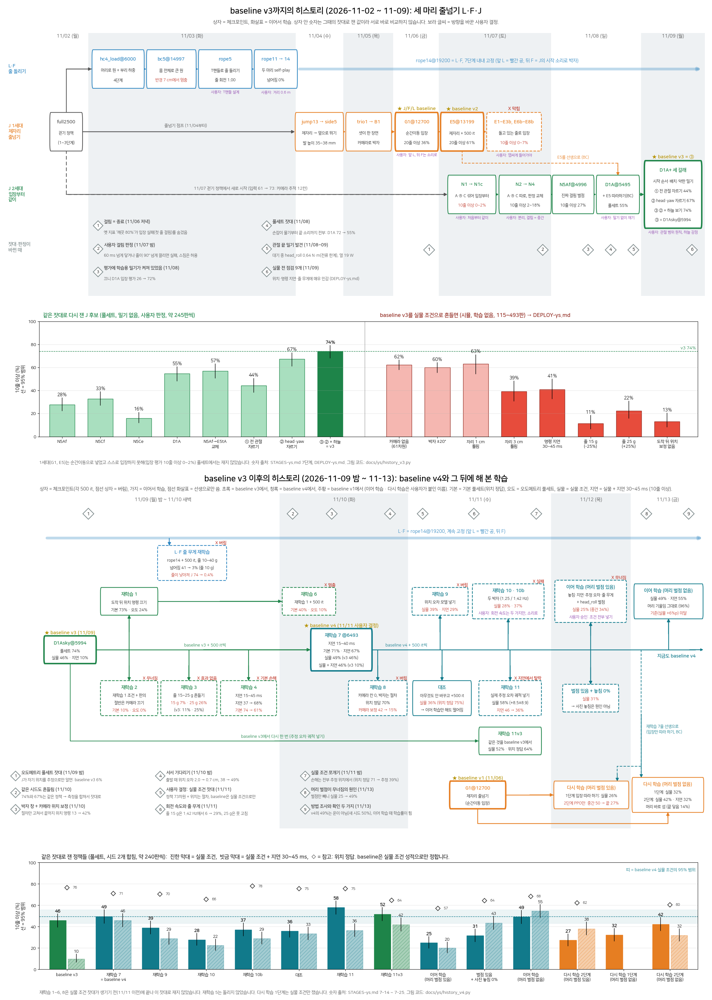
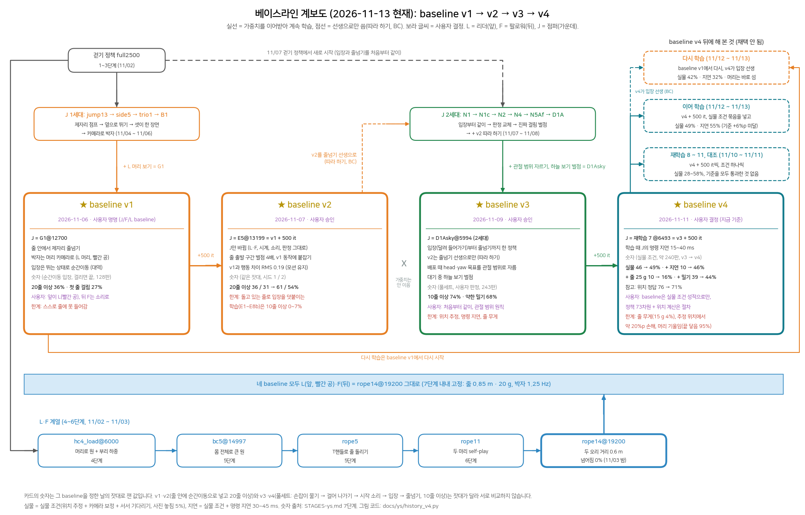

# 줄넘기 커리큘럼 진행 기록 (ys)

목표: microduck 두 마리가 줄 양끝을 잡고 돌리기. 단계별로 학습하며 익힌다.
각 실험: 바꾼 것 → 예측 → 결과 → 해석. 결과를 만든 코드는 커밋 해시로 남긴다.
체크포인트/영상은 `logs/` (gitignore) — 커밋하지 않는다.

| 단계 | 내용 | 상태 |
|---|---|---|
| 0 | 공식 정책 구경 (`infer_policy.py`) | 완료 |
| 1 | 스모크 학습, TensorBoard 읽기 | 완료 |
| 2 | 본 학습 2500 iter, 공식 정책과 비교 | 완료 |
| 3 | 보상/seed/backlash/DR 실험 | 완료 |
| 4 | 머리로 원 그리기 (4a 기존 정책, 4b 새 태스크) | 완료 (2026-11-03) |
| 5 | 줄 달기 (T핸들, 몸 전체로 큰 원, 한 마리) | 완료 (rope5) |
| 6 | 두 마리 | 완료 (rope14) |
| 7 | 세 마리 줄넘기: 점퍼 J + 리더 L + 팔로워 F | **baseline v4** 확정 (2026-11-11; J/F/L baseline 11-06, v2 11-07, v3 11-09) |
| 8 | 실물 고려 | 시뮬 점검 9개 완료, 항목별 개선은 `DEPLOY-ys.md` |

## 히스토리 그래프 (2026-11-13까지: baseline v4와 그 뒤에 해 본 학습)

- 위쪽 절반(baseline v3까지, `history_v3.png` 그대로): 체크포인트 계보(L·F / J 1세대 / J 2세대)와 평가 잣대·판정이 바뀐 시점 6개. 상자 안 숫자는 그때의 잣대로 잰 값이다. 그 아래 막대는 같은 잣대(풀세트, 밀기 없음, 사용자 판정)로 다시 잰 J 후보와 v3를 실물 조건으로 흔든 결과.
- 아래쪽 절반(2026-11-09 밤 ~ 11-13, 7-14 ~ 7-25): baseline v3 뒤의 재학습 1~11, baseline v4(재학습 7), 그 뒤의 이어 학습·다시 학습, 잣대가 바뀐 시점 9개. 맨 아래 막대는 모든 정책을 같은 표준 잣대(실물 조건 / 실물 조건 + 지연 / 위치 정답, 시드 1·2 합침)로 잰 값이고, 띠는 baseline v4 실물 조건의 95% 범위다.

## 베이스라인 계보도 (baseline v1 → v2 → v3 → v4)

- 카드마다: J 체크포인트, 무엇에서 이어졌는지, 무엇이 달라졌는지, 그때의 성적, 한계, 누가 정했는지. L·F는 네 baseline 모두 rope14@19200 그대로다.
- 가중치를 이은 것은 v1 → v2(+500 it), v3 → v4(+500 it)이고, v2 → v3는 선생으로만 썼다(따라 하기, BC). baseline v4 뒤에 해 본 것은 채택된 것이 없다.
- 두 그림의 코드는 `docs/ys/history_v4.py`(새 baseline이 나오면 갱신; 위쪽 절반은 `docs/ys/history_v3.py`). 작업·보고 방식은 `WORKFLOW-ys.md`, 실물 투입 전 고려사항은 `DEPLOY-ys.md`.

## 도구 (`scripts/ys_*.py`)
- `ys_eval.py` — 명령 고정 시나리오 평가 (.pt/.onnx). `|wz|r` = 로봇별 평균 회전의 절댓값 평균. `--drop`(DR 끄기), `--only`.
- `ys_traj.py` — 고정 명령 15초 궤적을 로봇별 시작 좌표계로 그림.
- `ys_multiview.py` — 2×2 멀티뷰 영상. `--cmd`, `--views`, onnx 지원.
- `ys_rope_probe.py` — 줄 물리만(로봇 없음): mocap 핸들이 원을 그릴 때 줄이 도는지. `--kick`(돌려놓고 줄이기).

## 1~3단계 요약 (2026-11-02, Velocity-Flat, 2048 env)

### 교훈
1. **커리큘럼 통과 확인.** 500 iter = 11,976 step < 12,000 → 모든 커리큘럼이 0단계에 갇혔다.
2. **행동은 직접 잰다.** 학습 지표는 비슷해도 체크포인트마다 회전 행동이 다르다.
3. **평균의 함정.** 로봇 전체 평균 회전은 좌/우로 휘는 로봇이 상쇄돼 0이 된다 → 로봇별 `|wz|r`.
4. **seed 하나로 결론 금지.** R0(seed42)는 모두 같은 방향, R1(seed43)는 양방향으로 휜다.

### 직진 0.3 m/s, `|wz|r` (rad/s, 작을수록 직진)
| alpha_walking | v8 | R0 500 | R1 500 | 2500@1000 | 2500@2250 | 2500@2499 |
|---|---|---|---|---|---|---|
| 0.043 | 0.076 | 0.481 | 0.192 | 0.108 | 0.040 | 0.059 |

로봇별로 휘는 원인: IMU 장착 오차 DR(6°). 끄면 0.059 → 0.023. CoM 등 나머지는 영향 없음.
휘어도 고치지 않는 이유: 회전 보상 std²=0.5 → 0.06 rad/s 오차의 보상 손실 0.7%.

### 제자리 회전 (명령 → 실제 rad/s)
| 명령 | alpha_walking | v8 | 2500@2499 |
|---|---|---|---|
| ±0.3 | 0 / 0 | +0.06 / −0.16 | 0 / 0 |
| ±0.6 | +0.03 / −0.01 | +0.52 / −0.52 | +0.06 / −0.11 |
| ±1.0 | +0.35 / −0.13 | +1.00 / −0.83 | +0.85 / −0.93 |

- 2500은 작은 회전 dead zone: 제자리 회전 명령 하한이 0.4×max라 작은 명령을 학습 중 못 본다 (v8은 0.1 + `track_yaw_fine`로 수정).
- 우리 레시피 = alpha_walking 레시피 (보상 weight/std 동일, wandb config 비교). 차이: Rough+Backlash, 4096 env, 3750 iter, 코드 시점. 그런데 우리가 ±1.0을 더 잘 도는 이유는 **미확인**.
- v8은 레시피가 아니라 파이프라인이 다르다: warm start 연쇄 + 선생님 BC + 체크포인트 평가 선택.
- Flat-Backlash 환경 평가: 2500도 유지됨(+0.89/−1.09). 예측(악화)은 틀림.

## 4a. 기존 정책으로 머리 원 그리기 (학습 없음, 2026-11-02 밤)

방법: 서 있는 상태(twist 0)에서 `head_yaw = A·sin(2πft)`, `head_pitch = A·cos(2πft)` 명령.
`scripts/ys_head_circle.py` — 환경마다 (A, f) 조합 하나, 1차 고조파(푸리에 계수)로 gain·지연 측정.

예측: 0.25 Hz는 깨끗, 1 Hz에선 작아지고 지연, 큰 진폭에선 몸이 흔들림.

### 결과 (full2500@2499, 8대 평균, 넘어짐 전부 0%)
| A (rad) | f (Hz) | gain (yaw) | 지연 (°) | 부리 끝 좌우/상하 진폭 (mm) |
|---|---|---|---|---|
| 0.7 | 0.25 | 0.99 | 18 | 39 / 28 |
| 0.7 | 1.0 | 0.86 | 58 | 34 / 27 |
| 0.7 | 2.0 | 0.56 | 106 | 23 / 20 |
| 0.7 | 3.0 | 0.34 | 141 | 15 / 13 |
v8도 거의 같음 (1 Hz gain 0.92, 지연 64°).

1. **학습 없이도 된다.** 두 정책 모두 3 Hz, A=1.0 rad까지 넘어지지 않고 원(타원)을 그린다. 몸 흔들림 ≤ 3 mm.
2. **low-pass filter(저역통과 필터) 모양.** gain이 진폭과 무관하게 주파수에만 의존 → 토크 포화가 아니라 선형 지연 시스템. 지연 ≈ 0.17~0.2 s 일정.
3. **병목은 서보.** 정책을 거치지 않고 머리 관절 목표를 직접 넣으면(`--direct`) 1 Hz 0.90/45°, 2 Hz 0.68/84°, 3 Hz 0.43/113°. 정책은 지연을 약 15° 더할 뿐이다.
4. **feedforward(피드포워드) 보상으로 해결.** 측정한 gain/지연의 역수로 명령을 키우고 앞당기면(`--boost --lead`) A=0.4에서 1 / 1.5 / 2 Hz 모두 gain ≈ 1.0, 지연 ≈ ±7°. 제어공학의 고전 기법: 시스템의 주파수 응답을 알면 미리 거꾸로 걸어 상쇄한다. 한계: 필요한 명령 진폭이 1/gain으로 커져, 3 Hz·큰 진폭은 학습 범위(±1.1 rad)와 토크 한계에 걸린다.
5. **joint space ≠ task space.** 관절은 sin/cos인데 부리 끝은 좌우가 상하보다 30~40% 큰 타원 (round 0.7~0.9), 저주파에선 한쪽이 평평하게 눌린 모양(원인 미확인). 순기구학이 비선형이기 때문.

### 4b로 넘기는 것
- 진짜 남은 문제: (a) 부리 끝 기준의 **둥근 원**(task space), (b) 지연 0을 **명령 쪽 보정 없이** 정책 스스로 (위상을 알면 미래를 안다), (c) 5단계 줄 장력을 견딜 바탕 태스크.
- 결과물: `logs/rsl_rl/stage4/4a_*.mp4`, `4a_tip_paths.png`

## 4b. 새 태스크 `Mjlab-YsHeadCircle-Flat-MicroDuck` (학습)

파일: `src/mjlab_microduck/tasks/ys_head_circle_env_cfg.py` (+ `tasks/__init__.py` 등록 한 블록).
- 걷기 레시피 위에 만든다 → 관측 61D/행동 14D 그대로, `full2500`에서 `--init-checkpoint`로 이어 학습(plain resume: 커리큘럼은 최종 단계 유지).
- 모든 환경이 서 있음(twist 0). `head_pose` 명령이 원을 따라 움직인다: yaw=A·sin φ, pitch=A·cos φ, **φ는 1.5 Hz 고정 방향**, A∈[0.2, 0.7], 10%는 머리 정지.
- 위상이 한 방향·한 속도로만 돌기 때문에 "지금 명령"만 보면 "다음 명령"을 알 수 있다 → 정책이 앞당겨 움직이는 것(feedforward)을 스스로 배울 수 있다.
- `head_pose_tracking`에 `fine_std=0.1` 추가: 4a의 80° 지연(A=0.4에서 약 0.5 rad 오차)이 공짜가 아니게 한다.

### 4b-1 예측 (1.5 Hz, A=0.4, ys_head_circle 기준)
| | 4a (학습 전) | 예측 |
|---|---|---|
| gain | 0.70 | > 0.9 |
| 지연 | 85° | < 20° |
| 몸 흔들림 | 0.5 mm | 늘어날 수 있음 (머리가 질량의 38%) |
| 넘어짐 | 0% | 0% |

### 4b-1 결과 (run `hc1_fine01`, 2500→3998, 2048 env, 약 25분)
| ckpt | f=1.5, A=0.4: yaw gain / 지연 | pitch gain / 지연 | round |
|---|---|---|---|
| 2500 (=full2500) | 0.63 / 86° | 0.73 / 79° | 0.92 |
| 3000 | 0.98 / 11° | 0.50 / 14° | 0.48 |
| 3998 | 0.99 / 11° | 0.63 / 13° | 0.59 |
- **지연은 예측대로 사라졌다** (85° → 11°). 정책이 위상을 보고 앞당겨 움직이는 법을 배웠다. 학습하지 않은 주파수에선 어긋난다: 1 Hz는 −7°(앞섬), 2 Hz는 +30°.
- **예측 밖: pitch 진폭이 절반으로 줄어 원이 납작해졌다** (round 0.9 → 0.5~0.6). 넘어짐 0%.
- 진단 (보상 항목별, A=0.7 고정): upright·회전 속도·action_rate는 4a 정책과 거의 같음 → 균형 때문에 pitch를 포기한 게 아니다. tracking 보상은 3300 iter부터 평평.
- 가설: 좁은 Gaussian(fine_std 0.1)은 pitch 오차 0.2~0.34 rad에서 이미 ≈0 → 기울기 없음. yaw는 오차가 작아 기울기가 살아 있어 해결됐다. 4a의 feedforward 실험에서 pitch gain 1.06이 나왔으니 물리적으로는 가능.

### 4b-2: fine_std 0.1 → 0.3 (하나만 바꿈), hc1@3998에서 1000 iter 이어 학습
예측: pitch gain 0.63 → 0.85 이상, round 0.6 → 0.75 이상, yaw 지연은 유지.

### 4b-2 결과 (run `hc2_fine03`, 4000→4997)
| ckpt | f=1.5, A=0.4: yaw gain / 지연 | pitch gain / 지연 | round |
|---|---|---|---|
| hc1@3998 | 0.99 / 11° | 0.63 / 13° | 0.59 |
| 4500 | 1.00 / 13° | 0.88 / 16° | 0.67 |
| **4997** | 0.96 / 14° | 0.85 / 14° | 0.70 |
- **가설 맞음**: std를 넓혀 기울기를 살리자 pitch가 0.63 → 0.85~0.88. 지연 유지, 넘어짐 0%.
- round 예측(0.75 이상)은 실패. 4a 저주파에서도 0.71~0.75였다 → **관절 공간의 원은 부리 끝에서 타원**이 되는 게 상한. 관절을 잘 따라가는 것만으로는 둥근 원이 안 된다.

### 4b-3: 부리 끝 위치 보상 (task space) — `Mjlab-YsHeadCircleTip-Flat-MicroDuck`
- 측정(full2500 정지, 몸통 좌표): HOME 부리 끝 (83.8, −0.1, 88.8) mm. yaw=A·sin → y ≈ +54 mm/rad, pitch=A·cos → z ≈ −44 mm/rad.
- 목표: 몸통 y-z 평면의 원, 중심 HOME, 반지름 R = 50 mm/rad × A (10~35 mm), y=+R·sin φ, z=−R·cos φ. x는 자유.
- 보상 `mouth_circle` = 0.5·exp(−e²/2cm²) + 0.5·exp(−e²/0.5cm²), weight 2. `head_pose_tracking`·`head_pose_bias`는 0 → 머리 관절 4개(neck_pitch 포함)를 자유롭게 쓴다. 명령은 위상/진폭을 알려주는 신호일 뿐.
- 새 지표 `tipE`: 부리 끝과 목표점의 y-z 거리 평균. hc2@4997 기준선: A=0.4 → 12.9 mm, A=0.7 → 14.1 mm.
- 예측: tipE 13 → 6 mm 이하, round 0.7 → 0.9 이상. 위험: 머리 관절 제약이 풀려 neck_pitch가 이상한 자세로 갈 수 있음 → 영상으로 확인.

### 4b-3 결과 (run `hc3_tip`, 5000→6496) — 채택: **`hc3_tip/model_5250.pt`**
| 정책 (f=1.5 Hz) | A=0.4: round / tipE | A=0.7: round / tipE | 반지름 y/z (목표 20 / 35 mm) |
|---|---|---|---|
| 4a full2500 | 0.90 / 24.2 mm | 0.81 / 41.0 mm | 16·15 / 30·25 (지연 80°) |
| 4b-2 hc2@4997 | 0.71 / 12.9 | 0.65 / 13.2 | 23·16 / 37·24 (중심이 위로 13 mm) |
| **4b-3 hc3@5250** | **0.98 / 3.1** | **0.96 / 4.4** | **21·21 / 35·34** |
- **예측 달성** (tipE ≤ 6 mm, round ≥ 0.9). 체크포인트 5250~6496 모두 비슷, tipE가 가장 작은 5250 채택.
- 정책이 관절 움직임을 스스로 바꿨다: yaw gain 0.89, pitch 1.14 → 관절 공간 원을 포기하고 부리 끝 원을 만든다. **보상을 무엇에 거느냐가 곧 "무엇을 잘하게 되느냐"** — 역기구학을 따로 풀지 않고 보상으로 맡겼다.
- 넘어짐 0%, 몸 흔들림 ≤ 0.2 mm, 정지 명령에서 완전 정지. 자세 이상 없음(영상).
- 기어 유격 환경(Flat-Backlash)에서도 유지: round 0.97~0.98, tipE 2.9 / 5.4 mm.
- 한계: **1.5 Hz 고정** (위상 속도가 하나뿐이라 다른 주파수는 미학습), **서 있기 전용**, 부리 끝에 하중(줄 장력)이 없다.
- 결과물: `logs/rsl_rl/stage4/4_compare_A0.7_1.5Hz.mp4`(4a / 4b-2 / 4b-3 정면·측면), `4b_tip_compare.png`

### 4b-4: 부리 끝 하중 (줄 장력 대용) — `Mjlab-YsHeadCircleTipLoad-Flat-MicroDuck`
먼저 4b-3(hc3@5250)에 힘을 걸어 봤다 (`ys_head_circle.py --tip-force FX FR FZ`, A=0.4, 1.5 Hz):
| 힘 (N) | 몸 흔들림 | 넘어짐 | tipE |
|---|---|---|---|
| 없음 | 0.2 mm | 0% | 3.1 mm |
| 바깥(반지름) 0.3 | 0.2 | 0 | 4.0 |
| 아래 0.3 | 0.2 | 0 | 2.8 |
| 앞(상대 쪽) 0.15 | 0.4 | 0 | 2.8 |
| **앞 0.3** | **63 mm** (끌려가며 발을 뗌) | 0 | 3.3 |
| 앞1.0 + 바깥1.0 + 아래0.3 | — | **100%** | — |
- **줄 장력이 상대 쪽으로 당기는 성분이 치명적.** 0.3 N은 약 30 g의 무게. 두 마리가 줄을 잡으면 서로를 당기니 6단계의 핵심 위험이다.
- 발견: mjlab `RewardManager`는 weight 0 항목을 계산하지 않는다 → GroundPick의 `apply_mouth_payload_force`(weight 0 보상 훅)는 실제로 실행되지 않는다(업스트림 잠재 버그, 손대지 않음). 우리는 명령 항목의 매 스텝 업데이트에서 힘을 건다.
- 학습 설정: 명령을 다시 뽑을 때마다 앞 0~1 N, 바깥 0~0.3 N, 아래 0~0.3 N 무작위, 20%는 무하중. hc3@5250에서 이어 학습.
- 예측: 앞 0.3 N에서 흔들림 63 → 5 mm 이하, 1 N 조합 넘어짐 100% → 10% 이하, 무하중 tipE는 3~5 mm 유지. 위험: 몸을 뒤로 기울인 자세가 생겨 무하중일 때 어색해질 수 있음.

### 4b-4 결과 (run `hc4_load`, 5250→6749) — 채택: **`hc4_load/model_6000.pt`**
A=0.4 / 0.7, 1.5 Hz, 16대 평균. 칸 = 넘어짐 % · 몸 흔들림 mm · tipE mm
| 하중 (N) | 4b-3 hc3@5250 | **4b-4 hc4@6000** |
|---|---|---|
| 없음 | 0 · 0.2 · 3.0 / 0 · 0.2 · 5.1 | 0 · 0.7 · 3.0 / 0 · 0.7 · 5.2 |
| 앞 0.3 | 0 · 54 · 3.2 / 0 · 70 · 5.5 | 0 · 1.4 · 2.9 / 0 · 1.2 · 4.9 |
| 앞 0.6 | **38 · 538** · 11 / **62 · 517** · 14 | **0 · 2.6 · 2.9 / 0 · 2.5 · 4.6** |
| 앞1.0+바깥0.3+아래0.3 | **100 / 100** | **0** · 15 · 3.5 / **0** · 43 · 5.2 |
- **예측 달성**: 앞 0.3 N 흔들림 54~70 → 1.4 mm, 1 N 조합 넘어짐 100 → 0%. 무하중 성능 유지(tipE 3.0, 흔들림 0.2 → 0.7 mm로 약간 증가).
- 학습 범위 끝(1 N)에선 넘어지진 않지만 15~43 mm 끌려간다. 체크포인트별로 이 값이 15~57 mm로 갈려 6000 채택(나머지 지표는 동일).
- 교훈: 정책은 **본 적 없는 외력에 무력하다**(0.6 N에 절반이 넘어짐). 실물의 줄 장력을 모르니 넓게 무작위화 = domain randomization을 "외력"에 적용한 것. 대가: 무하중 흔들림이 조금 늘었다.
- 결과물: `logs/rsl_rl/stage4/4b4_load_compare.mp4`

## 4단계 정리
- 최종 정책: `logs/rsl_rl/ys_head_circle/2026-11-03_00-07-27_hc4_load/model_6000.pt`, ONNX `logs/rsl_rl/stage4/ys_head_circle_hc4_6000.onnx`(평가로 .pt와 동일 확인). 태스크 `Mjlab-YsHeadCircleTipLoad-Flat-MicroDuck`.
- 계보: full2500 (걷기) → hc1 위상 원 + fine_std 0.1 → hc2 fine_std 0.3 → hc3 부리 끝 보상 → hc4 부리 끝 하중. 모두 plain resume.
- 사용법: 서 있는 상태에서 head_pose 명령 = [0, A·cos φ, A·sin φ, 0], φ는 1.5 Hz로 증가, A ∈ [0.2, 0.7] → 부리 끝 반지름 50 mm/rad × A.
- 한계: 1.5 Hz 고정 · 서 있기 전용(걷기는 평가 안 함) · 런타임 manifest에 이 인코딩이 없음 · 실물 검증 없음.

## 5단계 사전 조사 (코드로 확인)
- **MuJoCo `cable` 플러그인은 못 쓴다**: mujoco_warp `io.py`가 body plugin이 있으면 `NotImplementedError("Body plugins not supported.")`. → 줄은 **캡슐 여러 개를 ball joint로 이은 사슬**로 만든다(일반 body라 지원됨).
- **장면에 엔티티 여러 개는 된다**: BallKick이 로봇 + 공 두 엔티티를 쓴다.
- **equality CONNECT는 MJWarp가 지원**(`EqType.CONNECT`). 다만 mjlab 엔티티 API에서 엔티티 사이 equality를 거는 방법은 못 찾음 → 가장 쉬운 길: 줄 사슬을 로봇 MJCF의 `jaw_soft` 자식으로 붙이고, 반대 끝은 world에 고정된 점에 connect.
- 6단계(두 마리): 관측/행동 매니저가 엔티티 이름 "robot" 하나를 전제한다 → 두 로봇을 한 정책으로 돌리려면 커스텀 환경이 필요. 미확인.
- 4b-4의 "앞으로 당기는 0.3 N이 위험"이 5단계 첫 실험의 기준이 된다: 실제 사슬 줄의 장력이 학습한 0~1 N 안에 드는지부터 잰다.

## 5단계 기획 (2026-11-03, 사용자 컨펌)
- 장면: 벽 고정점 ─ 사슬 줄 ─ T핸들(부리에 weld 고정; 걷기 모델엔 턱 관절이 없어 "물기"는 고정으로 대신 = 실물은 클립).
- 사용자 요구: 가운데 마이크로덕(키 ≈ 0.23 m)이 뛰어야 하므로 **줄 가운데가 바닥~머리 위**를 지나야 한다 → 핸들 원이 4단계(2~3.5 cm)보다 커야 하고, 몸 전체를 써야 한다.
- 순서: 5a 줄 물리만(필요 핸들 반경 r*, 주파수 f*) → 5b 몸 전체로 원(발 기준 좌표계 목표) → 5c 줄 연결 → 5d DR.

## 5a. 줄 물리 — 어떤 핸들 원이 줄을 돌리나 (학습 없음)
설정: 벽 고정점 (0,0,0.2), 핸들 중심 (0.7,0,0.2), 줄 0.8 m / 20 g / 12마디. dt 5 ms implicitfast(학습과 같음). 처음 12초 중 마지막 4초를 잰다.
`rev` = 줄 가운데가 핸들 한 바퀴당 몇 바퀴 도나(1 = 같이 돔).

**예측**: 부리 원 3.5 cm로도 공진 처짐(약 11 cm)만 맞추면 줄이 돈다.

### 시뮬레이션 안정화 (먼저 부딪힌 문제)
- 24마디·감쇠 2e-5: 줄이 크게 돌기 시작하면 터짐(QACC NaN, 힘 10⁵ N). 마디 하나 0.8 g — 5 ms 간격에 비해 너무 가볍다.
- 81조합 격자: 관절 감쇠 ≥ 1e-4, armature 1e-6~1e-5면 안정. armature 1e-5는 줄을 눈에 띄게 뻣뻣하게 만들어 1e-6 채택.
- 비틀림 없는 유니버설 조인트(힌지 2개)는 오히려 나빴다 → ball joint 유지. 바닥 접촉을 끄면 더 불안정, dt 2 ms와 결과 비슷 → 지금 설정은 물리를 크게 왜곡하지 않는다.
- 남은 위험: 드물게(약 20회 중 1회) 여전히 발산. 학습에선 NaN 종료가 환경을 리셋한다.

### 결과 (`logs/rsl_rl/stage5/5a_spinup.txt`, `5a_sustain.txt`)
멈춘 줄에서 시작(rev, 힘 평균/95%):
| 핸들 반경 | 1.5 Hz | 1.75 Hz | 2.0 Hz | 2.5 Hz |
|---|---|---|---|---|
| 3.5 cm | 0 | | 0 | 0 |
| 5 cm | 0 | 0 | 0 | 0.47 |
| 6.5 cm | | 0 | 0.89 | 0.89 |
| 8 cm | 0 | 0 | 0.62 | 0.88 |
| 10 cm | | 0.88 | 0.74 | 1.15 |
| 12 cm | 0.31~0.65 | 0.55 | 0.74 | 1.00 |
- 돌 때 힘: 평균 0.3~0.6 N, 95% 1~1.4 N, 순간 최대 3~5 N(줄이 바닥을 치거나 팽팽해지는 순간).
- 12 cm로 돌려놓은 뒤 줄여도(sustain) 5 cm 이하는 유지 못함. 6.5~8 cm는 2 Hz 이상에서 유지.

### 해석
- **예측 틀림.** 3.5 cm로는 어떤 주파수에서도 줄 가운데가 바닥에 누운 채 거의 안 움직인다.
- 이유 = **스케일 물리 (Froude 수 ω²R/g)**. 줄이 호 모양을 유지하려면 원심 가속도 ω²R이 중력 g보다 충분히 커야 한다. 줄 가운데 반경 R≈0.2 m에서 1.5 Hz는 ω²R/g ≈ 1.8, 2 Hz 3.2, 2.5 Hz 5. 사람 줄넘기(R≈1 m, 2 Hz)는 16. **작은 줄일수록 빨리 돌려야 한다.**
- 그래서 r*와 f*는 맞바꾸는 관계: **2 Hz면 핸들 반경 7~10 cm, 1.5 Hz면 12 cm로도 불안정.**
- 줄 회전은 사람 줄넘기처럼 매끈하지 않다: rev가 1에 고정되지 않고 0.7~0.9 (가끔 한 바퀴 건너뜀). 가볍고 짧은 줄 + 바닥 마찰.
- 5b로 넘기는 숫자: **목표 f* = 2.0 Hz, r* = 8~10 cm.** 4a에서 머리만으로 2 Hz gain 0.68이었으니, 몸 전체를 써도 쉽지 않을 것.
- 장력은 4b-4 학습 범위(0~1 N)를 순간적으로 넘는다(95% 1.4 N, 순간 3~5 N). 방향도 바퀴마다 회전한다.
- 영상: `logs/rsl_rl/stage5/5a_compare.mp4` (5 cm 2 Hz / 10 cm 2 Hz / 12 cm 1.5 Hz).

## 5b. 몸 전체로 큰 원 — `Mjlab-YsBodyCircle-Flat-MicroDuck` (학습)
`ys_head_circle_env_cfg.py`에 `whole_body=True` 추가. 4b-4(부리 끝 보상 + 하중) 위에서 바꾼 것:
- **목표 원을 발 좌표계로**: 원점 = 두 발 중간, y축 = 오른발→왼발(수평). 몸통 좌표계에선 몸이 움직여도 목표가 같이 움직여 머리만 쓰게 된다. 발 기준이면 웅크리기·기울이기도 반경에 보탬이 된다. 중심 = 서 있을 때 부리 끝 (47, 0, 205) mm.
- **2 Hz** (5a의 f*). 반경 R은 명령 칸에 R/0.05로 실어 보낸다(관측 61D 그대로).
- **적응형 커리큘럼**: 반경 상한 r_max 3.5 cm에서 시작, 250 step마다 평균 오차 < 0.3·r_max면 +1 cm (최대 10 cm). 반복 횟수가 아니라 실력에 맞춰 키운다 → AGENTS.md "phase-align" 규칙.
- **몸 움직임을 막던 보상 완화** (5 cm·2 Hz면 몸통 최고 속도 ≈ 0.6 m/s): twist 선속도 std 0.32→1.0(z 속도도 벌점이었다), upright std 0.22→0.5, 서 있을 때 자세 std를 걷기용으로.
- **feet_planted (−1.0)** 추가: 발이 뜨면 1, 미끄러지면 10·v². 기존 feet_slip은 걸을 때만 켜져서 서 있을 땐 꺼져 있었다.
- 평가 도구 `scripts/ys_body_circle.py`: 반경별 Ay/Az(발 좌표계), tipE, 몸통 진폭 trY/trZ, 발 뜸 %, 넘어짐 %.

### 학습 전 기준 (hc4@6000을 그대로, 8대 평균)
| R (mm) | 1.5 Hz: Ay / Az / tipE / 넘어짐 | 2 Hz: Ay / Az / tipE / 넘어짐 |
|---|---|---|
| 35 | 35 / 34 / 5 / 0% | 33 / 32 / 13 / 0% |
| 60 | 53 / 45 / 16 / 0% | 50 / 44 / 29 / 0% |
| 80 | 57 / 47 / 34 / 38% | 52 / 46 / 48 / 63% |
| 100 | 넘어짐 100% | 넘어짐 100% |
- 머리만으로 약 5 cm에서 포화, 몸통 진폭 0.1 mm(몸을 전혀 안 씀). 8 cm부터 넘어진다.

### 5b-1 예측 (run `bc1_body`, hc4@6000에서 2000 iter, 2048 env)
- r_max는 7~8 cm까지 오르고 멈춘다. 위아래(Az)가 더 부족할 것: 서 있는 자세에서 위로 뻗을 다리 여유가 적다.
- 몸통 진폭 2~3 cm, 넘어짐 0%.
- 위험(보상 해킹): 발을 들거나 미끄러뜨려 몸을 옮기기, 크게 기울이기.

### 5b-1 결과 (run `bc1_body`, 6000→7999) — 실패
| ckpt | R=35: Ay / Az / tipE | R=60 | R=100 | 몸통 진폭 |
|---|---|---|---|---|
| hc4@6000 (기준, 2 Hz) | 33 / 32 / 13 | 50 / 44 / 29 | 넘어짐 100% | 0.1 mm |
| bc1@6500 | 22 / 15 / 20 | 29 / 19 / 43 | 36 / 23 / 83 | 0.5 mm |
| bc1@7999 | 30 / 3 / 28 | 33 / 3 / 53 | 14 / 1 / 103 | 0.1 mm |
- **정책이 움직이길 포기했다**: 위아래 진폭 3 mm, 몸통은 전혀 안 씀. 넘어짐은 0%가 됐지만 그건 안 움직여서.
- 원인 = **내 커리큘럼 버그**: "평균 오차 < 0.3·r_max면 키운다"는 r_max가 클수록 기준도 느슨해진다(10 cm면 30 mm 오차 허용). 실제로 r_max가 약 70 iter 만에 3.5 → 10 cm. 목표가 오차 50~100 mm로 멀어지자 Gaussian(std 30 mm) 꼬리라 기울기가 없고, 움직이면 넘어질 위험만 있으니 "가만히"가 최선이 됐다. AGENTS.md의 "실력보다 앞서 단계를 올리지 말 것" 그대로.
- 수정(5b-2): 기준을 **상대 오차** err/R로 (< 0.25면 +5 mm, > 0.5면 −5 mm, 500 step마다). hc4@6000에서 다시 시작.
- 예측: r_max는 처음엔 안 오른다(hc4의 2 Hz 상대 오차 ≈ 0.37). 2 Hz 위상을 익힌 뒤 5~7 cm까지.

### 5b-2 결과 (run `bc2_relcurr`, 6000→8499) — r_max가 한 번도 안 올랐다
| ckpt (2 Hz) | R=10: Ay/Az/tipE | R=35 | R=60 | R=80: 넘어짐 |
|---|---|---|---|---|
| hc4@6000 | 10 / 9 / 3.7 | 33 / 32 / 13 | 50 / 44 / 28 | 88% |
| bc2@7000 | 10 / 9 / 3.3 | 33 / 30 / 8.7 | 50 / 44 / 21 | 38% |
| bc2@8499 | 10 / 9 / 2.7 | 33 / 24 / 11 | 51 / 31 / 28 | 0% |
- 상대 오차가 학습 내내 0.29~0.35 (기준 0.25 미달) → r_max 3.5 cm 고정.
- **발견: 상대 오차가 반경과 무관하게 ≈ 0.3** (10 mm에 3 mm, 35 mm에 9~13 mm). 크기는 맞는데(Ay ≈ R) **위상이 약 17° 늦다**는 신호다(위상 오차 θ → 상대 오차 ≈ θ rad).
- 줄에는 일정한 위상 지연이 상관없다(원이 통째로 회전할 뿐). 나는 필요 없는 것(정확한 타이밍)에 값을 매겼고 그게 커리큘럼을 막았다. AGENTS.md "Price only the escapable part"의 변형: **목표에 필요 없는 것엔 값을 매기지 말 것.**

### 5b-3: 위상 무관 점수 — 반경 × 회전 속도
- `circle_score` = [반경 오차 ρ−R의 Gaussian (넓은 30 mm + 좁은 10 mm)] × [접선 속도 v_t가 ωR에 가까운지 (상대 std 0.3)]. 위상은 안 본다. 회전 방향은 본다.
- 커리큘럼도 이 점수로: 평균 > 0.6이면 +5 mm, < 0.35면 −5 mm.
- 학습 전 점수: hc4 R=10 0.89, R=35 0.86, R=60 0.29 → r_max는 5 cm 근처까지 바로 오르고, 그 뒤로는 몸을 써야 오른다.
- 예측: r_max 6~7 cm, 몸통 진폭 1~2 cm, 넘어짐 0%.

### 5b-3 결과 (run `bc3_score`, 6000→8999) — 반경 6.5 cm까지, 몸은 여전히 안 씀
| ckpt (2 Hz, 16대) | R=35: Ay/Az/점수 | R=50 | R=65 | R=100 | 몸통 진폭 | 넘어짐 |
|---|---|---|---|---|---|---|
| hc4@6000 | 33 / 32 / 0.86 | — | (R=60) 50 / 44 / 0.29 | 100% | 0.1 mm | R≥80에서 넘어짐 |
| bc3@8999 | 36 / 35 / 0.94 | 48 / 44 / 0.77 | 57 / 45 / 0.28 | 65 / 44 / 0.01 | 1~2 mm | **전부 0%** |
- 예측 맞은 것: r_max 5.5 cm까지 바로, 6.5 cm에서 멈춤. 넘어짐 0%.
- 예측 틀린 것: 몸통 진폭 1~2 mm(예측 1~2 cm). **위아래가 약 45 mm에서 막힌다** — 머리 관절의 한계.
- 확인: HOME에서 무릎이 거의 펴져 있다(knee 0.28°) → 다리로는 **위로 올라갈 여유가 없고** 아래로만 웅크릴 수 있다. 위아래 원을 키우려면 중심 자체를 낮춘(웅크린) 자세가 필요하다. 다리 좌우 부호는 서로 반대(HOME left hip_pitch −0.458, right +0.458).
- 영상: `logs/rsl_rl/stage5/5b3_bc3_8999_R65_2Hz.mp4` (R=65 mm, 2 Hz).

## 5a 재검증 — 줄 운동은 혼돈적이라 한 번 돌린 결과는 믿을 수 없다
같은 조건에서 시작 위상만 바꿔 8번씩(`ys_rope_probe.py --trials 8`, 측정 창 8초). `ok%` = rev > 0.8인 비율, `blow` = 발산해서 뺀 횟수.
| 핸들 반경 | 1.5 Hz: rev / ok% | 2.0 Hz | 2.5 Hz (blow) |
|---|---|---|---|
| 5 cm | 0 / 0 | 0 / 0 | 0.47 / 20 (3) |
| 6.5 cm | 0 / 0 | 0.45 / 0 | 0.75 / 50 (4) |
| 8 cm | 0 / 0 | 0.59 / 12 | 0.70 / 25 (4) |
| 10 cm | 0.30 / 0 | 0.74 / 14 | 0.83 / 67 (5) |
| 12 cm | 0.51 / 0 | 0.81 / 50 | 0.91 / 80 (3) |
- **5a의 "2 Hz면 6.5~10 cm"는 운 좋은 한 번이었다.** 2 Hz에서 절반 이상 확실히 돌리려면 12 cm.
- 2.5 Hz에선 사슬 줄이 8번 중 3~5번 발산 → **빠른 회전에서 캡슐 사슬은 믿을 수 없다.** Newton(VBD cable)으로 검증할 이유가 생겼다.
- 지금 정책(6.5 cm × 4.5 cm 타원, 2 Hz)으로는 줄이 거의 확실히 안 돈다(타원 0.7배 측정에서도 0~63%로 들쭉날쭉).

## 5a-3. 반대쪽 끝도 같이 돌리기 (사용자 지시: 벽 고정 대신 상대가 같은 원을 같은 위상으로)
- 사용자 지시 2가지: (1) 너무 빠르다, 더 느리게 — 멈춘 줄은 빨리 돌려야 해도 돌고 있으면 천천히 해도 될 것. (2) 벽 고정점 대신 반대쪽 끝도 오리 핸들과 같이 움직이게.
- **내 버그 하나**: 처음엔 줄을 반대쪽 mocap 손잡이의 자식으로 붙였다. mocap을 움직이면 자식들이 순간이동하므로 줄 전체가 관성 없이 통째로 끌려다녔다(주파수를 바꿔도 결과가 소수점까지 같았던 것이 증거). 줄 첫 마디를 free joint로 바꾸고 양끝 모두 CONNECT로 잇게 고침. 그 전의 "양끝" 결과는 버림.
- 확인: 낮은 감쇠(2e-6) + dt 1 ms로도 한쪽 고정 결과는 같았다 → 관절 감쇠 1e-4는 결론을 바꾸지 않는다.

### 결과 (`5a3_both_ends_fixed.txt`, 시작 위상 6가지, L 0.8 m)
| 핸들 반경 | 1.0 Hz | 1.25 Hz | 1.5 Hz | 2.0 Hz |
|---|---|---|---|---|
| 3.5 cm | 0 | 0.06 (최고 0.30 m) | 0 | 0 |
| 5 cm | 0 | 0.29 | 0 | 0.31 (발산 1) |
| 6.5 cm | 0 | 0.30 | 0.19 | 전부 발산 |
| 8 cm | 0 | 0.50 (최고 0.39 m) | 0.71 (0.42 m) | 전부 발산 |
| 10 cm | 0 (최고 0.32 m) | 0.62, ok 20% | 0.50 | 전부 발산 |
(숫자 = rev, 핸들 한 바퀴당 줄 가운데가 도는 바퀴 수)
- **양끝을 같이 돌리면 더 느리게도 된다**: 한쪽 고정은 2 Hz·12 cm가 필요했는데, 양끝은 1.25~1.5 Hz·8~10 cm에서 줄 가운데가 0.4 m 이상(머리 위)까지 넘어간다. 다만 매 바퀴 확실히(ok ≥ 80%)는 아니다.
- **돌린 뒤 느리게** (2 Hz·8 cm로 5초 → 낮춤): 1.5 Hz 유지 rev 0.57, 1.25 Hz 0.44, 1.0 Hz 0. → 1.25 Hz 아래로는 줄이 원 모양을 못 지킨다(ω²R/g: R≈0.2 m에서 1 Hz는 0.8 < 1).
- 사슬 줄은 양끝 + 2 Hz에서 전부 발산 → 빠른 회전 검증엔 Newton이 필요하다(보류 중).
- 영상: `5a3_both_r0.10_f1.25.mp4`.

## 5b-4: 느린 주파수 범위 + 정책이 정하는 중심 — run `bc4_slow` (bc3@8999에서 3000 iter)
- 주파수 1.0~1.5 Hz를 명령마다 뽑고 **neck_pitch 칸에 f − 1.25로 실어 보낸다** (런타임에서 빨리 시작 → 느리게 유지를 명령으로 고를 수 있게).
- 원의 중심 = 부리 끝 위치의 1초 이동평균(발 좌표계). 고정 중심(서 있을 때 부리 높이)이면 무릎이 펴진 HOME에서 위로 갈 여유가 없었다 → 정책이 웅크린 자세를 고를 수 있게.
- r_max 최대 12 cm.
- 학습 전 (bc3@8999, 1.25 Hz): R=35 점수 0.60, R=65 0.29, R=100 넘어짐 50%.
- 예측: 느려진 만큼(가속도 ∝ f²: 1.25 Hz는 2 Hz의 39%) 몸통을 쓰기 쉬워진다 → r_max 8~10 cm, 몸통 진폭 1 cm 이상.

### 5b-4 결과 (run `bc4_slow`, 9000→11998) — r_max가 3.5 cm에서 한 번도 안 올랐다
- 학습 중 점수 0.53~0.58 < 기준 0.6. 그런데 하중 없이 평가하면 R=35에서 0.87.
- 원인: 기준 0.6을 **하중 없는 bc3(2 Hz)**에서 정했는데, 학습엔 부리 끝 하중(최대 1 N)이 있다. 느린 주파수에선 하중이 원을 상대적으로 더 흐트린다. → 기준 0.5 / 0.3으로 낮춤 (5b-5).

### 5b-5 결과 (run `bc5_gate05`, bc4@11998에서 3000 iter → 14997)
r_max 3.5 → 6.5 cm (100 iter) → 7.0 cm (550 iter)에서 멈춤. 학습 점수는 0.49 → 0.34~0.38로 서서히 하락(원인 미확인).
| 주파수 | R=50: Ay/Az/점수 | R=65 | R=80 | R=100 | 몸통 진폭 | 넘어짐 |
|---|---|---|---|---|---|---|
| 1.0 Hz | 49 / 44 / 0.70 | 58 / 53 / 0.42 | **63 / 55** / 0.21 | 43 / 6 (포기) | 1~2.5 mm | 0% |
| 1.25 Hz | 47 / 44 / 0.63 | 57 / 52 / 0.38 | 62 / 47 / 0.12 | 36 / 4 | 2~3 mm | 0% |
| 1.5 Hz | 46 / 42 / 0.55 | 54 / 46 / 0.27 | 34 / 8 (포기) | 33 / 5 | 2~3 mm | 0% |
- 좋아진 것: 느려지고 중심을 정책에 맡기자 위아래가 45 → **55 mm**(1 Hz). 모든 조건 넘어짐 0%.
- 그대로인 것: **몸통은 여전히 2~3 mm.** 머리로만 그린다. 학습 범위 밖(R=100)에선 원을 거의 포기.
- 줄 요구(양끝 1.25~1.5 Hz, 8~10 cm)와 비교: 지금 약 6 × 5 cm → 아직 부족.
- 영상: `5b5_bc5_R65_1.25Hz.mp4`.

## 5단계 조사: 사람은 긴 줄을 어떻게 돌리나 (웹, 2026-11-03)
출처 수준: 체육 수업 자료·코칭 글(동료 심사 아님) + 물리 논문 1편. 확실한 것과 추측을 나눈다.
- **손의 궤적은 원**, 두 사람이 같은 크기·같은 박자. 한 손이 한 바퀴 안의 특정 지점에서 빨라지거나 느려지면 줄이 "휘청인다"(skip-hop). 흔한 실수: 팔이 앞뒤/위아래로만 움직이고 원을 안 그림.
- **줄 모양은 정원이 아니다**: 위는 둥근 무지개 아치, 아래는 바닥을 리듬 있게 스친다(PE 수업 카드). 일본 수업 자료의 비유 "가마보코"(반원통): 위는 둥글게, 발밑은 수평으로 빠르게 지나간다. → 이건 **손 궤적이 아니라 줄+바닥이 만드는 모양**이다. 손은 원, 줄 길이가 바닥을 스치게 맞춰져 있으면 아래가 평평해진다.
- **줄 길이**: 바닥을 살짝 스칠 정도. 너무 길면 바닥을 세게 치고 걸린다.
- **시작이 어렵다**: 흔한 실수로 "충분히 빨리 안 돌림", "두 번째 바퀴 전에 느려짐". 시작 전엔 줄을 바닥에서 띄워 잡는다. → 사용자 직관(멈춘 줄은 빨리)과 맞는다.
- **팔 사용**: 아래팔과 손목, 손은 몸 중심선 안쪽(더블더치 수업 자료). 사람 줄(3.7~4.9 m)에 아래팔 원(약 30 cm)은 줄 길이의 약 7%. 우리 줄 0.8 m에 핸들 8~10 cm는 10~12% → **비율로는 사람과 비슷하다.**
- **박자**: 한 줄 넘기 기준 92~100 rpm(1.5~1.7 Hz)이 무릎 부담이 적다는 보고, 120 bpm 이상에서 동작이 안정적이라는 보고(소규모 연구).
- **물리 (troposkein, Aristoff & Stone 2012)**: 중력이 없으면 도는 줄의 모양은 속도와 무관하다. 중력이 있으면 속도가 모양을 바꾼다. 모양을 정하는 무차원 수: 줄 길이/손 사이 거리, 공기력/원심력.
- **우리에게 중요한 차이 (계산)**: 원심/중력 비 ω²R/g가 사람(R≈1 m, 1.5~2 Hz)은 9~16, 우리(R≈0.2 m, 1.25 Hz)는 1.3. 우리 줄은 겨우 중력을 이기는 수준이라 회전이 불규칙하다. 사람과 같은 비를 이 크기에서 얻으려면 3.4~4.5 Hz가 필요하다 → **느리게 하고 싶은 것과 물리가 충돌한다.** 줄 모양을 사람처럼 만들려면 빨라야 하고, 느리게 하면 줄이 겨우 돈다.

### 정책에 반영 (5b-6, run `bc6_hiproll`, bc5@14997에서 3000 iter)
- 손 궤적은 **원 유지**(타원으로 바꿀 근거 없음). 한 바퀴 안에서 **속도 일정**(지금 점수의 속도 항 그대로).
- 주파수 범위 1.0~1.5 → **1.25~1.5 Hz** (1.0 Hz에선 줄이 못 돈다, 사람 박자 1.5~1.7 Hz).
- 시작은 런타임에서 주파수 명령으로: 1.5 Hz로 시작 → 돌기 시작하면 1.25 Hz. (정책은 이미 주파수를 명령 칸으로 받는다.)
- 몸 움직임: 자세 보상의 hip_roll 허용 폭 0.05 → 0.3 rad. 0.15 rad만 기울여도 그 항이 e⁻⁹였다. action_rate(−1.0)는 계산해 보니 1.25 Hz에서 다리 0.3 rad 움직임에 약 0.01 → 걸림돌 아님, 그대로.
- 예측: 몸통 좌우 진폭 1 cm 이상, r_max 8 cm 이상.

### 5b-6 결과 (run `bc6_hiproll`, 14997→17996) — 예측 틀림, bc5보다 나빠짐
r_max 3.5 → 6.0 cm에서 멈춤(bc5는 7.0).
| 1.25 Hz | R=50: Ay/Az/점수 | R=65 | R=80 | R=100 넘어짐 | 몸통 진폭 |
|---|---|---|---|---|---|
| bc5@14997 | 47 / 44 / 0.62 | 56 / 51 / 0.37 | 62 / 47 / 0.12 | 0% | 2~3 mm |
| bc6@17996 | 46 / 42 / 0.53 | 53 / **31** / 0.20 | 62 / 29 / 0.06 | **33%** | **< 1 mm** |
- hip_roll을 풀어도 몸통은 오히려 덜 움직이고 위아래가 줄었다. → **"보상이 몸을 막아서"라는 가설은 틀렸다(적어도 hip_roll은 아님).**
- 해석(추측): 머리만 쓰는 해법이 강한 국소 최적(local optimum). 머리가 몸무게의 38%라 머리 움직임이 가장 싸고, 몸을 쓰는 해법은 탐색으로 우연히 발견되기 어렵다. 반경이 머리 한계를 넘으면 정책은 몸을 찾는 대신 원을 포기한다(R=100에서 Az 4~12 mm).

## 5c. 부리에 T핸들 + 줄 연결 (사용자 설계)
- 사용자 제안: 입에 T자 핸들을 weld하고 T 몸통 끝이 원을 그리게. 몸통 길이로 원 반경을 키울 수 있다. 줄을 연결한 채 학습. 목에 토크가 몰리지 않게 몸 전체도 쓰기(사람은 팔힘이 부족하면 허리를 쓴다).
- 원리 = 지렛대: 부리 끝은 머리 관절에서 약 5.4 cm → 몸통 L을 앞으로 뻗으면 끝점은 (5.4+L) cm/rad.

### 5c-0 (학습 없음): T 끝점 원 크기 — bc5@14997, 1.25 Hz (`5c0_stem.txt`)
| 명령 R | 부리 끝 Ay/Az | L 4 cm | L 8 cm | L 12 cm |
|---|---|---|---|---|
| 35 | 35 / 34 | 58 / 51 | 82 / 67 | 105 / 84 |
| 50 | 47 / 43 | 78 / 63 | 110 / 82 | 141 / 102 |
| 65 | 57 / 52 | 94 / 71 | 132 / 90 | 170 / 110 |
- 예측((5.4+L)/5.4배)보다 약간 작지만 거의 맞다. 머리를 쉽게 움직이는 범위(R=35)에서 L 8~12 cm면 8~10 cm 원 = 줄에 필요한 크기.
- 목 토크: head_roll 서보 하나가 내내 0.64 N·m(관절 한계 쪽으로 밀고 있음). 다른 목 서보는 0.04~0.23.

### 5c-2: 학습 환경 `Mjlab-YsRope-Flat-MicroDuck` (`ys_rope_env_cfg.py`)
- 로봇(T핸들 L=10 cm, 5 g, 충돌 없음) + 줄 엔티티(free root, ys_rope 사슬) + 반대쪽 mocap 손잡이(오리 끝점의 실제 움직임을 1초 평균 중심 기준으로 따라 함). 줄 양끝은 CONNECT.
- 보상: 끝점 원 점수(가중치 1, 보조) + **rope_turn**(줄 가운데가 축을 도는 각속도 / 명령 각속도, 2.0) + **neck_torque**(목 서보 토크², −0.5). critic만 줄 상태를 본다.
- mjlab 1.3.0 우회 2개: (1) 엔티티가 여럿이면 줄의 default_joint_pos를 장면 keyframe에서 잘라 읽음(65 vs 44) → 줄 자체 qpos0 사용. (2) `write_mocap_pose_to_sim`이 [n,1,3] vs [n,3]로 깨짐 → mocap_pos 직접 쓰기.

### 줄 폭발 디버깅 (학습 없음)
| 실험 | 결과 | 해석 |
|---|---|---|
| 솔버 반복 50, 감쇠/관성/마디 수/dt 2.5·1.25 ms | 전부 25~32/32 "폭발" | 원인 아님 |
| 줄만 CPU vs MJWarp (양끝, 1.25 Hz, 8 cm) | 1/8 vs 2/8 | MJWarp 자체 문제 아님 |
| 오리 쪽 연결 끊기 | 1/32 | **오리와의 연결이 원인** |
| 반대쪽 손잡이 고정 | 여전히 32/32 | 따라 하기 되먹임은 원인 아님 |
| 타임라인 | 줄은 4 m/s로 멀쩡, 로봇이 바닥으로 끌려 들어감(몸통 −0.04 m) | 내 "폭발" 판정이 넘어짐 리셋과 섞여 있었다 |
| **연결 solref 0.01 → 0.05** | 넘어짐 16 → 0, 틈 1.2 mm | **사용자 지적이 맞다: 연결에 늘어날 여유가 없었다.** 0.01 = 2·dt는 가벼운 마디(1.7 g)와 만나면 불안정 |
| 원 6.5 cm에선 다시 3/16 폭발 → **줄 관절 감쇠 1e-4 → 5e-4** | 0/16 폭발, 넘어짐 2, **rope_turn 0.86**, 줄 가운데 최고 0.24 m | 채택 |
- 영상: `5c2_bc5_rope_R65_1.25Hz.mp4` (학습 없는 bc5 + T핸들 10 cm + 줄). 줄이 넘어가지만 오리가 줄에 끌려 몸이 돈다.
- 사용자가 제시한 대안 검토(케이블 플러그인 / Flex 1D / 사슬 / tendon): 플러그인은 MJWarp 불가(코드 확인), Flex 1D는 MJWarp 3.8.1에 구현 있음(미시험), tendon은 보조용. 사슬이 안정화돼 Flex는 보류.

### 5c-3: 한 마리 줄 돌리기 학습 (rope1~rope5, 각 ~400 iter, 2048 env)
반경 12 cm, 1.25 Hz, 16대. 회전 = rope_turn(1 = 핸들과 같은 속도로 줄이 돎).
| run | 바꾼 것 | 줄 회전 | 최고점 | 넘어짐 |
|---|---|---|---|---|
| rope2 | 반경 커리큘럼 유지 | 0.69 | 349 mm | 18.8% |
| **rope3_bob** | 반경 12 cm 고정 + trunk_bob(다리 굽혀 위아래) | 0.99 | 437 mm | 0% |
| rope4_loop | + rope_loop(고리 크기) + 목 토크 강화 | 0.98 | 388 mm | 0% |
| **rope5_stay** | rope3 + stay_put(제자리·방향 유지) | 1.00 | — | 0% (1.0~1.5 Hz), 밀림 6~12 mm |
- 반경 커리큘럼은 줄의 당김과 싸워 12 → 4.5 cm로 출렁였다(rope2) → 고정.
- 측정: 덕 키 285 mm(jaw_soft 꼭대기), 줄 표면은 매 바퀴 바닥 아래 6~12 mm까지 내려감 = 바닥을 쓴다. 처음 "1~3 mm 떠 있다"는 말은 마디 원점 기준이라 틀렸다.
- 공개 프로젝트 점프 최고 ≈ 5.5 cm(p90, chenp9527). Microduck Circus(ros-claw) 분석은 아래 6단계.

## 6. 두 마리 (같은 정책, 상대는 좌우 대칭)
- 방향: 마주 보는 덕은 반대로 돌려야 한다. **명령 플래그(−2)로 반대 방향 학습(rope6)은 실패** — 학습 중 늘 0이던 명령 칸이라 관측 정규화 분산이 ~0, −2가 거대한 입력이 됐다(AGENTS.md의 dead command slot). → **정책을 좌우 대칭(symmetry.py)으로 뒤집어 넣기**: 대칭된 정방향 원 = 세계 기준 같은 원(평행 이동 복사).
- 평가 도구: `scripts/ys_rope_duo.py`(두 마리, 학습 없음, `--partner`, `--no-connect`, `--video`), `scripts/ys_rope_check.py`(정지 줄에서 돌리기 시작/유지/밀림).

| 시도 | 바꾼 것 | 1마리 넘어짐 | 2마리 (회전 · 넘어진 적 있음) |
|---|---|---|---|
| rope5 ×2 | 학습 없이 | 0% | 0.95 · 72% (64판) |
| rope7 | 가상 손 지연 0~100 ms·크기 0.7~1.3·중심 표류 | 0% | 중단(원인 아님) |
| rope8 | 박자 맞추기(phase_lock) | 0% | 1.03 · 75% |
| (시험) | 스프링 손(0.1~0.3 kg, timeconst 0.08~0.3 s) | 0% | 학습 안 함 |
| (시험) | **줄 끊기** | **100%** (~1 s) | 두 마리도 100% |
| rope9 | 손 x를 −6~+3 cm + 2 cm 표류(느슨/팽팽) | 0% | 0.97 · 69~75% |
| rope10 | 두 마리 장면 학습, 상대 rope5 고정 | — | 0.19 · 6% (무임승차) |
| **rope11** | 두 마리, 상대 = 학습 중인 정책(self-play) | 12~25% | **1.00 · 5%** (64판, model_19000) |
- 교훈 1: **가상 상대로 만든 대리 시험은 진짜 상대와의 연쇄를 재현하지 못했다.** 1마리에서 통과한 네 가지가 2마리에서 모두 실패.
- 교훈 2: rope5는 줄 장력에 기대어 선다(줄 끊으면 머리를 뒤로 젖히며 넘어짐). 두 마리는 서로 기대다 한쪽이 흔들리면 같이 무너진다(추정).
- 교훈 3: **상대를 고정하면 일을 떠넘긴다**(rope10: 둘 다 무임승차하면 줄이 안 돎). 상대가 자기 자신이면 떠넘길 수 없다.
- 2마리 넘어짐은 2~15 s 사이 아무 때나, 대칭 덕이 먼저인 것도 아니다(먼저 기운 쪽 8:3, 6:7).
- rope11 대가: 최고점 439 → 376 mm(덕 키 + 9 cm), 1마리 환경에선 나빠짐. 후반 체크포인트(19100: 19%, 19193: 28%, 32판)가 다시 나빠짐 — 원인 미확인.
- 구현(`ys_rope_duo_env_cfg.py`): 상대는 action_dim 0인 행동 항이 대칭 관측으로 정책을 직접 돌림 → rsl_rl은 그대로 14-D 에이전트 하나. `YsSelfPlayRunner`가 그 항에 학습 중인 actor를 연결. 상대 넘어짐은 time_out(벌점 없음). 상대 경험은 학습에 쓰지 않는다.
- Circus 비교: 그쪽도 단단한 mocap 상대에서 "양쪽 붕괴"를 겪고 끌려가는 carrier로 대응, 절반 env를 π 회전시켜 한 정책이 양쪽을 맡게 함(세계 기준 원·위상 관측). 결과 85.7% 깨끗한 회전(8회 중 5회).

### 6-2: 평가 버그 수정, rope12(B)·rope13(A)
- **`ys_rope_duo.py` 버그**: 바탕 cfg(YsRopeBoth)의 reverse_prob 0.5 때문에 명령 재추출·리셋마다 −2 플래그가 한 스텝 관측에 들어가 덕을 걷어찼다. 학습 환경으로 직접 재서(재시작 없음, 60° 기울기) 차이를 발견. 수정 후 64판: rope5 ×2 22~33%(이전 50~72%), rope11 @19000/19100/19193 전부 0%(이전 5/19/28%). **"rope11이 후반에 나빠진다"는 평가 버그였다.** rope8·rope9의 두 마리 수치도 부풀려져 있었다.
- rope12 (B, 상대도 학습자 std로 탐색, rope11@19000에서): 넘어짐 0%, 최고점 353~388 mm. 고칠 문제가 없었다 → 효과 없음.
- rope13 (A, trunk_bob 1.0 → 2.0, rope11@19000에서): 몸통 위아래 6 → 9~15 mm, 핸들 세로 237 → 243~250 mm, 그런데 **최고점 369~395 mm로 그대로**(예측 410+ 틀림). 넘어짐 0~1.6%.
  - 해석(추측): 몸통 출렁임이 핸들 세로 폭으로 거의 옮겨가지 않는다(+9 mm 출렁임 → +12 mm 세로). rope5의 431 mm는 세로 284 mm 타원에서 나왔다.

### 6-3: 두 덕 거리 0.70 → 0.60 m (줄 0.85 m 그대로, 사용자 제안)
- `set_span()`(ys_rope_env_cfg): 줄 초기 V자·리셋 자세·상대 위치만 바꾼다. 최대 처짐 0.24 → 0.30 m.
- 학습 전 rope11@19000을 0.60 m에 그대로: 최고점 388 → 479 mm, 넘어짐 0 → 39%.
| run | 출발 | 거리 | 다리 보상 | 최고점 | 몸통 위아래 | 바닥 아래(최저) | 넘어짐 (64판) |
|---|---|---|---|---|---|---|---|
| rope11 @19000 | rope5 | 0.70 | 1.0 | 388 mm | 6 mm | −4.5 mm | 0% |
| rope13 @19200 | rope11 | 0.70 | 2.0 | 395 mm | 12 mm | −5.0 mm | 0% |
| rope14 @19200 | rope11@19000 | 0.60 | 1.0 | 452 mm | 5 mm | −7.0 mm | 0% |
| rope15 @19500 | rope13@19200 | 0.60 | 2.0 | 453 mm | 18 mm | −14.1 mm | 0% |
- 거리를 줄이는 게 다리 보상보다 줄 높이에 훨씬 효과적(+6 cm vs +1 cm). rope14와 rope15는 높이가 같다 → 다리 보상은 높이에 기여하지 않는다.
- 학습할수록 최고점이 조금씩 내려간다(rope14 472 → 452, rope15 469 → 441): 넘어짐을 줄이는 쪽으로 원을 줄이는 듯(추정).

## 7. 세 마리 줄넘기 — J/F/L baseline (2026-11-04 ~ 11-06)

목표: 두 덕(L 리더, F 팔로워)이 줄을 돌리고 가운데 덕(J 점퍼)이 넘는다. **실물에서 얻을 수 있는 정보만** 쓴다
(actor에 특권 정보 없음. 특권 정보는 critic과 보상에만). 모션은 한 번 승인되면 크게 바꾸지 않는다(재학습보다 추정기·시나리오로 해결).

### J/F/L baseline (2026-11-06, 사용자 명명) — 앞으로의 기준점
| 역할 | 자리 | 정책 | 정책 입력 | 박자 |
|---|---|---|---|---|
| **L** 리더 | 앞, 빨간 공 | rope14 @19200 (`ys_rope/2026-11-03_23-03-17_rope14_short/model_19200.pt`) | 61-D (시계) | J의 시작 소리를 들은 순간 시계 시작 |
| **F** 팔로워 | 뒤, 초록 공 | rope14 @19200, 좌우 대칭 | 61-D, 카메라 없음 | 시작 소리 시계를 **그대로**(보정 끔, `ys_beat.CORRECT=False`) |
| **J** 점퍼 | 가운데 | G1 @12700 (`ys_trio_jump/2026-11-06_09-15-55_G1/model_12700.pt`) | 73-D = 61 + 머리 카메라 추적기(L 머리 6 + 빨간 공 6) | 시작 소리를 내고 자기 시계 시작. 그 시계가 **129°**(오른발 드는 위상)를 지날 때마다 "톡" |

- 셋이 **같은 시계**(J가 낸 시작 소리 기준)를 쓴다. 남는 오차는 마이크 지연 보정 잔차뿐(F−L 약 2.3° std).
- 태스크 `Mjlab-YsTrioJumpBeat-Flat-MicroDuck` 기본값(`YS_BEAT_FOLLOWER`=rope14, `YS_BEAT_CAM=0`, `YS_BEAT_START=ear`), 코드 commit `66981d6`.
- 시나리오(`scripts/ys_trio_scn.py`): L·F가 먼저 돌리고, J는 0.8 m 옆에 대기 → 6 s 이후 **L 시계 225°**(줄이 발밑을 막 지난 순간)에
  **뛰는 상태 + 카메라 기억째** 제자리로 순간이동(걸어 들어가기는 나중 과제, 그 대역). **걸리면(겹침 > 0 mm) 또는 J가 넘어지면 그 판 끝.**
- 목소리: 로봇 런타임 합성기 `runtime/sounds` seed 1 — 시작 `greet` v0, 박자 `peck` v2 (`scripts/ys_voice/`).

baseline 수치 (128 env, 30 s, 입장부터 셈, 걸림 = 종료):
| 지표 | 값 |
|---|---|
| 20번 이상 연속 | 36% |
| 첫 줄에서 걸림 | 27% |
| 끝까지(약 27번) 무사 | 30% |
| 끝 시점 F 시계 오차 (F−L 절댓값) | p50 1°, p90 4° |
| L/F 넘어짐 | ≤ 2% |
| 영상 실행(seed 1, 3개 중 선택) | 19/19 무사, 발-줄 여유 중앙값 21 mm, 최소 3.5 mm, L 머리가 J 시야 상자 안 93% |
- GPU 비결정성 때문에 같은 seed라도 실행마다 ±4%p 흔들린다. 정상 상태(J가 처음부터 제자리에서 뜀)도 20번 이상이 37~41% →
  **지금의 한계는 J 정책 자체**(정상 상태에서도 판마다 약 20% 걸림). 올리려면 J 미세조정이 필요(모션이 바뀔 수 있어 보류).

재현:
```bash
J=logs/rsl_rl/ys_trio_jump/2026-11-06_09-15-55_G1/model_12700.pt
# 1) 진입 상태 저장: J가 처음부터 제자리에서 뛰고, 225°에서 상태(관절·속도·카메라 추적기 기억)를 기록
SEED=1 BEAT_NOREF=1 BEAT_INPLACE=1 BEAT_ENTER_PH=225 BEAT_BANK_OUT=logs/ys_trio/bank225t.pt uv run python scripts/ys_trio_scn.py $J ear
# 2) baseline 평가 (STREAK 줄이 핵심)
SEED=1 BEAT_NOREF=1 BEAT_BANK_IN=logs/ys_trio/bank225t.pt uv run python scripts/ys_trio_scn.py $J ear
# 3) 영상: 한 번 녹화하고 두 언어로 조립 (그래프: 발/줄, A 발-줄 여유, C 줄 단면, D 세 시계, E J 시야 상자)
SEED=1 BEAT_BANK_IN=logs/ys_trio/bank225t.pt uv run python scripts/ys_trio_video.py record $J logs/ys_trio/av 22
uv run python scripts/ys_trio_video.py compose logs/ys_trio/av ko logs/ys_trio/media/TRIO_jumprope_v2_ko.mp4
```
결과물: `logs/ys_trio/media/` (영상·그림), `logs/ys_trio/*.eval` (평가 로그), `logs/ys_trio/PLAN_stage7_worklog.md` (작업 로그 원본).

### 7-1. 제자리 점프 `Mjlab-YsJump` (jump3~13, commit `4c3fd9c`)
- 발바닥 박스 높이 + 접촉 시계(contact clock) 보상. jump13: 발 최고점 p50 35 mm, 넘어짐 0%, 표류 9 mm.
  35 ms 앞당긴 시계면 줄 중심 ±30 ms 동안 발이 20 mm 위에 있는 점프 94%. 착지 충격 p95 54 N.

### 7-2. 옆으로 뛰기 `Mjlab-YsSideJump` (side3~5, commit `0a0d79a`, `beec808`)
- 줄을 보고 서서 왼발 → 오른발 순서로 각자 창(96 ms, 160 ms 간격)에서 든다. 줄이 옆으로 쓸고 지나가므로 두 발이 번갈아 피한다.
- side5: 발 최고점 35~38 mm, 착지 p95 25 N, 넘어짐 0%. 앞으로 두 발 점프(jump17~19)는 높이와 충격을 맞바꿀 뿐(37 mm/60 N → 31 mm/41 N).

### 7-3. 셋이 한 장면 `Mjlab-YsTrioJump` (trio1, commit `634903a`~`0202eee`)
- `ys_trio.py`: 점퍼 위치 × 시계 오프셋 격자로 줄 걸림을 먼저 쟀다. 얼린 rope14 두 마리 사이에서 J 학습, 벌점 `rope_overlap`.
- trio1은 **학습한 오프셋에서만** 넘는다(60°: 67% 깨끗, 45/75°: 27/43%).

### 7-4. 실물에서 가능한 박자 입력 (trio4~6, H1, B1)
| run | 바꾼 것 | 결과 |
|---|---|---|
| Rand | 에피소드마다 줄 위상 오프셋 | 시계만으론 못 맞춤 |
| Cam (trio4) | 머리 카메라 추적기(62°, 30 Hz, 60~100 ms 지연, 5% 누락)로 L 머리를 봄 | actor가 카메라를 **무시**(0으로 지워도 같음) |
| Cam2 (trio5) | 보상 창이 오프셋을 따라감 | 여전히 무시 |
| CamOnly (trio6) | actor의 시계를 200 iter에 걸쳐 0으로 → 카메라만 박자 단서 | 깨끗 68/64/65% (30/60/90°) |
| H1 @11849 | `head_back`(점프 중 머리가 앞으로 62 mm 나감) | 머리 57 mm, 80/77/75% |
| B1 @12348 | 추적기가 빨간 공(L 줄 끝)도 봄 | 78/79/74% |
- 교훈: **보상 창이 시계에 묶여 있으면 카메라는 쓸모없는 입력이 된다.** 시계를 지워야 카메라를 쓴다.

### 7-5. 렌더해서 직접 보니 (2026-11-06 아침, `trio_cams.py`)
- J 카메라 pitch: trio6 +3° → H1 +29° → B1 +35°. **`head_back`을 "고개 들기"로 만족**시켰고 L 머리는 화면 밖(100%).
- 당시 앞자리 팔로워(F1, 카메라로 L 공을 봄)의 시뮬 추적기는 **J 몸을 투과해서** 봤다: "보임" 68/68 프레임이 실제론 J에 가림.
- 사용자 결정: **앞 덕(빨간 공) = 리더, 뒤 덕 = 팔로워, 팔로워는 소리로 박자를 맞춘다.**
- G1 = B1 + `gaze`(L 머리가 카메라 중앙 ±14°/±24° 밖이면 10°당 벌점) → **@12700 채택**: 78/79/77%, L 머리 화면 안 0 → 90%, 공 52%, pitch +12° (commit `f42029b`).

### 7-6. 소리로 박자 맞추기 (commit `989bf5d`~`df13e7b`, 재학습 없음)
- `ys_beat.py`: J가 착지할 때 삑 → 스피커·공기·마이크 지연, 유실 10%, 가짜 삑 0.3/s → F의 추정기
  (런타임 `chorale/beat.rs` Follower 포팅: 템포 고정, 8개 창의 원형 중앙값, 이상치 문턱, 시계를 최대 90°/s로 끌기).
  **잠금(lock)**: 최근 5개 중 4개가 ±15° 안에서 일치해야 움직인다(가짜 삑이 시계를 끌고 가던 문제, 시작 오차 p50 30~51°).
- 시작 소리(사용자 제안, `ae242a3`): L·F가 J의 시작 소리로 같이 시작 → 시작 오차 std 2.3° → 깨끗 83%.
- "F에 보정이 필요한가?"(사용자 질문, `df13e7b`): 보정 없이도 77%(시뮬 시계는 안 흐른다). 흐름 0.5°/s: 67 vs 75%, 틱 누락 0.2/s(9°씩): 37 vs 75%.
  F1(카메라)은 J 입장 전 흔들림만 더함(p90 32 vs 10°) → **F1 은퇴, F = rope14.**
- 상대 모드(잠금 시점의 관계를 기준으로) 시도 → 나쁨(71/68/54 vs 80/75/75%), 되돌림.

### 7-7. v2 → baseline (2026-11-06 저녁, commit `66981d6`)
사용자 지적 네 가지가 모두 맞았다:
1. **J의 소리에 힘 센서가 필요 없다** — 발을 움직이는 건 J 자신이다(efference copy). 128 env에서 오른발 듦은 L 시계 128.6° ± 9° → 자기 시계 129°마다 소리.
2. **걸리면 끝** — 옛 지표 "clean t≥16"은 판마다의 비율이었고 입장 직후를 세지 않았다. 지난 영상의 "걸림 0"은 틀렸다(입장 직후 2번, 최대 0.5 mm).
3. **F의 목적은 L과의 오프셋 0** — 착지 기준 보정(MU_LAND 154°)은 J 다리의 치우침을 F로 옮겼다(영상에서 F −12°).
4. **셋이 같은 시계면 F가 보정할 게 없다** — 보정 켬/끔 20번 이상 39 vs 35%(오차 범위). 실물의 정답은 robotd가 위상을 틱 개수가 아니라 monotonic time으로 계산하는 것.

걸림 = 종료로 다시 재니 입장이 문제였다(서 있는 자세로 순간이동, 128 env):
| 놓는 L 위상 | 0° | 45° | 90° | 135° | 154° (옛) | 180° | **225°** | 270° | 315° |
|---|---|---|---|---|---|---|---|---|---|
| 첫 줄 걸림 | 100% | 100% | 100% | 100% | 100% | 91% | **63%** | 89% | 98% |
| 끝까지 무사 | 0% | 0% | 0% | 0% | 0% | 2% | **16%** | 5% | 0% |
- 걸림 깊이 중앙값 23 mm: 스침이 아니라 **서 있던 J가 첫 점프를 못 한다**(그런 상태를 학습한 적 없음).
| 225°에 넣는 방식 | 첫 줄 걸림 | 20번 이상 | 끝까지 |
|---|---|---|---|
| 서 있는 자세 | 69% | 19% | 13% |
| 뛰는 상태(관절·속도) | 41% | 35% | 27% |
| **뛰는 상태 + 카메라 추적기 기억 (baseline)** | **27%** | **36%** | **30%** |
| 참고: 처음부터 제자리 | 23~29% | 37~41% | 30~33% |
- 영상 v2: 표지 없음, 실시간 22 s + 0.5배속 44 s, 진짜 목소리, 그래프 A/C/D/E 추가(KO/EN, `logs/ys_trio/media/`).

### 7-8. 밤샘: 끝내기·손잡이·J 입장 (2026-11-06 밤 ~ 11-07 새벽, commit `86a7bfe`~)
**3번 끝내기 + 2번 손잡이를 한 경기로** (재학습 없음, 128 env): 바깥 거치대(y −0.5 m)에서 L·F가 물고 → 조금 뒤로 → 작업 위치 쪽으로 90° 돌기 → 앞으로 → 다시 마주 보기 → L 뒷걸음(odometry) → F 뒷걸음(L 공 크기) → 둘 다 1 s 정지 → J 시작 소리 → 4 s 뒤 J 진입 → 걸림 → 끝 소리 → 원 0으로.
| 물기 | 도착 | 걷다 넘어짐 | 시작 후 4 s 넘어짐 | 멈춘 뒤 넘어짐 | J 서기 |
|---|---|---|---|---|---|
| 100% | 98% | 0% | F 2% / L 1% | 0% | 100% |
- 시작 램프와 멈춤 램프가 같은 변수를 덮어써서 3번이 빠졌었다 → 둘 중 작은 값(min).
- C(넘어짐 줄이기): 정지 판정 2 s / 회전 0.8 rad/s / 최소 대기 3 s 모두 ±4%p 잡음 안. 넘어진 시점을 나눠 보니 **절반은 J가 걸린 뒤**(줄이 계속 도는 평가에서만) → 실제 경기 기준 2%, 걷기 없는 기준과 같음. 손잡이 그대로.

**1번 J 입장 — 세 갈래 모두 첫 줄에서 막힘**
| 방식 | 들어온 뒤 첫 줄(들) 걸림 | 10번 이상 | 메모 |
|---|---|---|---|
| 달리며 순간이동 (대역, baseline) | 27~31% | 38~44% | 실물 불가 |
| 돌고 있는 줄로 걸어 들어옴 E1/E2 | 96 / 87% | 0% | 도착 0.50~0.58 s, 줄 빈틈 ~0.5 s |
| 〃 E3 (G1부터, 대기 중에도 붙잡기) | 100% | 0% | 넘어짐 99% → 250 it에서 중단 |
| 〃 E3b (E1부터, 서두르기·첫 줄 보너스, 붙잡기 ×3) | 88% | 0% | 제자리 38%(모션 유지), 도착 0.46 s 그대로 |
| 멈춘 줄에 먼저 걸어감 (velstand, 학습 없음) | 81~97% (변형 10개) | 0~3% | 걷기 자체는 도착 97%, 넘어짐 0% |
| 〃 E4 (리셋 후 유예 2 s → 0.3 s) / E5 (출발 구간 벌점 ×4) | 92 / 88% | 0 / 2% | 500 it로는 안 움직임 |
- 멈춘 줄 방식에서 바꿔 본 것: 원 키우기 0.02~2.5 s, 대기 0~1 s, J를 정확한 자리로/학습 리셋 자세로, L·F 관절 리셋, 줄 V 모양 재설치, 시계 0에서 시작, G1 고개 자세로 걷기 — **전부 81~97%**. 서 있던 J가 막 출발한 줄의 첫 줄을 못 넘는다(7-7의 "서 있는 자세로 넣으면 첫 줄 100%"와 같은 현상).
- 학습 환경은 리셋 뒤 2 s 동안 줄 걸림을 세지 않는다(`ROPE_GRACE_STEPS`). 그래서 G1은 줄 출발 첫 줄을 넘는 걸 배운 적이 없다. (정정: 처음엔 "리셋에서 첫 줄부터 세도 52%"라고 했는데, 평가도 같은 유예를 썼다.)

**부수 효과: E5가 제자리 줄넘기를 크게 올림** (G1@12700 + 500 it, 붙잡기 ×3, G1과 행동 차이 RMS 0.19 — 미세조정 중 최소)
| 128 env | 10번 이상 | 20번 이상 | 첫 줄 걸림 | 끝까지 |
|---|---|---|---|---|
| G1 제자리 (SEED 1 / 2) | 44 / 38% | 36 / 31% | 27 / 34% | 30 / 24% |
| **E5 제자리 (SEED 1 / 2)** | **70 / 61%** | **61 / 54%** | 19 / 26% | **56 / 48%** |
| G1 / E5 전체 경기 (손잡이 걷기 후) | 29 / 30% | 20 / 21% | 37 / 36% | 5 / 3% |
- 손잡이 걷기 뒤 배치(L·F 자리 오차 36~52 mm, F 방향 ~9°)에서는 둘 다 같다 → 그 배치에서는 J가 아니라 L·F 배치가 한계(추측). 채택은 사용자 결정.

### baseline v2 (2026-11-07, 사용자 승인)
J/F/L baseline에서 **J만 G1@12700 → E5@13199** (`ys_trio_jump/2026-11-07_01-53-39_E5/model_13199.pt`). L·F·시계·소리·판정은 그대로.
제자리(225° 순간이동) 20번 이상 36/31% → 61/54% (SEED 1/2), G1과 행동 차이 RMS 0.19.

### 7-12. J 입장 다시: 돌고 있는 줄에 잽싸게 (2026-11-07)
사용자 지적: 줄넘기는 **돌고 있는 줄에 잽싸게 들어가야** 한다. 멈춘 줄에 먼저 걸어 들어가기(7-8의 JWALK, E4)는 잘못된 방향 → 중단.

**레이블 범례**
| 레이블 | 뜻 |
|---|---|
| C (옆달리기) | L을 보고 선 채 옆으로 들어옴 (E1~E3b, E6) |
| A (앞으로 달리다 돌기) | 자리 쪽(−y)을 보고 달려오며 마지막 12 cm에서 L 쪽으로 90° 돌고, 옆점프 |
| B (앞으로 넘다가 돌기) | −y를 보고 달려와 y −5 cm에서 첫 3줄을 **앞으로**(두 발) 넘고, 0.6 rad/s로(약 3줄 동안) 돌아 옆점프 |
| E6 | E5 + 500 it, C, 한 판에 입장 3~4번(아래) |
| 문(door) | J가 지나갈 수 있는 시간 창 |

**문 지도** (`logs/ys_trio/media/ENTER_door.png`, E3b 64판, 학습 없음): 줄 한 바퀴 0.8 s.
- L 위상 10~60°: 줄이 **대기 쪽으로 4~15 cm 높이**에서 내려옴(발 최고점 35 mm라 못 넘음). 80~180°: J 자리 바닥에 누움(J 두 발 사이). ≈185°: 반대쪽으로 쓸고 나감.
- 문 ≈ 185° → 다음 바퀴 40° = **0.48 s**. E3b는 156~186°에 출발해 0.46~0.50 s에 도착 → 걸린 순간 거의 전부 L 위상 9~75°, 내려오는 줄에 다리 중간.
- E3b 옆 이동 최고 속도 p50 0.52 m/s (걸음 한계 아님, 7-8의 추측 정정). 대기 중 L 머리가 화면 안 84~91% (카메라 원인 아님).
- 앞을 보는 J는 y −5 cm에 서면 누운 줄이 발뒤꿈치 뒤 → 한 바퀴에 두 발 점프 한 번(≈190°) (B의 근거).

**학습 없이 바꿔 본 것 (E3b, 128 env, 대기 12~20 cm)**
| 바꾼 것 | 도착 p50 | 도착 전 걸림 | 첫 줄 걸림 |
|---|---|---|---|
| 그대로 (P 명령, 출발 120~220°) | 0.48 s | 47% | 90% |
| 일정 속도 0.5 / 0.7 m/s | 0.50 / 0.50 s | 52 / 47% | 90 / 84% |
| 출발 40~140° | 0.55 s | 46% | 74% |
- 명령을 바꿔도 도착 시간이 안 바뀐다 → 병목은 E3b가 배운 입장 동작. (게인 100 첫 시도는 x축까지 튀어 넘어짐 62~68%: 구현 버그.)
- 한 판(19 s)에 입장이 한 번이라 입장 구간이 ~5% (교훈 8) → `enter_again`: 줄은 계속 돌고 J만 3줄 뒤 또는 걸린 0.5 s 뒤 대기 자리로 되돌림 → 한 판에 입장 3~4번 (학습 전용, actor는 모름).

**시나리오별 학습 (각 500 it, E5 앵커 `stay_g1`, A·B는 J 시계를 2400 스텝에 걸쳐 다시 켬)**
- E6(E5에서 시작)은 실패: E5는 줄 옆에서 기다리다 88% 넘어진다(학습 전). → E3b@14198에서 다시: E6b(C), E7b(A), E8b(B). E6c = E6b + 300 it, 출발 40~80°.

128판, 대기 12~20 cm, 출발 80~180° (따로 적은 것 제외). "첫 0.8 s 걸림" = 출발 후 줄 한 바퀴 안.
| | 넘어짐 | 자리 도착 | 첫 0.8 s 걸림 | 10번 이상 | 제자리 20번↑ |
|---|---|---|---|---|---|
| C 학습 전 E3b | 4% | 93% | 84% | 1% | 38% |
| C 학습 후 E6b | 3% | 96% | 64% | 0% | 16% |
| C E6b, 출발 40~80° | 4% | 95% | 43% | 1~7% | – |
| C E6c@14850, 출발 40~80° | 5% | 96% | 42% | 2% | 40% |
| A 학습 전 E5 | 65% | 23% | 97% | 0% | 61% |
| A 학습 후 E7b | 38% | 41% (1.23 s) | 60% | 0% | 36% |
| B 학습 전 E5 | 74% | 19% | 90% | 0% | 61% |
| B 학습 후 E8b | 34% | 10% (3.24 s) | 47% | 0% | 47% |
- 출발 위상 스윕(E3b·E6b, 0~360°, 20° 칸, `logs/ys_trio/media/ENTER_phase_sweep.png`): 40~80°가 최선(E6b 도착 전 걸림 28~29%, 첫 줄 43~44%), 200~360°는 도착 전 걸림 76~98%.
- 도착 뒤 E5로 바꿔 끼우기(학습 없음): 10번 이상 3~7%. 도착한 J는 제자리 J와 자세가 달라(−y로 약 1.5 cm) 정상 상태 정책도 첫 1~2줄에 걸린다.
- 영상 `logs/ys_trio/media/ENTER_scenarios_ko.mp4` (범례 → 시나리오별 학습 전·후 → 결과표). **성공한 시나리오 없음.** A·B는 출발 전에 이미 넘어진 판이 많다.

**N1: 새 J (사용자 결정 2026-11-07 오후)**: "시작부터 J가 깨져 있다 → E5 기준 말고 처음부터 기획해서, 입장부터 줄넘기까지 다같이 배워야".
| 항목 | N1 | E6b~E8b와 차이 |
|---|---|---|
| 시작 가중치 | 걷기 full2500@2499, 입력 61→73 / critic 76→90을 0 가중치로 넓힘 (`widen_checkpoint`) | E3b(제자리 줄넘기 계보) |
| 입장 방식 | `YS_ENTER_MODE=mix`: 입장마다 A·B·C 중 하나를 뽑음 | 런마다 하나 |
| 앵커 | 없음 (`YS_ENTER_W3=0`) | E5 동작에 붙잡음 |
| J 시계 | 처음부터 켬 (`YS_J_CLOCK_IN=1`, v2에서 실물 가능) | C는 끔 |
| 나머지 | 출발 40~80°, 5줄 뒤 되돌림, 대기 거리 300 it에 걸쳐 20 cm까지, 30%는 제자리에서 시작 | |
- 길이: 사용자 지시로 **최대 1000 it** 후 영상. 500 it·1000 it에 방식별 128판 평가 (`scratchpad/s10/n1.sh`).
- 학습 속도: 2048 env에서 4.7 s/it. 33 it에 이미 에피소드 길이 412~460 스텝(E6b 수준). 걷기 정책이라 잘 안 넘어진다.
- **N1@3000 (500 it) 중간 평가 = 보상 해킹.** 128판, 대기 12~20 cm:
  | | 넘어짐 | 자리 도착 | 첫 0.8 s 걸림 | 10번 이상 |
  |---|---|---|---|---|
  | C | 3% | 96% | 92% | 0% |
  | A | 10% | **2%** | 13% | 78% |
  | B | 7% | **4%** | 13% | 81% |
  - A·B의 "10번 이상 78~81%"는 가짜다. 출발 후 위치(`s10/where.py`)를 재 보니 −y를 보고 "앞으로 0.8 m/s" 명령을 받으면서 **뒷걸음**: 3 s 동안 19 → 37 cm. 줄 밖에서 제자리로 뛰면 `foot_lift`·`contact_clock`는 다 받고 `rope_overlap`은 0이다. C는 제자리 자세 그대로라 들어온다(제자리 첫 줄 걸림은 66%로 아직 높음).
  - 평가 지표의 구멍: STREAK은 "출발 후 안 걸린 줄 수"라 안 들어온 J도 센다. 도착률을 같이 봐야 한다.
  - (코드로 본 것) 대기 거리 ramp는 사실상 꺼져 있었다: ramp 시작점은 환경 생성 때 스텝 카운터(0)인데, 체크포인트를 불러오며 걷기의 카운터 60,000이 복원돼 처음부터 20 cm였다.
- **N1b** = N1@3100 + 399 it, 벌점 `enter_late` 추가: 출발 0.6 s 뒤부터 자리에서 3 cm 넘게 떨어진 cm당 −1 (도착한 뒤에도). `rope_overlap`은 cm당 −3이지만 걸리는 건 몇 스텝뿐이라 밖에 머무는 쪽이 더 비싸다. 걷기에서부터 합계 1000 it.
  - 200 it 뒤(3300) A·B 모두 들어온다: A는 0.5 s에 5 cm, 1 s에 2 cm(90° 회전은 대부분 도착 무렵), B는 1 s 안에 −5 cm 자리.
  - 벌점 직후 에피소드 길이 834 → 415, 끝(3450)에 582로 회복 중. `foot_lift` 2.75 (N1 끝 3.54). 아직 오르는 중.

**N1b@3498 (합계 1000 it) 결과** — 영상 `logs/ys_trio/media/ENTER_N1_ko.mp4` (범례 → N1 500 it A 실패 → N1b C·A·B → 결과표)
| 128판, 대기 12~20 cm, 출발 40~80° | 넘어짐 | 자리 도착 (p50) | 첫 0.8 s 걸림 | 10번 이상 |
|---|---|---|---|---|
| C N1b (이전 E6c) | 3% (5%) | 96% 0.58 s (96%) | 69% (42%) | 2% (2%) |
| A N1b (이전 E7b*) | 7% (38%) | 94% 0.59 s (41%) | 50% (60%) | 1% (0%) |
| B N1b (이전 E8b*) | 12% (34%) | 91% 0.72 s (10%) | 16% (47%) | 0% (0%) |
\* E7b·E8b는 출발 80~180°에서 잰 값.
- 제자리 줄넘기 (`ys_trio_scn.py BEAT_INPLACE=1`, 225°부터 셈, 걸림 = 끝): 20번 이상 N1b 26% / E5 67%, 첫 줄 걸림 N1b 27% / E5 9%. N1b는 G1 baseline(36%)보다도 낮다.
- **N1c** (사용자 승인 2026-11-07 저녁) = N1b@3498 + 1000 it, 같은 설정(A·B·C 섞기). 합계 2000 it. 예측: 제자리 20번 이상 26% → 40% 안팎, 입장 후 10번 이상 5~15% (확신 낮음). 입장 후 10번 이상 < 10%면 이 방향은 멈추고 보고. (`s10/n1c.sh`)
- **N1c@4497 (합계 2000 it) 결과**: C 넘어짐 3% / 도착 98% / 첫 0.8 s 걸림 54% / 10번 이상 0%, A 4 / 97 / 22 / 1%, B 6 / 94 / 16 / 0%. 제자리 20번 이상 25% (예측 40% 틀림). 기준(10번 이상 < 10%)대로 한 정책 계속 학습은 멈춤.
- 걸리는 곳 (`s10/hits.py`, N1c@4000): C·A는 도착 후 첫 줄 64~73%, 왼발, L 위상 40~60°(줄이 내려옴)와 120~160°(누운 줄). B는 98%가 첫 줄 ~185°, 오른발만 들고 왼발은 땅에(두 발 점프가 필요한 자리에서 옆점프 박자).
- 발 박자 (`media/ENTER_N1c_footphase.png`, 제자리 64판): N1c는 E5보다 왼발을 늦게·낮게(중앙값 최고 ~50 vs 60+ mm) 들고 일찍 내림. 줄이 발 위인 스텝 N1c 8.2% / E5 4.6%. 발 높이 목표(`h_target` 3 cm)는 두 계보가 같다 → 원인 아님.
- 교체 시험 (학습 없음): N1c로 들어오고 도착 순간 E5(시계 칸 0)로 → C 10번 이상 2%(즉시)/0%(0.8 s 뒤), A 0%/1% (즉시 교체는 A 넘어짐 65%). E5도 도착 직후 상태에선 못 넘긴다 = 연결 구간 문제.
- 실패 모음 영상 `media/ENTER_failures_ko.mp4` (출발 전부터 넘어진 판 제외, 7가지 유형 + 원인·대응 표).

**다음 실험 (사용자 승인 2026-11-07 저녁: ②·③ 둘 다, N1c C 추가, 반대쪽 입장)**
| 이름 | 내용 |
|---|---|
| N1d | 입장 쪽 시험: +y(앞문, 줄이 J 앞으로 내려와 멀어짐, 12~20 cm) / −y(뒷문, 줄이 바닥을 따라 J 쪽으로 −28 cm까지 쓸려 와 올라감 → 36~44 cm에서 대기, 출발 250~290°). N1c + 500 it 반반 섞기. 학습 전(N1c를 −y에서): 넘어짐 C 95% / A 54% / B 57%, 도착 1~37% |
| E5t (②) | E5 + 500 it, N1c 도착 상태 bank(C 1037 + A 780개, `s10/bank_rec.py`)로 순간이동(`bank_put`), 1 s 뒤부터 E5 앵커 ×3. 평가 = N1c 입장 → L을 본 순간 E5t로 교체 |
| D1 (③) | 증류: 학생 N1c + PPO + 프레임별 BC(`PpoWithJumpBc`, `Mjlab-YsTrioJumpEnterBc`): 자리 1 s 뒤 → E5, 대기·달리기 → N1c 앵커 ×0.5, 연결 구간 → PPO만 |
| N1e | N1c + 500 it, C만 (사용자 제안) |

**바뀐 계획 (사용자 2026-11-07 저녁: "A·B·C를 섞지 말고 분리해서, 그중 가장 잘되는 걸 찾자")**: N1d(섞기)는 4900 it에서 멈추고 평가 안 함.
- 1단계 N2 전문 정책 (`s10/q4.sh`): N1c@4497 + 500 it, **한 방식 × 한 쪽**만. 앞문 N2Cf·N2Af·N2Bf → 뒷문 N2Cb·N2Ab·N2Bb. 250 it 중간 평가, 500 it 최종 평가 + 제자리 + 클립.
- 2단계: 가장 잘된 방식 하나에만 ② E5t(그 전문 정책의 도착 상태 bank로)와 ③ D1 적용.
- 빠진 조건 점검 (사용자 질문 "누락된 조건 없나?"):
  - B가 요청한 B가 아니었다. 옆점프 발 박자 창(왼발 → 160 ms 뒤 오른발)이 앞을 보는 B에도 걸려서 한 발로 넘었다. → `YS_B_TWOFOOT=1`: B가 앞을 보는 동안 두 발이 오른발 창 하나를 공유(두 발 점프). B 두 개는 맨 뒤로.
  - 출발 위상 스윕은 C 앞문만 했었다. → 전문 정책마다 넓은 창에서 평가 (앞문 0~160°, 뒷문 200~340°, 20° 칸, 256판).
  - 쪽 비교의 공정성: 앞문 정책은 N1c에서 앞문 2000 it 경험, 뒷문은 0에서 시작. 뒷문이 비슷하면 늘릴지 결정.
  - ②의 실물 교체 시점(자리에 와서 L을 봄)을 실물에서 아는 방법은 미정.
  - 대기열 `s10/q5.sh`: N2Cf → N2Af → N2Cb → N2Ab → N2Bf → N2Bb.
- N1d 영상 `media/ENTER_N1d_ko.mp4` (64판씩): 뒷문 도착 C 2% / A 57% / B 80% (앞문 94~96%), C 뒷문 넘어짐 92%. 단 뒷문 경험 400 it, B는 수정 전.

**출발 시점 케이스 분석 (사용자: "앞문과 뒷문의 진입 타이밍은 달라야 한다")**
- 기하 (`s10/door_case*.py`, `media/ENTER_door_case.png`, 학습 없음): 줄 단면(문 지도 데이터) 위에 J가 출발 위상 p0에서 일정 속도로 달려 들어감.
  출발 위상마다 (가) 피할 수 없는 걸림 = 줄이 J 발 폭 안을 3.5~17 cm 높이로 지남(뛰어넘을 수 없고 머리보다 낮음), (나) 달리는 중 뛰어넘을 줄 수, (다) 도착 후 첫 발 들기까지 여유를 계산.
  C는 옆을 봐서 발 폭 ±6.5 cm, A·B는 앞을 봐서 ±3 cm. 첫 발 들기는 C·A가 40°(왼발 쪽으로 줄이 내려옴), B가 185°(자리 5 cm 앞에 서서 발밑을 쓰는 줄).
- 실측: N1d로 출발 위상 0~360° 전체, 20° 칸, 쪽 × 방식마다 256판 (`s10/sweep_sides.eval`; 칸당 약 10판이라 거침).
- 결과:
  - 앞문은 쉽게 들어가지만 들어간 직후가 빠듯하다(C 0.13~0.22 s).
  - 뒷문은 0.3 m/s로는 안전한 창이 없고 0.4~0.5 m/s가 필요하다. 대신 들어가면 여유가 0.3~0.7 s다.
  - **뒷문 출발은 줄이 J 앞으로 올라갈 때(250~290°, 가정했던 값)가 아니라, 줄이 자리 바닥에 누웠다가 J 쪽으로 쓸려 오기 시작할 때(110~200°)다.** 실측도 같다: A·B 뒷문 140~200°의 첫 0.8 s 걸림 0~12%, 250~290°는 53~75%.

| 경우 | 예전 창 | 새 창 | 근거 (기하 위험 / 도착 후 여유, 실측 첫 0.8 s 걸림) |
|---|---|---|---|
| C 앞문 | 40~80° | 60~90° | 40~50°는 내려오는 줄 위험 14~20% / 실측 60~80° 42% 최선 |
| A 앞문 | 40~80° | 20~60° | 발 폭이 좁아 위험 9~13%, 여유 0.26~0.30 s / 실측 0~40° 9~23% |
| B 앞문 | 40~80° | 0~60° | 위험 1~4%, 여유 0.38~0.51 s / 실측 320~60° 0~9% |
| C 뒷문 | 250~290° | 140~190° | 0.4~0.5 m/s에서만 가능 (위험 6~20%) / 실측은 대부분 넘어짐 |
| A 뒷문 | 250~290° | 110~170° | 0.4 m/s 위험 7~11%, 여유 0.3~0.4 s / 실측 140~200° 0~7% |
| B 뒷문 | 250~290° | 150~200° | 0.4 m/s 위험 5~8%, 여유 ~0.7 s / 실측 140~200° 0~12% |
- **N2 결과 1 — C 앞문** (128판, 각자 학습 창에서 출발): N2Cf(40~80°) 넘어짐 7% / 도착 99% / 도착 전 걸림 36% / 첫 0.8 s 걸림 43% / 10번 이상 2% / 제자리 20번 이상 19%; N2Cf2(60~90°) 4 / 97 / 27 / 45 / 4 / 31%. (N1c 섞기 3 / 98 / 41 / 54 / 0 / 25%.)
  - C만 학습하면 첫 0.8 s 걸림 54 → 43~45%. 창을 바꾸면 도착 전 걸림 36 → 27%, 첫 줄은 오차 범위.
  - 두 정책 모두 0~360° 스윕 최선 칸이 40~60°(38%, 27%; N2Cf2는 10번 이상 7%) → 앞문은 내려오는 줄을 피하는 것보다 도착 후 여유가 더 중요해 보인다(칸당 ~15판).
- **N2 결과 2 — A 앞문** N2Af(20~60°): 250 it 넘어짐 2% / 도착 98% / 첫 0.8 s 걸림 13% / 10번 이상 1%; 500 it 5 / 94 / 20 / 4%, 제자리 20번 이상 34%(N 계열 최고). 첫 줄은 C보다 훨씬 잘 넘고(20 vs 45%), 2~3번째 줄(돌고 나서 옆점프 박자로 올라타기)에서 걸린다. 스윕 최선 300~20°(0~11%), 학습 창 20~60°는 17~20%.
- **걸림 판정 검토** (사용자: "걸림 판정 뒤에도 줄이 계속 돈다, 판정이 맞나?"). `s10/hit_review.py`, N2Cf2·N2Af 128판. 그림: `media/HIT_review_frames.png`.
  - `rope_overlap`은 근사다. 줄이 J **몸통 중심** 옆의 고정 띠(왼발 +2.0~6.4 cm, 오른발 −1.8~−6.5 cm) 안에 있고, 발바닥보다 높고 17 cm보다 낮으면 걸림. 판정된 스텝 중 실제 발–줄 접촉은 45~47%, 실제 다리(고관절-무릎-발목-발 선분, 1.8 cm 안) 통과까지 합쳐 55~56% → **거짓 걸림 44~45%**. 반대로 실제 접촉 스텝의 39~41%를 놓친다.
  - 시뮬의 발은 줄과 실제로 부딪힌다(접촉 목록에 발–줄 쌍; 발 상자 겹침과 95% 일치). 접촉의 61~66%는 20~40 ms 스침이고, 20 g 줄이 미끄러져 계속 돈다. 닿은 뒤 0.5 s 안에 줄 가운데 마디가 평소보다 늦어지는 정도: 중앙값 20~24°(평소 12°), 상위 1% 153~155°.
  - 판마다 처음 걸리는 시점으로 보면 오류가 상쇄되어 성적은 비슷하다. 대신 **"걸림" 정의에 따라 크게 달라진다**:

    | 정의 | C 앞문 10번 이상 | A 앞문 10번 이상 |
    |---|---|---|
    | 지금 근사 | 3% | 1% |
    | 닿거나 다리 통과 | 1~2% | 0~1% |
    | 줄이 30° 넘게 끌림 | 12% | 14% |
    | 60 ms 넘게 닿음 | 16% | 15% |
    | 120 ms 넘게 닿음 | 39~42% | 34~43% |
  - 코드: `rope_hit_real` = 접촉 목록의 발–줄 접촉 | `rope_leg_pass`. 평가에서 `HIT_RULE=real`, `HIT_MIN_MS` (s8/enter_eval.py). 학습 보상은 아직 근사 그대로(사용자 결정 대기).
- **사용자 결정 (2026-11-07 밤)**: 걸림 = "중간". 실제 발·다리에 60 ms 넘게 닿거나, 닿은 뒤 0.5 s 안에 줄이 30° 넘게 끌려 늦어지면 실패. 스침은 허용. 학습 벌점도 이 판정으로 바꾸고 **6개 모두 새로**(N3).
  - 구현 `YS_HIT_RULE=caught`: `rope_state`(접촉 지속 스텝 수, 마지막 접촉 후 시간, 줄 지연 = 가운데 마디 각 − 시계 − 평소 패턴 `ROPE_REF` − 판별 오프셋), `rope_hit_cost`(스침 스텝당 0.3, 걸림 3.0, 가중치 −3), `rope_bad`(첫 줄 보너스·다시 입장·bank·ys_trio_scn).
  - 속도: 부를 때마다 GPU 동기화가 생겨(마디 루프의 마스크 쓰기) 학습이 11k → 6.6k steps/s로 느려졌다. 벡터화 후 rope_state 40.6 → 12.2 ms/호출(N3Af부터 적용).
  - 재평가(새 판정, 128판; 넘어짐 / 도착 / 첫 0.8 s 걸림 / 10번 이상): N1c C 3/98/29/6%, A 11/94/14/6%, B 6/94/11/0%; N2Cf 2/98/16/3%; N2Cf2 5/99/23/9%; N2Af 10/96/7/9%. 제자리 20번 이상 N1c 26%, N2Cf2 25%, N2Af 33%, E5 68%. 스침을 허용하니 첫 줄 걸림은 줄었지만 10번 이상은 최고 9%.
  - 대기열 `s10/q8.sh` (N3Cf → N3Af → N3Bf → N3Cb → N3Ab → N3Bb, 출발 창은 케이스 분석값) → `s10/q9.sh` (N3Cf에서 N3Cfp = 500 it 더, N3Cd = 머리 숙이기).
  - **N3Cf 결과 (500 it)**: 넘어짐 2% / 도착 99% / 첫 0.8 s 걸림 16% / 10번 이상 6%. 그런데 제자리 20번 이상이 **9%**(N2Cf2 25%), 제자리 첫 줄 걸림 52%.
  - 원인 (`hit_review.py`): "줄이 30° 넘게 끌림" 기준이 줄의 원래 출렁임 안에 있었다.
    - 아무것도 안 닿아도 0.5 s 창의 최대 지연이 30°를 넘는 경우가 49~63%(60° 5~10%, 90° 1~3%).
    - 짧은 스침 직후는 71~74%, 60 ms 넘게 닿은 직후는 77~87%(90° 넘음 21~26%).
    - 그래서 허용하기로 한 스침이 약 70% 걸림이 되고, 학습에선 스침 뒤에 3.0/스텝 벌점이 운에 따라 붙었다. N3Cf는 1스텝 스침이 42 → 60%로 늘었다.
  - **수정**: 줄 지연 기준 30° → **90°** (`YS_CAUGHT_LAG`; 출렁임만으로는 1~3%). 60 ms 접촉 기준은 그대로. 사용자는 자는 중이라 의도("스침 허용, 줄이 실제로 끌리면 실패")를 지키는 쪽으로 정하고 아침에 보고.
  - **N4** = 이 판정으로 6개 다시 (`s10/q10.sh`) → `s10/q11.sh` (N4Cfp, N4Cd). N3Cf는 비교용으로 남김.
  - 고친 판정(90°)으로 확인 평가(128판; 넘어짐 / 도착 / 첫 0.8 s 걸림 / 10번 이상 / 15번 이상, 제자리 20번 이상):
    - N2Cf2 4 / 98 / 16 / 13 / 7%, 제자리 30%
    - N2Af 8 / 96 / 8 / 14 / 8%
    - N3Cf 4 / 99 / 15 / 18 / 10%, 제자리 13%
    - E5 제자리 68%
    - 입장 후 10번 이상이 처음으로 두 자릿수. N3Cf의 약한 제자리는 판정 탓이 아니라 학습 탓(30° 벌점 잡음).
  - **N4Cf (90° 판정으로 학습, 500 it)**: 넘어짐 4% / 도착 99% / 첫 0.8 s 걸림 10% / 10번 이상 4%, 제자리 20번 이상 **2%**(첫 줄 75%). 새 판정만으로 학습하면 정상 줄넘기가 무너진다.
    - 다리 판정 의심은 틀렸다 (`s10/inplace_why.py`): 제자리 걸림의 원인은 세 정책 모두 비슷(발 접촉 지속 51~58%, 줄 지연 31~35%, 다리 8~17%). 다리 통과도 누운 줄 위상(80~180°)에 몰리지 않는다.
    - 원인 (추정): 학습 신호의 밀도. 새 벌점(스침 0.3, 걸림 3.0, 판당 −0.19)은 옛 근사(겹친 cm, 스텝당 최대 15, 판당 −0.5)보다 훨씬 성기다. 근사는 판정으로는 틀려도 "발을 줄에서 넉넉히 떨어뜨려라"는 촘촘한 신호였다.
  - **N5** (사용자 수면 중 결정, 아침 보고): 학습 = 근사 벌점(촘촘한 신호) + 진짜 걸림 벌점(3.0/스텝), `YS_HIT_RULE=hybrid`. 입장 장치와 평가는 사용자 판정(90°). 대기열 `s10/q12.sh`(N5 6개) → `s10/q13.sh`(N5Cfp, N5Cd).
  - **N5Cf (C 앞문 60~90°)**: 250 it 넘어짐 4% / 도착 98% / 첫 0.8 s 걸림 19% / 10번 이상 **34%** / 15번 이상 30%; 500 it 8 / 98 / 18 / **28** / 21%, STREAK 중앙값 4.5, 제자리 20번 이상 **52%**(E5 68%). 처음으로 의미 있는 성공률. 클립(고르지 않은 첫 판): 도착 후 걸림 없이 7줄.
  - **N5Af (A 앞문 20~60°)**: 250 it 8 / 97 / 7 / 29 / 19%; 500 it 8 / 95 / **7** / **35** / 29%, 중앙값 5, 제자리 20번 이상 34%. 입장은 A가, 제자리는 C가 낫다.
  - **N5Bf (B 앞문 0~60°, 두 발)**: 250 it 12 / 91 / 8 / 0%; 500 it 8 / 94 / 6 / **0** / 0%, 중앙값 1(두 번째 줄에서 걸림), 제자리 41%. 출발 위상 0~360° 어디서도 10번 이상 0%. 앞을 보고 두 발로 넘는 두 번째 점프부터 무너지는 것으로 보임(리뷰 때 확인).
    - B가 걸리는 곳 (`s10/hits_caught.py`, 92판): 도착 후 첫 줄 57%, 두 번째 24%. 위상 180~220° 61%(발밑을 쓰는 줄). J는 −92°(아직 −y를 봄), 발 높이 왼발 −2 mm / 오른발 11 mm. 두 발 창 보상을 넣었어도 500 it으로는 앞을 보고 두 발로 뛰는 동작을 못 배웠다(시작점 N1c는 옆점프만 앎).
  - **N5Cb (C 뒷문 140~190°)**: 넘어짐 **100%** / 도착 18%(1.18 s) / 10번 이상 0%, 출발 위상 0~360° 모두 넘어짐 100%. 제자리 39%(멀쩡). 기하 분석의 예측(뒷문 C는 옆걸음 0.4~0.5 m/s가 필요)과 맞다 → 탈락.
  - **N5Bb (B 뒷문 150~200°, 두 발)**: 넘어짐 6% / 도착 96%(1.14 s) / 첫 0.8 s 걸림 2% / 10번 이상 **0%**, 중앙값 2, 제자리 59%. 앞문 B와 같은 이유(두 발 앞점프를 못 배움)로 탈락.
  - **6개 리뷰** (`media/ENTER_N5_review_ko.mp4`, `media/ENTER_N5_review.png`): 최선 A 앞문(10번 이상 35%), 다음 C 앞문(28%, 제자리 52%), A 뒷문 18%; B 둘·C 뒷문 0%.
    - 앞문이 뒷문보다 낫다(A 35 vs 18%).
    - 뒷문은 앞을 보고 달리는 A만 된다(옆걸음 C는 100% 넘어짐).
    - B는 두 발 앞점프가 안 돼 문과 상관없이 두 번째 줄에서 걸린다.
  - 출발 창 검증 (1024판, 0~360°, 칸당 40~59판, seed 2; 10번 이상):
    - A 앞문: 0~20° 35%, 60~80° 32%, 240~260° 33%, 300~340° 30~33%, 학습 창 20~60° 21~25%. 칸당 ±13%p라 더 나은 창은 뚜렷하지 않음.
    - C 앞문: 0~20° 45%, 20~40° 42%, 학습 창 60~90° 33%. 일찍 출발이 약 10%p 나음(경계). N2 스윕·기하 분석(도착 후 여유)과 같은 방향.
  - 클립 스크립트가 걸림을 옛 근사로 세고 있었다(평가만 사용자 판정) → 고쳐서 N5 클립 재녹화. N5Af 첫 판은 근사로는 "1줄 뒤 걸림", 사용자 판정으로는 "걸림 없이 6줄".
  - **N5Ab (A 뒷문 110~170°)**: 250 it 11 / 91 / 2 / 11 / 5%; 500 it 넘어짐 8% / 도착 95%(1.30 s) / 도착 전 걸림 32% / 첫 0.8 s 걸림 0% / 10번 이상 **18%** / 15번 이상 10%, 제자리 37%. A는 뒷문으로도 들어가지만 40 cm 달리는 중에 걸려 앞문(35%)의 절반.
  - **N5Cf 후속** (`s10/q13.sh`, N5Cf@4996 + 500 it → 5495, 128판; 넘어짐 / 도착 전 걸림 / 첫 0.8 s 걸림 / 10번 이상, 제자리 20번 이상). 영상 `media/ENTER_C_followup_ko.mp4`, 그림 `media/ENTER_duck_compare.png`.
    - N5Cfp (그대로): 250 it 10 / 11 / 14 / **40**%; 500 it 7 / 7 / 14 / **32**%, 제자리 49%. 기준 N5Cf 28%와 오차(±9%p) 안 → 같은 설정의 추가 학습은 30% 근처에서 정체.
    - N5Cd (`YS_DUCK=1`): 250 it 4 / 14 / 18 / 22%; 500 it 6 / 9 / 11 / **28**%, 제자리 41%. 달릴 때 카메라 중앙값 −25°(p10 −39°; N5Cfp +3°)로 숙이기는 배웠지만 도착 전 걸림(9 vs 7%)·10번 이상 모두 차이 없음 → 머리가 실패 원인은 아니었다(추정). 채택 안 함 제안.
  - **(2) E5tA · (3) D1A** (`s10/q14.sh`, 밀기 있음, 아래 정정 참고): E5tA = E5 + 500 it(N5Af 도착 상태 `bank_A5.pt`에서), D1A = N5Af + 500 it(도착 뒤 E5 따라하기, BC) → 5495.
    - 10번 이상 (여러 번 잰 값 합침): N5Af 27% (288판), N5Af→E5tA 교체 32% (286), N5Af→E5 교체 17% (193), D1A 26% (202). N5Cf를 0~40°에 출발 34% (184), N5Ce(0~40° 학습) 18% (98). 전부 잡음 안에서 같다.
    - 교체는 교체 뒤 걸림을 고치지만 교체 1~4 s 뒤 넘어짐을 만든다(N5Af 혼자 도착 후 넘어짐 0, E5 9/91, E5tA 7/91).
    - 정정(잘못 말했다가 바로잡음): "A 앞문 35%로 최고" → 다시 재니 24%(합치면 27%). "C 앞문 0~40°가 43%로 최고" → 26%(합치면 34%). N5Ce 예측 40~50% → 18%(근거였던 43%가 운).
- **10판 표본 확인 + 무작위 밀기 발견** (2026-11-08 오후, 사용자: "영상은 괜찮아 보이는데 숫자가 나쁘다, 10판이 통계와 맞나?", `scratchpad/s11/`)
  - `trials10.py`: 고르지 않은 연속 10판(12~20 cm에서 출발한 판 전부, enter_eval의 "y0 12-20" 줄과 같은 규칙), 경기 끝까지 19.9 s, 걸리면 0.1 s 뒤 L·F 원 0.4 s에 0으로(7-8의 멈춤) + J 서기(velstand), 걸린 순간 0.5배속 가까이 다시 보기.
  - 밀기 있음(지금까지의 평가와 같은 조건): 10줄 이상 N5Af 2 / D1A 2 / N5Cf 2 / N5Ce 3판 (합계 9/40, 통계로 기대 10.1) → 4개 모두 이항 90% 범위 안. 숫자는 맞았다.
  - 예전 영상이 좋아 보인 이유: `entry_clip.py`가 출발 후 6.1 s(6~7줄)에서 잘랐다(성공 기준은 10줄). N5Af·N5Cf "성공 판" 클립은 골라낸 판(표시는 했음).
  - **입장 평가에 학습용 무작위 밀기가 켜져 있었다.** `enter_eval.py`·`trials10.py`는 play 설정을 그대로 써서 `push_robot`(0.5~1 s마다 J에 최대 ±0.3 m/s)이 살아 있었다. 제자리 평가 `ys_trio_scn.py`는 `ys_eval.make_env` → `fix_command`가 밀기를 끈다. 제자리 평가는 걸림을 근사 판정(`rope_overlap`)으로 센다(사용자 판정 아님, 정정).
  - 같은 D1A, J가 처음부터 자리에서, 6 s부터 셈 (`s11/dual_eval.py`, `s11/scn_rule.py`): 제자리 평가 환경(밀기 꺼짐) 사용자 판정 90% / 근사 76%. 입장 환경 밀기 켜짐 사용자 판정 28·30·26% (근사 8%, J 시계 어긋남 ±20° → 0 고정해도 26%: 원인 아님). **입장 환경 밀기만 끔 84%** (중앙값 17줄 = 최대). 근사 판정은 `YS_ENTER_MODE`가 side가 아니면 돌아간 발 상자로 계산이 바뀐다(turn에서 더 엄격).
  - **밀기 없는 입장** (`s11/enter_eval_np.py NOPUSH=1`, 256판, SEED 1, 12~20 cm): 넘어짐 / 도착 / 도착 전 걸림 / 첫 줄 걸림 / 10줄 이상 / 15줄 이상
    | J | 넘어짐 | 도착 | 도착 전 걸림 | 첫 줄 | 10줄 이상 | 15줄 이상 |
    |---|---|---|---|---|---|---|
    | D1A | 0% | 100% | 0% | 1% | **72%** | 67% |
    | N5Af | 0% | 100% | 0% | 1% | 64% | 60% |
    | N5Cf (60~90°) | 0% | 100% | 9% | 20% | 62% | 60% |
    | N5Ce (0~40°) | 0% | 100% | 4% | 4% | 47% | 42% |
    - 밀기 없는 10판 영상: D1A 8 / N5Af 8 / N5Cf 7 / N5Ce 6판 (합계 29/40, 기대 24.5), 모두 범위 안. 넘은 줄 중앙값 19~20(최대).
    - 10줄을 넘기면 대부분 끝까지 간다(15줄/10줄 = 93~97%, 한 줄당 ~98.6%). 남은 실패는 도착 직후 0~4줄에 몰린다.
    - 걸린 순간 15번 (신호로 본 추정): 줄이 들어온 쪽(왼쪽)으로 내려오는 L 위상 65~72°에 들린 왼발(6~7 cm)과 겹침 7번, 바닥에 누운 줄(152~159°) 위에 왼발 4번, 빠져나가는 줄(213~223°) 위에 오른발 3번, 붙잡음 1번.
    - 영상 `s11/np/*_10판_밀기없음.mp4`, 그림 `s11/np/push_vs_nopush.png`·`summary.png`·`hits.png` (밀기 있는 판 `s11/out/`).
- 추가 시험 (사용자: "N2Cf2는 좀 더 하면 될 것 같다, 머리 숙이고 들어오면?"), `s10/q7.sh`, q6 뒤: N2Cf2@4996에서 둘 다 500 it(→ 5495).
  - N2Cf3: 그대로.
  - N2Cd: `YS_DUCK=1`. 달려 들어오는 동안 head_up·gaze·head_back을 끄고, `duck`이 카메라 −35°를 보상(폭 0.5 rad; N2Cf2는 달릴 때 −3.7°, 0.15 폭이면 점수가 0이라 학습 단서가 없었다).
  - 시뮬에서는 발만 줄과 부딪히므로, 효과가 있다면 몸(무게중심) 쪽이다. 실물에서는 머리 위 줄과의 여유도 생긴다.
- 대기열 `s10/q6.sh` (q5 대체): 예전 창 N2Cf(40~80°)는 평가만, N2Cf2(60~90°) → N2Af → N2Bf → N2Cb → N2Ab → N2Bb. 각 N1c@4497 + 500 it(체크포인트 4497 → 4996), 끝마다 0~360° 전체 스윕으로 창 검증.
- 결론: 처음부터 학습하니 **기다리기·들어오기는 풀렸다**(세 방식 모두 도착 91~96%, 출발 전 넘어짐 사라짐). **줄넘기 점프 자체가 부족**하고 들어온 뒤 첫 줄들에서 걸린다 → 성공한 방식 없음(10번 이상 0~2%).

### 7-13. 풀세트로 다시 줄 세우기, 관절 끝 밀기, D1A+ 세 갈래 (2026-11-08 ~ 11-09, `s12/fullset.py`, `s13/`)
- **잣대 (사용자)**: 기본 성적은 밀기 없이, 약한 밀기(2~4 s마다 0.1 m/s)는 따로 잰다. 풀세트는 손잡이 물기 → 걸어 나가 자리 서기 → J의 시작 소리 → 입장 → 줄넘기 → 끝 소리 → 멈춤 전체다. 판정은 사용자 규칙(caught)이고, J마다 128판 × 시드 2개, 영상은 고르지 않은 5판(판마다 다른 로봇)이다.
- **줄 세우기 (10줄 이상, 밀기 없음)**: AF2TA(N5Af → 자리에서 E5tA) 57%, D1A 55%, N5Cf 33%, N5Af 28%, N5Ce 16%. 약한 밀기에서는 59 / 62 / 31 / 33 / 17%. L·F 넘어짐은 1536판 중 3.5%이고, 실패는 대부분 도착 뒤 0~4줄째다.
- **검산**: 1판 환경에서 새 로봇 6~20호로 74판을 돌려 30판 성공했다. 128판 통계로 기대한 값은 27.9 ± 3.9판이라 통계가 맞다. 영상 4~5판으로는 순위를 못 정한다(같은 로봇을 다시 돌리면 10판 중 2판이 뒤집힘).
- **풀세트 → 입장 환경 대조 (D1A / N5Cf, %)**: 풀세트 55 / 33 → 걸어 나가기 없이 69 / 27 → J 정책을 리셋부터 70 / 28 → 줄이 리셋부터 돎 79 / 63 → F 귀 오차 0 80 / 66 → J 시계 ±20° 73 / 54. N5Cf는 줄 시작 순서(멈춤 → 시작 소리 → 1 s 원 키우기)에서 반을 잃고, D1A는 걸어 나가기(L·F 배치)에서 14%p를 잃는다.
- **관절 토크 (그림 `s12/wait_pose.png`, `wait_torque.png`)**:
  - J 넷 모두 대기 중 head_roll을 +25° 끝에 붙인 채 PD 목표를 +200~+320°로 줘서 0.64 N·m(전류 한계)를 시간의 89~93% 동안 낸다. 그중 0.65 N·m를 끝 멈춤이 받아내고, 자세가 쓰는 몫(`qfrc_bias`)은 0.005 N·m다.
  - left_hip_yaw도 −25° 끝에서 목표 −64~−77°로 민다.
  - 대기 중 14개 모터 열 합은 19~21 W(head_roll 8 W, left_hip_yaw 5 W, 제자리걸음 6 W)이고, velstand로 서 있을 때는 0.3 W다.
  - N5 계열은 줄넘기 중에도 head_roll을 100% 민다. D1A는 줄넘기 중 매 줄 머리를 ±25° 양 끝까지 휘둘러 부딪힌다(충격 최대 1.9 N·m).
- **원인 (코드)**: J 보상 23개 항에 토크를 보는 항이 없다. `dof_pos_limits`는 각도만 본다. 끝을 넘은 목표는 얼마든 결과가 같아서, 목표가 계속 흘러갔다. L·F는 5c-0에서 같은 일이 있었고 `neck_torque`로 고쳤다.
- **실물**: 런타임은 목표를 ±π로만 자르고(`runtime/duck-control/src/safety.rs:47`), 서보는 `shutdown = 52`(과부하·과열 차단)다. 따라서 실물도 끝을 밀고, 오래 밀면 서보가 꺼질 수 있다. 몇 초에 꺼지는지는 모른다.
- **배포 때 목표 자르기 (학습 없음, 풀세트, D1A / N5Cf)**:
  - 전 관절·전 구간: 23 / 2% (N5Cf는 J 넘어짐 20%)
  - 전 관절·대기 중에만: 56 / 30%
  - head_roll만: 53 / 32%
  - left_hip_yaw만: 60 / 31%
  - 두 관절 함께: 55 / 31%. 대기 열은 19 W에서 6~7 W로 준다.
  - 전 관절을 자르면 무너지는 이유는 다리의 목표 넘겨 주기(target overshoot)가 점프 힘이기 때문이다. D1A의 줄넘기에서 right_ankle 목표는 시간의 32% 동안 범위 밖이다.
- **하늘 보기**: A형(D1A, N5Af)만 대기 중 목·머리 pitch를 서 있을 때보다 −133~−137° 젖히고, C형은 −36~−40°다. 위를 보는 걸 막는 항은 gaze 하나인데, A형은 L 쪽으로 돌기 전에는 gaze가 꺼져 있다.
- **D1A+ 세 갈래 (사용자 2026-11-09, `s13/train3.sh`)**:
  - D1A@5495에서 500 it씩, PPO만 쓴다. BC는 뺐다. N5Af 앵커가 하늘 보기와 끝 밀기로 되돌리기 때문이다.
  - 공통: (나) 시작 순서 `YS_START_SEQ`(줄 멈춤 → 시작 소리 0.2~1 s → 1 s 원 키우기 → J는 4 s 뒤 출발), (다) L·F 배치 `YS_PLACE`(풀세트 1785판의 p5~p95, J는 L·F가 만든 줄 중심 기준), (가) 약한 밀기 `YS_PUSH=mild`.
  - ①은 `YS_CLIP=all`(14개 관절 목표를 범위 안으로), ②는 `YS_CLIP=head+yaw`, ③은 ② + `YS_SKY_W=0.5`(카메라가 20° 넘게 위를 보면 10°마다 벌점, 100 it 동안 0에서 올림).
  - GPU(16 GB)에 2048 env 학습이 2개만 들어가서 ③은 뒤에 돌렸다.
- **D1A+ 결과 (풀세트, 각 갈래의 배포 자르기 적용, 밀기 없음 시드 2개 합침)**:
  - 10줄 이상: D1A 55%(249판, 95% 48~61) → ① 44%(248판, 38~51, 250 it 40%), ② 67%(248판, 61~73, 250 it 66%), ③ 74%(243판, 68~79, 250 it 61%). 약한 밀기에서는 D1A 61, ① 41, ② 72, ③ 68%다.
  - ② − D1A는 z 2.9, ③ − D1A는 z 4.5다. ③ − ②는 +7%p(z 1.6)로 잡음 안이고, 약한 밀기에서는 반대(−4%p)다.
  - 도착 후 4줄 안에 걸리는 판은 D1A 36% → ① 45, ② 23, ③ 17%다. 학습 장면을 풀세트에 맞춘 효과로 보인다.
  - J 14개 모터 열(대기/달리기/줄넘기)은 D1A 19.3/23.9/10.8 W → ① 5.8/11.2/7.8, ② 6.1/13.0/9.4, ③ 5.9/13.4/10.2 W다.
  - 대기 중 목+머리 pitch(서 있을 때 대비)는 D1A −133° → ① −140°, ② −129°, ③ −61°다. ③만 하늘 보기를 고쳤다. head_roll은 셋 다 +25°로 기운 채 미는 힘이 0이다.
  - 영상 5판(로봇 1~5호, 고르지 않음)은 ① 2/4, ② 4/4, ③ 4/4다. 3호는 셋 다 L·F가 넘어졌다(s12 영상과 같은 로봇).
  - 예측(② 60~70, ① 35~55, ③은 ② ± 5)은 모두 맞았다. 체크포인트는 `ys_trio_jump/2026-11-09_*_D1A{all,hy,sky}/model_5994.pt`, 그림과 영상은 `s13/`(result3.png, wait_pose3.png, curves.png, vid/)에 있다.

### baseline v3 (2026-11-09, 사용자 승인)
- **구성**: J = D1Asky@5994(③). 배포 때 head_roll과 left_hip_yaw 목표를 관절 범위로 자르고, A형(마지막 12 cm에서 돌기)으로 출발 창 20~60°다. L·F는 rope14, 진행은 풀세트 절차다. 풀세트 10줄 이상은 74%(밀기 없음, 243판), 약한 밀기에서 68%다.
- **실물 조건 점검 (`s13/torq3.py`, fullset 옵션 VIN / NOCAM / NOCENTER / DRIFT, 그림 `s13/real3.png`)**:
  - 배터리 6.5 V에서도 J는 78%로 같은 시드의 정상 전압 78%와 같다. 다만 L·F 넘어짐이 3.9 → 9.4%로 늘었고, 주로 줄을 돌리기 시작할 때였다(판 수가 적어 확인 필요).
  - 카메라 추적 입력(73차원 중 12칸)을 0으로 두면 66%(243판)로 −8%p다.
  - **도착 후 위치 보정이 없으면 13%다.** 위치 추정이 흘러가는 정도(드리프트)에 따라 0.3 cm/√s 66%(247판), 0.5 cm/√s 65%, 1 cm/√s 41%, 3 cm/√s 7%다. 시뮬은 J의 이동 명령을 실제 위치로 만든다. 실물에서는 이 위치 추정이 가장 큰 숙제다.
  - J 14개 모터 전류 합(줄넘기)은 중앙값 4.4 A, 상위 1% 9.6 A, 최대 12 A이고, 달리기 최대는 14 A다. 열은 대기 5.9, 달리기 13.4, 줄넘기 10.2 W이고, 오른 무릎은 줄넘기 시간의 10%를 전류 한계에서 일한다. L·F는 걸어 나가기와 줄 돌리기 모두 약 2 W다.
  - 줄넘기 중 관절 끝 충돌(초당 횟수, 부딪힐 때 속도): 왼 발목 1.3회, 9.5 rad/s; 오른 hip_yaw 1.2회, 10.5 rad/s; 오른 hip_pitch 1.1회, 13.3 rad/s; 오른 발목 1.1회, 3.7 rad/s; 왼 무릎 0.7회, 8.3 rad/s. D1A부터 있던 습관이다. head_roll은 +25° 끝에 기댄 채 미는 힘이 0.04 N·m 이하다.
  - 실물 런타임은 정책 입력을 61차원으로 고정하고 있어서(`duck-control/src/obs.rs:51`) v3(73차원)는 그대로는 돌지 않는다.
- **실물 투입 전 시뮬 점검 9개 (2026-11-09, 사용자 요청, `s14/`, 그림 check1~9 · 영상 s14/vid)**:
  1. 런타임 오도메트리(실물 코드 그대로, `s14/odo_replay`)는 줄넘기 16 s 뒤 오차 46 cm(허용 약 2 cm)다. 한 번 뛸 때마다 2.3 cm씩 같은 방향으로 밀린다.
  2. 61차원 ONNX(카메라 12칸 0)는 torch와 출력 차이 0.000005로 정확하다. 성적은 62%(489판, 카메라 있을 때보다 −12%p)이고 입장 직후 걸림이 는다.
  3. 박자 어긋남: ±10°(±22 ms)는 손해가 없고, ±20°는 −13~15%p다.
  4. J가 믿는 자리 오차: 1/2/3/5 cm에서 63/47/39/20%다. 방향 10°는 69%다.
  5. head_roll 자르기 ±20°는 69%(흔들림 안)다.
  6. 부딪히는 다리 관절을 배포 때 자르면 한 관절씩 −8~10%p, 넷 모두 −26%p다.
  7. 전류 한계 −20%까지 손해가 없다. 명령 지연(J만) 30~45 ms는 41%, 40~60 ms는 2%(J 넘어짐 81%)다.
  8. 6.5 V에서 L·F 넘어짐 5 → 9%다. 줄 시작을 2 s로 늦추면 5%로 돌아온다.
  9. 줄 무게 10/15/20/25/30/40 g에서 J는 14/11/74/22/4/1%다(10 g은 L·F 넘어짐 45%). 감쇠 0.5~2배는 무관하다.
  - 정리: v3는 위치(1·4), 지연(7), 줄 무게(9)에 매우 약하고, 전류·전압·관절 범위에는 여유가 있다. 다음 단계는 사용자 결정 대기다.

### 7-14. 밤샘: 위치 없이 버티기, L·F 줄 무게, J 줄 무게·지연 (2026-11-09 밤 ~ 11-10, `s16/`, DEPLOY-ys.md 1-1·4-1·2-3·9-3·7-2)
- **잣대 추가: 오도메트리 풀세트** (`scripts/ys_fullset.py` ODO=1 NOCENTER=1)
  - J의 위치 추정을 런타임 오도메트리(`scripts/ys_odo_replay`, 실물 코드 그대로)에서 실시간으로 받습니다. 도착 판정도 그 추정으로 하고, 도착 뒤에는 위치 보정 명령을 주지 않습니다.
  - baseline v3는 6%(243판, 예측 13% 이하)입니다. 끝까지 오도메트리로 보정하면 0%(126판, 예측 5% 이하)입니다.
- **첫째: 위치 재학습** (baseline v3에서 500 it, 2048 env, 지금 학습 설정 + `YS_NOCENTER_AFTER=1 YS_BELIEF=3,10 YS_STAY_ARRIVE=1`, 재학습 2는 + `YS_CAM_DROP=0.5`)
  - 첫 시도(P1, P2)는 무너졌습니다. 판 길이 819 → 263 스텝, 넘어짐 0.9 → 7, 풀세트 0/118이었습니다.
    - 원인은 위치 명령을 끈 뒤에도 '줄 밖에 머묾'(`enter_late`, 자리에서 3 cm 넘으면 −1/cm)이 남아 피할 수 없는 벌점이 된 것입니다. baseline v3는 명령 없이 2 s에 5 cm 떠내려갑니다.
    - 도착 뒤에는 도착 지점에서 10 cm 넘을 때만 세도록 고쳤습니다(`6404759`).
  - 결과(10줄 이상, 시드 2개):

    | 잣대 | baseline v3 | 재학습 1 (P1b) | 재학습 2 (P2b) |
    |---|---|---|---|
    | 기본 풀세트 | 74% (243판) | 73% (251판) | 10% (248판) |
    | 오도메트리 풀세트 | 6% (243판) | **24%** (247판, 95% 19~30) | 0% (249판) |
    | 카메라 없이 기본 / 오도메트리 | 66% / — | — / 1% (시드 1) | 0% / 0% |
    | 250 it: 기본 / 오도메트리 (시드 1) | — | 70% / 6% | 45% / 9% |

  - 판정: 오도메트리 풀세트가 둘 다 25% 미만이라 규칙상 실패입니다(기준은 40% 통과, 25~40% 애매).
  - 예측: 재학습 1의 오도메트리 30~50%는 틀렸습니다(24%). 기본 65~74%는 맞았습니다.
  - 재학습 1은 자리를 지키지 못합니다. 도착 2 s 뒤 중앙값 5 cm로 baseline v3와 같습니다. 대신 5~10 cm 벗어나도 계속 뜁니다(걸린 판의 걸린 시점 중앙값: 도착 뒤 0.5줄 → 2.1줄).
  - 재학습 1에서 카메라를 빼면 24 → 1%입니다. J는 L의 머리와 공으로 위치를 가늠하는 것으로 보입니다.
  - 재학습 2는 학습 내내 나빠졌습니다(평균 보상 64 → 30). 카메라가 꺼진 판에서는 위치 단서가 없어 유지 보상을 피할 수 없었던 것으로 추정합니다.
  - 체크포인트: `ys_trio_jump/2026-11-10_*_P{1b,2b}/model_6493.pt`. 그림: `docs/ys/deploy/improve1_*.png`. 영상: `s16/vid/{v3,P1b,P2b}_5판_small.mp4`.
- **둘째: L·F 줄 무게** (rope14@19200에서 500 it, `Mjlab-YsRopeSelfShort`, `YS_ROPE_DR=0.01,0.04`: 줄 전체 질량과 관성을 env마다 로그 균등으로)
  - 두 오리 평가(64판)에서 넘어짐은 10 g 41 → 3%, 30 g 14 → 2%, 40 g 52 → 8%입니다(예측 "10 g에서 10% 아래" 맞음).
  - 대신 손잡이 축이 233 → 210 mm, 줄 최고 높이가 20 g에서 452 → 437 mm(40 g은 478 → 417)로 낮아졌습니다.
  - baseline v3의 J를 새 L·F와 하면 **74 → 0.4%(253판)**입니다. 72%가 도착 전 첫 줄에서 걸립니다. 같은 로봇 2판도 20·20줄 → 0·1줄입니다.
  - 규칙대로 지금 L·F를 유지하고, J의 줄 무게 학습은 15~25 g으로 했습니다. 그림: `docs/ys/deploy/improve9_lf.png`.
- **둘째: J 줄 무게·지연** (첫째가 규칙상 실패라 baseline v3에서 시작, 위치 손잡이 없이, L·F는 rope14, 각 500 it. 카메라 있는 쪽과 없는 쪽 모두 출발점이 baseline v3라 학습은 하나씩 하고 평가를 카메라 있음 / 없음(NOCAM=1)으로 둘 다 함)
  - 재학습 3 = `YS_ROPE_DR=0.015,0.025`(J 학습 환경에서 줄이 env마다 15~25 g으로 바뀌는 것 확인), 재학습 4 = `YS_J_DELAY=3,9`(J만, 15~45 ms).
  - 결과(10줄 이상, 시드 2개, 카메라 있음 / 없음):

    | 조건 | baseline v3 | 재학습 3 | 재학습 4 |
    |---|---|---|---|
    | 기본 (20 g, 15~30 ms) | 74 / 66% | 66 / 59% | 61 / 47% |
    | 줄 15 g | 11 / 5% | 7 / 11% | — |
    | 줄 25 g | 25 / 20% | 26 / 23% | — |
    | 지연 30~45 ms | 37 / 26% | — | **68 / 63%** |
    | 오도메트리 풀세트 | 6% | 2% | 1% |

  - 판단(흔든 조건 +15%p 이상, 기본 손해 5%p 이내): 재학습 3은 둘 다 미달, 재학습 4는 흔든 조건 +30%p이지만 기본 −13%p로 미달. 재학습 5(합치기)는 하지 않음.
  - 예측: 재학습 3의 15 / 25 g 30~50%는 틀림(7 / 26%). 재학습 4의 30~45 ms 55~65%보다 조금 높음(68%). "기본 손해 0~5%p"는 둘 다 틀림(−8, −13%p).
  - 재학습 4는 학습 범위 15~45 ms의 가운데에 맞춘 것으로 보입니다(추정). 30~45 ms에서 기본(15~30 ms)보다 성적이 좋습니다.
  - 지연 40~60 ms에서는 baseline v3 0%(249판), 재학습 4 7%(244판)입니다.
  - 체크포인트: `ys_trio_jump/2026-11-10_*_R{3,4}/model_6493.pt`. 그림: `docs/ys/deploy/improve7_9_j.png`. 영상: `s16/vid/R3_25g.mp4`, `R4_d69.mp4`.
- **baseline v4 후보 비교** (학습 없이 잰 추가 잣대, 시드 2개, 그림 `docs/ys/deploy/candidates_v4.png`)

  | 잣대 | baseline v3 | 재학습 1 | 재학습 4 |
  |---|---|---|---|
  | 기본 풀세트 | 74% | 73% | 61% |
  | 약한 밀기 | 70% | 73% | 61% |
  | 오도메트리 풀세트 | 6% | **24%** | 1% |
  | 카메라 없이 | 66% | **29%** | 47% |
  | 줄 15 / 25 g | 11 / 25% | 14 / 27% | 9 / 23% |
  | 지연 30~45 / 40~60 ms | 37 / 0% | 29% / — | **68 / 7%** |
  | J 줄넘기 전류 중앙값 / 상위 1% (시드 1) | 4.4 / 9.6 A | 5.3 / 10.6 A | 4.2 / 9.3 A |
  | 관절 끝 충돌 (초당, 시드 1) | 5.8 | 8.3 | 6.9 |

  - 모든 잣대에서 앞서는 후보는 없습니다. 재학습 1은 실물 위치에 강하지만 카메라에 크게 기댑니다. 재학습 4는 긴 지연에 강하고 짧은 지연에 약합니다. 사용자 결정 대기입니다.

### 7단계 교훈
1. **렌더해서 직접 본다.** 보상은 "머리 뒤로"를 "고개 들기"로 만족시켰다. 지표만 봐서는 몰랐다.
2. **시뮬 센서는 실물보다 많이 본다.** 가림을 모델링하지 않은 추적기는 J 몸을 투과해 봤다.
3. **공유 시계 + 시작 신호면 보정이 필요 없다.** 보정은 오히려 다른 덕의 치우침을 옮겨왔다. 남는 위험(틱 누락)은 런타임에서 원인을 없앤다.
4. **지표가 결론을 바꾼다.** 판마다 80% 깨끗 ≠ 오래 뛴다. 처음 3 s를 빼는 순간 입장 실패(첫 줄 100%)가 숨었다.
5. **정책이 본 적 없는 상태로 넣지 않는다.** 서 있는 J를 넣으면 첫 줄에서 걸린다. 몸 상태뿐 아니라 센서 기억(추적기)까지 맞춰야 정상 상태가 된다.
6. **학습 환경의 유예 시간도 '본 적 없는 상태'를 만든다.** 리셋 뒤 2 s를 세지 않으면 정책은 그 구간을 못 해도 된다고 배운다. 실물의 경기 시작이 바로 그 구간이다.
7. **평가도 같은 유예를 쓰면 문제가 숨는다.** 학습 함수(`rope_overlap`)를 평가에 재사용해서 유예까지 따라왔다. 평가 지표는 학습 보상과 독립적으로 정의한다.
8. **보상 비중을 본다.** 한 판(19 s) 중 줄 출발 구간은 ~10%라 벌점을 켜도 신호가 약했다(E4). 구간만 4배로 줘도(E5) 500 it로는 출발 첫 줄이 안 움직였다.
9. **좁게 다듬은 정책에 새 기술을 덧붙이기는 어렵다.** 제자리 줄넘기만 1만 it 넘게 다듬은 E5는 줄 옆에서 기다리기조차 못 했고(넘어짐 65~88%), 500 it 미세조정 + 앵커로는 들어온 직후 자세를 못 고쳤다. 함께 해야 하는 기술은 처음부터 같이 배운다(N1).
10. **참여하지 않는 게 공짜면 참여하지 않는다.** N1의 A·B는 줄 밖에서 뛰며 점프 보상만 받았다(명령과 반대로 뒷걸음). 성공 지표(STREAK)도 "안 걸림"만 세서 78~81%로 속았다. 해야 할 일을 안 하는 상태에 비용을 매기고(`enter_late`), 지표는 도착률과 같이 본다.

11. **평가 설정을 학습 설정에서 그대로 가져오면 학습용 외란까지 따라온다.** play 설정에 밀기(0.5~1 s마다 0.3 m/s)가 남아 입장 숫자가 26~30%로 나왔다. 끄면 47~72%. 외란은 평가에서 명시적으로 켜고 끈다.
12. **두 평가를 비교할 때는 판정·외란·시작 상태를 한 줄씩 대조한다.** 제자리 평가(근사 판정, 밀기 없음)와 입장 평가(사용자 판정, 밀기 있음)는 두 가지가 동시에 달랐다. 원인을 추측(시계 어긋남)으로 정하지 않고 하나씩 꺼 봤다.
13. **영상 길이가 성공 기준보다 짧으면 영상이 숫자보다 좋아 보인다.** 6줄에서 자른 클립 vs 10줄 기준. 표본은 고르지 않고 연속으로, 기준을 다 보여주는 길이로.
14. **로봇을 직접 놓을 때는 리셋 이벤트가 하는 일을 전부 따라 한다.** 풀세트 첫 숫자는 J를 기본 자세로만 놓아 바닥에 박힌 채 시작한 값이었다(reset_base의 높이 추첨을 빠뜨림).
15. **시뮬의 관절 끝 멈춤은 공짜다.** 끝을 넘은 목표는 실물에서 열, 과부하 차단, 마모로 돌아오는데 학습은 그걸 모른다. 성공률과 함께 관절별로 전류 한계에 붙어 있는 시간을 구간별로 본다.
16. **한 프로세스는 한 로봇이다.** 시작 무작위화는 프로세스마다 한 번 뽑힌다. 영상 몇 판으로는 순위를 정하지 못한다(한 판은 GPU 비결정성으로도 뒤집힌다).
17. **보상이 보지 않는 자유도는 흘러간다.** head_roll 목표가 +200~+320°까지 간 것도, A형이 대기 중 하늘을 본 것도 그쪽을 막는 신호가 없어서였다. 보상 항 목록과 각 항이 켜지는 구간을 같이 확인한다.
18. **평가 장면의 차이를 학습 장면에 넣으면 빨리 오른다.** 대조 실험에서 찾은 차이(줄 시작 순서, L·F 배치)를 학습에 넣자 D1A가 250 it 만에 55 → 66%가 됐다. 학습을 길게 하기 전에 평가와 학습 장면의 차이부터 줄인다.
19. **정책이 받는 정보를 바꾸면, 그 정보에 기대는 보상 항을 모두 다시 본다.** 위치 명령을 끄자 자리 기준 벌점(`enter_late`)을 피할 수 없게 되어 정책이 일찍 넘어지는 쪽을 배웠다(7-14). 피할 수 없는 매 스텝 벌점은 판을 빨리 끝내는 행동을 보상한다.
20. **함께 뛰는 정책은 한 쌍이다.** L·F만 다시 학습해 넘어짐을 줄였더니 줄 높이가 몇 cm 바뀌어 J가 74 → 0.4%가 됐다(7-14). 한쪽을 바꾸면 다른 쪽과 함께 재야 한다.
21. **보지 못하는 것은 흔들어도 배우지 못할 수 있다.** J는 줄을 보지 않아서, 줄 무게를 15~25 g으로 흔들어 500 it 학습해도 15 g / 25 g 성적이 그대로였다(7-14). 흔들기(domain randomization)는 정책이 그 차이를 느낄 입력이 있거나, 모든 경우에 통하는 한 가지 행동이 있을 때 효과가 있다.
22. **흔드는 범위의 가운데로 끌려간다.** 지연을 15~45 ms로 흔들자 30~45 ms는 37 → 68%가 됐지만 원래 조건(15~30 ms)은 74 → 61%가 됐다(7-14). 실측값을 모르면 범위를 넓히는 것도 공짜가 아니다.
23. **같은 시드로 다시 재도 숫자가 흔들린다.** GPU 계산 순서 때문에 같은 시드 128판 중 44판만 같았다(7-15). 전날 74%와 그날 67%는 같은 정책이다. 측정을 합쳐 잣대로 쓰고, 시드 2개로 잰 6%p 안의 차이로는 결정하지 않는다.
24. **같이 움직이는 값을 원인으로 단정하지 않는다.** 10 g에서 L·F 위상차는 깔끔하지 않은 바퀴와 같이 커졌지만, 위상차만 일부러 28° 줘도 줄은 흐트러지지 않았다(7-15). 원인을 가리려면 그 값만 바꾸고 나머지(여기서는 두 오리의 피드백)는 그대로 둔다. 싱크를 강제로 맞추는 방법은 피드백까지 빼앗아 오리를 넘어뜨렸다.
25. **한 외란에 강하게 학습하면 다른 외란에 약해질 수 있다.** 지연으로 학습한 J 둘(재학습 4, 7)이 모두 오도메트리 풀세트에서 baseline v3보다 나빴다(6% → 1%, 0.4%, 7-15, 이유는 추정 못 함). 새 정책은 모든 잣대에서 다시 잰다.
26. **잣대가 무엇을 재는지 코드로 확인한 뒤 예측한다.** 오도메트리 풀세트는 도착 뒤 위치 명령을 주지 않아서, 도착 뒤 오차를 44 → 12 cm로 줄여도 숫자가 거의 움직이지 않는다(7-15). 고친 것이 실제로 쓰이는 조건을 같이 잰다.
27. **카메라 하나로는 크기를 알아야 거리를 안다.** L 공의 원 크기를 함께 풀게 두자 거리 오차가 22~35 cm였고, 반지름을 고정하자 1 cm가 됐다(7-15). 모르는 값을 늘리기 전에, 그 값이 다른 값과 같은 모양을 만드는지 본다.
28. **정책 입력 하나가 여러 일을 한다.** 카메라 12칸은 박자를 맞추는 데만 쓰는 줄 알았지만, 빼고 학습한 재학습 8은 위치가 정확할 때만 같고 위치를 추정하면 42 → 15%였다(7-15). 입력을 빼거나 바꾸는 설계는 그 입력이 하던 숨은 일까지 모든 잣대로 다시 잰다.
29. **서 있는 카메라는 거리를 겉보기 크기로만 안다.** 움직임 모델이 조금만 틀려도(공이 줄 방향으로 ±40 mm 움직이는 것을 모름) 거리 방향으로 1~2 cm 치우친다. 뛰면서 여러 시점에서 보면 덜 치우친다(7-15).

### 7-15. 질문 7개의 답과 반영 (2026-11-10 오전, `s16/stage3.sh`)
- 아침 총정리가 길어서 질문을 하나씩 드렸습니다(`WORKFLOW-ys.md`). 받은 답은 다음과 같습니다.

  | 질문 | 답 |
  |---|---|
  | 1. 위치 재학습을 더 돌릴지 | 더 돌린다. **재학습 6** = 재학습 1(P1b@6493)에서 같은 설정으로 500 it. 오도메트리 풀세트 40% 미만이면 멈춘다 |
  | 2. 카메라를 끄고 학습할지 | 그만둔다. 실물에서 카메라 입력(73차원 런타임)을 쓰는 것을 전제로 한다 |
  | 3. L·F 줄 무게 재학습 | 줄 높이를 유지하는 L·F 재학습을 `DEPLOY-ys.md`에 후보(9-4)로만 적는다 |
  | 4. J 줄 무게 재학습과 실물 줄 측정 | 학습 없는 짧은 평가를 먼저 한다(두 오리, 줄 10~40 g, L의 공 궤적과 줄 가운데를 같이). 실물 줄 측정(9-1)은 보류를 유지한다 |
  | 5. 지연 | 실측 없이 범위를 좁혀 다시 학습한다. **재학습 7** = baseline v3에서 지연 15~40 ms(`YS_J_DELAY=3,8`)로 500 it |
  | 6. 위치 문제의 큰 작업 | 오도메트리 고치기(1-2)를 먼저 하고, 카메라 위치 보정(1-3·2-2·4-3)은 그다음에 한다 |
  | 7. baseline v4 | baseline v3를 유지한다. 재학습 6, 7 결과를 본 뒤 다시 정한다 |

- 질문 중에 사용자가 더한 일
  1. **풀세트 버그**: L·F가 자리로 가는 동안 J가 잘못 들어오는 것처럼 보이는 판이 있습니다.
     - 로봇 3호 영상(`s16/vid/v3m25_g3.mp4` 등 4개)에서는 L이 손잡이를 못 문 채 판이 진행됐습니다. 시작 소리 0.6~0.7 s 뒤 L이 넘어져 판이 다시 시작됐고, 그 뒤 2 s 더 찍힌 영상에서 J가 L 쪽으로 걸어 들어갑니다(추정, 프레임으로 확인).
     - 이런 판은 "lf"로 분류되어 J 성공률에서 이미 빠집니다.
  2. **줄을 보고 들어가기**: J가 정해진 시간(시작 소리 뒤 4 s)이 아니라 줄이 깔끔하게 돌 때를 보고 들어가도록 추가 학습합니다.
     - 줄 10 g에서는 명령 1바퀴에 줄 가운데가 1.05바퀴(지금 L·F) / 1.15바퀴(새 L·F) 돕니다.
     - 첫 단계는 질문 4의 짧은 평가입니다. 설계안을 먼저 드리고, 승인 뒤에 학습합니다.
- 예측 (돌리기 전, 확신 낮음): 재학습 6은 오도메트리 풀세트 30~40%. 재학습 7은 기본 68~72%, 지연 30~45 ms 55~65%.
- 판단: 재학습 6은 오도메트리 풀세트 40% 미만이면 멈춥니다. 재학습 7은 기본 손해 5%p 이내이고 30~45 ms에서 baseline v3보다 +15%p 이상이면 통과입니다.
- 진행: 한 번에 학습 하나와 평가 4개만 GPU에 올라갑니다. 그래서 재학습 6 다음에 재학습 7을 돌립니다. 평가는 7-14와 같은 도구로 합니다(버그 수정 전).
- **결과** (2026-11-10 낮~저녁, 그림 `docs/ys/deploy/improve_r67.png`)

  | 10줄 이상 (시드 2개 합) | baseline v3 | 재학습 6 | 재학습 7 |
  |---|---|---|---|
  | 기본 풀세트 | 74.1% (243판) → 다시 잼 66.9% (245판). 모두 합쳐 69.8% (853판, 95% 67~73%) | 39.7% (247판, 95% 34~46%) | 70.6% (248판, 95% 65~76%) |
  | 오도메트리 풀세트 | 6.2% (243판, 95% 4~10%) | 10.4% (241판, 95% 7~15%) | 0.4% (250판, 95% 0~2%) |
  | 지연 30~45 ms | 37.4% (246판) | – | 67.2% (247판, 95% 61~73%) |
  | 지연 40~60 ms | 0.0% (249판) | – | 3.3% (243판) |

  1. **재학습 6은 멈췄습니다.** 오도메트리 풀세트가 10%로 기준(40%)에 못 미쳤고, 예측(30~40%)도 틀렸습니다. 출발점인 재학습 1(24%)보다 낮고, 기본도 40%로 무너졌습니다. 원인은 확인하지 않았습니다.
  2. **재학습 7은 두 기준을 통과했습니다.** 기본 71%는 baseline v3를 합친 70%와 같은 수준이고, 지연 30~45 ms는 67%로 +30%p입니다(예측 55~65%보다 조금 높음). 그러나 오도메트리 풀세트는 0.4%로 baseline v3(6%)보다 낮습니다(예측 3~10% 틀림). 지연으로 학습한 재학습 4(1%)도 같은 쪽입니다. 지연에 강해진 대신 위치 오차에 약해진 것으로 보입니다(추정).
  3. **풀세트 버그를 고쳤습니다** (`scripts/ys_fullset.py`). 손잡이를 못 문 판은 그 자리에서 L·F 실패(`lf_when: bite`)로 끝내고, 넘어져 다시 시작된 장면은 영상에 넣지 않습니다. baseline v3 기본 풀세트 4번(512판)에서 이런 판은 0판이어서 숫자는 그대로입니다. 로봇 3호 25 g 판은 0.78 s에 L이 48 mm 차이로 못 물어 이 결과로 끝납니다.
  4. **같은 시드로 다시 재도 결과가 다릅니다.** 고친 코드로 시드 1을 두 번 돌리면 66.4%(119판)와 72.8%(125판)이고, 128판 중 44판만 같습니다. GPU 계산 순서 때문으로 보입니다(추정). 고치기 전 코드도 같은 날 66.9%여서, 74 → 67%는 버그 수정 탓이 아닙니다(예측 ±3%p를 벗어난 이유). 시드 2개 측정은 ±6%p쯤 흔들리므로 baseline v3의 잣대는 합친 70%로 합니다.
  5. **오도메트리 원인 (1-2, 그림 `docs/ys/deploy/improve1_odo_cause.png`)**: 런타임 오도메트리를 한 줄씩 옮긴 파이썬 사본(`scripts/infer_policy.py`의 `PyOdometry`)으로 baseline v3 기록 44판을 재생했습니다. 도착 뒤 16 s 오차 45 cm(중앙값)에서 가장 큰 몫은 두 발이 모두 뜬 틱입니다(800틱 중 53틱, 66 cm). 정답 접촉으로 공중 구간을 알려 주고 직전 속도를 유지하면 45 → 14 cm입니다.
  6. **줄 무게별 짧은 평가 (L·F만, 64판씩, 그림 `docs/ys/deploy/improve9_short.png`)**: 깔끔하지 않은 바퀴(L의 공 한 바퀴 동안 줄 가운데가 J의 발밑을 한 번도 쓸고 지나가지 않은 바퀴)는 10 g 6.4%, 15~40 g 0.6~1.6%입니다. 기다려도 줄이 더 깔끔해지지 않습니다.
  7. **L·F 싱크 확인** (사용자 질문 "l과 f의 싱크가 뭔가 안맞아서 그런거 아닐까?", 그림 `improve9_sync.png`, `improve9_sync_force.png`, `improve9_foff.png`, 도구 `scripts/ys_rope_duo.py --track/--copy/--foff`, `scripts/ys_rope_solo.py`)
     - 위상차(L의 공과 F의 공이 각자의 원에서 어디쯤인지의 각도 차이)는 10 g에서만 깔끔하지 않은 바퀴가 큽니다(19° 대 8°, 판별력 AUC 0.83). 넘어지지 않은 판의 위상차는 무게와 관계없이 4~6°입니다.
     - 싱크를 강제로 맞춘 세 방법(F가 L의 동작을 거울로 따라 함, L 혼자 두고 반대쪽 끝이 L을 따라 돎: 단단한 끝 / 출렁이는 끝)은 모두 오리를 1~2 s 안에 넘어뜨려 잴 수 없었습니다.
     - F의 시계만 10/20/30° 앞당기면(두 오리 모두 피드백 유지) 준 어긋남의 93%가 그대로 남습니다. 10 g과 20 g이 같습니다(예측 20 g 40~60%, 10 g 70~90% 틀림). 28°를 어긋나게 해도 깔끔하지 않은 바퀴는 늘지 않았습니다(20 g 0.8 → 0.8%, 10 g 6.4 → 7.2%, 예측 20 g 1~3%, 10 g 10~15% 틀림). 넘어짐은 10 g·30°에서만 36 → 53%입니다(시드 1개, 확인 필요).
     - 바퀴별로 보면 손잡이 높이는 깔끔하지 않은 바퀴와 관계가 없습니다(AUC 0.51).
     - **해석 (추정)**: 위상차는 줄이 흐트러질 때 같이 커지는 결과이지 원인이 아닙니다. "가벼운 줄은 손잡이를 덜 끌어당겨 싱크가 깨진다"는 중간 추정은 틀렸습니다. 가벼운 줄이 왜 흐트러지는지(줄 자체인지, 20 g만 배운 L·F의 손잡이 움직임인지)는 아직 모릅니다.
  8. **정정**: 중간 보고에서 "L·F는 가짜 손잡이를 상대로 학습했다"고 했으나 틀렸습니다. rope14는 진짜 오리 상대(자기 거울상)와 함께 20 g 하나로 학습했습니다(`Mjlab-YsRopeSelfShort`). 가짜 손잡이는 rope5~9 때입니다. "한 번 깔끔하지 않은 줄은 계속 그렇다"도 과장이었습니다. 전체 평균은 시간에 따라 일정하지만, 판 안에서 이어지는 정도는 중간입니다(순위 상관 0.4~0.8).
- **사용자 결정** (2026-11-10 저녁, "전부 추천으로 가자")
  - 실물 줄을 20 g 근처로 씁니다(9-2). 이를 위해 실물 줄 측정(9-1)의 보류를 풀고 무게부터 잽니다(사용자).
  - baseline v4는 보류하고 baseline v3를 유지합니다. 오도메트리를 고친 뒤(1-2) baseline v3와 재학습 7을 "고친 오도메트리 + 지연 30~45 ms"로 다시 비교해 정합니다.
  - 오도메트리 고치기(1-2)는 J 자신의 박자 시계로 공중 구간을 알아내 직전 속도를 유지하는 방식을 파이썬 사본에서 먼저 시험합니다.
  - J가 줄을 보고 들어가기(9-5)는 후보로 둡니다. 줄이 20 g이면 얻을 것이 적습니다.
- **오도메트리 고치기 시험 (1-2, 2026-11-10 저녁, 그림 `docs/ys/deploy/improve1_clock.png`, `improve1_clock_fullset.png`)**
  - 바꾼 것: J의 박자 시계 위상이 창 안에 있으면 공중 구간으로 보고, 오도메트리 출력이 직전 속도를 유지합니다. 런타임 코드는 그대로 두고 출력에 덧씌웁니다(`scripts/ys_fullset.py` `ODO_HOLD=-174.9,8`). 창은 baseline v3 경기 기록(`scripts/ys_odo_rec.py`가 J의 시계 위상도 기록)의 절반에서 정하고 나머지 절반에서 시험했습니다(`s16/odo/clock.py`, `clock2.py`).
  - 예측: 도착 후 16 s 오차 45 → 18~25 cm. 풀세트는 baseline v3 6% → 15~35%(이 예측은 아래 정정).
  - 파이썬 결과(시험 36판): 도착 후 16 s 오차 44 → 12 cm(정답 접촉을 쓴 것과 같음). 런타임 안에서 고치면 18 cm. J는 자기 시계 175~205°에서 뜹니다. 창이 실제 공중 구간보다 22 ms 늦으면 34 cm, 44 ms 늦으면 91 cm로 고치기 전보다 나빠집니다(이르면 23 / 36 cm).
  - 정정: 오도메트리 풀세트(`NOCENTER=1`)는 도착 뒤 위치 명령이 없어서, 도착 뒤 오차를 고쳐도 숫자에 거의 나타나지 않습니다. 그래서 "끝까지 위치 명령"(`ODO=1`만) 조건을 같이 쟀습니다.
  - 풀세트 결과 (10줄 이상, 시드 2개 합, 약 245판씩)

    | 조건 | baseline v3 | 재학습 7 |
    |---|---|---|
    | 오도메트리 풀세트 + 박자 창 | 7.3% (95% 5~11%) | 3.6% (2~7%) |
    | 끝까지 위치 명령 + 박자 창 (고치기 전 baseline v3 0%, 126판) | 8.0% (5~12%) | 12.9% (9~18%) |
    | 끝까지 위치 명령 + 박자 창 + 지연 30~45 ms | 0.0% (0~2%) | 2.9% (1~6%) |

  - 해석: 박자 창은 풀세트 안에서도 작동합니다(도착 뒤 오차 3~5 cm 유지). 그래도 J는 거의 못 넘습니다. 도착할 때 이미 약 3 cm 틀려 있기 때문입니다(기다리는 4.4 s 동안 1.5 cm, 뛰어 들어가는 0.66 s 동안 1.3 cm). J는 기다리는 동안에도 몸통이 약 70 cm 길이를 움직입니다(실제 자리 이동 7~8 cm). 실패의 71~78%는 도착 후 4줄 안입니다. 오도메트리만으로는 1 cm 수준에 닿지 못하므로, 카메라로 위치를 바로잡는 일(1-3·2-2·4-3)이 남은 핵심입니다.
  - 예측과 비교: 오도메트리 풀세트는 맞았습니다(5~12%, 0~5%). 끝까지 위치 명령은 baseline v3 10~30% 예측이 8%로 조금 낮았고, 재학습 7이 더 낮을 것이라는 예측은 틀렸습니다(13%, 다만 차이 5%p는 흔들림 안).
- **사용자 결정 (2026-11-10 밤)**: 아직 baseline을 올릴 개선은 아니므로 baseline v3를 유지합니다. 다음 작업은 재학습 7로 합니다. 계획(승인됨, "응 전부 그대로 해줘"):
  1. 재학습 7 경기를 카메라 칸(J가 받는 L의 머리와 공의 화면 위치)까지 다시 기록합니다.
  2. 카메라로 J의 위치 알기 시뮬 시험(1-3의 첫 단계). 예측: 옆 방향 1 cm 안쪽, L 쪽 앞뒤 2~3 cm.
  3. 카메라와 오도메트리(박자 창)를 합쳐 풀세트. 예측: 도착 때 오차 1~1.5 cm, 재학습 7 끝까지 위치 명령 30~50%. 40% 이상이면 런타임 카메라 작업(2-2·1-3) 설계를 다시 여쭙니다.
  4. 병행: 박자 창을 런타임에 넣기(1-2, `runtime/` 로컬 브랜치, 코드 먼저 보고).
  - 새 제안 1-4(기다리는 동안 가만히 서기)를 `DEPLOY-ys.md`에 추가했습니다.
- **카메라로 위치 바로잡기 시험 (1-3, 2026-11-10 밤, 그림 `docs/ys/deploy/improve1_cam.png`, `improve1_cam_fullset.png`)**
  - 기록: 재학습 7 경기 128판(기본 75%)을 J의 카메라 추적값(L의 공과 머리의 화면 위치, 보임 여부)과 정답까지 다시 기록했습니다(`scripts/ys_odo_rec.py`).
  - 카메라 위치 시험(`s16/cam/campos.py`): 로봇이 가진 정보만 씁니다(추적값과 지연, 엔코더로 구한 머리 카메라 자세, IMU, J의 시계, 박자 창 오도메트리). L의 공은 줄 축을 도는 타원이므로, 1초 창의 시선들로 그 중심을 오도메트리 좌표에서 구합니다. 그러면 J와 중심의 차이에서 오도메트리 오차가 지워집니다.
    - 공의 원 크기를 함께 풀게 두면 거리를 모릅니다(작은 원이 가까이 있는 것과 큰 원이 멀리 있는 것이 같아 보임). 첫 시도는 줄 방향 오차가 22~35 cm였습니다. L의 실제 움직임으로 반지름을 고정(옆 117 mm, 위아래 108 mm)하자 도착 1초 뒤부터 중앙값 1.1~1.4 cm(줄 방향 0.7~1.0, 옆 0.5~0.7)입니다. 같은 때 오도메트리만으로는 3 → 8 cm입니다. 예측(옆 1 cm 안쪽, 줄 방향 2~3 cm)보다 좋습니다.
    - J는 기다리는 동안과 뛰어 들어가는 동안 L을 거의 못 봅니다(공 0.1% / 4%, 머리 0%). 도착 뒤 1초는 공 45%, 머리 75%입니다.
    - J의 자리 기준은 L 공의 원 중심에서 판마다 다릅니다(표준편차 줄 방향 0.9 cm, 옆 1.4 cm). F가 선 위치 때문이고 J는 F를 볼 수 없습니다.
  - 풀세트(`scripts/ys_camfix.py`, `CAM_FIX=1`): 카메라로 구한 위치 쪽으로 오도메트리를 천천히 당깁니다. 재학습 7, 끝까지 위치 명령, 시드 2개, 약 245판씩.

    | 조건 | 카메라 없음 | 카메라, 계획한 설정 (0.5 s, 6프레임) | 카메라, 빠르게 반영 (0.15 s, 4프레임) |
    |---|---|---|---|
    | 끝까지 위치 명령 | 12.9% | 36.0% (95% 30~42%) | **41.7%** (36~48%) |
    | + 지연 30~45 ms | 2.9% | 33.6% (28~40%) | 35.1% (29~41%) |

    - 도착 직후(0~3줄) 실패가 65%에서 45~49%로 줄었습니다. 도착 때 오차(약 3 cm)는 그대로이고, 도착 1초 뒤부터 약 2 cm입니다.
    - 예측과 비교: 돌리기 직전에 "도착 때 3 cm가 남으니 15~25%"로 낮춰 적었는데 틀렸습니다. 계획 때 예측(30~50%)이 맞았습니다. 도착 때의 오차보다 도착 뒤에 쌓이는 오차가 더 큰 몫이었던 것으로 보입니다(추정).
    - 정한 기준(40%)은 빠르게 반영한 설정만 넘었고, 95% 범위는 40% 아래까지 걸칩니다. 런타임 카메라 작업(순서 5)은 사용자에게 다시 여쭙니다.
  - 런타임(1-2): `runtime/`의 로컬 브랜치 `ys/odo-flight-hold`(커밋 `7061ab4`, 작업 폴더 `~/YS/personal/microduck/runtime-ys`)에 `Odometry::update_with_flight`를 넣었습니다. 테스트 7개 통과, 시험 판 36개에서 파이썬과 판별 최대 0.16 cm 차이입니다. 런타임에는 아직 J의 박자 시계가 없어서 `robotd` 연결은 하지 않았습니다. `scripts/ys_odo_replay`는 이 작업 폴더를 씁니다.

- **사용자 질문과 결정 (2026-11-10 밤 늦게)**
  - 풀세트 영상(재학습 7 + 카메라 보정, 빠르게 반영, 로봇 1~6호): J 판정 5판 중 2판 성공. 3호는 L이 손잡이를 63 mm 차이로 못 물어 J 판정 없음(줄 25 g 때도 48 mm). 128판씩 묶은 통계 1792판에는 이런 판이 없음. 영상 아래 줄에 J 위치 추정 오차를 표시하도록 `scripts/ys_fullset.py`를 고침.
  - 정책 입력 차원(체크포인트 층 크기): L·F 61(같은 체크포인트, F는 좌우 거울), J 73(61 + 카메라 12), 출력 모두 14, critic 76 / 90. 실물 런타임은 61로 고정(`duck-control/src/obs.rs` `OBS_LEN`).
  - 정책과 절차: 정책은 학습한 신경망, 절차는 어느 정책을 언제 돌리고 명령 칸에 무엇을 넣을지 정하는 바깥 코드. F는 걸어 나갈 때만 절차에서 카메라(L 공 크기)를 쓰므로 정책은 61차원. J의 카메라 보정(오도메트리 드리프트)은 절차이고, 카메라 12칸은 정책이 점프 타이밍(줄이 실제로 어디쯤 도는지)에 씀(추정). 근거: 위치 정답에서도 12칸을 0으로 두면 74 → 62~66%.
  - F의 카메라 박자 맞추기(F1)는 7-5·7-6에서 은퇴(시뮬 추적기가 J 몸을 투과, 입장 전 흔들림 증가).
  - 결정 ("전부 너가 말한대로 하면 돼"):
    1. 첫째: 기다리는 동안 서서 L을 보고 위치를 바로잡은 뒤 출발(1-4 + 사용자 제안). L만 보기와 L·F 모두 보기를 둘 다 시험.
    2. 둘째: 표준 잣대 묶음(8개)을 `WORKFLOW-ys.md`에 적고, 빈칸을 잰 뒤 baseline v4를 정함. 기준: 재학습 7이 카메라 보정 + 지연 30~45 ms에서 baseline v3보다 10%p 이상 높고, 다른 잣대에서 6%p 넘게 낮은 것이 없으면 올리자고 제안.
    3. 셋째: 런타임 카메라 설계서(1-3·2-2·4-3), 코드 없음.
    4. 1-5(도착 직후 L 머리도 쓰기)는 보류.
  - 기다리는 동안 L의 공은 J 카메라 정면에서 왼쪽으로 48~87°(중앙값 69°, 재학습 7 기록 122판)라 화면 밖. 서기 정책은 머리 좌우 ±80°까지 명령을 받도록 학습됨.
  - F의 공(재학습 7 기록 60판, `s16/wait/fball.py`): 반지름 120 / 109 mm, J 시계와의 어긋남 259°로 L과 같음. J의 자리는 L 공 중심에서 판마다 0.7 / 1.6 cm(줄 방향 / 옆) 다르고, L·F 두 공 중심의 가운데에서는 0.5 / 1.0 cm 다름.

- **밤사이 결과 (2026-11-11 새벽, `s16/std`, `s16/wait`, 그림 `docs/ys/deploy/improve1_wait.png`)**
  - **표준 잣대 (둘째)**: 10줄 이상, 시드 2개 합(전류·충돌은 시드 1개, 같은 코드로 baseline v3도 다시 잼).

    | 잣대 | baseline v3 | 재학습 7 | 차이 |
    |---|---|---|---|
    | 1 기본 | 69.8% (853판) | 70.6% (248판) | +1 |
    | 2 약한 밀기 | 70% | 70.0% (243판, 95% 64~75%) | 0 |
    | 3 지연 30~45 ms | 37.4% | 67.2% | +30 |
    | 4 줄 15 / 25 g | 11 / 25% | 6.6% (226판) / 34.9% (249판) | −4 / +10 |
    | 5 카메라 없이 | 66% | **49.4%** (243판, 43~56%) | **−17** |
    | 6 카메라 보정 (빠르게 반영) | 36.5% (244판, 31~43%) | 41.7% (247판) | +5 |
    | 7 6번 + 지연 30~45 ms | 9.9% (243판, 7~14%) | 35.1% (247판) | **+25** |
    | 8 줄넘기 전류 중앙값 / 상위 1%, 관절 끝 충돌 | 4.4 / 9.6 A, 5.8회/s | 4.7 / 9.0 A, **7.6회/s** | +7% / −7%, **+32%** |

    - 예측과 비교: baseline v3 카메라 보정 35~45%, + 지연 5~20%는 맞음. 재학습 7 약한 밀기(64~72%), 카메라 없이(45~66%)는 맞음. 줄 15 g(8~15%)은 조금 낮고 25 g(18~30%)은 높음.
    - baseline v4 기준(카메라 보정 + 지연에서 +10%p 이상, 다른 잣대 −6%p 이내): 첫째 조건은 통과(+25%p), **카메라 없이 −17%p로 둘째 조건에 걸림**. 관절 끝 충돌도 +32%(왼 무릎 0.6 → 1.2회/s, 오른 hip_roll 새로 1.2회/s).
  - **서서 기다리기 (첫째, 재학습 7, 끝까지 위치 명령 + 박자 창 + 카메라 보정, 사용자 순서: 시작 소리 → 줄 돌리기 → 줄이 안정되면(1.5 s) 서서 보기 → 넘김 5.2 s → 출발 6.2 s 뒤 첫 박자 창)**

    | 갈래 | 옛 공 모델 | 새 공 모델 | 합쳐 |
    |---|---|---|---|
    | 지금 순서 (기다리며 자기 정책, 출발 4 s) | 41.7% | 34.6% | 38% (490판, 34~43%) |
    | 서서 기다리기 | 45.5% | 51.7% | **49%** (486판, 44~53%) |
    | 서서 L 보기 | 53.5% | 43.0% | 48% (485판, 44~53%) |
    | 서서 L·F 보기 | 40.8% | 34.7% | 38% (485판, 34~42%) |
    | 위치 정답 + 서서 L·F 보기 후 넘김 (넘겨받기 확인) | 68.5% (241판) | | 지금 순서 70.6% |

    1. **서서 기다리기만으로 약 +10%p**입니다. 출발 때 위치 오차 2.0 → 0.7 cm, 도착 때 3.0 → 2.1 cm입니다. 예측(44~50%)과 맞습니다.
    2. **서서 보기는 더 얻는 것이 없습니다.** 서 있는 카메라로 잰 L 원 중심이 줄 방향(카메라에서 보면 거리 방향)으로 치우쳐서, 출발 때 오차가 0.7 → 2.3 cm로 오히려 커집니다. L·F를 보면 판마다 구한 자리 오프셋이 틀려 도착 뒤 오차도 커집니다(3.4 cm). 예측(서서 L 보기 48~58%)은 숫자 범위는 맞았지만, 이유(도착 때 오차 1.6 cm)는 틀렸습니다.
    3. **넘겨받기 문제는 없습니다**(68.5% 대 70.6%).
    4. **도착 1초 뒤 오차는 모든 갈래가 약 2.3 cm**이고 옆 방향으로 약 −1 cm 치우칩니다. 지금 남은 한계는 도착 뒤의 카메라 보정 정확도입니다(추정).
  - **공의 줄 방향 움직임 (새로 찾음)**: L·F의 공은 원을 돌며 줄 방향으로도 ±40 mm(L) / ±38 mm(F, 반대 방향) 움직입니다(줄 방향 움직임의 95%가 원 박자로 설명됨). 정확한 화면 위치로 풀어도 L 원 중심이 줄 방향으로 −1.3 cm 치우치는 원인입니다. 모델에 넣으면 서서 볼 때 치우침이 −1.6 → −0.7 cm로 줄지만, 풀세트에서는 이득이 없어(같은 조건 4쌍 평균 −4%p, 흔들림 안) 기본값은 끔(`CAMFIX_ALONG=1`로 켬).
  - **카메라 자세 계산 확인**: 고개를 1 rad 돌린 상태에서도 엔코더로 계산한 카메라 위치 오차 1.2 mm, 방향 0.5°(실제 관절각으로는 0). 치우침의 원인이 아님.
  - **버그 (고치지 않음, 사용자 확인 대기)**: `ys_trio_env_cfg.py`의 프레임 놓침 비율 `CAM_DROP = 0.05`를 7-14의 `CAM_DROP = YS_CAM_DROP`(기본 0)이 덮어써서, 커밋 `f962f22`(2026-11-09) 이후 학습과 평가의 카메라 프레임 놓침이 5%가 아니라 0%였음. 재학습 3·4·6·7·8은 0%로 학습됨.
  - **재학습 8 (사용자 제안: 박자는 절차가 재서 주고 정책은 카메라 없이, 그림 `docs/ys/deploy/improve_r8.png`)**: 재학습 7에서 500 it(`ys_trio_jump/2026-11-10_23-46-49_R8/model_6992.pt`), 카메라 12칸 항상 0(`YS_CAM_DROP=1`), 시계 칸 = 줄 박자(판마다 ±20° 어긋남 반영) + 절차 오차 5°(`YS_CLOCK_ROPE=5`, 절차가 실제로 줄 박자를 재는 부분은 가정). 평가는 `NOCAM=1 YS_CLOCK_ROPE=5`. 중간(257 it, 시드 1) 기본 55%.

    | 잣대 | baseline v3 | 재학습 7 | 재학습 8 |
    |---|---|---|---|
    | 1 기본 (= 5 카메라 없이) | 69.8% | 70.6% (카메라 없이 49.4%) | 70.2% (245판) |
    | 2 약한 밀기 | 70% | 70.0% | 64.9% |
    | 3 지연 30~45 ms | 37.4% | 67.2% | 68.5% |
    | 4 줄 15 / 25 g | 11 / 25% | 6.6 / 34.9% | 12.4 / 31.2% |
    | 6 카메라 보정 | 36.5% | 41.7% | **14.6%** (246판, 11~20%) |
    | 7 카메라 보정 + 지연 | 9.9% | 35.1% | **8.5%** |
    | 8 전류 중앙값 / 상위 1%, 충돌 | 4.4 / 9.6 A, 5.8회/s | 4.7 / 9.0 A, 7.6회/s | 4.3 / 9.1 A, 7.7회/s |

    1. 위치가 정확하면 카메라 입력 없이도 재학습 7과 같습니다(70%). 예측(60~72%)과 맞습니다. 박자만 놓고 보면 사용자 설계가 통합니다.
    2. 실물처럼 위치를 추정하면(카메라 보정) 42 → 15%입니다. 예측(35~45%) 틀림. 판의 36%가 자리에 도착하기 전에 걸립니다(재학습 7은 3%).
    3. 해석(추정): 카메라 12칸은 박자뿐 아니라, 들어갈 때 몇 cm 위치 오차를 견디는 데도 쓰입니다. 앞서 "정책은 카메라로 위치를 고치지 못한다"고 한 설명은 너무 강했습니다. 시간이 지나며 쌓이는 오차는 못 지키지만(재학습 1·6), 몇 cm는 카메라로 흡수합니다.
  - 7단계 교훈 추가: 28, 29.

### 7-16. 사용자 의도 다시 맞추기와 새 방향 (2026-11-11, `s17/`)
- **어긋났던 것** (사용자 설명 뒤 확인, 그림 `s17/의도와_실제.png`)
  - 사용자는 재학습 7을 "카메라로 위치를 고치는 학습"으로, 재학습 8을 "시작 전 위치 보정"으로 이해하고 있었다. 실제로는 재학습 7 = 지연 학습, 재학습 8 = 박자는 절차·정책 61차원이고, 위치 보정은 학습 없는 절차(카메라 보정, 서서 L·F 보기)였다.
  - 카메라 12칸은 baseline v3 이전(trio4~G1)부터 박자용으로 있었다. 7-15 질문 2의 "73차원 런타임 전제"가 61차원 포기라는 뜻을 분명히 말하지 않았다.
  - baseline v4 규칙이 위치 정답·카메라 없이 잣대를 섞어 "모두 좋아져야"로 판단했다. 사용자 의도는 실물 조건 성적으로만 판단하는 것이다.
- **사용자 결정** ("전부 너가 추천한걸로 하자")
  1. 목표 구조: 정책은 73차원(카메라 입력: 박자, 지연, 남은 몇 cm 흡수), 위치 계산은 같은 카메라로 절차가 한다. 카메라 없는 61차원 쪽(재학습 8 계열)은 이어 가지 않는다.
  2. 판정: baseline은 실물 조건(위치 추정 + 카메라 보정 + 서서 기다리기 + 새 순서, 카메라 놓침 5%) 성적으로만 정한다. 위치 정답·카메라 없이는 참고로만 둔다.
  3. 이전 측정은 학습·평가 조건이 조금씩 달라 기준으로 쓰지 않는다. 비교 대상은 모두 같은 도구로 새로 잰다.
  4. 순서: 첫째 실물 조건 잣대(baseline v3, 재학습 7) → 둘째 재학습 9 → 셋째 줄 무게 원인 → 넷째 런타임 설계서 보완. 셋째 분석이 잘 안 되면 F에도 카메라를 넣어 보정할 수 있는지 검토한다(결과가 처음부터 잘 나오면 하지 않음).
- **카메라 놓침 버그 수정**: 에피소드 단위 카메라 끄기 확률을 `CAM_OFF_P`로 이름을 바꿔, 프레임 놓침 `CAM_DROP = 0.05`가 다시 쓰인다(학습·평가 모두).
- **재학습 9** = 재학습 7 + 500 it(`s17/trainR9.sh`): 재학습 7 설정 + `YS_BELIEF=3,0`(판마다 반지름 3 cm 원 안 고정 오차, 위치 명령은 끝까지 유지) + `YS_BELIEF_JIT=0.75,0.3`(0.75 cm, 0.3 s 흔들림) + 놓침 5%. 오차 크기는 `s16/wait/W3_stand` 기록(도착 뒤 판별 치우침 약 −1, −1 cm, 판끼리 0.9~1.4 cm, 흔들림 0.6~0.9 cm, 1 s 안에 사라짐)에서 정했다.
  - 예측: 실물 조건 재학습 7 대비 +5~15%p (확신 낮음). 판단: +6%p 이상이고 실물 조건 + 지연에서 떨어지지 않으면 baseline v4 후보.
- **잣대 기록 추가**: `ys_fullset.py` DIAG에 J 위치에서 줄의 옆 위치·높이(열 13, 14)를 더했다(셋째 줄 무게 분석용).

**결과 (2026-11-11 12시, `s17/std/`, `s17/figStd.py`)** — 세 정책 모두 같은 도구로 새로 잼, 시드 2개 합침, 약 240판씩, 10줄 이상 %.

| 잣대 | baseline v3 | 재학습 7 | 재학습 9 |
|---|---|---|---|
| 실물 조건 | 46 (40~52) | 49 (43~56) | 39 (33~45) |
| 실물 + 지연 30~45 ms | 10 (7~14) | 46 (40~52) | 29 (23~35) |
| 실물 + 줄 15 g | 4 (2~8) | 4 (2~8) | 4 (2~7) |
| 실물 + 줄 25 g | 10 (7~15) | 16 (12~21) | 12 (8~16) |
| 실물 + 약한 밀기 | 39 (33~45) | 44 (38~50) | 39 (33~45) |
| 참고: 위치 정답 | 76 (71~81) | 71 (65~76) | 70 (64~76) |

- 재학습 9는 판정 실패: 재학습 7보다 실물 −10%p (±9), 지연 −17%p (±9). 원인은 일찍 닿음 증가(39~44 → 46~52%) 추정. 버림.
- 재학습 7은 실물 조건 잣대에서 baseline v3보다 모두 같거나 낫고, 지연에서 +36%p. 위치 정답에서만 −5%p (범위 겹침). → baseline v4 후보로 제안 (사용자 결정 대기).
- 줄 무게가 가장 큰 구멍: 세 정책 모두 15 g 4%, 25 g 10~16%. 원인(셋째, `s17/rope/`)은 J 자리에서 줄이 지나는 길(모양)이 바뀌는 것이고 J 카메라로는 못 봄 → F 카메라 검토는 불필요(원인이 분명). 다음은 실제 줄 무게·궤적 실측(9-1) 또는 L·F 줄 모양 학습(9-4).
- 토크(시드 1, J 전류 A, 중앙/99%/최대): 뛰기 v3 4.4/9.6/11.5, 재학습 7 4.7/9.1/11.8, 재학습 9 4.4/9.6/13.8. 큰 차이 없음.
- 실수 기록: 학습 중간 평가(6750)는 대기열에서 빠져 안 돎. 재학습 7 두 개가 GPU 메모리 부족으로 죽어 다시 돌림.

### 7-17. baseline v4 = 재학습 7, 줄 무게에 맞춰 회전 속도 바꾸기 (2026-11-11, `s17/hz/`)
- **사용자 결정**: 가) baseline v4 = 재학습 7(`ys_trio_jump/2026-11-10_10-34-32_R7/model_6493.pt`), L·F = rope14@19200. 나) 실제 줄 측정은 지금 못 함. 다) L·F 쪽에서 줄 모양을 지킴. 사용자 가설: "줄이 가벼우면 더 빨리 돌려야 모양이 맞을 것".
- **물리 (계산)**: 시뮬 줄의 관절 감쇠(5e-4)와 armature는 무게와 무관하게 고정. 감쇠가 없다면 줄 모양은 무게와 무관(중력·원심 모두 질량에 비례). 감쇠 토크 ∝ ω, 관성 ∝ mω² → 비 c/(mω)를 맞추려면 15 g은 ×1.33, 다만 중력 비 g/(ω²R)도 같이 바뀌어 정확히는 못 맞춤.
- **먼저 학습 없이**: rope14는 neck 칸으로 1.25~1.5 Hz 명령을 받도록 학습된 계열(5b-4). 손잡이 `YS_BEAT_HZ`(ys_beat.OMEGA, turner neck 칸 f − 1.25, ys_fullset의 J 시계)를 추가. 위험: J(재학습 7)는 1.25 Hz에서만 학습 → 빠른 박자에 J가 못 맞출 수 있음. `DELTA0`(rad)도 속도와 함께 바뀔 수 있음(안 고침).
- **예측 (낮은 확신)**: 20 g에서 1.35 Hz 25~40%, 1.5 Hz 10~30% (J 박자 한계). 15 g 1.5 Hz 10~25% (4%에서), 25 g은 빠를수록 줄이 바닥에서 떠 20~30% (16%에서).

- **결과** (재학습 7, 실물 조건, 시드 2개 약 240판, 10줄 이상; 그림 `s17/회전속도_줄무게.png`, `s17/hz/{ana,fig}.py`):

  | 줄 | 1.15 Hz | 1.2 Hz | 1.25 Hz | 1.35 Hz | 1.42 Hz | 1.5 Hz |
  |---|---|---|---|---|---|---|
  | 15 g | — | — | 6% | 14% | **29%** (23~35) | 20% |
  | 20 g | — | — | **50%** | 43% | — | 10% |
  | 25 g | 9% | 11% | **21%** | 7% | — | 6% |

  - 15 g: 사용자 가설 맞음. 1.25 Hz에서 내려오는 줄이 박자 60~75°에 약 8 cm 높이로 머무는 턱이 1.35 Hz부터 사라짐.
  - 20 g 1.5 Hz 10%: J가 1.25 Hz로만 학습한 한계로 추정 → 15 g의 빠른 쪽 성적도 J에 막혔을 수 있음.
  - 25 g: 예측 틀림. 빠르게도 느리게도 나빠짐 → 회전 속도로는 못 고침.
  - 영상: `s17/vid/m15_hz.mp4` (15 g, 1.25 vs 1.5 Hz, 로봇 1~3호; 1·2호 둘 다 1~2줄, 3호는 L 손잡이 놓침. 2026-11-14 정정: 처음에 F라고 적었으나 L이 맞음, 원인은 7-28).

### 7-18. 두 박자 학습 (재학습 10, 10b) — 실패 (2026-11-11, `s17/r10/`)
- **사용자 결정**: L·F가 전류로 줄 무게를 재서 회전 박자를 정하고, J에게는 소리로 알린다. 박자는 두 가지만(1.25 / 1.42 Hz).
- **구현**: `YS_TEMPO=lo,hi[,kg]`. 학습은 판마다 줄 15~25 g(로그 균등), 17.5 g보다 가벼우면 1.42 Hz. J는 늘 0이던 neck 칸으로 0/1을 받음(73차원 유지). L·F neck 칸은 J 시계의 속도를 따름. `YS_CAM_FRAME_DROP`(사진 한 장마다 놓칠 확률) 손잡이 추가.
- **발견**: 재학습 7은 이름 충돌 버그 때문에 사진을 놓치지 않는 카메라(0%)로 학습됐고, 재학습 9·10은 5%로 학습됐다. 평가는 모두 5%.
- **결과** (실물 조건, 시드 2개, 약 240판, 10줄 이상; 그림 `s17/두박자_학습.png`):

  | 조건 | 재학습 7 | 재학습 10 (학습 5%) | 재학습 10b (학습 0%) |
  |---|---|---|---|
  | 15 g · 1.42 Hz | 29% | 18% | 17% |
  | 20 g · 1.25 Hz | 50% | 28% | 37% |
  | 25 g · 1.25 Hz | 21% | 10% | 11% |
  | 지연 30~45 ms | 46% | 22% | 29% |

  - 재학습 10: 약한 밀기 44 → 30%, 위치 정답 71 → 66%. 중간(250 it) 15 g 18%, 20 g 31%.
  - 예측(15 g 35~50%) 틀림. 사진 놓침은 20 g에서 일부(+9%p)만 설명. 재학습 10b도 모든 조건에서 재학습 7보다 10~17%p 낮음 → 판정 실패, baseline v4 유지.
  - 박자를 알려 줘도 15 g 1.42 Hz가 오르지 않음.
  - 전류(시드 1, 상위 1%): 1.42 Hz에서 L·F 회전 약 4.3 A(1.25 Hz 3.5 A). 재학습 10의 J는 뛰어 들어갈 때 중앙값 4.5 → 6.6 A.
  - 실수: 재학습 10 측정이 19:28에 끝났지만 끝남을 알리는 감시를 걸지 않아 2시간 늦게 보고함.

### 7-19. 왜 이어 학습하면 실물 조건만 떨어지나 (2026-11-11 밤, 사용자 승인 "쭉쭉 진행", `s18/`)
- **사실**: 재학습 7에서 이어 학습한 재학습 9·10·10b는 넣은 것이 다른데 모두 위치 정답은 그대로(66~70%), 실물 조건만 10~20%p 하락.
- **추정**: (1) 학습 환경에는 실물 위치 오차(오도메트리 + 카메라 보정)와 기다리는 동안 서 있기(다른 정책에서 넘겨받기)가 없어서, 학습은 판정하는 능력을 키우지 않고 흔들기만 한다. (2) 재학습 7은 실물 조건으로 골라서 운이 섞여 있다.
- **첫째 (학습 없음)**: 실물 조건 쪼개기. 재학습 7·9·10b × {위치 정답 + 서서 기다리기(tw), 실물 위치 보정만(rn)} × 시드 2개, + 재학습 10b 위치 정답.
- **대조 (R7c)**: 재학습 7 + 500 it, 아무것도 안 바꿈(학습 때 사진 놓침 0%, 지연 15~40 ms).
- **둘째**: 실물 위치 오차를 학습에 넣어 두 갈래(재학습 7에서 / baseline v3에서), 각 500 it. 내용은 첫째 결과로 정함.
- **예측 (낮은 확신)**: 첫째 — 재학습 9·10b의 손해는 주로 rn(위치 보정)에서 나옴. 대조 — 실물 조건 5~15%p 하락, 위치 정답은 그대로.

- **첫째 결과** (줄 20 g, 시드 2개, 약 240판; 그림 `s18/실물조건_쪼개기.png`):

  | 정책 | 위치 정답 | + 서서 기다리기(tw) | 추정 위치만(rn) | 실물 조건 |
  |---|---|---|---|---|
  | 재학습 7 | 71 | 69 | 39 | 49 |
  | 재학습 9 | 70 | 74 | 26 | 39 |
  | 재학습 10b | **78** | **80** | 26 | 37 |

  - 서서 기다리다 넘겨받기는 손해가 없다. 손해는 모두 추정 위치에서 난다: 일찍 닿음 46~49% → 52~63%, 도착 96~99% → 89~92%, 도착 전 걸림 3~7% → 9~13%.
  - 재학습 10b는 위치 정답에서는 재학습 7보다 낫다(78 vs 71). 이어 학습이 J를 망친 것이 아니라 추정 위치 오차에 약해진 것.
  - 실제 추정 오차(재학습 7, 실물 조건, 시드 3~6, 486판): 들어가는 첫 3 s 최대 |오차| 중앙값 4.0 cm, 상위 10% 5.8 cm, 뒤쪽 sd 1.8 / 2.5 cm. 재학습 9의 오차 모델(3 cm 원판 + 0.75 cm 흔들림)보다 크고 들어가는 동안 변한다.
- **둘째 (밤, `s18/night.sh`)**: `YS_ERR_BANK` = 기록한 추정 오차 궤적을 출발 순간부터 그대로 J의 이동 명령에 더해 학습(평가 시드 1·2와 겹치지 않게 시드 3~6에서 기록). 재학습 11 = 재학습 7 + 500 it, 재학습 11v3 = baseline v3 + 500 it, 둘 다 사진 놓침 0%, 지연 15~40 ms. 대조 R7c와 함께 표준 잣대.
  - 예측 (낮은 확신): 재학습 11 실물 조건 49 → 52~62%, 위치 정답 65~75%. 재학습 11v3는 지연에서 재학습 11보다 약함.
  - 판정: 실물 조건 +6%p 이상, 지연·줄 무게·밀기에서 −5%p 이내 → baseline v5 후보.
- **둘째 결과** (10줄 이상 %, 시드 2개, 각 약 240판; 그림 `s18/밤사이_학습_비교.png`, 영상 `s18/vid/R7_R11_real.mp4`):

  | 잣대 | 재학습 7 | 대조 R7c | 재학습 11 | 재학습 11v3 |
  |---|---|---|---|---|
  | 실물 조건 | 49 | 36 (−14) | **58 (+8.5±8.9)** | 52 (+2) |
  | 실물 + 지연 30~45 ms | 46 | 33 (−13) | 36 (**−9.5±8.7**) | 42 (−4) |
  | 실물 + 줄 15 g | 4 | 3 | 5 | 2 |
  | 실물 + 줄 25 g | 16 | 10 (−6) | 23 (+7) | 22 (+6) |
  | 실물 + 약한 밀기 | 44 | 41 | **54 (+10)** | 40 (−4) |
  | 위치 정답 | 71 | 75 | 75 | 64 (−6) |

  - 대조: 아무것도 안 바꾸고 이어 학습하면 실물 조건 −14%p(위치 정답은 +4). 이어 학습 자체가 추정 오차에 약하게 만든다 → 재학습 9·10·10b 하락의 대부분은 이것.
  - 재학습 11: 대조 대비 실물 조건 +22%p. 오차 넣기가 효과 있음. 예측(52~62%) 안. 일찍 닿음 39~44% → 29~31%, 중앙 줄 수 10 → 17~20.
  - 그러나 지연 조건에서 −9.5%p: 도착 전 걸림 5~7% → 16%, 넘어짐 1~3 → 10~11판. 판정 기준(−5%p 이내) 탈락 → baseline v5 아님.
  - 추정: 오차 기록은 지연 없는 실물 조건에서 했고, 학습 지연은 15~40 ms. 30~45 ms 지연에서는 오차 보정 동작이 늦게 나와 과하게 움직이는 듯 (확인 안 함).
  - 재학습 11v3: 예측대로 재학습 11보다 약함(지연은 덜 떨어짐). 중간(250 it) 실물 50%, 끝 52% → v3에서 시작할 이점 없음.

### 7-20. 셋째: 조건 1~11 전부 넣고 학습 (2026-11-12, 사용자 승인 "전부 너 말대로 하자", `s19/`)
- 조건 묶음 = 사진 놓침 5%, 지연 15~45 ms (`YS_J_DELAY=3,9`), 실제 추정 오차 궤적 (`YS_ERR_BANK`), 줄 무게 15~25 g (`YS_ROPE_DR`), head_roll 벌점 (`YS_ROLL_W=0.5`, ±5° 넘으면 벌점) + COMMON.
- 갈래 가 = 재학습 7 + 500 it (R12). 갈래 나 = baseline v1 + 입장 구간만 재학습 7 따라하기 (`YS_BC_ROUTE=enter`, head_roll 뺌 `YS_BC_MASK=8`) 500 it (R12a) → PPO만 500 it (R12b).
- 예측 (틀림): 갈래 가 실물 조건 55~60%. 실제 25%.
- 갈래 나 1단계: 따라하기로 입장은 배움 (도착 98%). 실물 시드 1: 250 it 15%, 500 it 26%.

### 7-21. 중간 체크포인트와 갈래 라 (2026-11-12 밤, 사용자 "너 권장대로 해봐", `s20/`)
- 갈래 라 = 갈래 가에서 사진 놓침만 0% (R13, 재학습 7 + 500 it).
- 예측: 라가 실물 45% 이상이면 사진 놓침이 원인. 결과 31% → **사진 놓침은 원인 아님** (예측 틀림).
- 표준 잣대 (10줄 이상 %, 시드 2개, 각 약 240판; 그림 `s20/중간_라_비교.png`):

  | 잣대 | 재학습 7 | 가 중간 (6750) | 가 끝 | 나 중간 (13450) | 나 끝 | 라 |
  |---|---|---|---|---|---|---|
  | 실물 조건 | 49 | 34 (−16) | 25 (−25) | **50 (+1±9)** | 27 (−22) | 31 (−18) |
  | 실물 + 지연 | 46 | 38 | 20 | 38 (−8±9) | 38 | 43 (−2) |
  | 실물 + 줄 15 g | 4 | 4 | 2 | 2 | 1 | 3 |
  | 실물 + 줄 25 g | 16 | 15 | 2 | 20 (+4) | 10 | 9 |
  | 실물 + 약한 밀기 | 44 | 34 | 23 | 48 (+4) | 30 | 34 |
  | 위치 정답 | 71 | 63 | 57 | 68 (−3) | 62 | 64 |

  - 가 중간의 시드 1 숫자(46%)는 운이 좋았던 것. 시드 2개로는 34%.
  - 나 중간(baseline v1 + 입장 따라하기 + PPO 250 it)은 재학습 7과 같은 수준이고 머리가 바로 섬. 더 낫지는 않음.
  - 머리 기울임 벌점이 들어간 모든 갈래에서 head_roll 끝 닿음 95% → 0%, 대신 left_hip_yaw 끝 닿음 4% → 10~40% (그림 `s20/멈춤쏠림.png`). 추정: 재학습 7은 머리를 기울여 균형을 잡았고, 그걸 막자 고관절로 옮겨 감. 머리 벌점이 무너짐의 원인 후보로 다시 올라옴.

### 7-22. 갈래 다: 머리 기울임 벌점만 빼기 (2026-11-13, 사용자 "응 해봐", `s20/chain2.sh`)
- 갈래 다 = 갈래 가에서 `YS_ROLL_W=0` (R14, 재학습 7 + 500 it). 중간 6750과 끝 6992 둘 다 표준 잣대 (시드 2개).
- 예측: 끝 실물 45% 이상이면 머리 벌점이 원인. 결과 49% → **무너짐의 원인은 머리 기울임 벌점** (그림 `s20/다_비교.png`).

  | 잣대 | 재학습 7 | 다 중간 | 다 끝 |
  |---|---|---|---|
  | 실물 조건 | 49 | 39 (−10) | 49 (−0.4±9.0) |
  | 실물 + 지연 | 46 | 41 | **55 (+8.8±8.8)** |
  | 실물 + 줄 15 g | 4 | 5 | 6 |
  | 실물 + 줄 25 g | 16 | 7 | **23 (+7.4±7.1)** |
  | 실물 + 약한 밀기 | 44 | 31 | **51 (+7.4±8.9)** |
  | 위치 정답 | 71 | 68 | 68 |

  - 가·라와 반대로 중간이 낮고 끝이 높다. 일찍 닿음 35~39% (재학습 7 39~44%).
  - head_roll 끝 닿음 다시 96%, left_hip_yaw 10~19%. 머리 문제는 그대로.
  - v5 기준(실물 +6%p 이상) 미달. 대신 지연·줄 25 g·밀기에서 +7~9%p.

### 7-23. 다시 학습, 머리 벌점 없음 (2026-11-13, 사용자 "응 진행해봐", `s20/chain3.sh`)
- 이름 정리 (사용자 요청): 이어 학습 = 재학습 7에서 출발 (7-20 갈래 가, 7-22 갈래 다). 다시 학습 = baseline v1에서 출발, 1단계 달려 들어가기만 재학습 7 따라 하기(head_roll 뺌) 500 it → 2단계 따라 하기 없이 500 it (7-20 갈래 나).
- R15a = 1단계, R15b = 2단계, 둘 다 `YS_ROLL_W=0`, 나머지 조건은 7-20과 같음.
- 1단계 끝 실물 32% (26~38, 240판; 머리 벌점 있을 때 26%). 도착 98~99%.
- 예측: 2단계 끝 실물 45~55%. 결과 42% (예측보다 낮음). 그림 `s20/다시학습_비교.png`.

  | 잣대 | 재학습 7 | 이어 학습 (R14) | 다시 학습 2단계 중간 | 다시 학습 2단계 끝 |
  |---|---|---|---|---|
  | 실물 조건 | 49 | 49 | 33 | 42 (−7±9) |
  | 실물 + 지연 | 46 | 55 | 34 | **32 (−14±9)** |
  | 실물 + 줄 25 g | 16 | 23 | 18 | 12 |
  | 실물 + 약한 밀기 | 44 | 51 | 36 | 40 |
  | 위치 정답 | 71 | 68 | 66 | **60 (−11±8)** |

  - 이어 학습이 모든 잣대에서 다시 학습보다 낫다. 다시 학습은 지연에서 도착 전 걸림 7~11% (재학습 7 0~3%).
  - 다시 학습은 벌점 없이도 머리가 거의 바로 섬: head_roll 끝 닿음 14% (재학습 7 95%, 이어 학습 96%). left_hip_yaw 쏠림도 없음.

### 7-24. 세 정책 비교 영상 (2026-11-13, 사용자 요청, `s20/vid3.sh`)
- 재학습 7 (baseline v4) / 이어 학습 (R14, `model_6992.pt`) / 다시 학습 (R15b, `model_13698.pt`), 실물 조건, 줄 20 g, 고르지 않은 연속 5판(로봇 1~5호), J 얼굴 정면 화면 포함(`FACE=1`, commit `eb5a9e3`). 영상 `s20/vid/세정책_비교.mp4` (작은 것 `세정책_비교_작게.mp4`).
- 점프 중 head_roll이 끝에 닿아 있는 시간: 재학습 7 95%, 이어 학습 96%, 다시 학습 14%. 실물 조건 10줄 이상: 49 / 49 / 42%.
- 사용자 (2026-11-13): baseline v4보다 뚜렷하게 나은 정책이 없으니 새 접근 방법을 온라인에서 조사할 것 → 7-25.

### 7-25. 강화학습 방법 조사, 확인 두 가지 (2026-11-13, 사용자 요청, 학습 없음, `s21/`)
- **요청**: "온라인에서 다양한 강화학습 방법론을 살펴보고 우리 케이스에 적용할만한게 있는지 찾아봐. 내생각에는 뭔가 새로운 접근방법이 필요한것 같아". 그림 `s21/조사_요약.png`.
- **확인 1 (기존 기록)**: baseline v4의 실물 조건 숫자는 운이 아니다. 고를 때 쓰지 않은 시드 3~6(`s18/bank/R7_s{3..6}.log`)에서 49.6 / 51.6 / 52.5 / 47.9% → 246/488판 = 50.4% (시드 1·2는 49.4%). 7-19의 추정 (2)는 아님.
- **확인 2 (이어 학습 시작 학습률; 3 it 진단, 정책은 버림; `s21/lrdiag.py`, `s21/lrdiag.sh`)**
  - 코드: 설치된 rsl_rl 5.0.1의 `PPO.load`는 optimizer 상태만 되살리고 `self.learning_rate`는 설정값(1e-3) 그대로 둔다. `update`가 미니배치마다 이 값을 optimizer에 덮어쓰므로, 이어 학습은 늘 1e-3에서 다시 시작한다. upstream v5.4.2에서 고쳐짐(issue #221).
  - 측정 (재학습 7에서 R7c 설정으로): 저장된 학습률 2.0e-4. 고치지 않으면 첫 갱신 스텝 1.5e-3, 그 한 스텝으로 KL 0.034 (고치면 3.0e-4, 0.0013; 보통 한 it이 끝날 때 0.02 근처). 6스텝 안에 1.3e-4로 내려오고 첫 it 끝 KL 0.011, 2·3번째 it은 고친 쪽과 구별되지 않는다.
  - 판단: 계속 틀린 학습률이 아니라 처음 한 스텝의 큰 걸음. 대조 R7c의 −14%p 중 얼마가 이것인지는 재지 않음 (추정: 작은 몫). 고침은 load 뒤 `self.learning_rate = optimizer의 lr` 한 줄이고 아직 코드에 넣지 않음.
- **조사 요지** (괄호는 arXiv 번호, 숫자는 그 논문의 것)
  1. 줄넘기 선행 연구는 하나: Marope (2606.08064, Unitree G1). 점프 로봇은 박자 시계와 자기 몸 감각(기억 10스텝)만 보고, 줄 돌리는 쪽과 조율기가 줄 모양과 점프 로봇을 보고 맞춘다. 시뮬 완주율 0.787, 맞추지 않으면 0.358. 실물은 모션 캡처이고 성공률 숫자는 없다. 우리는 반대로 J만 맞추고 L·F는 시계대로만 돌며 아무도 줄을 못 본다.
  2. 인식으로 박자를 맞추는 과제는 확인한 7건 중 6건이 추정기를 정책 밖에 둔다. ANYmal 배드민턴 (2505.22974)은 학습과 실물에 같은 추정기를 쓰고 실측 카메라 오차를 학습에 넣는다. 휴머노이드 배드민턴 (2511.11218) 실물: 정책 밖 추정기 91.3% (42/46), 정책이 직접 예측 71.7% (33/46).
  3. 기억 + 선생 → 학생 + 마무리 학습: 축구 슛 (2512.06571, 시뮬) 따라 하기만 52.3% → 마무리 학습 뒤 79.5% (선생 81.1%). RMA (2107.04034, 시뮬) 무작위화만 62.4 → 기억 사용 73.5 (정답 아는 정책 76.2). 전제는 숨은 값이 자기 기억으로 추론될 것. 우리 위치 오차는 69~90%가 판마다 고정된 값이고 F가 선 위치에서 온다(7-16) → J의 기억으로는 못 알아낼 가능성 (추정). 반대로 줄 무게는 줄을 쥔 L·F의 목 관절에 걸리므로 L·F의 기억으로는 알아낼 수 있을 가능성 (추정, 재지 않음) → 9-4를 다시 할 때의 방법 후보.
  4. 이어 학습이 떨어지는 이유 후보: 학습에서 안 겪는 상태의 행동을 빨리 잊음 (2402.02868). 대조 R7c(위치 정답 +4, 실물 −14)와 재학습 11(오차를 넣으면 대조보다 +22%p)이 이 모양과 맞는다.
  5. 안전하게 이어 가는 방법: 얼린 정책 + 한도 있는 덧붙임 정책 (2412.13630; 다만 Cassie 논문 2401.16889에서는 실물에서 가장 나빴음), 평가망 먼저 맞추고 정책 학습률을 0에서 올리기 (2301.07302: 53.6 → 61.9%).
  6. 관절 한계: 2509.06342는 학습과 실물 모두에서 목표를 관절 한계로 자른다 (사용자 원칙과 같음). 다 배운 정책에 한계를 나중에 넣는 사례는 못 찾음.
  7. 맞지 않음: 알고리즘 교체 (FastTD3, SAC, 모델 기반: 속도 주장), 대칭 손실, 무작위화 넓히기나 커리큘럼만 (넓게 흔들어 성공한 사례는 모두 정책에 기억이 있음), 도착 상태를 모아 시작하기 (다시 들어가기 5줄마다 + 자리 근처 시작 30%로 이미 하고 있음).
  8. 비교 방법: 학습 시드 1개로는 방법의 차이와 시드의 차이를 가를 수 없다 (1709.06560, 1806.08295). 우리가 비교한 학습은 모두 학습 시드 1개 → 7~9%p 차이는 확인 필요.
- **제안 (실행 안 함, 사용자 결정 대기)**: 먼저 평가만 하는 측정 둘. (1) 줄 쪽에서 잃는 양 재기: baseline v4로 L·F를 정확한 자리에 세운 대조(`NOWALK=1`)를 위치 정답과 실물 조건에서 잼 (예측: 실물 조건 49 → 52~60%, 위치 정답 71 → 72~78%). (2) 기억 탐침: 얼린 baseline v4의 관측 기록(5 / 25 / 50스텝)으로 실제 위치 오차를 맞혀 봄. 그 결과로 줄 쪽이 J에게 맞추기(라)와 기억 + 선생 → 학생(다, 7-16 구조 결정과 런타임이 바뀜) 중 고름. 추정기를 넣은 채 학습은 싼 절반(기록한 오차)을 이미 했고 남은 이득이 작다고 보아 뒤로 둠 (추정). 이어 학습을 다시 할 때는 학습률 고침 + 아무것도 안 바꾼 대조 + 학습 시드 2~3개. 줄 무게는 9-1 / 9-2 그대로.

### 7-26. 줄 쪽에서 잃는 양 재기, 기억 탐침 (2026-11-13, 사용자 "응 해보자", 평가만, `s22/nw/`)
- **요청**: 7-25 제안의 측정 둘을 시작. `DEPLOY-ys.md`에 번호를 붙임: 4-4 줄 쪽에서 잃는 양 재기, 1-6 기억 탐침 (후보로 4-5 줄 쪽이 J에게 맞추기, 1-7 기억 + 선생 → 학생).
- **바꾼 것**
  - 4-4: baseline v4는 그대로. L·F가 걸어 나오지 않고 정확한 자리에서 돌리는 대조(`NOWALK=1`: `Mjlab-YsTrioJumpBeat`, 손잡이 물기와 걸어 나오기 없음, 시작 소리는 1.0 s, 그 뒤 절차와 판정은 같은 코드)를 위치 정답과 실물 조건에서 잼. 걸어 나오는 원래 경기도 같은 도구와 시드(1, 2)로 다시 잼. 128판씩.
  - 1-6: `scripts/ys_fullset.py`에 `OBSLOG=1`(매 스텝 J의 관측 73개를 `DIAG` 파일에 함께 저장, 읽기만 함)을 더함. 실물 조건 경기(시드 1~4)를 기록하고 `scripts/ys_memprobe.py`로 관측 이력 1 / 5 / 25 / 50스텝에서 위치 추정 오차(실제 − 추정)를 맞힘. 판 단위로 5등분해 배우지 않은 판으로 채점. ridge 회귀와 작은 MLP(256-128).
- **예측 (돌리기 전)**
  - 4-4: 실물 조건 49 → 52~60%, 위치 정답 71 → 72~78%. 10%p 넘게 오르면 줄 쪽이 큰 몫, 오차 범위(±9%p) 안이면 L·F 배치는 큰 원인이 아님.
  - 1-6: 지금 추정 오차 2.5 cm가 2 cm 근처까지만 줄어듦(늘 같은 쪽으로 치우친 약 1 cm를 빼는 효과). 1.5 cm 아래면 J가 보는 것 안에 쓰지 않은 정보가 있음.
  - 시작 확인(대조 + 실물 조건, 16판, 시드 1)은 오류 없이 돌았고 10줄 이상 14/16판이었음 (16판이라 판단 보류).
- **이어서 잰 것 (4-4 안, 평가만): 대조의 무엇이 차이를 만드는지**
  - 대조는 원래 경기와 한꺼번에 여러 가지가 다름: L·F 배치의 흩어짐, 시작 소리 때 줄 상태(대조는 팽팽, 원래는 늘어져 있음), J가 서서 기다리는 시간(1 s / 약 15 s). 그래서 배치만 따로 넣어 봄.
  - `scripts/ys_fullset.py`에 `PLACE_FROM=<npz>`(`NOWALK=1`과 함께)를 더함: 대조의 reset 직후 L·F·줄을 기록된 걸어 나온 배치 한 줄(자리 x·y, 줄 축 방향, 간격, L·F 방향 오차)로 옮김(학습 때 쓰는 `place_reset`을 그대로 부름). 판마다 뽑힌 줄은 결과 JSON의 `place`에 남김.
  - 배치 기록: 걸어 나오는 원래 경기 128판(위치 정답, 시드 1)에서 시작 소리 때 L·F의 root 위치와 방향을 기록(`s22/nw/lfpose.py`, 읽기만 함) → 경기가 된 121판을 은행으로 씀(`s22/pl/bank.py`).
  - 기록에서 먼저 확인된 것: 걸어 나온 배치 121판 가운데 여섯 값이 모두 학습 범위(`PLACE_RANGE`) 안인 판은 51%뿐이고, 10줄 이상은 범위 안 82%(62판) / 밖 59판 56%(121판을 둘로 나눈 관찰. 같은 배치를 재생해 다시 재면 75.1% / 64.7%로 차이가 줄어듦, 아래 결과 표). 간격은 `place_reset`이 0.630 m 기준으로 넣는데 범위는 0.60 m 기준으로 잰 값이라 학습 쪽이 약 15 mm 넓게 치우쳐 있음(원래 경기 p5~p95 −24~+16 mm, 학습 −13~+33 mm).
  - **예측 (돌리기 전)**: 대조 + 걸어 나온 배치 전부는 위치 정답 76~84%(대조 91%, 원래 76%), 실물 조건 50~60%(대조 73%, 원래 51%)로 원래 쪽에 가깝게 내려감. 배운 범위 안 배치만은 위치 정답 86~92% / 실물 조건 62~72%, 범위 밖만은 60~72% / 35~48%. 하나씩만 넣으면(위치 정답) L 방향만 84~89%, 간격만 85~90%, F 방향만 88~92%, 자리·축 방향만 88~92%.
  - **판단 규칙**: 배치 전부가 원래와 ±8%p 안이면 배치 흩어짐이 원인(고칠 곳: L·F를 정확히 세우기 또는 J를 실제 배치 범위 전체로 학습). 대조와 ±8%p 안이면 배치가 아니라 걸어 나온 뒤의 줄·자세 상태가 원인이므로 그쪽(`CALL0=15` 등)을 이어서 잼.
  - 재생 도구 자체의 확인을 더함(22:05, 결과 보기 전): 배치 오차를 모두 0으로 넣은 재생(`p_zero.npz`, 위치 정답, 시드 1·2). **예측**: 대조와 같음(88~95%). 83% 아래면 옮기는 동작 자체가 해를 끼치는 것이므로 재생 숫자는 대조가 아니라 이 줄과 비교함.
  - 재생이 실제로 같은 배치를 만드는지도 기록으로 확인(`s22/pl/pose_all.npz`: 대조 + 걸어 나온 배치 전부, 위치 정답, 시드 1, `lfpose.py`).
  - 배치 전부 / 범위 안 / 범위 밖 결과를 본 뒤(22:17) 세 가지를 더함. 모두 같은 재생 도구, 시드 1·2, **예측은 돌리기 전**.
    - 대조 + 학습 때 쓴 배치 범위에서 고르게 뽑기(`p_unif.npz`: `PLACE_RANGE`에서 512줄, 위치 정답과 실물 조건). J가 학습 때 본 분포 그대로에서 얼마를 잃는지. 예측: 위치 정답 68~78%, 실물 조건 45~55% (범위 안 배치만과 비슷). 규칙: 범위 안 배치만(75% / 53%)과 ±8%p 안이면 J는 배운 분포 안에서도 그만큼 잃는 것이므로 "실제 배치 범위로 넓혀 학습"만으로는 대조 수준이 안 됨. 85% 이상이면 분포의 모양(실제 배치의 값들이 함께 움직이는 것)이 문제.
    - 대조 + 걸어 나온 배치 오차를 절반으로(`p_half.npz` = 은행 × 0.5, 위치 정답과 실물 조건). 얼마나 정확히 세워야 하는지. 예측: 위치 정답 82~89%, 실물 조건 60~70% (작은 오차는 덜 해로울 것이라 중간값 80% / 61%보다 조금 위).
    - 대조 + 걸어 나온 배치에서 평균 치우침만 뺌(`p_ctr.npz` = 은행 − 열별 중앙값, 위치 정답). 걸어 나오는 목표 자세를 상수로 고치는 것만으로 되는지. 예측: 74~82%. 83% 이상이면 상수 보정이 큰 몫.
- 하나씩만 넣은 것과 도구 확인(위치 정답)을 본 뒤(22:25), 판정 기준인 실물 조건에서도 같은 여섯을 잼(시드 1·2, **예측은 돌리기 전**, 대조 실물 조건 72.5% 기준).
    - L의 방향 오차만 62~70%, 간격 오차만 62~71%, F의 방향 오차만 55~65% (위치 정답에서 잃은 6 / 5 / 11%p를 그대로 뺀 값 근처).
    - 자리·줄 축 방향 오차만 60~70%. 위치 정답에서는 잃는 것이 없었지만(92%), 실물 조건에서는 J가 자리를 카메라와 오도메트리로 찾아야 하므로 조금 잃을 것으로 봄. 규칙: 대조와 ±8%p 안이면 자리 이동은 실물 조건에서도 해롭지 않음. 10%p 넘게 떨어지면 위치 추정이 L·F 배치를 따라가지 못하는 것(1번과 4번이 엮임).
    - 배치 오차 0 (도구 확인) 67~78% (대조와 같아야 함). 평균 치우침만 뺌 50~60%.
- **결과: 1-6 기억 탐침** (실물 조건의 원래 경기, 시드 1~4, 경기가 된 389판, 표본 36,784개 = 도착 0.5 s 뒤부터 끝 소리까지 5스텝마다. 위치 추정 오차의 2-D RMS(cm), 배우지 않은 판으로 채점, 괄호는 판을 다시 뽑아 구한 95% 범위. `s22/nw/memprobe_t.json`, 그림 `docs/ys/memprobe_7-26.png`)

  | 무엇으로 맞혔나 | 오차 (cm) | x만 / y만 |
  |---|---|---|
  | 지금 추정 그대로 | 2.67 (2.57~2.78) | 1.89 / 1.89 |
  | 평균 치우침만 뺌 | 2.21 (2.10~2.33) | 1.45 / 1.67 |
  | 탐침, 지금 관측 1개 | 1.98 (1.88~2.08) | 1.23 / 1.55 |
  | 탐침, 기억 5스텝 (0.1 s) | 1.89 (1.81~1.98) | 1.16 / 1.49 |
  | 탐침, 기억 25스텝 (0.5 s) | 1.53 (1.47~1.60) | 1.05 / 1.12 |
  | 탐침, 기억 50스텝 (1 s) | 1.46 (1.40~1.52) | 1.02 / 1.04 |
  | 탐침, 기억 100스텝 (2 s) | 1.48 (1.42~1.54) | 1.03 / 1.05 |
  | 판마다의 상수를 안다면 (바닥) | 1.15 (1.10~1.21) | 0.98 / 0.60 |

  - 탐침은 MLP(256-128). ridge 회귀는 2.09 / 2.03 / 1.67 / 1.52 / 1.48로 같은 모양. 평균 치우침은 (−1.23, −0.88) cm (x = 줄 방향 F → L, y = 줄을 가로지르는 방향).
  - 기억 50스텝에서 관측 종류별: 고유 감각 48칸만 1.88, 명령 13칸만 1.97, 카메라 12칸만 1.69, 셋 다 1.46.
  - 도착 뒤 시간별 (그대로 → 기억 50스텝): 0.5~1.5 s 2.96 → 1.63, 1.5~3 s 2.59 → 1.49, 3~8 s 2.60 → 1.40, 8 s 뒤 2.68 → 1.45. 도착 직후에는 카메라 칸만으로는 2.17(관측 1개와 같음)이고 셋을 함께 써야 줄어듦.
  - 예측과 비교: 관측 1개는 1.98로 예측("2 cm 근처")대로. 기억 0.5~1 s는 1.46 (1.40~1.52)으로 기준 1.5 cm에 걸침 → 예측보다 더 줄었고, 평균만 뺀 것(2.21)과 바닥(1.15) 사이의 약 70%를 메움. 7-25의 추정 "J의 기억으로는 못 알아낼 가능성"은 틀림. 2 s로 늘려도 더 줄지 않음(줄 한 바퀴 0.8 s 분량에서 멈추는 것으로 보임, 추정).
  - 치우침과 조건 (`v4nw_real`, 229판과 비교): x 치우침은 원래 −1.22 / 대조 −1.50 cm로 배치와 무관하게 있음. 판마다의 상수 sd는 x 1.31 / 1.28 cm로 같고 y는 대조 0.97 → 원래 1.72 cm → y 오차는 L·F 배치가 흩어질 때 커짐.
  - 성공과의 관계 (관찰, 도착 뒤 1 s, `s22/nw/offs.py`): J가 실제로 선 곳이 자리에서 y로 −1~0 cm일 때 10줄 이상이 가장 높고(실물 조건 원래 98/151 = 65%, 대조 79/94 = 84%; 위치 정답 67/83 = 81%, 91/95 = 96%), −3 cm 아래는 13/53 = 25% / 4/10 = 40%. x 어긋남과는 무관(48~57%). J가 선 곳의 평균은 위치 정답 (−0.2, 0.0) cm, 실물 조건 원래 (−1.8, −1.3) / 대조 (−1.7, −0.9) cm.
  - **해석**: (1) J의 관측 0.5~1 s 안에 위치 오차를 2.67 → 1.46 cm로 줄일 정보가 있음(주로 y, 성패를 가르는 방향). (2) 탐침은 정보가 있다는 것까지만 말함. 오차가 1.46 cm가 되면 10줄 이상이 얼마나 오르는지는 재지 않음. (3) 쓰는 길은 둘: 정책에 기억을 줌(1-7, 재학습 + 구조·런타임 변경) 또는 정책은 그대로 두고 절차 안에 배운 보정을 둠(새 후보, 런타임 변경). 상수 x 치우침 보정은 1-5(보류 중)에 해당.
- 이어서 잰 것 (1-6 안, 평가만, 22:29): **추정 오차가 줄면 10줄 이상이 얼마나 오르는지** (해석 (2)의 빈칸). `scripts/ys_fullset.py`에 `ERRK`(기본 1 = 그대로)를 더함: 실물 조건의 절차는 그대로 돌리고, 명령에 쓰이는 위치 추정 오차(실제 − 추정)에만 이 배수를 곱함. 추정기를 고치는 것이 아니라 "오차가 이만큼이라면"을 보는 가정 실험. 원래(L·F가 걸어 나옴) 실물 조건, 시드 1·2, `s22/ek/`.
    - `ERRK=0` (오차 0, 실물 조건의 나머지 절차는 그대로): 위치 정답(75.8%)과 실물 조건(51.0%)의 차이 중 추정 오차의 몫. 실물 조건은 J가 6.2 s 서서 기다리는 것 등 절차도 다름.
    - `ERRK=0.55` (2.67 → 1.47 cm, 탐침의 전체 오차와 같은 크기), `ERRK=0.37` (판마다 고정된 몫이 탐침만큼 줄어든 크기, 2.41 → 0.90 cm). 탐침은 고정된 몫을 주로 줄이므로 실제 효과는 이 둘 사이로 봄.
    - 예측 (돌리기 전): `ERRK=0` 70~76%, `ERRK=0.55` 58~66%, `ERRK=0.37` 62~70%. 규칙: `ERRK=0.55`가 실물 조건(51.0%)보다 10%p 넘게 높으면 기억을 쓰는 쪽(1-7 또는 절차 안의 배운 보정)이 걸 만함. ±9%p 안이면 탐침 수준의 개선으로는 부족.
- **결과: 4-4 줄 쪽에서 잃는 양 재기** (baseline v4, 128판 × 시드 1·2. 10줄 이상 = 성공 판 / 경기가 된 판, 괄호는 95% 범위, 차이 뒤의 ±는 95% 반폭. `s22/nw/`, `s22/pl/`, 그림 `docs/ys/place_7-26.png`, `docs/ys/place_parts_7-26.png`)

  | 조건 | 위치 정답 | 실물 조건 | 예측 (위치 정답 / 실물 조건) |
  |---|---|---|---|
  | 원래 (L·F가 걸어 나옴) | 191/252 = 75.8% (70~81) | 124/243 = 51.0% (45~57) | 지난번(`s17/std`) 70.9% / 49.4% |
  | 대조 (L·F가 정확한 자리에서 시작, `NOWALK=1`) | 234/256 = 91.4% (87~94) | 185/255 = 72.5% (67~78) | 72~78 / 52~60 → 둘 다 틀림 (훨씬 높음) |
  | 대조 + 배치 오차 0 (재생 도구 자체의 확인) | 234/256 = 91.4% (87~94) | 179/256 = 69.9% (64~75) | 88~95 / 67~78 → 맞음 |
  | 대조 + 걸어 나온 배치 전부 | 167/243 = 68.7% | 116/234 = 49.6% (43~56) | 76~84 / 50~60 → 둘 다 틀림 (낮음) |
  | 대조 + 배운 범위 안 배치만 | 187/249 = 75.1% | 127/241 = 52.7% (46~59) | 86~92 / 62~72 → 둘 다 틀림 (낮음) |
  | 대조 + 배운 범위 밖 배치만 | 152/235 = 64.7% | 104/233 = 44.6% (38~51) | 60~72 / 35~48 → 맞음 |
  | 대조 + L의 방향 오차만 | 217/254 = 85.4% (81~89) | 161/254 = 63.4% (57~69) | 84~89 / 62~70 → 맞음 |
  | 대조 + 간격 오차만 | 220/254 = 86.6% (82~90) | 170/252 = 67.5% (61~73) | 85~90 / 62~71 → 맞음 |
  | 대조 + F의 방향 오차만 | 196/245 = 80.0% (75~85) | 164/246 = 66.7% (61~72) | 88~92 / 55~65 → 둘 다 틀림 (위치 정답은 낮고 실물 조건은 높음) |
  | 대조 + 자리·줄 축 방향 오차만 | 236/256 = 92.2% (88~95) | 171/253 = 67.6% (62~73) | 88~92 / 60~70 → 맞음 |
  | 대조 + 걸어 나온 배치 오차를 절반으로 | 218/253 = 86.2% (81~90) | 154/252 = 61.1% (55~67) | 82~89 / 60~70 → 맞음 |
  | 대조 + 걸어 나온 배치에서 평균 치우침만 뺌 | 198/252 = 78.6% (73~83) | 156/250 = 62.4% (56~68) | 74~82 / 50~60 → 위치 정답 맞음, 실물 조건 틀림 (높음) |
  | 대조 + 학습 때 쓴 배치 범위에서 고르게 뽑기 | 140/246 = 56.9% (51~63) | 106/239 = 44.4% (38~51) | 68~78 / 45~55 → 둘 다 틀림 (낮음) |

  - **대조 − 원래**: 위치 정답 +15.6 ± 6.3%p, 실물 조건 +21.5 ± 8.3%p. 규칙(10%p 초과)에 따라 줄 쪽이 큰 몫임. 0~4줄에서 걸리는 판이 실물 조건 39.5 → 22.7%로 줄어듦.
  - **도구 확인**: 배치 오차 0은 대조와 같음(대조와의 차이 +0.0 ± 4.9 / −2.6 ± 7.8%p) → 옮겨 넣는 동작 자체는 깎지 않음. 재생이 기록과 같은 배치를 만드는 것도 `s22/pl/pose_all.npz`로 확인함.
  - **판단 규칙의 결과**: 걸어 나온 배치 전부는 원래와 −7.1 ± 7.9 / −1.5 ± 9.0%p(±8%p 안), 대조와 −22.7 ± 6.8 / −23.0 ± 8.4%p. 원인은 걷는 동작이나 기다린 시간, 줄 상태가 아니라 **걸어 나온 뒤 L·F가 선 모양(배치)** 임.
  - **하나씩만 넣기** (대조와의 차이, 위치 정답 / 실물 조건): L의 방향 오차만 −6.0 ± 5.5 / −9.2 ± 8.1, 간격 오차만 −4.8 ± 5.4 / −5.1 ± 8.0, F의 방향 오차만 −11.4 ± 6.1 / −5.9 ± 8.0, 자리·줄 축 방향 오차만 +0.8 ± 4.8 / −5.0 ± 8.0%p. L·F 한 쌍이 통째로 옮겨지거나 돌아간 것은 위치 정답에서 깎지 않음. 실물 조건의 하나씩 넣기는 모두 오차 범위 근처라 순서를 말할 수 없음.
  - **걸어 나온 배치 121판의 통계** (중앙값, 표준편차, 5~95%): 자리 x −13.4 mm, 17.4 (−30.1~+4.8). 자리 y +22.8 mm, 30.3 (−17.4~+72.8). 줄 축 방향 +0.1°, 4.3 (−6.4~+7.0). 간격 −3.8 mm, 13.1 (−24.3~+16.2). L의 방향 오차 −0.6°, 7.5 (−12.3~+12.7). F의 방향 오차 −7.9°, 5.1 (−15.8~+0.7). L과 F의 방향 오차는 서로 무관함(상관 +0.02).
  - **L과 F가 서로 틀어진 각도** (= L의 방향 오차 − F의 방향 오차. 0° = 서로 정확히 마주 봄. + = 두 오리의 몸이 J가 서는 쪽으로 틀어짐: L은 −x를, F는 +x를 보고 J의 자리는 줄 축에서 +y로 8 cm, 코드로 부호 확인). 재생 평가 11가지의 판을 합친 것(조건마다 2816판, `s22/pl/resp.py`):

    | 서로 틀어진 각도 | −12° 아래 | −12~−6° | −6~0° | 0~6° | 6~12° | 12~18° | 18~24° | 24° 위 |
    |---|---|---|---|---|---|---|---|---|
    | 위치 정답 10줄 이상 | 29/66 = 44% | 100/120 = 83% | 296/339 = 87% | 1212/1357 = 89% | 400/506 = 79% | 115/244 = 47% | 13/89 = 15% | 0/22 = 0% |
    | 실물 조건 10줄 이상 | 31/66 = 47% | 69/121 = 57% | 207/339 = 61% | 865/1348 = 64% | 294/504 = 58% | 114/234 = 49% | 25/77 = 32% | 3/21 = 14% |
    | L·F가 줄을 놓치거나 넘어진 판 (위치 정답 / 실물 조건) | 0 / 0% | 1 / 0% | 1 / 1% | 1 / 2% | 1 / 2% | 8 / 11% | 18 / 29% | 33 / 36% |
    | 걸어 나온 배치 121판의 분포 | 2% | 5% | 11% | 24% | 24% | 20% | 9% | 5% |

    - 걸어 나온 배치의 중앙값은 +8.4°(표준편차 9.0°)이고 34%가 +12° 밖임. 평균 치우침만 뺀 은행은 +12° 밖 10%, 절반으로 줄인 은행은 5%.
    - 각 오리의 방향이 아니라 둘의 차이가 문제임: L의 방향 오차 +6~12°인 판의 10줄 이상은 F가 −9° 아래로 돌아선 판에서 10/76 = 13%, F가 0° 이상인 판에서 70/85 = 82% (위치 정답). 둘이 함께 도는 양(평균)은 서로 틀어진 각도가 −6~12°인 판 안에서 73~96%로 뚜렷한 기울기가 없음.
  - **간격** (서로 틀어진 각도가 −6~12°인 판만. −20 mm 아래 / −20~−10 / −10~0 / 0~10 / 10~20 / 20 mm 위): 위치 정답 66 / 90 / 91 / 88 / 84 / 65%, 실물 조건 53 / 61 / 64 / 65 / 55 / 33%. 걸어 나온 배치의 분포는 11 / 19 / 33 / 18 / 17 / 2%. ±2 cm 밖에서 떨어짐.
  - **줄이면 얼마나 돌아오나**: 평균 치우침만 빼면 배치 전부보다 +9.9 ± 7.7%p(위치 정답), 약 +12.8%p(실물 조건). 오차를 절반으로 줄이면 원래보다 +10.4 ± 6.8 / +10.1 ± 8.7%p이고 대조에는 −5.2 ± 5.5 / −11.4 ± 8.1%p 못 미침.
  - **J를 더 넓은 배치로 학습하는 것은 약함**: 학습 때 쓴 배치 범위(`PLACE_RANGE`)에서 고르게 뽑으면 56.9% / 44.4%로 대조보다 −34.5 ± 7.1 / −28.2 ± 8.3%p. 미리 적은 규칙의 두 경우(범위 안 배치만과 ±8%p 안 / 85% 이상) 어느 쪽도 아니고 범위 안 배치만(75.1%)보다도 18%p 낮음. J는 자기가 배운 분포 안에서도 대조 수준에 못 미침. 범위의 약 35%가 서로 틀어진 각도 +12° 밖이고(범위에서 계산), 간격 +20 mm 이상이 28%임.
  - **확인: 두 숫자로 충분한가** (`s22/pl/loo.py`: 각 평가의 10줄 이상을 다른 평가의 같은 (서로 틀어진 각도, 간격) 칸의 판만으로 맞힘). 위치 정답은 11가지 가운데 8가지가 3%p 안이고, 자리·줄 축 방향 오차만 3.7%p, 범위 밖 배치만 5.5%p(64.7 vs 70.2), 고르게 뽑기 16.5%p(56.9 vs 73.4, 칸의 29%가 다른 평가에 5판 미만). 실물 조건은 최대 11.3%p 어긋남(범위 밖 배치만 44.6 vs 55.9). 두 숫자 밖의 요인이 남아 있고, 고르게 뽑기의 낮은 값은 두 숫자만으로 설명되지 않음.
  - **한계**: (1) 배치 기록은 걸어 나온 경기 한 번(위치 정답, 시드 1, 121판)에서 얻음. (2) 서로 틀어진 각도가 +12°를 넘으면 왜 무너지는지(줄 모양이 어떻게 달라지는지)는 확인하지 않음. (3) 전부 시뮬. 실물 L·F가 실제로 어떻게 서는지는 재지 않음.
- **걸어 나오는 절차 (코드 읽기, `scripts/ys_trio_scn.py`의 `walkout_pre`)**: 단계 4에서 L·F가 서로 마주 보게 제자리에서 돎(`turn_cmd`: 일정한 회전 속도, 오차 5° 안이면 끝). 단계 5에서 L이 자기 자리까지 뒤로 걸음(`walk_cmd`: 걷는 동안 방향 오차에 비례한 회전 명령으로 방향을 잡음). 단계 6에서 F가 뒤로 걸으며 L의 공이 카메라 화면 가운데 오도록 회전 명령을 내고(`cam_walk_cmd`: `-2.0 * u / CAM_F`), 공 크기가 기준에 닿으면 멈춤. 단계 7은 둘 다 가만히 서서 시작 소리를 기다림. **멈춘 뒤 방향을 다시 맞추는 단계는 없음.** F의 마지막 방향은 공을 화면 가운데 두려던 조향이 남긴 그대로이고, L은 멈춘 뒤 방향을 잡지 않음. F만 −7.9° 치우치는 것과 맞는 구조이나 치우침의 원인(카메라 지연, 공이 L의 몸 중심이 아니라 손잡이 끝에 있는 것 등)은 확인하지 않음(추정). 시뮬의 `turn_cmd`와 `walk_cmd`는 실제 방향(시뮬의 정답)을 쓰므로 실물에서는 IMU 방향의 오차가 더해짐.
- **결과: 추정 오차를 줄이면 10줄 이상이 얼마나 오르나** (`ERRK`, 원래(L·F가 걸어 나옴) + 실물 조건, 시드 1·2, `s22/ek/`, 그림 `docs/ys/errk_7-26.png`)

  | 명령에 쓰이는 위치 추정 오차 | 10줄 이상 | 실물 조건(51.0%)과의 차이 | 위치 정답(75.8%)과의 차이 | 0~4줄 / 20줄 | 시드 1 / 시드 2 | 예측 |
  |---|---|---|---|---|---|---|
  | 그대로 (2.67 cm) | 124/243 = 51.0% (45~57) | | −24.8%p | 39.5 / 42.4% | | |
  | 0.55배 (1.47 cm) | 159/237 = 67.1% (61~73) | +16.1 ± 8.7%p | −8.7 ± 8.0%p | 25.3 / 59.1% | 63.3 / 70.9% | 58~66 → 틀림 (조금 높음) |
  | 0.37배 (0.99 cm) | 174/245 = 71.0% (65~76) | +20.0 ± 8.5%p | −4.8 ± 7.8%p | 22.9 / 62.9% | 70.5 / 71.5% | 62~70 → 틀림 (조금 높음) |
  | 0 (오차 없음, 나머지 실물 절차 그대로) | 178/243 = 73.3% (67~78) | +22.2 ± 8.4%p | −2.5 ± 7.7%p | 20.6 / 70.0% | 69.4 / 77.0% | 70~76 → 맞음 |

  - **규칙의 결과**: 0.55배가 실물 조건보다 +16.1 ± 8.7%p(차이의 아래 끝 +7.4)로 10%p를 넘음 → 기억을 쓰는 쪽(1-7 또는 절차 안에 배운 보정 두기)이 걸 만함.
  - 오차가 0이면 실물 절차 그대로도 위치 정답 수준(−2.5 ± 7.7%p). 위치 정답과 실물 조건의 차이는 위치 추정 오차가 만든 것이고, 실물 절차의 다른 차이(6.2 s 서서 기다리기 등)는 깎지 않음.
  - 오차를 절반쯤만 줄여도 22%p 가운데 16%p가 돌아옴. 다만 세 점 사이의 차이(0.55배와 오차 없음 +6.2 ± 8.2%p)는 오차 범위 안이라 곡선의 모양은 확인 필요.
  - **한계**: (1) 오차에 배수를 곱한 가정 실험이고 추정기를 고친 것이 아님. (2) 탐침의 1.46 cm는 기록에 맞춘 값임. 보정을 실제로 넣으면 J의 움직임과 관측이 달라지므로 닫힌 고리에서 다시 재야 함. (3) 시뮬.
- **종합: 원인 둘** (실물 조건, 10줄 이상)

  | | L·F가 걸어 나옴 | L·F가 정확한 자리에서 시작 |
  |---|---|---|
  | 위치 추정 오차 그대로 | 51.0% (124/243) | 72.5% (185/255) |
  | 위치 추정 오차 없음 | 73.3% (178/243) | 91.4% (234/256, 위치 정답 조건) |

  - L·F가 선 모양만 고치면 +21.5%p, 위치 추정 오차만 없애면 +22.2%p, 둘 다면 +40.4 ± 7.2%p. 두 원인은 거의 따로 더해짐(21.5 + 22.2 = 43.7).
  - 오른쪽 아래 칸은 실물 절차가 아니라 위치 정답 조건으로 잰 값임(왼쪽 열에서 둘의 차이는 −2.5 ± 7.7%p).
- **다음 (사용자 결정 대기, 실행하지 않음)**: `DEPLOY-ys.md`에 새 후보를 올림: 4-6 L·F를 바닥 표시나 지그로 정확히 세우기, 4-7 걸어 나온 뒤 서로 마주 보게 고쳐 서기, 4-8 실물에서 L·F가 선 모양 재기, 1-8 절차 안에 배운 보정 두기. 4-5(줄 쪽이 J에게 맞추기)와 1-7(기억 + 선생 → 학생)은 그 뒤로 미룰 수 있음.

### 7-27. 걸어 나온 뒤 고쳐 서기, 절차 안에 배운 보정 두기 (2026-11-14, 사용자 "응 진행해봐. 작업 다 하고 영상을 포함해서 결과 정리해줘", 평가만, `s23/`)
- **요청**: 7-26의 후보 가운데 정책 학습이 없는 둘을 시뮬로 잼. 순서 1 = 4-7 걸어 나온 뒤 서로 마주 보게 고쳐 서기, 순서 2 = 1-8 절차 안에 배운 보정 두기, 순서 3 = 둘 다. baseline v4는 그대로, 옵션은 기본 꺼짐, 실물 런타임은 손대지 않음.
- **바꾼 것**
  - 4-7 (`scripts/ys_trio_scn.py`): `BEAT_W_FACE=1`이면 걸어 나오기에 단계 하나(10)를 더함. F가 멈춘 뒤 L·F가 제자리에서 걸어 나오기 전 방향(`yaw0`)으로 돌아섬(허용 `BEAT_W_FACE_TOL`, 기본 5°). F가 뒤로 걷다 멈추는 거리 여유를 손잡이로 뺌(`BEAT_W_COAST`, 기본 0.04 m = 지금 값).
  - 1-8 (`scripts/ys_fullset.py`, `scripts/ys_memprobe.py`): `CORR=<model.pt>`이면 작은 신경망(256-128)이 J의 최근 관측 50스텝(1 s)과 지금 쓰는 보정을 읽고 남은 위치 추정 오차를 답함. 보정은 그 답을 시간 상수 `CORR_TAU`로 따라가며 위치 추정에 더해짐(±6 cm 제한, 끝 소리에서 멈춤). 정책은 손대지 않음. `DIAG` 기록의 15:17열 = 쓰고 있는 보정.
  - 맞춤 자료: 보정을 넣으면 J가 움직여 관측이 달라지므로, 보정이 무작위로 떠도는 경기(`CORR_EXPLORE=1.5`: 2 s마다 목표를 다시 뽑음, 평균 (-1.2, -0.9) cm, 표준편차 1.5 cm)를 기록해 보정이 없는 기록과 함께 맞춤(`FIT=<model.pt> ys_memprobe.py - <기록...>`). 맞춤에는 시드 3~8, 13~16만 쓰고 평가는 시드 1, 2, 9, 10으로 함.
  - 처음 방식: 보정을 도착 0.5 s 뒤부터 켬(600판, 표본 46,189개, 배우지 않은 판에서 남는 오차 2.9 → 1.38 cm, `logs/ys_corr/corr_from_arrival.pt`). 고친 방식: J가 출발할 때부터 켬(`CORR_FROM=go`로 맞춤, 1,195판, 표본 105,670개, 2.83 → 1.43 cm, `logs/ys_corr/corr_from_setoff.pt`). 모델 파일은 커밋하지 않음.
  - 확인: `SELFTEST=1 ys_memprobe.py`, `CHECK=<model.pt> ys_memprobe.py - <기록>`(기록된 관측으로 다시 계산한 보정이 경기 중 보정과 같은지: 최대 차이 1.3e-8 m).
- **예측 (돌리기 전)**
  - 순서 1: 위치 정답 82~88%, 실물 조건 60~67%. 순서 2: 실물 조건 58~67%. 순서 3: 70~80%.
  - 고친 방식(출발부터): 도착 뒤 첫 1초의 오차 2.5~3.0 → 1.8 cm 근처, 실물 조건 57 → 60~66%. 순서 3(고친 방식): 순서 2와 같음(63~72%).
- **결과** (baseline v4, 풀세트, 10줄 이상, 경기가 된 판 기준, 128판 × 시드 1·2, 괄호 뒤쪽은 95% 범위. 그림 `docs/ys/summary_7-27.png`)

  | 설정 | 실물 조건 | 모든 판 기준 | L·F 넘어짐 |
  |---|---|---|---|
  | baseline v4 그대로 | 51.0% (124/243; 45~57) | 48.4% | 13 |
  | 순서 1: 고쳐 서기 | 51.1% (121/237; 45~57) | 47.3% | 19 |
  | 순서 2, 처음 방식 (도착 0.5 s 뒤부터, 시간 상수 0.4 s) | 57.3% (138/241; 51~63) | 53.9% | 15 |
  | 순서 2, 출발부터, 0.4 s | 59.4% (145/244; 53~65) | 56.6% | 12 |
  | **순서 2, 출발부터, 0.2 s** | **66.5% (163/245; 60~72)** | 63.7% | 11 |
  | 순서 2, 출발부터, 0.1 s | 69.6% (167/240; 63~75) | 65.2% | 16 |
  | 순서 3, 처음 방식 | 57.5% (138/240; 51~64) | 53.9% | 16 |
  | 순서 3, 출발부터 0.2 s | 62.6% (149/238; 56~69) | 58.2% | 18 |

  - 순서 2(출발부터, 0.2 s)를 처음 쓰는 시드 9·10으로 다시 잼: baseline v4 53.3% (131/246; 47~59) → 69.7% (170/244; 64~75). 네 시드 합: **52.1% (255/489; 48~57) → 68.1% (333/489; 64~72), +16.0 ± 6.1%p**. 모든 판 기준 49.8 → 65.0%. baseline v4만 여섯 시드로 재면 51.2% (372/726; 48~55).
  - 경기 중 위치 추정 오차(RMS): 도착 뒤 첫 1초 2.97 → 1.65 cm, 그 뒤 2.55 → 1.2~1.3 cm. 도착 2초 뒤까지 뛰고 있는 판 68 → 80% (baseline v4 시드 1·2 / 순서 2 시드 9).
  - 위치 정답(참고 상한)은 baseline v4 75.8% (191/252). 순서 2는 실물 조건과 위치 정답 사이 약 24%p 가운데 16%p를 되찾음.
  - 순서 1의 위치 정답: 66.9% (160/239; 모든 판 62.5%, L·F 넘어짐 16)로 baseline v4보다 낮음. 서로 틀어진 각도는 고쳐짐(중앙값 +8.6 → +1.4°, 12°를 넘는 판 36 → 1~5%). 간격의 흩어짐은 커짐(표준편차 13.6 → 18.0 mm).
  - 따로 잰 것(위치 정답): 고쳐 서기 + F가 1.5 cm 더 가까이 멈춤(`BEAT_W_COAST=0.055`)은 79.9% (187/234; 74~85)이지만 L·F 넘어짐이 22판으로 늘어 모든 판 기준 73.0% (baseline v4 74.6%). 간격이 기준보다 좁을수록 J 출발 전에 L·F가 넘어짐(-40 mm 아래 3/18, -40~-30: 6/17, -30~-20: 5/31, -20~-10: 7/64, -10~0: 1/61, 0 위 0/65). J는 간격 -20~+10 mm에서 79~89%, +20 mm 위에서 25%. 쓸 만한 간격의 폭은 ±10 mm쯤인데 멈추는 자리의 흩어짐은 14~18 mm.
- **예측과 다른 것**
  - 순서 1(82~88% / 60~67% → 66.9% / 51.1%)과 순서 3 처음 방식(70~80% → 57.5%)은 틀림. 7-26의 "서로 틀어진 각도가 가장 큰 원인"은 배치를 옮겨 넣은 재생 평가에서 나온 것이고, 실제로 걸어 나오는 경기에서 각도만 고쳐서는 성적이 오르지 않음.
  - 순서 2 처음 방식은 예측의 아래 끝(58~67% → 57.3%, baseline v4와의 차이 +6.3 ± 8.8%p로 오차 범위 안). 오차를 시간대로 나누니 가장 큰 때가 도착 뒤 첫 1초(2.97 cm)이고 그 사이에 판의 약 1/3이 끝나는데, 처음 방식은 그때 꺼져 있었음 → 출발부터 켜도록 고침. 고친 방식은 0.4 s에서 59.4%(예측 60~66% 바로 아래), 0.2 s에서 66.5%.
  - 순서 3(출발부터 0.2 s)은 62.6%로 예측(63~72%) 바로 아래. 순서 2만 켠 것보다 -3.9 ± 8.6%p(오차 범위 안)이고 L·F 넘어짐은 11 → 18판.
- **한계**
  - 전부 시뮬. 보정 신경망의 정답(실제 위치)은 시뮬에만 있어 실물 기록으로는 같은 방식으로 맞출 수 없음. 시뮬에서 맞춘 것이 실물 관측에서도 맞는지는 확인하지 않음.
  - 시간 상수는 시드 1·2에서 고른 뒤 시드 9·10으로 확인함. 0.1 s는 시드 1·2만 잼.
  - 표준 잣대 묶음의 나머지(지연 30~45 ms, 줄 15 g / 25 g, 약한 밀기)에서는 재지 않음. 실물 런타임에는 넣지 않음.
  - 간격이 좁을 때 L·F가 왜 넘어지는지는 확인하지 않음.
- **영상**: 고르지 않은 연속 5판(시드 1~5), 실물 조건, baseline v4 / 순서 1 / 순서 2(출발부터 0.2 s). 10줄 이상은 3 / 3 / 2판(3번째 판은 셋 다 L·F가 손잡이를 물다 넘어짐). 5판으로는 순위를 정하지 않음.
- **다음 (사용자 결정 대기, 실행하지 않음)**: 순서 2를 표준 잣대 묶음으로 재기, 실물 런타임에 넣기(관측 50스텝 버퍼 + 신경망, 승인 필요), 4-7은 접기, F가 멈추는 자리의 흩어짐 줄이기(문서에 아직 없는 항목).
- **커밋**: `5dece5c`. 이어지는 작업은 7-28.

### 7-28. 순서 2를 까다로운 조건에서 재기, 런타임에 계산 코드 넣기, 영상 3번째 판 디버그 (2026-11-14, 사용자 "응 전부 다 해봐. … 5판중 3번째 판에서 계속 l,f가 줄을 제대로 못잡아서 테스트가 망가지는것 같아. 뭐가 문제인지 이걸 분석해서 디버그하는것도 추가해서 진행해줘", 평가만, `s24/`)
- **요청**: 7-27의 "다음" 넷을 모두 함(순서 2 = 1-8을 표준 잣대 묶음으로 재기, 실물 런타임에 넣기, 4-7 접기, F가 멈추는 자리의 흩어짐을 문서 항목으로 넣기 = 4-9). 더해서 영상 5판 가운데 3번째 판에서 늘 L·F가 손잡이를 못 잡는 원인을 찾음. 정책 학습 없음, baseline v4 그대로.
- **바꾼 것**
  - `scripts/ys_fullset.py`: `IMU_SCALE=<배수>`(기본 꺼짐). 환경마다 뽑힌 IMU 장착 기울기(`env._imu_misalign_quat`. 업스트림 `mdp.py`의 `_imu_misalignment_quat`: 임의 축으로 0~6°, 프로세스마다 한 번, 한 환경의 L·F·J가 같은 값)의 각도에 배수를 곱함. 0 = 똑바로 달림. 원인을 가르는 가정 실험용이고 표준 잣대는 바꾸지 않음.
  - `scripts/ys_corr_export.py`(새 파일): 보정 모델(`.pt`)을 런타임이 읽는 파일로 쓰고, 기록한 경기(`DIAG` + `OBSLOG=1`)를 런타임 코드로 다시 계산해 시뮬이 쓴 보정과 견줌. `scripts/ys_odo_replay/src/bin/corr_replay.rs`(새 파일): 그때 쓰는 런타임 코드 실행 파일.
  - 런타임(`runtime-ys`, 로컬 브랜치 `ys/odo-flight-hold`, 커밋 `99cafd0`, push하지 않음): `odometry/src/correction.rs`의 `Correction`. 모델 파일을 읽고, 최근 관측 50개를 모아 3층 신경망을 돌리고, 답을 시간 상수(0.2 s)로 따라가며 ±6 cm로 자름. 시간 상수와 한계는 손잡이로 둠. `robotd`는 손대지 않음.
- **예측 (돌리기 전)**
  - 순서 2, 까다로운 조건: 지연 30~45 ms 55~65%, 약한 밀기 52~62%, 줄 25 g 16~26%, 줄 15 g 3~8%.
  - 3번째 판: 처음에는 "다시 놓인 직후 정해진 시각에 손잡이를 무는 것이 원인이고, 무작위로 뽑는 값 하나로는 설명되지 않는다"고 봄(틀림, 아래).
  - IMU 장착 기울기를 0으로 둔 재측정: L·F 실패 13 → 0~4판(256판 중), baseline v4 51 → 54~60%(모든 판 기준 48 → 54~59%), 순서 2 66.5 → 68~76%.
- **결과 1: 순서 2를 까다로운 조건에서** (풀세트, 10줄 이상, 경기가 된 판 기준, 128판 × 시드 1·2, 그림 `docs/ys/summary_7-28.png`)

  | 조건 | baseline v4 그대로 | 순서 2 (1-8을 켬) | 예측 (순서 2) | 모든 판 기준 | L·F 실패 |
  |---|---|---|---|---|---|
  | 실물 조건 (기본, 7-27) | 51.0% (124/243; 45~57) | 66.5% (163/245; 60~72) | (7-27) | 48.4 → 63.7% | 13 → 11 |
  | + 지연 30~45 ms (`DELAY=6,9`) | 44.9% (111/247; 39~51) | 49.4% (118/239; 43~56) | 55~65% | 43.4 → 46.1% | 9 → 17 |
  | + 약한 밀기 (`PUSH=mild`) | 48.1% (115/239; 42~54) | 68.6% (166/242; 62~74) | 52~62% | 44.9 → 64.8% | 17 → 14 |
  | + 줄 25 g (`YS_ROPE_MASS=0.025`, 기본 20 g) | 19.2% (45/234; 15~25) | 32.1% (76/237; 26~38) | 16~26% | 17.6 → 29.7% | 22 → 19 |
  | + 줄 15 g (`YS_ROPE_MASS=0.015`) | 3.5% (8/227; 2~7) | 10.2% (23/226; 7~15) | 3~8% | 3.1 → 9.0% | 29 → 30 |

  - 낮아진 조건은 없음. 지연 조건의 차이(+4.5%p)는 오차 범위(±9%p) 안.
  - 위치 추정 오차(RMS, J가 자리에 도착한 뒤 첫 1 s, 시드 1만 = 확인 필요): 지연 2.89 → 2.41 cm, 약한 밀기 2.98 → 1.69 cm, 줄 25 g 3.23 → 1.64 cm, 줄 15 g 2.97 → 2.13 cm. 도착한 판 가운데 그 1 s 동안 경기가 이어진 판: 지연 76 → 76%, 약한 밀기 84 → 94%, 줄 25 g 48 → 70%, 줄 15 g 24 → 43%.
- **결과 2: 영상 3번째 판** (그림 `docs/ys/imu_tilt_7-28.png`, `docs/ys/level_7-28.png`)
  - 영상의 3번째 판은 늘 시드 3의 첫 환경. 손잡이를 놓치는 쪽은 L(52~65 mm, 허용 10 mm). 그 환경은 IMU 장착 기울기 5.55°를 뽑았고(한계 6°), 똑바로 선 오리의 센서가 앞뒤로 -4.95°를 읽음. L은 앞으로 기운 채 서 있다가 손잡이 받침이 놓이는 0.6 s와 무는 0.8 s 사이에 F 쪽으로 약 15 cm 걸어 나감.
  - 같은 판에서 기울기만 바꿈(`IMU_SCALE`): 0배 0.11 mm, 0.5배 0.32 mm, 0.8배 1.18 mm, 1배 58.0 mm. 0배 영상에서는 둘 다 물고(0.1 / 0.2 mm) J가 20줄을 모두 넘음.
  - baseline v4, 실물 조건, 여섯 시드 768판: L·F 실패 41판. 똑바로 선 오리의 센서가 읽는 앞뒤 기울기로 나누면 -6~-4°: 4/19판, -4~+2°: 6/636판, +2~+6°: 31/113판. 35판(85%)이 전체의 17%인 132판에서 나옴. -4~+2° 안에서 J의 10줄 이상은 baseline v4 54.3%, 순서 2 70.1%.
  - 자세(시드 1의 128판을 24 s 기록, 확인 필요): 센서가 읽는 앞뒤 기울기 1°에 실제 자세는 반대쪽으로 0.97°(L), 0.94°(F). 줄을 돌리다 넘어진 6판은 모두 +2° 이상(+2~+4°: 15판 중 2판, +4~+6°: 5판 중 4판, 나머지 108판 0판). 넘어진 것은 F 5, L 1. 4판은 넘어지기 0.2 s 전에 몸통이 뒤로 17~27° 넘어가 있었음. 시각은 6.8~23.3 s(줄을 돌리는 중).
  - 기울기를 모두 0으로 둔 재측정(128판 × 시드 1·2): L·F 실패 baseline v4 13 → 1판, 순서 2 11 → 2판. 10줄 이상 baseline v4 51.0 → 58.8% (150/255; 53~65), 순서 2 66.5 → 69.7% (177/254; 64~75). 차이는 +7.8 ± 8.7%p, +3.2 ± 8.2%p로 오차 범위 안. 모든 판 기준 48.4 → 58.6%(+10.2 ± 8.6%p), 63.7 → 69.1%(+5.4 ± 8.2%p).
- **결과 3: F가 멈추는 자리(4-9의 지금 숫자)** (실물 조건, 간격 = 걸어 나온 뒤 L·F 손잡이 끝 사이 거리 - 0.60 m)
  - baseline v4 여섯 시드 726판: 평균 +12.0 mm, 표준편차 13.8 mm, ±10 mm 안 38.7%. 간격별 10줄 이상: -10 mm 아래 31.8% (14/44), -10~0: 47.3%, 0~+10: 58.0%, +10~+20: 51.8%, +20~+30: 53.6%, +30 mm 위 43.8%.
  - 순서 2 네 시드 489판: 60.7% (17/28), 80.0% (68/85), 82.4% (98/119), 66.7% (80/120), 57.0% (53/93), 38.6% (17/44). ±10 mm 안 81.4% (166/204; 75~86), +20 mm 위 51.1% (70/137).
  - IMU 장착 기울기는 간격의 흩어짐을 설명하지 않음: 센서가 읽는 앞뒤 기울기와 간격의 상관 -0.24, -4~+2° 안의 표준편차 13.7 mm(전체 13.8), 기울기 0 재측정에서 14.0 / 13.9 mm.
- **결과 4: 런타임 코드**: `cargo test -p odometry` 9개 통과. 순서 2를 켠 경기 8판(시드 1, 관측 기록)을 런타임 코드로 다시 계산해 시뮬이 쓴 보정과 견줌: 가장 큰 차이 0.03 µm, 허용 10 µm. 8판 가운데 7판에서 보정이 켜졌고(131~800틱, 최대 2.4~3.7 cm), 1판은 출발과 같은 틱에 끝 소리가 나서 켜지지 않음.
- **예측과 다른 것**
  - 지연 조건의 순서 2(55~65% → 49.4%)는 틀림. 신경망을 지연이 없는 경기로만 맞췄고, 지연 조건에서는 오차가 덜 줄었음(2.89 → 2.41 cm). 왜 덜 줄어드는지는 확인하지 않음.
  - 약한 밀기(52~62% → 68.6%), 줄 25 g(16~26% → 32.1%), 줄 15 g(3~8% → 10.2%)은 예측보다 높음.
  - 3번째 판의 처음 가설은 틀림. 무작위로 뽑는 값들로 회귀할 때 IMU 장착 기울기를 빠뜨렸고, 중력 방향 계산의 부호도 한 번 틀렸음. 7-17의 "3호는 F 손잡이 놓침"도 L이 맞음(정정함).
  - 기울기 0 재측정은 예측 범위 안(L·F 실패 1 / 2판, baseline v4 58.8%, 순서 2 69.7%).
- **해석**
  - 순서 2는 시뮬의 다섯 조건에서 baseline v4보다 낮은 곳이 없고, 지연 조건을 빼면 차이가 오차 범위 밖. 줄 무게에 약한 것은 그대로(25 g 32%, 15 g 10%).
  - L·F가 넘어지거나 손잡이를 놓치는 판의 대부분은 IMU 장착 기울기가 큰 판. 실물 한 대의 기울기는 고정값이라 로봇별 수평 보정으로 없앨 수 있는 종류(업스트림 `AGENTS.md`: 장착 치우침은 런타임 보정). 런타임에는 로봇별 보정이 없음(`duck-control/src/imu.rs`, 코드 읽기). 실물 세 대의 실제 값은 모름.
  - 순서 2를 켠 뒤에는 간격이 성적을 더 뚜렷하게 가름(±10 mm 안 81%, +20 mm 위 51%). 판을 나눠 본 것이라 간격만의 효과인지는 확인하지 않음.
- **한계**
  - 전부 시뮬. 시뮬에서 맞춘 보정 신경망이 실물 관측에서도 맞는지는 확인하지 않음.
  - 런타임에는 계산 코드만 있음. 런타임의 정책 입력은 61차원이고 J의 절차(73차원 관측, 카메라 위치 보정, 위치 보정 명령, 출발과 끝 소리)가 없어서 `robotd`에 연결하지 않음.
  - `IMU_SCALE`은 L·F·J의 기울기를 함께 바꿈. L·F만 또는 J만 바꾼 것은 재지 않음.
- **영상**: 3번째 판(시드 3)만, 실물 조건, baseline v4, 기울기 그대로(`s23/vid/base_g3.mp4`)와 0(`s24/vid/notilt_g3.mp4`). 원인을 보이려고 고른 판이며 순위를 정하는 데 쓰지 않음.
- **문서**: `DEPLOY-ys.md`에 4-7 접음, 4-9 추가, 1-8 기록, "새로 찾은 것"(IMU 장착 기울기, 번호 없음). 용어집에 IMU mounting misalignment.
- **다음 (사용자 결정 대기, 실행하지 않음)**: IMU 장착 기울기 항목을 문서에 번호를 붙여 넣을지(실물 세 대 재기, 런타임 수평 보정), 시뮬 잣대의 기울기 범위를 줄일지, J의 절차를 런타임으로 옮기는 큰 작업(1-3 / 2-2 / 4-3)을 시작할지, 4-9의 방법(F가 멈추는 거리 여유를 따로 재기)을 시험할지.


### 남은 것 (8단계 후보)
- (2026-11-14) 7-28: 순서 2(1-8)는 지연·약한 밀기·줄 무게 조건에서도 baseline v4보다 낮은 곳이 없다(지연은 오차 범위 안). 런타임에는 계산 코드만 넣었다. L·F 실패의 85%는 IMU 장착 기울기가 큰 판에서 나온다(새로 찾은 것). 다음(IMU 수평 보정 항목, 잣대의 기울기 범위, J의 절차를 런타임으로 옮기기, 4-9의 방법)은 사용자 결정 대기다.
- (2026-11-14) 7-27: J의 위치 추정을 신경망으로 보정(1-8)하면 실물 조건 52 → 68%(네 시드 489판씩)다. 걸어 나온 뒤 고쳐 서기(4-7)는 효과가 없다(51 → 51%). 다음(1-8을 표준 잣대 묶음으로 재기, 실물 런타임에 넣기)은 사용자 결정 대기다.
- (2026-11-13) 7-26: baseline v4가 실물 조건에서 잃는 것은 L·F가 선 모양(+21.5%p)과 J의 위치 추정 오차(+22.2%p) 둘이고, 둘 다 없으면 91%다. 다음 작업(4-6 / 4-7 / 4-8 / 1-8, 그 뒤 4-5 / 1-7)은 사용자 결정 대기다.
- (2026-11-09) 풀세트 기준 순서는 D1A+③ 74 / D1A+② 67 / AF2TA 57 / D1A 55 / D1A+① 44 / N5Cf 33 / N5Af 28 / N5Ce 16%다. ③ 채택 여부, ①(전 관절)을 더 학습할지, D1C(N5Cf + 이긴 조건)는 사용자 결정 대기다. 실물에서는 head_roll의 실제 기구 한계 확인(모델 ±25°, 주석 ±20°)과 런타임에서 목표를 관절 범위로 자르기가 남았다.
- (2026-11-08 갱신) 밀기 없는 입장 10줄 이상 D1A 72% / N5Af 64% / N5Cf 62% / N5Ce 47% (넘어짐 0%). 남은 실패는 도착 직후 0~4줄. 다음 방향(잣대 확정, 후보 재정렬, 전환 구간 학습)은 사용자와 논의 중. 아래 줄들은 밀기 있는 숫자 기준이다.
- J 입장(1번) 미해결. 후보: (가) 줄 출발 첫 줄 학습을 길게(짧은 에피소드로 출발 구간을 자주, 1500 it 이상 — 사용자 승인 필요), (나) 돌고 있는 줄로 들어오되 첫 점프로 들어오기(걷기 대신 옆으로 뛰기, 7-2 SideJump 활용), (다) 당분간 대역 유지.
- E5 채택 여부(제자리 실력 +20%p, 행동 차이 최소) — 사용자 결정 대기.
- J 정상 상태 걸림 약 20%/판 → 올리려면 J 미세조정(걸림 = 종료 + 기존 정책에 붙어 있게, 300~500 iter, 전후 모션 비교). 사용자 결정 대기.
- 실물: robotd 위상 = monotonic time, 시작 소리 검출과 마이크 지연 보정(CAL_SD 3 ms 가정), peck 정합 필터 검출, J의 73-D 카메라 추적기 프로세스, 실제 줄이 몇 mm 겹쳐야 멈추는지.
